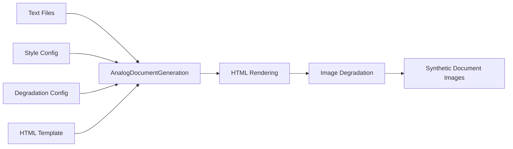
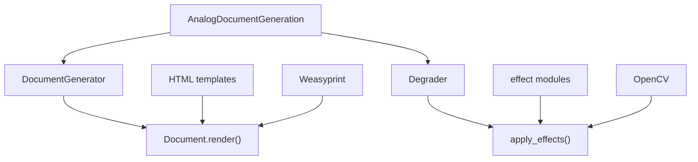
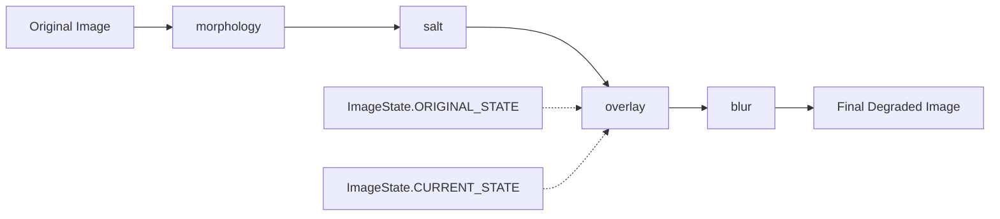
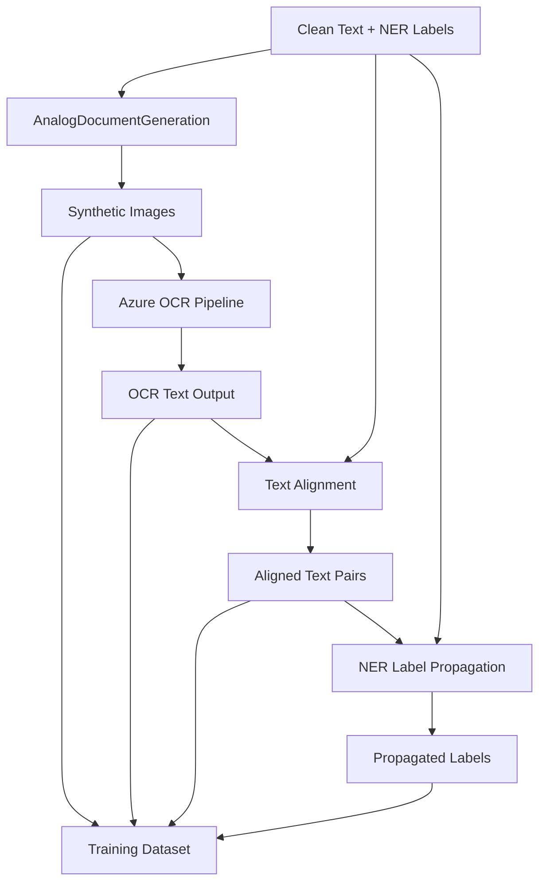

<!-- source: DeepWiki mcp.deepwiki.com · repo microsoft/genalog · page 1.1 Getting Started · fetched 2026-10-26 -->

# Getting Started

<details>
<summary>Relevant source files</summary>

The following files were used as context for generating this wiki page:

- [README.md](README.md)
- [example/dataset_generation.ipynb](example/dataset_generation.ipynb)
- [example/generation_pipeline.ipynb](example/generation_pipeline.ipynb)
- [example/static/analog_doc_gen_pipeline.png](example/static/analog_doc_gen_pipeline.png)
- [genalog/degradation/README.md](genalog/degradation/README.md)
- [genalog/text/README.md](genalog/text/README.md)

</details>


This document provides installation instructions, basic usage examples, and a quick start guide for new users of genalog. It covers the essential steps to generate synthetic document images with degradation effects that mimic real-world scanned documents.

For detailed information about individual system components, see [Core Components](#2). For development workflows and testing, see [Development](#3). For comprehensive examples and tutorials, see [Examples and Tutorials](#4).

## Purpose and Overview

Genalog is a synthetic document generation system that creates document images with realistic noise and degradation effects. The system transforms clean text into document images through HTML rendering, applies controlled degradation effects, and provides tools for OCR processing and text alignment to create training datasets for document understanding models.

**Quick Start Pipeline Diagram**


Sources: [README.md:5-20](), [example/generation_pipeline.ipynb:32-39]()

## Installation

### Basic Installation

Install the latest release from PyPI:

```bash
pip install genalog
```

### System Dependencies

Genalog depends on Weasyprint for HTML-to-image rendering, which requires additional system libraries:

| Operating System | Requirements |
|------------------|--------------|
| Ubuntu 18.04+ | Libraries available by default |
| macOS/Windows | Install Pango, cairo, and GDK-PixBuf separately |

For detailed installation instructions for non-Ubuntu systems, refer to the [WeasyPrint documentation](https://weasyprint.readthedocs.io/en/stable/install.html).

**Common Installation Issues:**
- Error: `no library called "libcairo-2" was found` indicates missing system dependencies

Sources: [README.md:24-38]()

## Quick Start Example

### Basic Document Generation

The following example demonstrates the core genalog workflow using the `AnalogDocumentGeneration` class:

```python
from genalog.pipeline import AnalogDocumentGeneration

# Define document styling
STYLE_COMBINATIONS = {
    "language": ["en_US"],
    "font_family": ["Segoe UI"],
    "font_size": ["12px"],
    "text_align": ["justify"],
    "hyphenate": [True, False],
}

# Define degradation effects sequence
DEGRADATIONS = [
    ("blur", {"radius": 3}),
    ("bleed_through", {"alpha": 0.8}),
    ("morphology", {"operation": "open", "kernel_shape": (3,3), "kernel_type": "ones"}),
]

# Initialize pipeline
doc_generation = AnalogDocumentGeneration(
    styles=STYLE_COMBINATIONS,
    degradations=DEGRADATIONS,
    resolution=300  # DPI
)

# Generate image from text file
img_array = doc_generation.generate_img(
    "path/to/text_file.txt",
    "text_block.html.jinja",
    target_folder=None  # Returns image array instead of saving
)
```

**Core Classes and Methods Diagram**


Sources: [example/generation_pipeline.ipynb:49-87](), [example/generation_pipeline.ipynb:115-136]()

### Batch Processing

For processing multiple files efficiently:

```python
from genalog.pipeline import generate_dataset_multiprocess

# Process multiple text files
text_files = ["file1.txt", "file2.txt", "file3.txt"]
output_directory = "output/images/"

generate_dataset_multiprocess(
    text_files,
    output_directory,
    STYLE_COMBINATIONS,
    DEGRADATIONS,
    "text_block.html.jinja",
    resolution=300,
    batch_size=5
)
```

Sources: [example/generation_pipeline.ipynb:200-208]()

## Core Workflow Components

### 1. Style Configuration

The `STYLE_COMBINATIONS` dictionary defines CSS properties applied to documents:

| Parameter | Description | Example Values |
|-----------|-------------|----------------|
| `font_family` | CSS font family | `["Times", "Arial", "Segoe UI"]` |
| `font_size` | CSS font size | `["10px", "12px", "14px"]` |
| `text_align` | Text alignment | `["left", "center", "justify"]` |
| `hyphenate` | Enable hyphenation | `[True, False]` |
| `language` | Document language | `["en_US", "en_GB"]` |

### 2. Degradation Effects

The `DEGRADATIONS` list applies effects sequentially. Each effect is a tuple of `(effect_name, parameters)`:

```python
from genalog.degradation.degrader import ImageState

DEGRADATIONS = [
    ("morphology", {"operation": "open", "kernel_shape": (9,9), "kernel_type": "plus"}),
    ("salt", {"amount": 0.7}),
    ("overlay", {
        "src": ImageState.ORIGINAL_STATE,
        "background": ImageState.CURRENT_STATE,
    }),
    ("blur", {"radius": 5}),
]
```

**Degradation Pipeline Diagram**


### 3. HTML Templates

Built-in templates available in [genalog/generation/templates/](genalog/generation/templates/):

- `text_block.html.jinja` - Simple text block layout
- `columns.html.jinja` - Multi-column layout  
- `letter.html.jinja` - Letter format layout

Sources: [example/generation_pipeline.ipynb:140-155](), [example/dataset_generation.ipynb:169-175]()

## End-to-End Dataset Generation

For complete synthetic dataset creation including OCR and label propagation:

**Complete Dataset Pipeline Diagram**


Key classes for advanced workflows:
- `genalog.text.alignment.align()` - Needleman-Wunsch alignment
- `genalog.text.anchor.align_w_anchor()` - RETAS alignment for longer texts
- `genalog.text.ner_label.propagate_label_to_ocr()` - Label propagation

Sources: [example/dataset_generation.ipynb:7-13](), [genalog/text/README.md:1-11]()

## Available Templates and Effects

### HTML Templates

Template files in [genalog/generation/templates/](genalog/generation/templates/):
- `columns.html.jinja`
- `letter.html.jinja` 
- `text_block.html.jinja`

### Degradation Effects

Effect modules in [genalog/degradation/effect/](genalog/degradation/effect/):
- `blur()` - Document blurring
- `bleed_through()` - Ink seepage simulation
- `salt()` and `pepper()` - Salt and pepper noise
- `morphology()` - Erosion, dilation, opening, closing
- `overlay()` - Image overlay operations

Sources: [genalog/degradation/README.md:74-233]()

## Next Steps

1. **Explore Core Components**: See [Document Generation](#2.1) for HTML template customization
2. **Advanced Degradation**: See [Image Degradation](#2.2) for complex effect configurations  
3. **Text Processing**: See [Text Processing](#2.3) for alignment and NER label propagation
4. **Complete Examples**: See [Examples and Tutorials](#4) for end-to-end workflows
5. **Development Setup**: See [Development](#3) for contributing to the project

For Azure OCR integration and metrics calculation, the system provides deprecated modules in [genalog/ocr/](genalog/ocr/) that are now superseded by direct Azure SDK integration.

Sources: [README.md:40-75](), [example/generation_pipeline.ipynb:1-218]()

---

