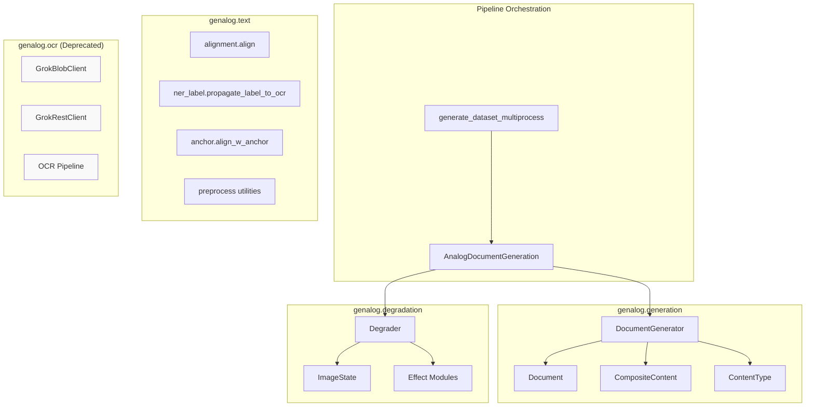
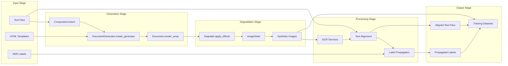
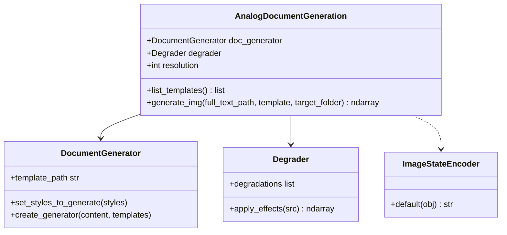
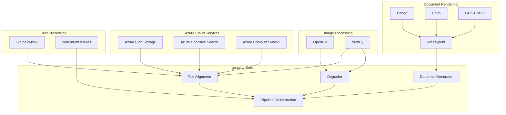
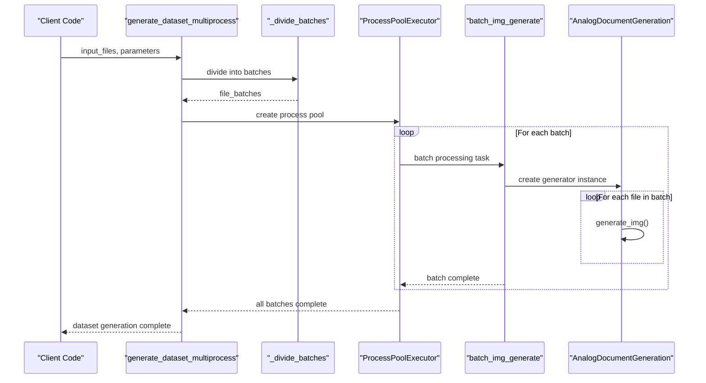

<!-- source: DeepWiki mcp.deepwiki.com · repo microsoft/genalog · page 1.2 System Architecture · fetched 2026-10-26 -->

# System Architecture

Relevant source files

The following files were used as context for generating this wiki page:

- [README.md](README.md)
- [genalog/pipeline.py](genalog/pipeline.py)

This document describes the overall system design, module relationships, and data flow patterns within the genalog codebase. It covers the core architectural components, their interactions, and how data flows through the synthetic document generation pipeline.

For installation and basic usage information, see [Getting Started](#1.1). For detailed module-specific documentation, see [Core Components](#2).

## Overview

Genalog implements a modular pipeline architecture for synthetic document generation, consisting of four primary processing stages coordinated by a central orchestration layer. The system transforms input text through document generation, image degradation, OCR processing, and text alignment to produce labeled training datasets for machine learning applications.

**Sources:** [README.md:101-113](), [genalog/pipeline.py:28-38]()

## Core Module Architecture

The system is organized into distinct functional modules, each responsible for a specific stage of the document processing pipeline:

**Module Responsibilities:**

| Module | Primary Classes | Purpose |
|--------|----------------|---------|
| `genalog.pipeline` | `AnalogDocumentGeneration` | Orchestrates end-to-end document generation workflow |
| `genalog.generation` | `DocumentGenerator`, `Document` | Renders HTML templates into document images |
| `genalog.degradation` | `Degrader`, `ImageState` | Applies synthetic noise and artifacts to images |
| `genalog.text` | `align`, `propagate_label_to_ocr` | Handles text alignment and NER label propagation |
| `genalog.ocr` | `GrokBlobClient`, `GrokRestClient` | Legacy Azure OCR integration (deprecated) |

**Sources:** [README.md:102-106](), [genalog/pipeline.py:15-18](), [genalog/pipeline.py:28-35]()

## Data Flow Pipeline

The core data transformation pipeline follows a linear progression from text input to labeled synthetic datasets:

**Key Data Transformations:**

1. **Text → Document**: [genalog/pipeline.py:66-73]() converts raw text files into `CompositeContent` objects
2. **Document → Image**: [genalog/pipeline.py:76]() renders documents as grayscale arrays at specified resolution
3. **Image → Degraded Image**: [genalog/pipeline.py:78]() applies synthetic degradation effects
4. **Image → OCR Text**: External OCR services extract text from degraded images
5. **Text Alignment**: Algorithms align ground truth with OCR output for training data

**Sources:** [genalog/pipeline.py:49-92](), [README.md:15-20]()

## Orchestration Layer

The `AnalogDocumentGeneration` class serves as the primary orchestration component, coordinating the document generation pipeline:

**Core Methods:**

- `generate_img()`: [genalog/pipeline.py:49-92]() - Single document processing pipeline
- `list_templates()`: [genalog/pipeline.py:39-45]() - Available template enumeration
- `generate_dataset_multiprocess()`: [genalog/pipeline.py:130-156]() - Batch processing with parallelization

**Sources:** [genalog/pipeline.py:28-92](), [genalog/pipeline.py:130-156]()

## External Dependencies

The system integrates with several external services and libraries for core functionality:

**Critical Dependencies:**

| Component | Purpose | Required For |
|-----------|---------|--------------|
| `Weasyprint` | HTML to image conversion | Document generation |
| `OpenCV` | Image processing operations | Degradation effects |
| `Azure SDK` | Cloud OCR services | Text extraction |
| `Bio.pairwise2` | Sequence alignment algorithms | Text alignment |
| `concurrent.futures` | Parallel processing | Batch operations |

**Sources:** [README.md:32-38](), [README.md:79-83](), [genalog/pipeline.py:7-13]()

## Processing Patterns

### Batch Processing Architecture

The system implements a parallel batch processing pattern for large-scale dataset generation:

**Key Functions:**

- `_divide_batches()`: [genalog/pipeline.py:94-96]() - Splits input files into processing batches
- `batch_img_generate()`: [genalog/pipeline.py:103-110]() - Worker function for parallel processing
- `_set_batch_generate_args()`: [genalog/pipeline.py:112-127]() - Prepares arguments for parallel execution

**Sources:** [genalog/pipeline.py:130-156](), [genalog/pipeline.py:94-127]()

### Error Handling and Resource Management

The pipeline implements defensive programming patterns for file I/O and resource management:

- **File Operations**: [genalog/pipeline.py:66-67]() uses UTF-8 encoding with explicit file handling
- **Directory Management**: [genalog/pipeline.py:99-100]() ensures output directories exist before writing
- **Error Propagation**: [genalog/pipeline.py:89-90]() raises `RuntimeError` for failed image writes
- **Resource Cleanup**: Process pools automatically manage worker lifecycle and cleanup

**Sources:** [genalog/pipeline.py:66-67](), [genalog/pipeline.py:89-90](), [genalog/pipeline.py:99-100]()

---

