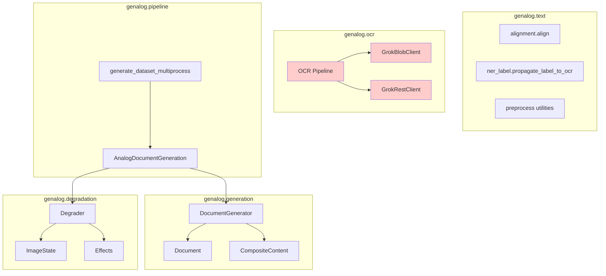
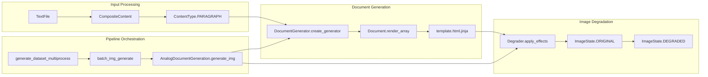
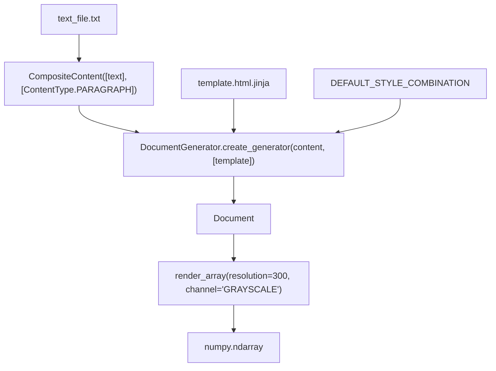
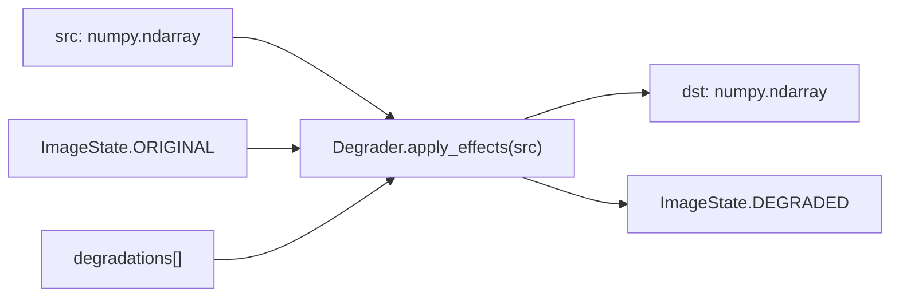
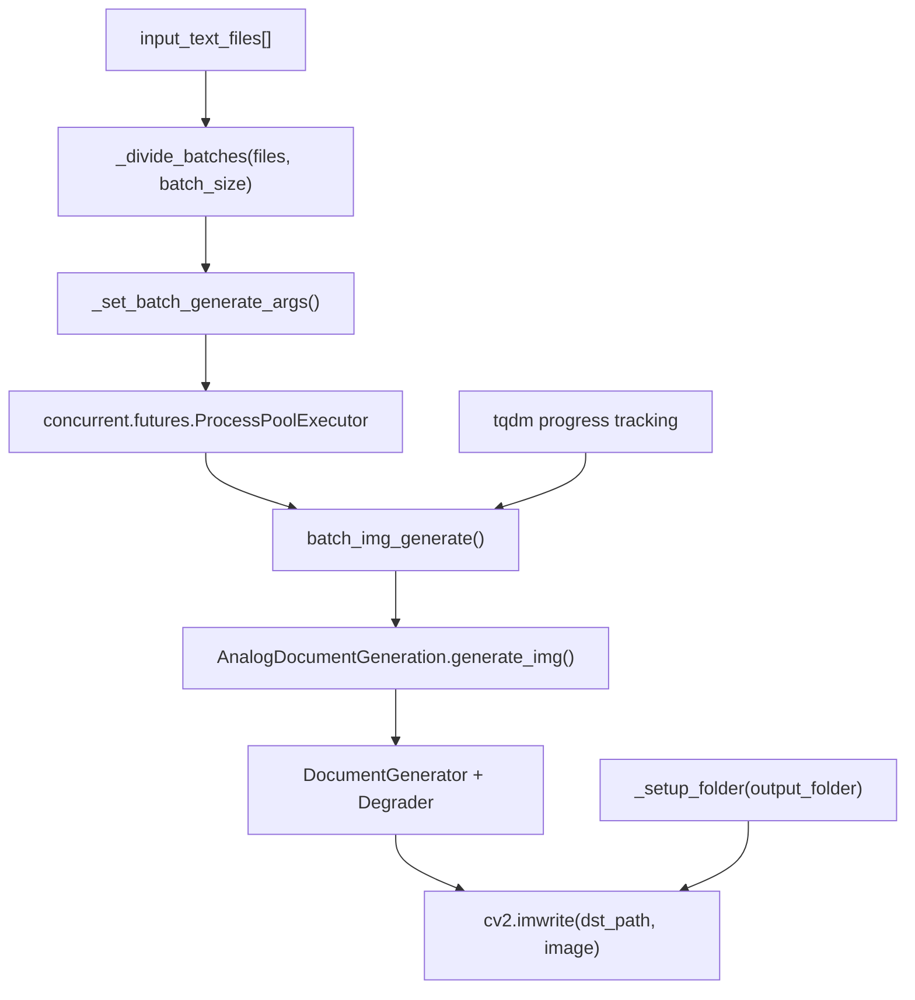

<!-- source: DeepWiki mcp.deepwiki.com · repo microsoft/genalog · page 2 Core Components · fetched 2026-10-26 -->

# Core Components

Relevant source files

The following files were used as context for generating this wiki page:

- [README.md](README.md)
- [genalog/pipeline.py](genalog/pipeline.py)

This page documents the main functional modules that comprise the genalog system for synthetic document generation and processing. It covers the implementation architecture, key classes, and integration patterns of the core processing pipeline.

For high-level system architecture and data flow, see [System Architecture](#1.2). For specific module usage examples, see [Examples and Tutorials](#4).

## Component Overview

The genalog system consists of five primary modules that work together to transform text into synthetic documents with controlled degradations:

Sources: [README.md:101-114](), [genalog/pipeline.py:15-18]()

## Processing Pipeline Architecture

The core processing flow follows a clear sequence from text input to final output, with each component handling specific transformations:

Sources: [genalog/pipeline.py:49-91](), [genalog/pipeline.py:130-156]()

## Document Generation Module

The `genalog.generation` module handles conversion from text content to rendered document images using HTML templates and styling systems.

### Key Components

| Class | Purpose | Key Methods |
|-------|---------|-------------|
| `DocumentGenerator` | Orchestrates document creation from templates | `create_generator()`, `set_styles_to_generate()` |
| `Document` | Represents a styled document instance | `render_array()` |
| `CompositeContent` | Structures input text with content types | Constructor with text arrays and types |

The generation process follows this pattern:

1. Text files are loaded and wrapped in `CompositeContent` with `ContentType.PARAGRAPH`
2. `DocumentGenerator.create_generator()` creates a generator for style combinations
3. `Document.render_array()` produces numpy arrays with specified resolution and channel settings

Sources: [genalog/pipeline.py:66-76](), [genalog/pipeline.py:17-18](), [README.md:60]()

## Image Degradation Module

The `genalog.degradation` module applies synthetic noise and artifacts to document images to simulate real-world scanning conditions.

### Key Components

| Class | Purpose | Key Methods |
|-------|---------|-------------|
| `Degrader` | Applies degradation effects to images | `apply_effects()` |
| `ImageState` | Enum tracking degradation pipeline state | `ORIGINAL`, `DEGRADED` values |

The degradation system operates on numpy arrays representing grayscale images:

The `ImageStateEncoder` class provides JSON serialization support for `ImageState` enums.

Sources: [genalog/pipeline.py:15](), [genalog/pipeline.py:21-26](), [genalog/pipeline.py:77-78]()

## Pipeline Orchestration Module

The `genalog.pipeline` module coordinates the entire document processing workflow and provides batch processing capabilities.

### Key Components

| Class/Function | Purpose | Key Parameters |
|----------------|---------|----------------|
| `AnalogDocumentGeneration` | Main pipeline coordinator | `template_path`, `styles`, `degradations`, `resolution` |
| `generate_dataset_multiprocess` | Batch processing with multiprocessing | `input_text_files`, `output_folder`, `batch_size` |
| `batch_img_generate` | Worker function for parallel processing | Processes file batches |

### Processing Flow

The pipeline supports both single image generation and batch processing:

- **Single generation**: `AnalogDocumentGeneration.generate_img()` returns numpy arrays or writes to disk
- **Batch processing**: `generate_dataset_multiprocess()` uses process pools for parallel execution

### Configuration Parameters

| Parameter | Default | Purpose |
|-----------|---------|---------|
| `resolution` | 300 | DPI for image rendering |
| `batch_size` | 25 | Files per process batch |
| `styles` | `DEFAULT_STYLE_COMBINATION` | Document styling options |
| `degradations` | `[]` | List of degradation effects |

Sources: [genalog/pipeline.py:28-38](), [genalog/pipeline.py:130-156](), [genalog/pipeline.py:103-110]()

## Text Processing Module

The `genalog.text` module provides text alignment algorithms and NER label propagation functionality for mapping between clean text and OCR output.

### Key Components

Based on the system diagrams, this module contains:

| Component | Purpose |
|-----------|---------|
| `alignment.align` | Implements sequence alignment algorithms |
| `ner_label.propagate_label_to_ocr` | Transfers NER labels from ground truth to OCR text |
| `anchor.align_w_anchor` | Anchor-based alignment methods |
| `preprocess utilities` | Text preprocessing functions |

The text processing module uses sequence alignment algorithms (Needleman-Wunsch, RETAS) to establish correspondence between original text and OCR output, enabling label propagation for training datasets.

Sources: [README.md:63-64](), System overview diagrams

## OCR Integration Module

The `genalog.ocr` module provides integration with Azure Cognitive Services for text extraction from document images. **Note: This module is deprecated** in favor of official Azure SDK integration.

### Legacy Components

| Component | Purpose | Status |
|-----------|---------|---------|
| `GrokBlobClient` | Azure Blob Storage integration | Deprecated |
| `GrokRestClient` | Azure REST API client | Deprecated |
| OCR Pipeline | End-to-end text extraction | Deprecated |

The system now recommends using Azure Computer Vision and Azure Cognitive Search services directly through official SDKs rather than the legacy `genalog.ocr` module.

Sources: [README.md:79-84](), System architecture diagrams

## Integration Patterns

The core components integrate through well-defined interfaces:

1. **Pipeline Coordination**: `AnalogDocumentGeneration` orchestrates `DocumentGenerator` and `Degrader` instances
2. **Content Flow**: Text → `CompositeContent` → `Document` → numpy array → degraded array
3. **Batch Processing**: Multiprocessing with `concurrent.futures.ProcessPoolExecutor` for scalability
4. **File I/O**: OpenCV `cv2.imwrite()` for image output, text file reading for input
5. **Progress Tracking**: `tqdm` integration for batch operation monitoring

The modular design allows individual components to be used independently or as part of the full pipeline workflow.

Sources: [genalog/pipeline.py:1-156](), [README.md:101-114]()

---

