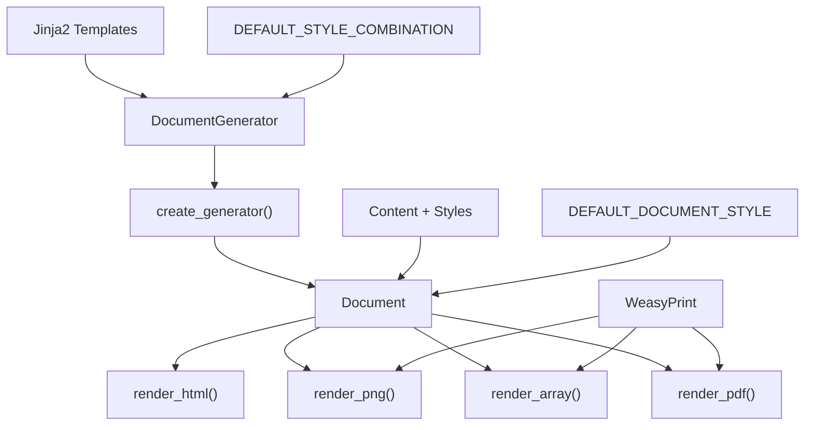
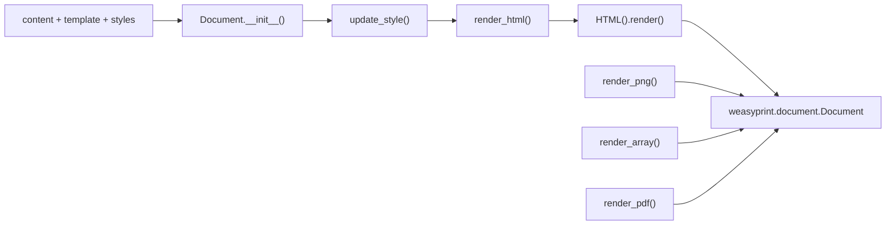
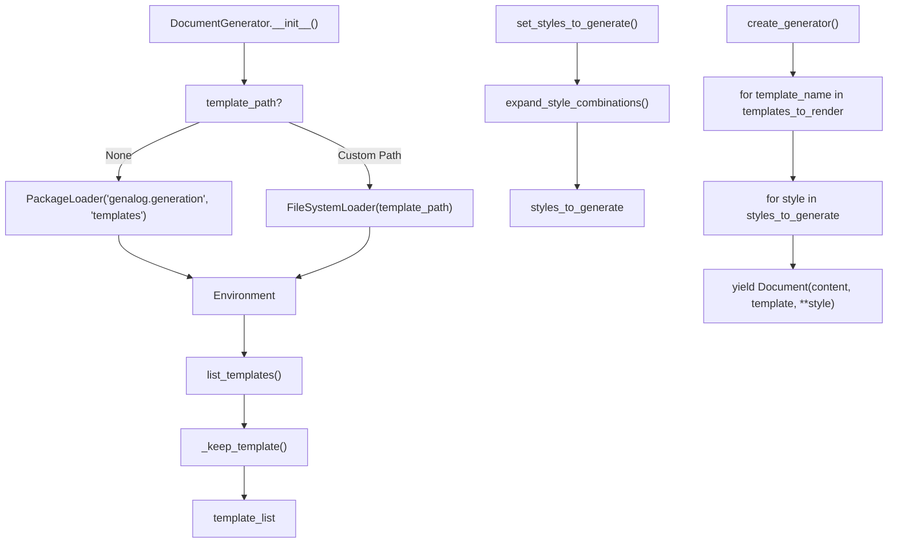
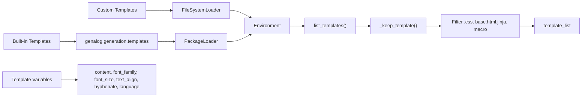
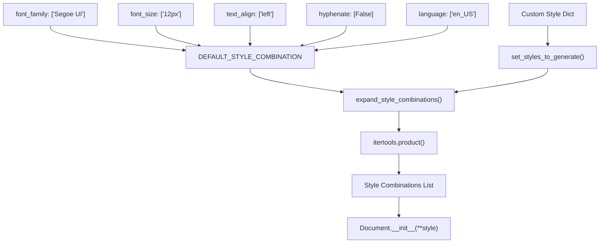
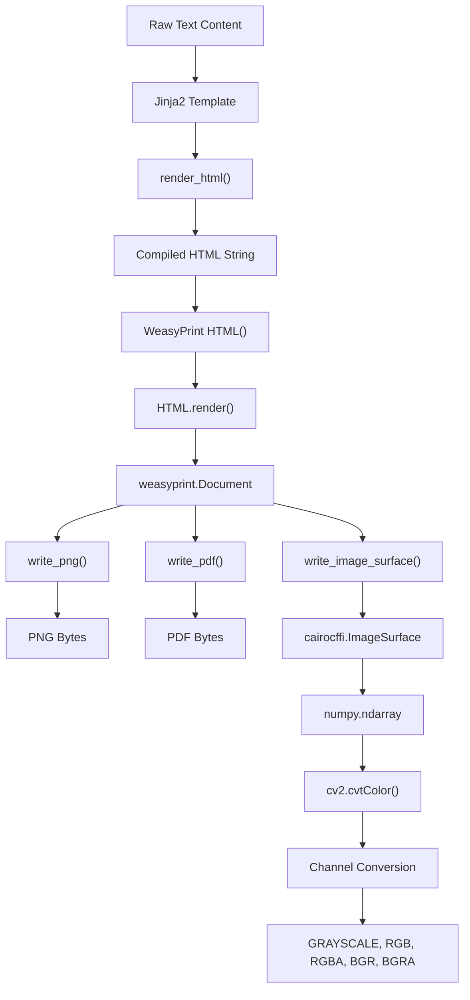
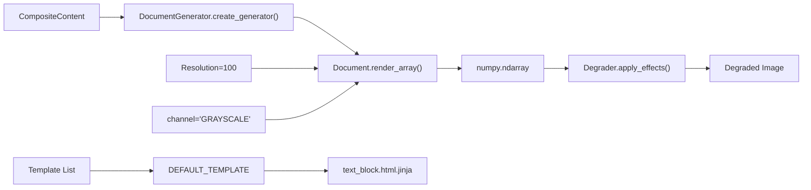

<!-- source: DeepWiki mcp.deepwiki.com · repo microsoft/genalog · page 2.1 Document Generation · fetched 2026-10-26 -->

# Document Generation

Relevant source files

The following files were used as context for generating this wiki page:

- [genalog/generation/document.py](genalog/generation/document.py)
- [tests/e2e/test_generaton_n_degradation.py](tests/e2e/test_generaton_n_degradation.py)
- [tests/e2e/test_splitter.py](tests/e2e/test_splitter.py)

## Purpose and Scope

The Document Generation module provides the core functionality for converting raw text content into styled HTML documents and rendering them as images. This module transforms input text through a template-based system to create synthetic documents that simulate real-world document layouts and typography. 

For information about applying degradation effects to generated documents, see [Image Degradation](#2.2). For text processing and alignment after OCR, see [Text Processing](#2.3).

## Core Components

The document generation system consists of two primary classes that work together to create styled documents from templates and content:

**Document Generation Class Hierarchy**

Sources: [genalog/generation/document.py:29-371]()

### Document Class

The `Document` class represents a single document instance with specific content, template, and styling. It encapsulates the rendering pipeline from HTML generation to various output formats.

| Method | Purpose | Output Format |
|--------|---------|---------------|
| `render_html()` | Generate HTML string from template | HTML string |
| `render_pdf()` | Create PDF document | PDF bytes |
| `render_png()` | Generate PNG image | PNG bytes |
| `render_array()` | Convert to numpy array | numpy.ndarray |

The class maintains internal state including the compiled HTML and WeasyPrint document object for efficient rendering:

**Document Rendering Pipeline**

Sources: [genalog/generation/document.py:70-198]()

### DocumentGenerator Class

The `DocumentGenerator` class manages template loading and provides a factory interface for creating multiple `Document` instances with different style combinations.

**DocumentGenerator Template and Style Processing**

Sources: [genalog/generation/document.py:201-303]()

## Template System

The template system uses Jinja2 templates with automatic HTML/XML escaping. Templates can be loaded from custom directories or from the built-in package templates.

**Template Loading and Filtering**

The `_keep_template()` method filters out non-renderable templates to ensure only valid HTML templates are available for document generation.

Sources: [genalog/generation/document.py:213-246]()

## Style Management

The style system provides combinatorial generation of document variations through parameterized styling options:

**Style Combination Generation**

| Default Style Property | Value | Purpose |
|----------------------|--------|---------|
| `language` | `"en_US"` | Text hyphenation rules |
| `font_family` | `"Segoe UI"` | Typography family |
| `font_size` | `"12px"` | Text size |
| `text_align` | `"left"` | Text alignment |
| `hyphenate` | `False` | Word breaking behavior |

The `expand_style_combinations()` method generates the Cartesian product of all style values to create comprehensive style variations.

Sources: [genalog/generation/document.py:11-26](), [genalog/generation/document.py:304-370]()

## Rendering Pipeline

The document rendering process converts templates and content through multiple stages to produce final output formats:

**Multi-Format Rendering Pipeline**

The `render_array()` method provides the most flexibility for image processing workflows, supporting multiple color channel configurations for downstream processing.

Sources: [genalog/generation/document.py:127-174]()

## Integration Patterns

The Document Generation module integrates with other genalog components through standardized interfaces:

**E2E Integration Example**

This pattern demonstrates how the generation module serves as the entry point for the genalog pipeline, producing numpy arrays that feed into degradation and subsequent processing stages.

Sources: [tests/e2e/test_generaton_n_degradation.py:23-37]()

---

