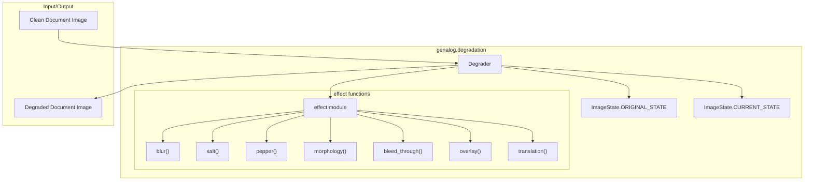
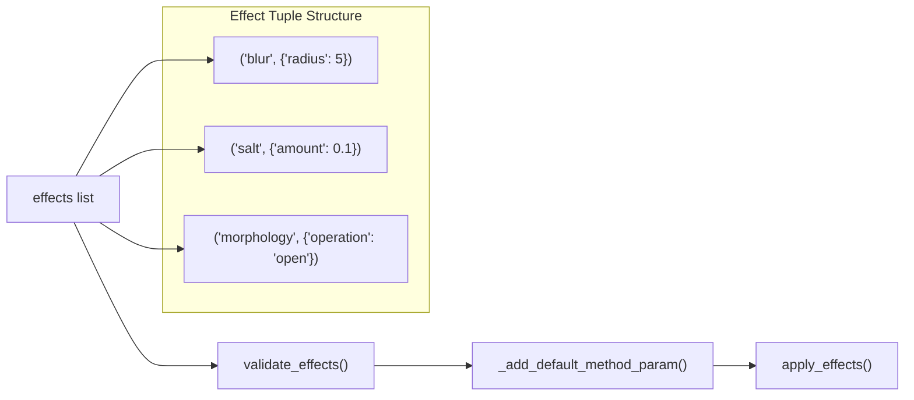
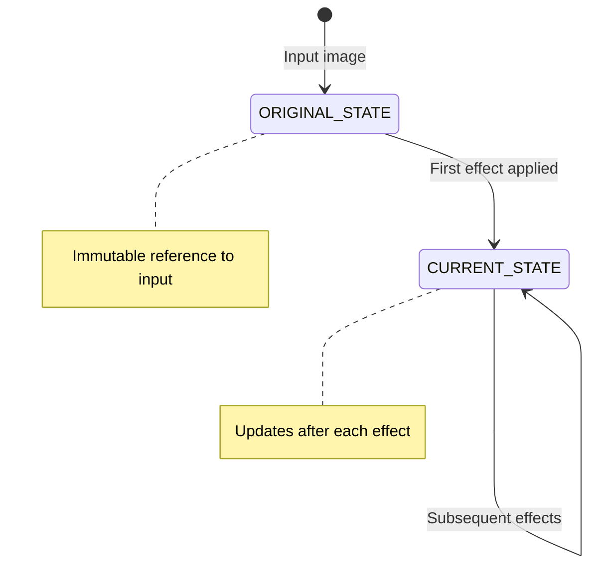
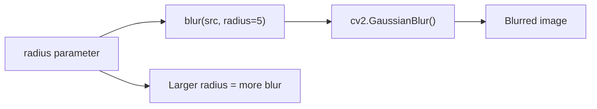
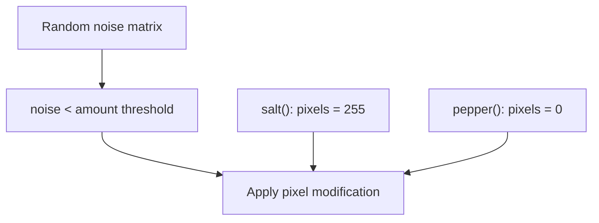
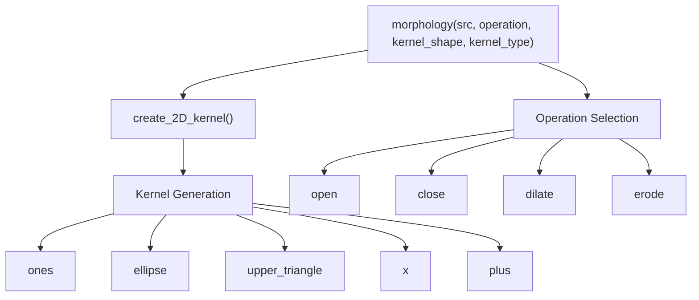
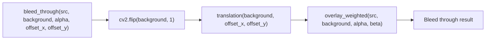
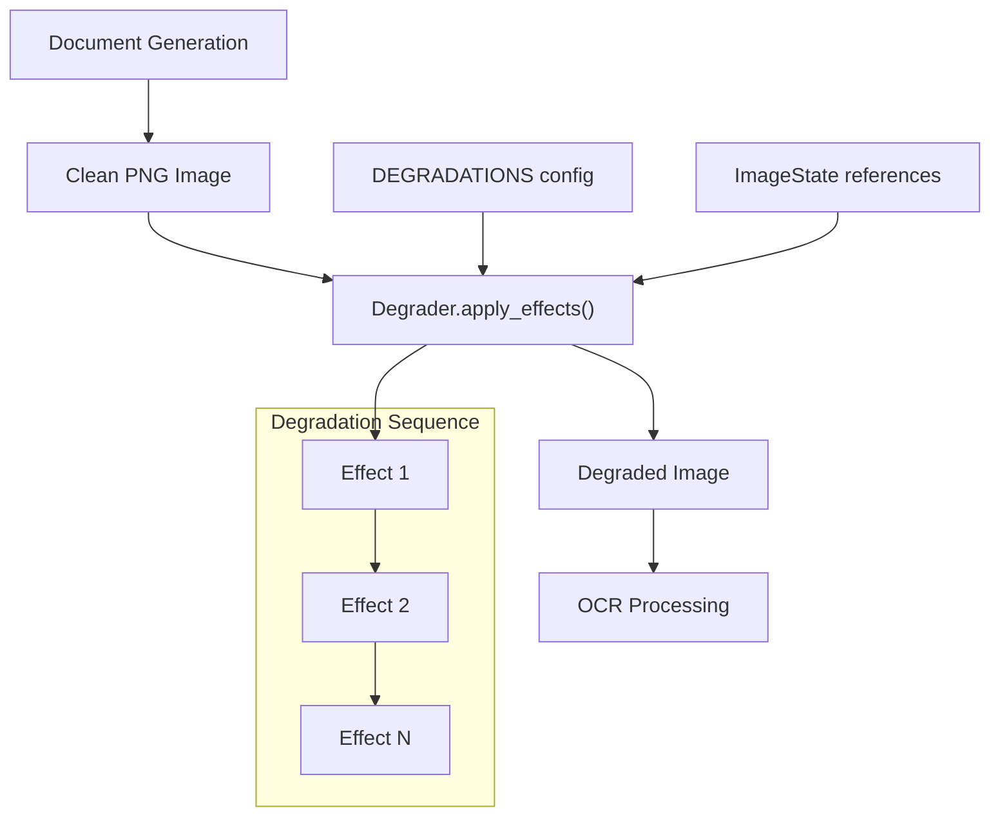

<!-- source: DeepWiki mcp.deepwiki.com · repo microsoft/genalog · page 2.2 Image Degradation · fetched 2026-10-26 -->

# Image Degradation

<details>
<summary>Relevant source files</summary>

The following files were used as context for generating this wiki page:

- [example/dataset_generation.ipynb](example/dataset_generation.ipynb)
- [example/generation_pipeline.ipynb](example/generation_pipeline.ipynb)
- [example/static/analog_doc_gen_pipeline.png](example/static/analog_doc_gen_pipeline.png)
- [genalog/degradation/README.md](genalog/degradation/README.md)
- [genalog/degradation/degrader.py](genalog/degradation/degrader.py)
- [genalog/degradation/effect.py](genalog/degradation/effect.py)
- [genalog/text/README.md](genalog/text/README.md)

</details>


This module provides synthetic image degradation capabilities that simulate real-world document scanning artifacts and quality issues. The image degradation system applies controlled noise, blur, and other visual distortions to clean synthetic documents to create realistic training data for OCR and document understanding models.

For document generation (creating the initial clean images), see [Document Generation](#2.1). For text processing after OCR, see [Text Processing](#2.3).

## Core Architecture

The degradation system consists of three main components: the `Degrader` orchestrator class, the `ImageState` enumeration for managing image states during processing, and a collection of individual effect functions.



**Degradation System Architecture**

Sources: [genalog/degradation/degrader.py:20-151](), [genalog/degradation/effect.py:1-374]()

## Degrader Class

The `Degrader` class serves as the main orchestrator for applying multiple degradation effects in sequence. It manages image state transitions and validates effect configurations.

### Configuration Structure

The `Degrader` accepts a list of effect tuples, where each tuple contains a method name and its keyword arguments:

| Component | Type | Description |
|-----------|------|-------------|
| method_name | str | Function name from `genalog.degradation.effect` |
| method_kwargs | dict | Keyword arguments for the effect function |



**Degrader Configuration Flow**

Sources: [genalog/degradation/degrader.py:23-48](), [genalog/degradation/degrader.py:51-97]()

### Effect Validation

The `validate_effects()` method ensures all specified effects exist and have valid parameters:

- Verifies method names exist in `genalog.degradation.effect` module [genalog/degradation/degrader.py:76-84]()
- Validates parameter names match function signatures [genalog/degradation/degrader.py:85-96]()
- Raises `ValueError` for invalid configurations

Sources: [genalog/degradation/degrader.py:50-97]()

## ImageState Management

The `ImageState` enumeration provides a mechanism to reference different image states during the degradation process, enabling complex effect compositions.



**ImageState Lifecycle**

The `insert_image_state()` method replaces enum references with actual image arrays:

| ImageState | Usage | Description |
|------------|-------|-------------|
| `ORIGINAL_STATE` | Reference clean image | Preserves original for comparison effects |
| `CURRENT_STATE` | Reference latest state | Default source for next effect |

Sources: [genalog/degradation/degrader.py:15-18](), [genalog/degradation/degrader.py:132-150]()

## Degradation Effects

The `genalog.degradation.effect` module provides individual degradation functions that simulate common document scanning artifacts.

### Blur Effects

Simulates scanner focus issues and motion blur:



**Blur Effect Implementation**

- Uses OpenCV Gaussian blur [genalog/degradation/effect.py:12-23]()
- Radius parameter controls blur intensity
- Must be odd integer for kernel size

Sources: [genalog/degradation/effect.py:12-23]()

### Salt and Pepper Noise

Simulates ink degradation and page damage through random pixel modifications:

| Effect | Function | Parameters | Description |
|--------|----------|------------|-------------|
| Salt | `salt(src, amount=0.3)` | amount: float [0,1] | Adds white pixels |
| Pepper | `pepper(src, amount=0.05)` | amount: float [0,1] | Adds black pixels |
| Combined | `salt_then_pepper()` | salt_amount, pepper_amount | Sequential application |

The noise functions generate random pixel locations and apply color changes:



**Salt and Pepper Noise Generation**

Sources: [genalog/degradation/effect.py:104-183]()

### Morphological Operations

Implements structural degradations using OpenCV morphological operations with customizable kernels:



**Morphological Operations Structure**

The `create_2D_kernel()` function supports multiple kernel types for different structural effects [genalog/degradation/effect.py:186-264]().

Sources: [genalog/degradation/effect.py:267-373](), [genalog/degradation/effect.py:186-264]()

### Bleed Through Effects

Simulates ink seepage from reverse side of document pages:



**Bleed Through Processing Pipeline**

- Horizontally flips background image [genalog/degradation/effect.py:98]()
- Applies spatial translation [genalog/degradation/effect.py:99]()
- Performs weighted overlay with `alpha` and `beta = 1 - alpha` [genalog/degradation/effect.py:100-101]()

Sources: [genalog/degradation/effect.py:79-101]()

## Pipeline Integration

The degradation system integrates with the broader genalog pipeline through the `AnalogDocumentGeneration` class:



**Degradation in Document Generation Pipeline**

The degradation configuration is passed to `AnalogDocumentGeneration` and applied after document rendering but before OCR processing.

Sources: [example/generation_pipeline.ipynb:117-135](), [example/dataset_generation.ipynb:202-221]()

## Usage Examples

### Basic Degradation Configuration

```python
from genalog.degradation.degrader import Degrader

degradations = [
    ("blur", {"radius": 3}),
    ("bleed_through", {"alpha": 0.8}),
    ("salt", {"amount": 0.5}),
]

degrader = Degrader(degradations)
degraded_image = degrader.apply_effects(source_image)
```

### Advanced State Management

```python
from genalog.degradation.degrader import Degrader, ImageState

degradations = [
    ("morphology", {"operation": "open", "kernel_shape": (9,9)}),
    ("salt", {"amount": 0.7}),
    ("overlay", {
        "src": ImageState.ORIGINAL_STATE,
        "background": ImageState.CURRENT_STATE,
    }),
    ("bleed_through", {
        "src": ImageState.CURRENT_STATE,
        "background": ImageState.ORIGINAL_STATE,
        "alpha": 0.8,
    }),
]
```

This configuration demonstrates using `ImageState` references to combine the original clean image with intermediate degradation results.

Sources: [example/generation_pipeline.ipynb:117-135](), [example/dataset_generation.ipynb:202-221](), [genalog/degradation/README.md:42-68]()

---

