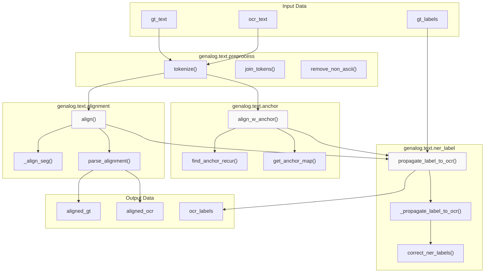
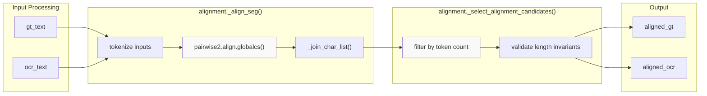
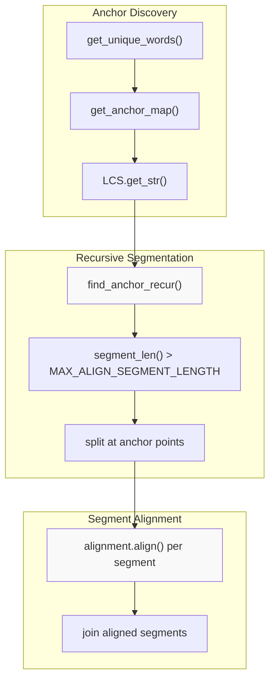
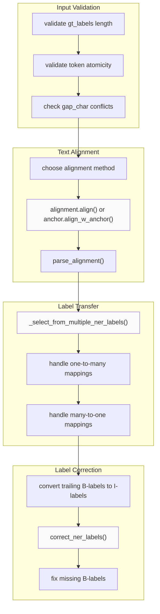
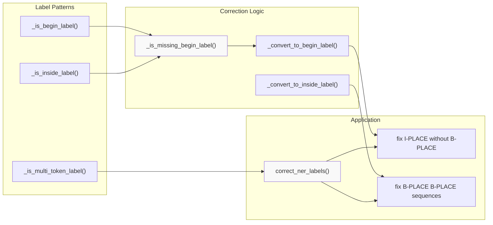
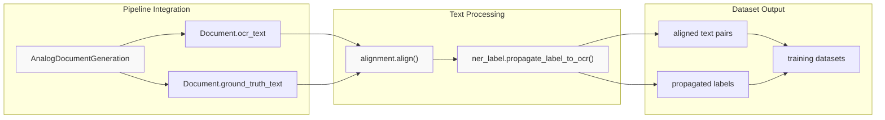

<!-- source: DeepWiki mcp.deepwiki.com · repo microsoft/genalog · page 2.3 Text Processing · fetched 2026-10-26 -->

# Text Processing

Relevant source files

The following files were used as context for generating this wiki page:

- [genalog/text/alignment.py](genalog/text/alignment.py)
- [genalog/text/anchor.py](genalog/text/anchor.py)
- [genalog/text/ner_label.py](genalog/text/ner_label.py)
- [genalog/text/preprocess.py](genalog/text/preprocess.py)

The text processing module provides core algorithms for aligning ground truth text with OCR output and propagating Named Entity Recognition (NER) labels from clean text to noisy OCR text. This module is essential for creating high-quality training datasets where ground truth annotations must be accurately transferred to synthetic OCR data that contains recognition errors.

For document generation capabilities, see [Document Generation](#2.1). For OCR integration details, see [OCR Integration](#2.4). For comprehensive alignment and label propagation workflows, see [Text Alignment](#2.3.1) and [NER Label Propagation](#2.3.2).

## Text Processing Architecture

The text processing module consists of four main components that work together to align text and transfer labels between clean and noisy text versions.

**Sources:** [genalog/text/alignment.py:1-471](), [genalog/text/anchor.py:1-310](), [genalog/text/ner_label.py:1-528](), [genalog/text/preprocess.py:1-68]()

## Text Alignment Algorithms

The module provides two text alignment approaches: a precise but slower algorithm for short texts and a faster anchor-based algorithm for longer documents.

### Basic Sequence Alignment

The core alignment functionality uses the Needleman-Wunsch global sequence alignment algorithm via BioPython's `pairwise2` module. The `align()` function is the primary entry point for text alignment.

The alignment algorithm ensures two critical invariants:
1. `len(aligned_gt) == len(aligned_ocr)`  
2. `number of tokens in gt == number of tokens in aligned_gt`

**Sources:** [genalog/text/alignment.py:149-194](), [genalog/text/alignment.py:28-86](), [genalog/text/alignment.py:88-147]()

### Anchor-Based Fast Alignment

For longer documents, the `align_w_anchor()` function provides a faster O(n) alternative by breaking text into smaller segments using common unique words as anchor points.

The algorithm identifies unique words that appear in both texts, finds their longest common subsequence, and uses these as breakpoints for smaller alignment operations.

**Sources:** [genalog/text/anchor.py:232-310](), [genalog/text/anchor.py:84-155](), [genalog/text/anchor.py:157-230]()

## NER Label Propagation

The NER label propagation system transfers named entity labels from clean ground truth text to noisy OCR text through careful alignment and label correction.

### Propagation Algorithm Flow

**Sources:** [genalog/text/ner_label.py:239-430](), [genalog/text/ner_label.py:190-237]()

### Label Mapping Cases

The propagation algorithm handles five distinct mapping scenarios between ground truth and OCR tokens:

| Case | GT→OCR Mapping | Label Handling | Example |
|------|---------------|----------------|---------|
| One-to-many | 1 GT → N OCR | First OCR gets B-label, rest get I-labels | "New York" → "New", "Yo", "rk" |
| Many-to-one | N GT → 1 OCR | OCR gets label from first GT token | "New", "York" → "NewYork" |
| Many-to-many | N GT → M OCR | Combined handling of above cases | "New York" → "N", "ewYork" |
| Missing tokens (GT) | GT → ∅ | No OCR token to label | "New York" → "New", ∅ |
| Missing tokens (OCR) | ∅ → OCR | Missing B-label correction applied | ∅ → "York" gets B-label |

**Sources:** [genalog/text/ner_label.py:252-279](), [genalog/text/ner_label.py:416-428]()

### Multi-Token Label Correction

The system includes sophisticated logic for correcting BIO (Begin-Inside-Outside) label sequences that become malformed during alignment:

**Sources:** [genalog/text/ner_label.py:113-138](), [genalog/text/ner_label.py:36-84](), [genalog/text/ner_label.py:86-111]()

## Text Preprocessing Utilities

The preprocessing module provides essential text manipulation functions used throughout the text processing pipeline.

| Function | Purpose | Usage |
|----------|---------|-------|
| `tokenize(s)` | Split text into space-separated tokens | Used before alignment operations |
| `join_tokens(tokens)` | Rejoin token list into space-separated string | Used after token-level processing |
| `remove_non_ascii(token)` | Replace non-ASCII characters with underscore | Ensures compatibility with alignment algorithms |
| `_is_spacing(c)` | Check if character is whitespace | Used in token boundary detection |
| `split_sentences(text)` | Split text at sentence boundaries | Text segmentation for processing |

**Sources:** [genalog/text/preprocess.py:30-41](), [genalog/text/preprocess.py:43-53](), [genalog/text/preprocess.py:12-28](), [genalog/text/preprocess.py:55-58]()

## Integration with Pipeline Components

The text processing module integrates with other genalog components to enable end-to-end synthetic dataset generation:

The module's alignment and label propagation capabilities are essential for creating training datasets where synthetic document images are processed through OCR and the resulting noisy text must be accurately aligned with ground truth for machine learning model training.

**Sources:** [genalog/text/alignment.py:1-25](), [genalog/text/ner_label.py:1-12](), [genalog/text/anchor.py:1-26]()

---

