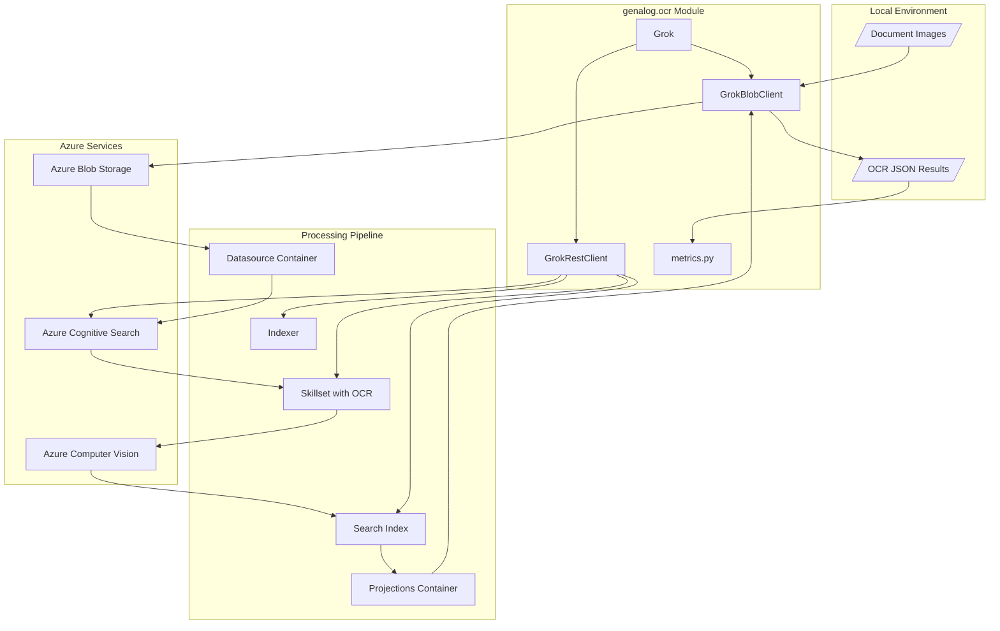
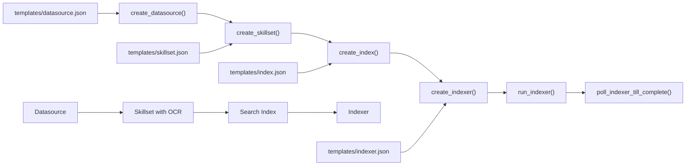
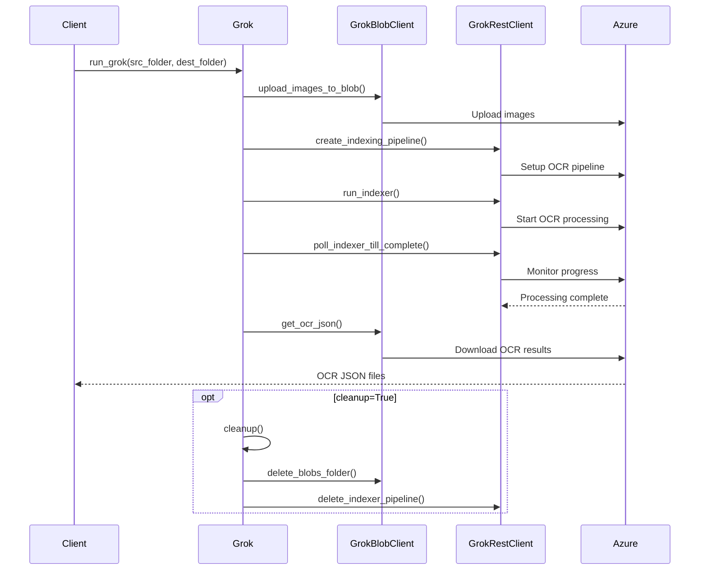
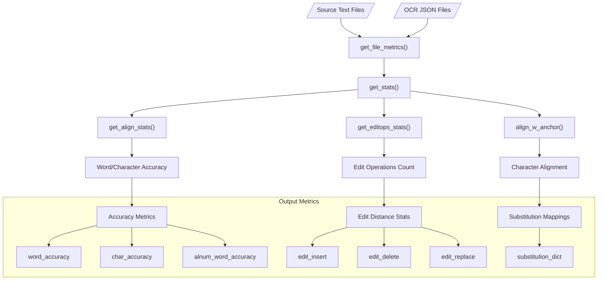
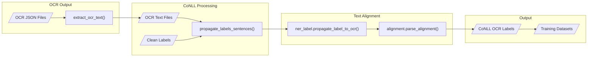

<!-- source: DeepWiki mcp.deepwiki.com · repo microsoft/genalog · page 2.4 OCR Integration · fetched 2026-10-26 -->

# OCR Integration

Relevant source files

The following files were used as context for generating this wiki page:

- [genalog/ocr/blob_client.py](genalog/ocr/blob_client.py)
- [genalog/ocr/grok.py](genalog/ocr/grok.py)
- [genalog/ocr/metrics.py](genalog/ocr/metrics.py)
- [genalog/ocr/rest_client.py](genalog/ocr/rest_client.py)
- [genalog/text/conll_format.py](genalog/text/conll_format.py)
- [tests/e2e/test_ocr_e2e.py](tests/e2e/test_ocr_e2e.py)

This section documents the Azure-based OCR processing pipeline implemented in the `genalog.ocr` module. This module provides integration with Azure Cognitive Search and Azure Blob Storage to perform batch OCR processing on document images, though it is currently deprecated in favor of the official Azure Python SDK.

**Note**: This module is being deprecated. For current OCR integration approaches, see the official Azure Computer Vision SDK documentation. For text processing and alignment capabilities that work with OCR output, see [Text Processing](#2.3).

## Architecture Overview

The OCR integration system consists of three main components that work together to upload images to Azure Blob Storage, process them through Azure Cognitive Search with OCR capabilities, and retrieve the results.

**OCR Integration System Architecture**

Sources: [genalog/ocr/grok.py:12-108](), [genalog/ocr/blob_client.py:33-408](), [genalog/ocr/rest_client.py:26-305]()

## Core Components

### GrokBlobClient

The `GrokBlobClient` class handles all Azure Blob Storage operations for the OCR pipeline, including uploading images and downloading OCR results.

| Method | Purpose | Key Features |
|--------|---------|--------------|
| `upload_images_to_blob()` | Upload images to Azure Blob Storage | Async/sync support, folder hashing, cache checking |
| `get_ocr_json()` | Download OCR results from projections container | Base64 projection path handling |
| `delete_blobs_folder()` | Clean up uploaded images | Batch deletion support |
| `get_folder_hash()` | Generate MD5 hash for folder naming | Deterministic folder naming |

**Key Configuration Parameters**:
- `DATASOURCE_CONTAINER_NAME`: Container for input images
- `PROJECTIONS_CONTAINER_NAME`: Container for OCR output projections  
- `BLOB_NAME`: Azure Storage account name
- `BLOB_KEY`: Azure Storage account key

Sources: [genalog/ocr/blob_client.py:33-82](), [genalog/ocr/blob_client.py:84-179](), [genalog/ocr/blob_client.py:248-311]()

### GrokRestClient

The `GrokRestClient` class uses the Azure Search Service REST API to create and manage the OCR processing pipeline.

**REST API Pipeline Components**

**Core Methods**:
- `create_indexing_pipeline()`: Sets up the complete OCR pipeline [genalog/ocr/rest_client.py:230-237]()
- `run_indexer()`: Triggers OCR processing [genalog/ocr/rest_client.py:259-269]()
- `poll_indexer_till_complete()`: Monitors processing status [genalog/ocr/rest_client.py:271-290]()
- `delete_indexer_pipeline()`: Cleanup all pipeline resources [genalog/ocr/rest_client.py:239-257]()

Sources: [genalog/ocr/rest_client.py:127-237](), [genalog/ocr/rest_client.py:259-300]()

### Grok Orchestrator

The `Grok` class coordinates the entire OCR workflow by combining blob storage operations with the search service pipeline.

**OCR Processing Workflow**

Key parameters for `run_grok()`:
- `src_folder_path`: Local directory containing images
- `dest_folder_path`: Output directory for OCR JSON files  
- `blob_dest_folder`: Optional custom folder name in blob storage
- `cleanup`: Whether to delete resources after processing
- `use_async`: Enable asynchronous operations

Sources: [genalog/ocr/grok.py:30-98](), [genalog/ocr/grok.py:99-107]()

## OCR Metrics and Quality Assessment

The `metrics.py` module provides comprehensive analysis tools for OCR output quality assessment and alignment statistics.

### Metrics Calculation Pipeline

**Key Metric Types**:

| Category | Metrics | Description |
|----------|---------|-------------|
| Accuracy | `word_accuracy`, `char_accuracy`, `alnum_word_accuracy` | Percentage of correctly recognized elements |
| Edit Operations | `edit_insert`, `edit_delete`, `edit_replace` | Character-level edit counts |
| Alignment | `insert`, `delete`, `replace`, `spacing` | Substring-level alignment operations |
| Substitutions | `substitution_dict` | Mapping of character/word replacements |

Sources: [genalog/ocr/metrics.py:430-482](), [genalog/ocr/metrics.py:400-427](), [genalog/ocr/metrics.py:324-371]()

## Integration with Text Processing Pipeline

The OCR module integrates with the text processing pipeline through CoNLL format utilities and label propagation.

**OCR to Text Processing Data Flow**

The `conll_format.py` utility extracts text from OCR JSON output and creates CoNLL-formatted training data:

- `extract_ocr_text()`: Extracts text from Grok OCR JSON format [genalog/text/conll_format.py:282-303]()
- `propagate_labels_sentences()`: Aligns clean labels with OCR tokens and preserves sentence boundaries [genalog/text/conll_format.py:61-158]()
- `propagate_labels_sentences_multiprocess()`: Parallel processing for large datasets [genalog/text/conll_format.py:244-279]()

Sources: [genalog/text/conll_format.py:282-303](), [genalog/text/conll_format.py:61-158](), [genalog/text/conll_format.py:424-471]()

## Environment Configuration

The OCR integration requires the following environment variables:

| Variable | Purpose | Component |
|----------|---------|-----------|
| `COGNITIVE_SERVICE_KEY` | Azure Cognitive Services API key | GrokRestClient |
| `SEARCH_SERVICE_KEY` | Azure Search Service API key | GrokRestClient |
| `SEARCH_SERVICE_NAME` | Azure Search Service name | GrokRestClient |
| `BLOB_NAME` | Azure Storage account name | GrokBlobClient |
| `BLOB_KEY` | Azure Storage account key | GrokBlobClient |
| `DATASOURCE_CONTAINER_NAME` | Blob container for input images | GrokBlobClient |
| `PROJECTIONS_CONTAINER_NAME` | Blob container for OCR projections | GrokBlobClient |

All components support initialization via `create_from_env_var()` factory methods for easy configuration management.

Sources: [genalog/ocr/rest_client.py:96-125](), [genalog/ocr/blob_client.py:64-82]()

## Deprecation Notice

**Important**: This OCR module is deprecated and marked for removal. The test suite shows it as flaky and recommends migration to the official Azure Computer Vision Python SDK.

**Migration Path**:
1. Replace `genalog.ocr` usage with [Azure Computer Vision SDK](https://docs.microsoft.com/en-us/azure/cognitive-services/computer-vision/quickstarts-sdk/client-library?tabs=visual-studio&pivots=programming-language-python)
2. Continue using `genalog.text` modules for alignment and label propagation with OCR results
3. Use `genalog.ocr.metrics` for OCR quality assessment if needed

Sources: [tests/e2e/test_ocr_e2e.py:51-54]()

---

