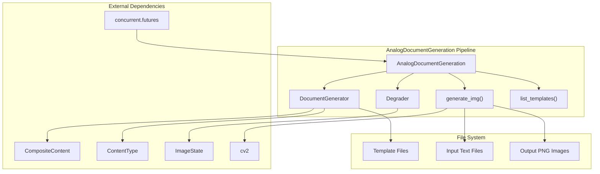
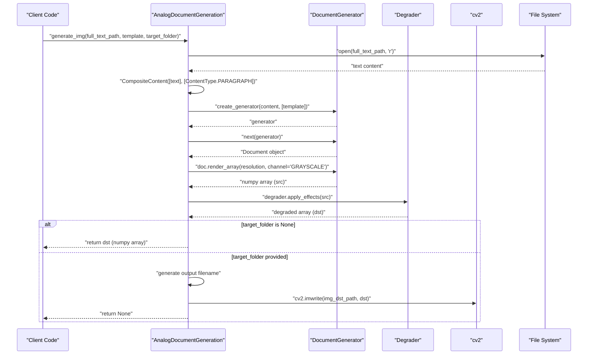
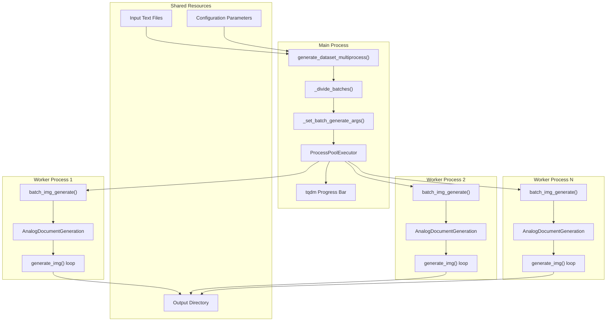
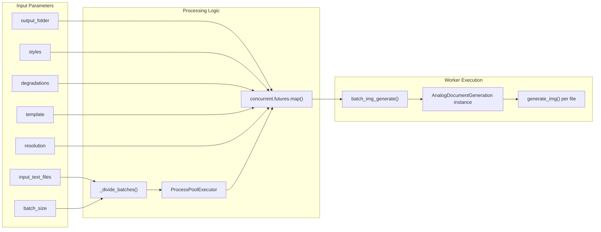
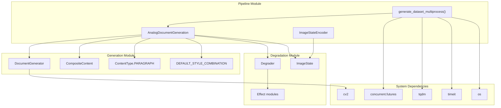

<!-- source: DeepWiki mcp.deepwiki.com · repo microsoft/genalog · page 2.5 Pipeline Orchestration · fetched 2026-10-26 -->

# Pipeline Orchestration

<details>
<summary>Relevant source files</summary>

The following files were used as context for generating this wiki page:

- [genalog/pipeline.py](genalog/pipeline.py)
- [tests/e2e/test_document_generation.py](tests/e2e/test_document_generation.py)
- [tests/e2e/test_pipeline.py](tests/e2e/test_pipeline.py)

</details>


This document covers the main pipeline orchestration system in genalog that coordinates document generation, image degradation, and batch processing workflows. The pipeline serves as the primary entry point for users to generate synthetic document datasets at scale.

For document generation specifics, see [Document Generation](#2.1). For image degradation effects, see [Image Degradation](#2.2). For text processing and alignment, see [Text Processing](#2.3).

## Main Pipeline Class

The `AnalogDocumentGeneration` class serves as the central orchestrator that coordinates the entire synthetic document generation pipeline. This class integrates document generation, image degradation, and file management into a unified interface.

### Class Structure and Dependencies



**Pipeline Orchestration Class Dependencies**

The `AnalogDocumentGeneration` class is initialized with several key parameters:

| Parameter | Type | Purpose | Default |
|-----------|------|---------|---------|
| `template_path` | str | Path to HTML template directory | None (uses built-in templates) |
| `styles` | dict | Style combinations for document generation | `DEFAULT_STYLE_COMBINATION` |
| `degradations` | list | Degradation effects to apply | `[]` (empty list) |
| `resolution` | int | Image resolution in DPI | 300 |

Sources: [genalog/pipeline.py:28-37]()

### Core Pipeline Workflow

The main pipeline workflow is implemented in the `generate_img()` method, which orchestrates the complete process from text input to degraded synthetic document image.



**Single Document Generation Pipeline**

The pipeline processes individual text documents through the following stages:

1. **Text Loading**: Reads input text file with UTF-8 encoding
2. **Content Wrapping**: Creates `CompositeContent` with `ContentType.PARAGRAPH`
3. **Document Generation**: Uses `DocumentGenerator` to create styled HTML document
4. **Image Rendering**: Renders document as grayscale numpy array at specified resolution
5. **Image Degradation**: Applies configured degradation effects using `Degrader`
6. **Output Handling**: Returns array or saves PNG file to disk

Sources: [genalog/pipeline.py:49-91]()

## Batch Processing and Multiprocessing

The pipeline provides multiprocessing capabilities for generating large datasets efficiently through the `generate_dataset_multiprocess()` function.

### Multiprocessing Architecture



**Multiprocessing Pipeline Architecture**

The batch processing system implements the following workflow:

| Function | Purpose | Input | Output |
|----------|---------|-------|--------|
| `generate_dataset_multiprocess()` | Main orchestrator for batch processing | File list, config parameters | Processed dataset |
| `_divide_batches()` | Splits file list into manageable chunks | File list, batch_size | Generator of file batches |
| `_set_batch_generate_args()` | Prepares arguments for worker processes | Batches, configuration | List of argument tuples |
| `batch_img_generate()` | Worker function processing single batch | Argument tuple | Side effect: generated images |

Sources: [genalog/pipeline.py:130-155](), [genalog/pipeline.py:94-127]()

### Batch Processing Configuration

The multiprocessing system accepts the following parameters:



**Batch Processing Parameter Flow**

Key processing parameters:

- **batch_size**: Default 25 files per batch, balancing memory usage and processing efficiency
- **ProcessPoolExecutor**: Uses all available CPU cores by default
- **Progress tracking**: `tqdm` provides real-time progress reporting
- **Timing**: Built-in execution time measurement

Sources: [genalog/pipeline.py:130-155]()

## Pipeline Integration Points

The pipeline orchestration integrates with several core genalog modules to provide end-to-end functionality.

### Module Integration Map



**Pipeline Integration with Core Modules**

The pipeline serves as the integration layer between:

1. **Document Generation**: Creates styled HTML documents from text content
2. **Image Degradation**: Applies realistic document scanning artifacts  
3. **File Management**: Handles input/output operations and directory structure
4. **Parallel Processing**: Enables scalable dataset generation

Sources: [genalog/pipeline.py:15-18](), [genalog/pipeline.py:7-13]()

## Error Handling and Validation

The pipeline implements several error handling mechanisms to ensure robust operation:

### Error Scenarios and Handling

| Error Type | Location | Handling Strategy |
|------------|----------|-------------------|
| File write failure | `generate_img()` | Raises `RuntimeError` with specific path |
| Template not found | Document generation | Propagates `FileNotFoundError` |
| Empty style combinations | Style expansion | Returns `None` from generator |
| Invalid file paths | File operations | Standard Python I/O exceptions |

```mermaid
graph TD
    subgraph "Error Handling Flow"
        A["generate_img()"]
        B["cv2.imwrite() failure"]
        C["RuntimeError raised"]
        D["File system check"]
        E["Template validation"]
        F["Style combination check"]
    end
    
    A --> D
    A --> E  
    A --> F
    A --> B
    B --> C
    
    E -.-> "FileNotFoundError"
    F -.-> "Returns None"
    D -.-> "IOError family"
```

**Pipeline Error Handling Strategy**

Sources: [genalog/pipeline.py:89-90]()

## Configuration and Customization

The pipeline supports extensive customization through initialization parameters and runtime configuration.

### Template and Style Management

The `AnalogDocumentGeneration` class provides template discovery and style configuration:

- **Template listing**: `list_templates()` method returns available HTML templates
- **Style combinations**: Supports complex style parameter combinations
- **Resolution control**: Configurable DPI for output image quality
- **Degradation effects**: Flexible degradation pipeline configuration

### Output Directory Structure

The pipeline automatically creates the following directory structure:

```
output_folder/
└── img/
    ├── document1.png
    ├── document2.png
    └── ...
```

This structure is created by the `_setup_folder()` helper function and maintained consistently across both single and batch processing modes.

Sources: [genalog/pipeline.py:39-45](), [genalog/pipeline.py:99-100]()

---

