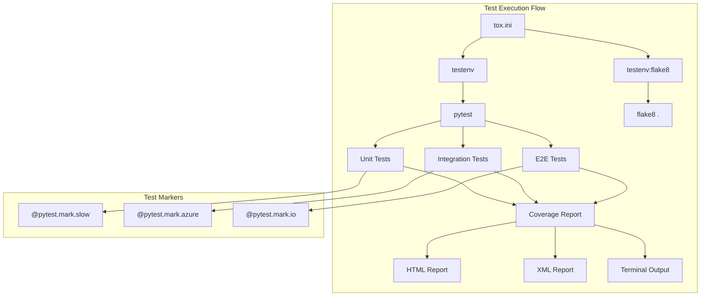
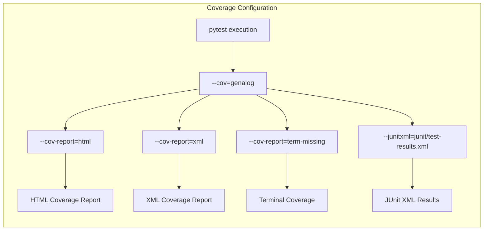
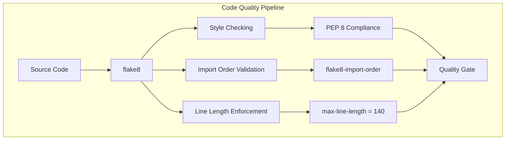
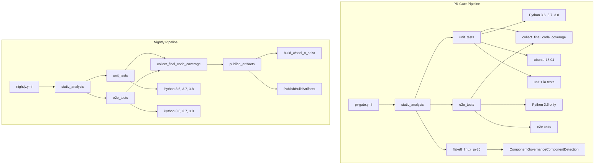
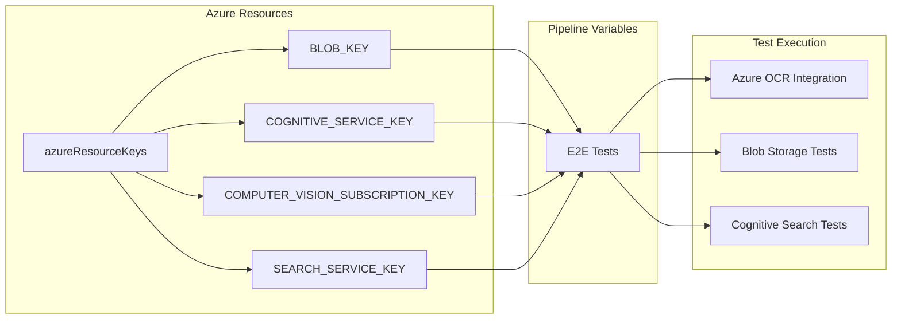
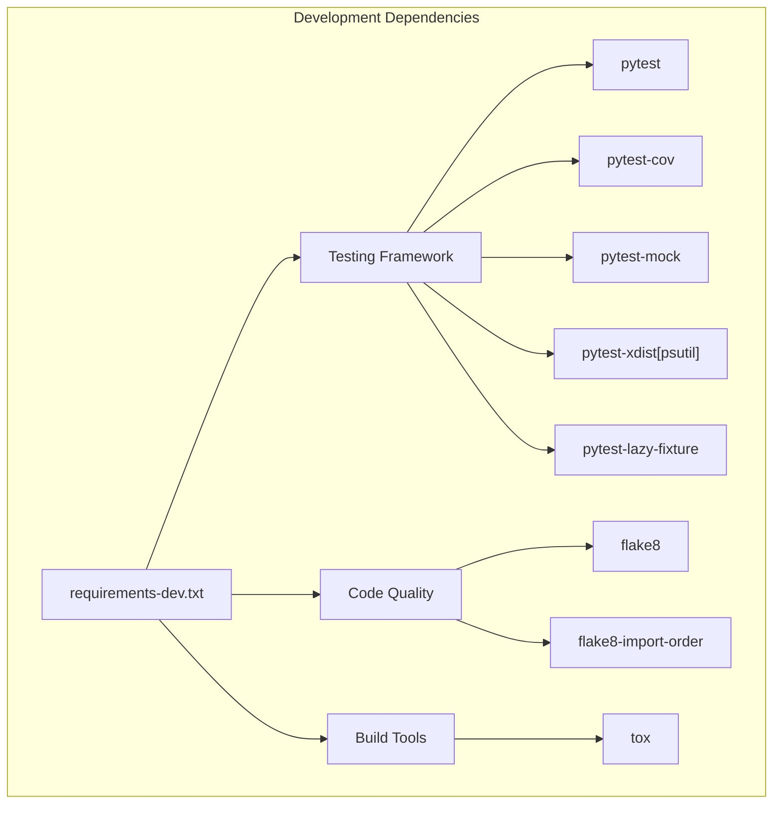
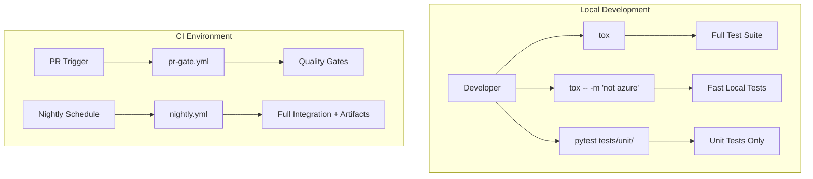

<!-- source: DeepWiki mcp.deepwiki.com · repo microsoft/genalog · page 3 Development · fetched 2026-10-26 -->

# Development

Relevant source files

The following files were used as context for generating this wiki page:

- [devops/nightly.yml](devops/nightly.yml)
- [devops/pr-gate.yml](devops/pr-gate.yml)
- [requirements-dev.txt](requirements-dev.txt)
- [tests/unit/text/test_alignment.py](tests/unit/text/test_alignment.py)
- [tox.ini](tox.ini)

This document covers the development infrastructure, testing framework, and continuous integration setup for the genalog project. It provides guidance for contributors on setting up development environments, running tests, and understanding the automated quality gates.

For information about the overall system architecture, see [System Architecture](#1.2). For details about building and releasing packages, see [Release Process](#3.3).

## Testing Framework

Genalog uses `tox` as the primary test orchestration tool, which manages multiple Python environments and test execution. The test suite is built on `pytest` with comprehensive coverage reporting and custom test markers for different test categories.

### Test Environment Configuration

The test environment is configured through `tox.ini` which defines multiple test environments and execution parameters:

**Test Environment Setup and Execution**

*Sources: [tox.ini:1-63]()*

The testing framework supports multiple Python versions (3.6, 3.7, 3.8) and uses custom pytest markers to categorize tests:

| Marker | Purpose | Usage |
|--------|---------|-------|
| `slow` | Long-running tests | `pytest -m "not slow"` |
| `azure` | Azure service integration tests | `pytest -m "not azure"` |
| `io` | I/O operations (disk, network) | `pytest -m "not io"` |

Environment variables are passed through for Azure service testing, including `BLOB_KEY`, `COGNITIVE_SERVICE_KEY`, and `COMPUTER_VISION_SUBSCRIPTION_KEY`.

### Coverage Reporting

Test coverage is configured to generate multiple report formats with comprehensive tracking:

**Coverage Reporting Configuration**

*Sources: [tox.ini:47-50]()*

## Code Quality Tools

The project enforces code quality through automated linting and formatting tools integrated into the development workflow.

### Flake8 Configuration

Static code analysis is performed using `flake8` with import order checking:

**Flake8 Quality Enforcement**

*Sources: [tox.ini:53-63]()*

The flake8 configuration enforces:
- Maximum line length of 140 characters
- Import order style using `edited` format
- Application import names: `genalog`, `tests`
- Exclusion of build artifacts and virtual environments

## CI/CD Pipeline Architecture

The project uses Azure DevOps pipelines for continuous integration with separate configurations for pull request validation and nightly builds.

### Pipeline Structure

**CI/CD Pipeline Architecture**

*Sources: [devops/pr-gate.yml:1-52](), [devops/nightly.yml:1-66]()*

### Pipeline Stages

The CI/CD system implements a multi-stage approach with dependency management:

| Stage | PR Gate | Nightly | Purpose |
|-------|---------|---------|---------|
| `static_analysis` | ✓ | ✓ | Flake8 linting and component governance |
| `unit_tests` | ✓ | ✓ | Unit and I/O integration tests |
| `e2e_tests` | ✓ | ✓ | End-to-end Azure integration tests |
| `collect_final_code_coverage` | ✓ | ✓ | Merge coverage reports |
| `publish_artifacts` | ✗ | ✓ | Build and publish distribution packages |

### Azure Resource Integration

Both pipelines integrate with Azure services for testing:

**Azure Service Integration for Testing**

*Sources: [devops/pr-gate.yml:13-14](), [devops/nightly.yml:12-14]()*

## Development Dependencies

The development environment requires specific packages for testing, linting, and development workflows:

**Development Dependency Structure**

*Sources: [requirements-dev.txt:1-9]()*

### Test Framework Components

The pytest ecosystem provides comprehensive testing capabilities:

| Package | Purpose |
|---------|---------|
| `pytest` | Core testing framework |
| `pytest-cov` | Coverage reporting integration |
| `pytest-mock` | Mocking utilities for unit tests |
| `pytest-xdist[psutil]` | Parallel test execution |
| `pytest-lazy-fixture` | Advanced fixture management |

## Development Workflow

### Local Development Setup

To set up a development environment:

1. Install development dependencies: `pip install -r requirements-dev.txt`
2. Install tox for environment management: `pip install tox`
3. Run the full test suite: `tox`
4. Run specific test categories: `tox -- -m "not azure and not slow"`

### Test Execution Patterns

**Development and CI Test Execution Patterns**

*Sources: [tox.ini:16-23](), [devops/pr-gate.yml:10-12](), [devops/nightly.yml:8-10]()*

### Test Categories and Execution

The test suite supports selective execution based on markers:

- **Fast feedback loop**: `tox -- -m "not slow and not azure"` 
- **Integration testing**: `tox -- -m "azure"`
- **I/O testing**: `tox -- -m "io"`
- **Full suite**: `tox` (no arguments)

This structure allows developers to get rapid feedback during development while ensuring comprehensive testing in CI environments.

---

