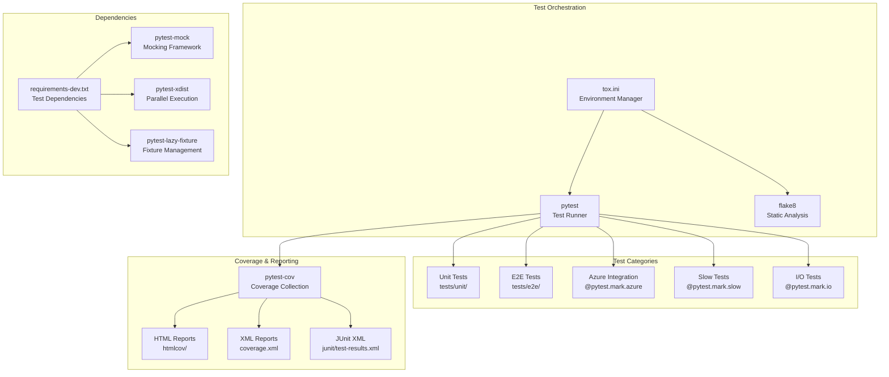
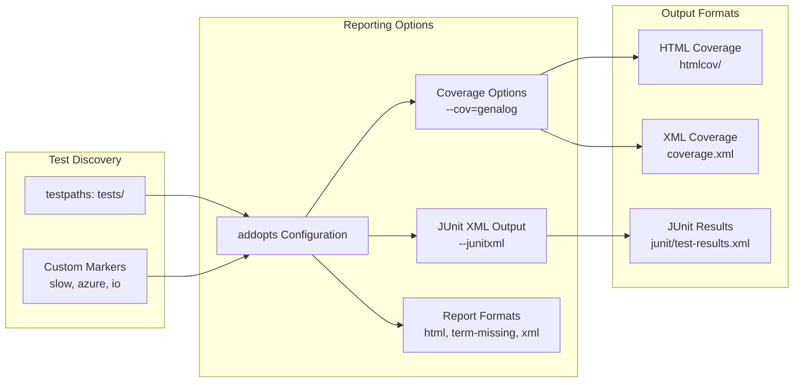
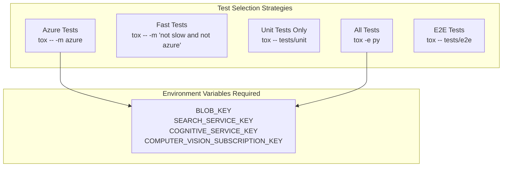
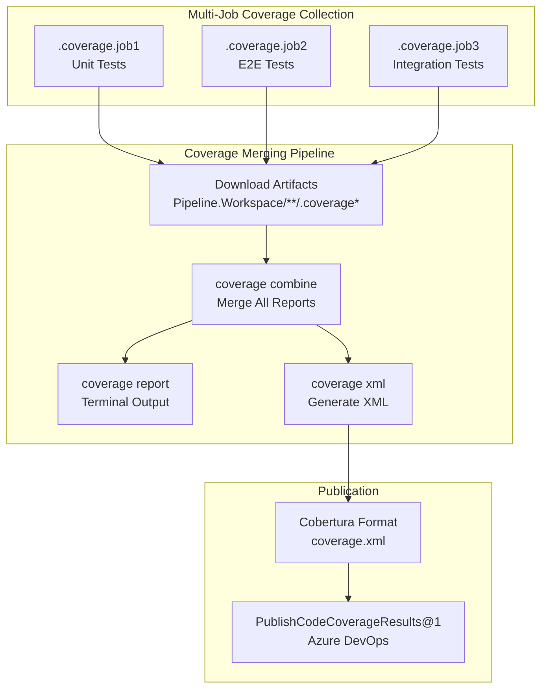
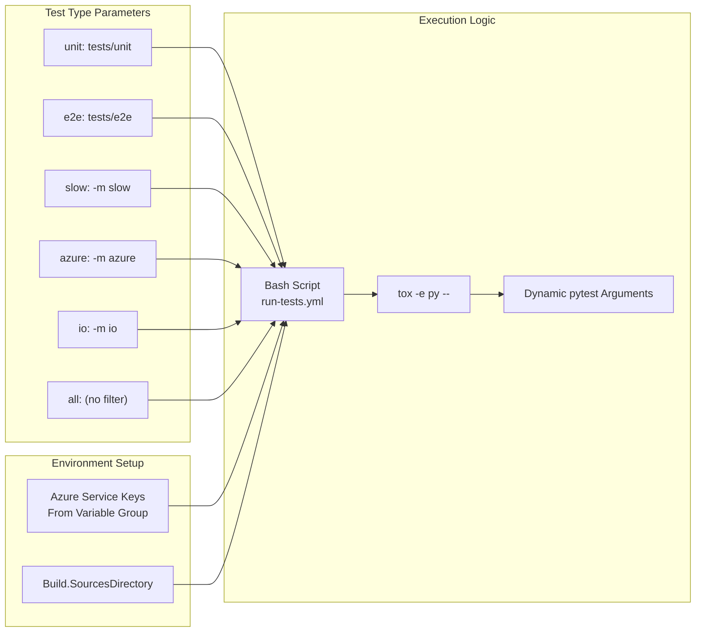
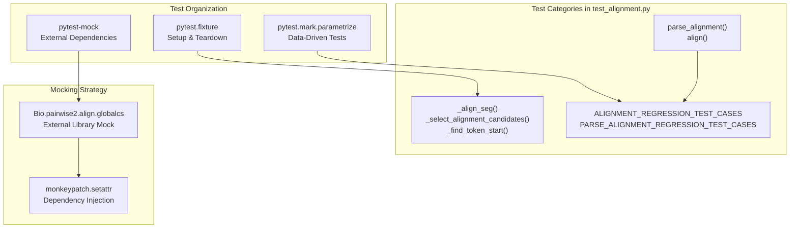

<!-- source: DeepWiki mcp.deepwiki.com · repo microsoft/genalog · page 3.1 Testing Framework · fetched 2026-10-26 -->

# Testing Framework

Relevant source files

The following files were used as context for generating this wiki page:

- [devops/templates/base/run-tests.yml](devops/templates/base/run-tests.yml)
- [devops/templates/install-dependencies.yml](devops/templates/install-dependencies.yml)
- [devops/templates/merge-cov-reports.yml](devops/templates/merge-cov-reports.yml)
- [requirements-dev.txt](requirements-dev.txt)
- [tests/unit/text/test_alignment.py](tests/unit/text/test_alignment.py)
- [tox.ini](tox.ini)

## Purpose and Scope

The Testing Framework provides comprehensive test automation, coverage reporting, and quality assurance for the genalog codebase. This framework orchestrates unit tests, integration tests, static analysis, and coverage measurement across multiple Python versions and environments. The system supports both local development workflows and CI/CD pipeline execution.

For information about the CI/CD pipeline configuration that utilizes this testing framework, see [CI/CD Pipelines](#3.2).

## Test Framework Architecture

The genalog testing framework is built around `tox` as the primary test orchestrator, which manages virtual environments, dependencies, and test execution across different Python versions and test categories.

### Core Testing Infrastructure

**Sources:** [tox.ini:1-63](), [requirements-dev.txt:1-9]()

## Test Configuration

### Tox Environment Configuration

The `tox.ini` file defines multiple test environments and configurations:

| Environment | Purpose | Configuration |
|-------------|---------|---------------|
| `py` | Main test environment | Runs pytest with coverage reporting |
| `flake8` | Static analysis | Code style and import order checking |

The main test environment (`[testenv]`) is configured with:

- **Environment Variables**: Azure service keys for integration testing ([tox.ini:6-12]())
- **Dependencies**: Development requirements from `requirements-dev.txt` ([tox.ini:15]())
- **Command Execution**: Flexible pytest execution with positional arguments ([tox.ini:16-23]())

### Pytest Configuration

The pytest configuration section defines comprehensive test execution parameters:

**Sources:** [tox.ini:33-51]()

## Test Categories and Markers

The framework uses pytest markers to categorize tests by execution characteristics and resource requirements:

### Test Markers

| Marker | Purpose | Usage Example |
|--------|---------|---------------|
| `slow` | Long-running tests | `pytest -m "not slow"` |
| `azure` | Azure integration tests | `pytest -m "not azure"` |
| `io` | I/O dependent tests | `pytest -m "io"` |

### Test Execution Patterns

**Sources:** [tox.ini:38-44](), [devops/templates/base/run-tests.yml:33-38]()

## Coverage Reporting

The framework implements comprehensive coverage measurement and reporting:

### Coverage Configuration

Coverage is configured through pytest addopts ([tox.ini:50]()):
- `--cov-append`: Append to existing coverage data
- `--cov=genalog`: Measure coverage for genalog package
- `--cov-report=html`: Generate HTML coverage reports
- `--cov-report=term-missing`: Show missing lines in terminal
- `--cov-report=xml`: Generate XML coverage reports for CI/CD

### Coverage Report Merging

For CI/CD scenarios with multiple test jobs, coverage reports can be merged:

**Sources:** [devops/templates/merge-cov-reports.yml:32-46]()

## Static Analysis

### Flake8 Configuration

The framework includes comprehensive static analysis through flake8:

| Configuration | Value | Purpose |
|---------------|-------|---------|
| `import-order-style` | `edited` | Enforce import ordering |
| `application-import-names` | `genalog, tests` | Define local imports |
| `max-line-length` | `140` | Line length limit |
| `exclude` | `build, dist, docs, example, .env*, .venv*, .tox` | Excluded directories |

**Sources:** [tox.ini:53-62]()

## CI/CD Integration

### Test Execution Templates

The testing framework integrates with Azure DevOps through parameterized templates:

**Sources:** [devops/templates/base/run-tests.yml:19-40]()

## Test Implementation Patterns

### Example Test Structure

The framework supports comprehensive testing patterns as demonstrated in the text alignment tests:

**Sources:** [tests/unit/text/test_alignment.py:14-50](), [tests/unit/text/test_alignment.py:177-207]()

## Test Execution Commands

### Local Development

| Command | Purpose |
|---------|---------|
| `tox` | Run all tests with flake8 |
| `tox -e py` | Run tests only |
| `tox -e flake8` | Run static analysis only |
| `tox -- -m "not slow"` | Skip slow tests |
| `tox -- tests/unit` | Run unit tests only |
| `tox -- -k test_align` | Run specific test pattern |

### Dependency Management

Dependencies are managed through `requirements-dev.txt` and installed via the dependency template:

**Key Testing Dependencies:**
- `pytest`: Core testing framework
- `pytest-cov`: Coverage measurement
- `pytest-mock`: Mocking capabilities
- `pytest-xdist[psutil]`: Parallel test execution
- `pytest-lazy-fixture`: Advanced fixture management
- `flake8` + `flake8-import-order`: Static analysis
- `tox`: Environment management

**Sources:** [requirements-dev.txt:1-9](), [devops/templates/install-dependencies.yml:8-12]()

---

