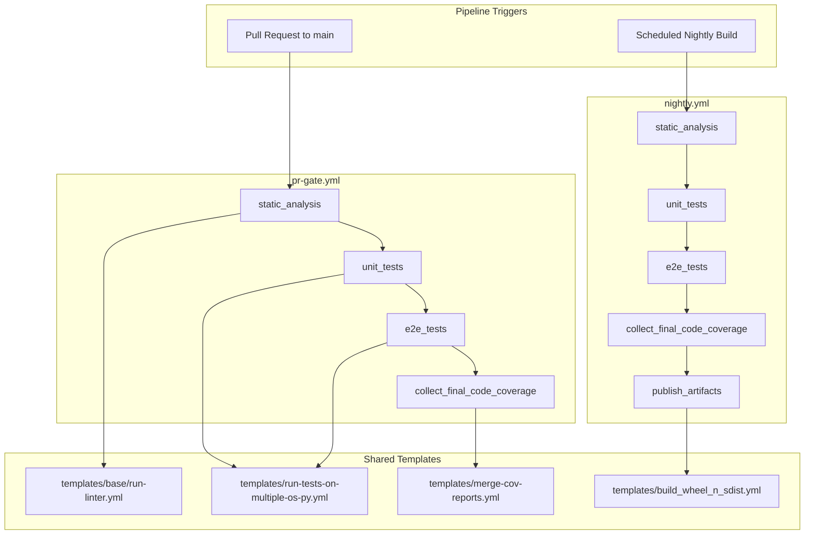
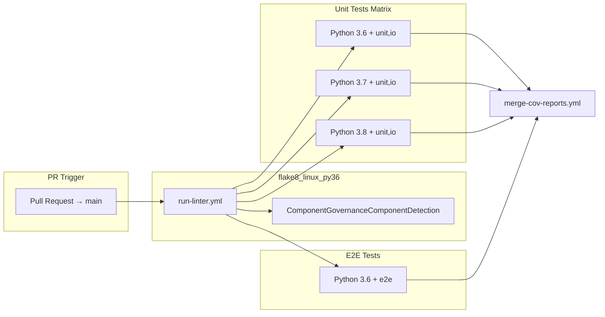
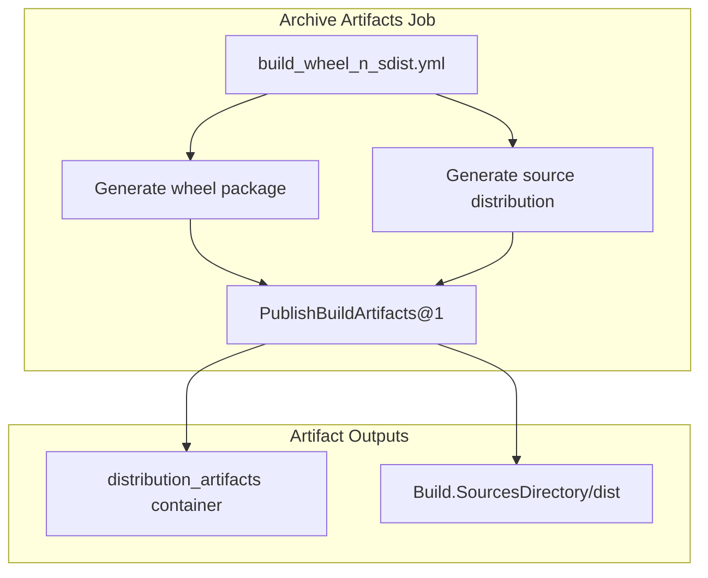
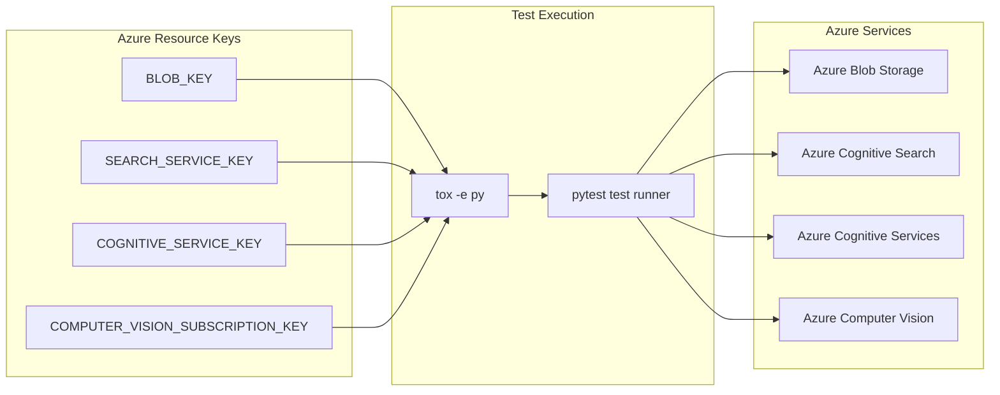
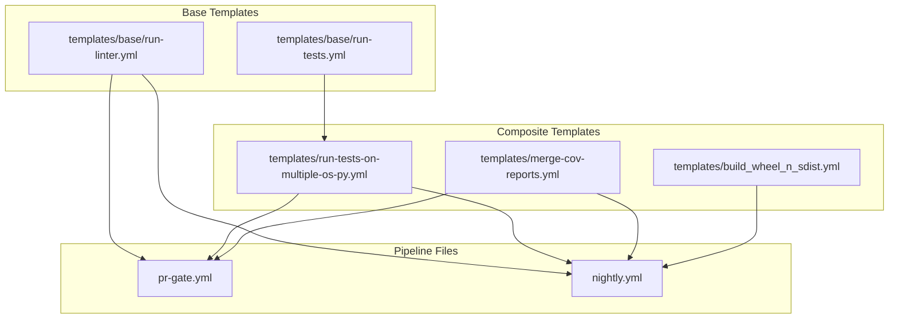

<!-- source: DeepWiki mcp.deepwiki.com · repo microsoft/genalog · page 3.2 CI/CD Pipelines · fetched 2026-10-26 -->

# CI/CD Pipelines

Relevant source files

The following files were used as context for generating this wiki page:

- [devops/nightly.yml](devops/nightly.yml)
- [devops/pr-gate.yml](devops/pr-gate.yml)
- [devops/templates/base/run-tests.yml](devops/templates/base/run-tests.yml)

This document covers the continuous integration and continuous deployment (CI/CD) infrastructure for the genalog project. It details the Azure DevOps pipeline configurations, test execution strategies, quality gates, and artifact management processes that ensure code quality and reliable releases.

For information about the testing framework configuration and test execution procedures, see [Testing Framework](#3.1). For details about package building and PyPI publishing, see [Release Process](#3.3).

## Pipeline Overview

The genalog project uses Azure DevOps for CI/CD automation with two primary pipeline configurations that orchestrate code validation, testing, and artifact generation.

**Pipeline Architecture Overview**

Sources: [devops/pr-gate.yml:1-52](), [devops/nightly.yml:1-66]()

## Pull Request Gate Pipeline

The `pr-gate.yml` pipeline validates all pull requests targeting the main branch through a multi-stage quality gate process. This pipeline prioritizes speed while maintaining comprehensive validation.

| Stage | Purpose | Dependencies |
|-------|---------|--------------|
| `static_analysis` | Code linting and governance | None |
| `unit_tests` | Fast unit and IO tests | `static_analysis` |
| `e2e_tests` | End-to-end integration tests | `static_analysis` |
| `collect_final_code_coverage` | Coverage aggregation | `unit_tests`, `e2e_tests` |

### Stage Configuration

The pull request pipeline uses optimized configurations to balance thoroughness with execution speed:

- **Python Versions**: Tests run on Python 3.6, 3.7, and 3.8 for unit tests, but only Python 3.6 for e2e tests
- **Operating Systems**: Limited to `ubuntu-18.04` due to dependency constraints  
- **Test Types**: Includes `unit` and `io` test categories for comprehensive coverage
- **Trigger**: Activated automatically on pull requests to main branch

**Pull Request Validation Flow**

Sources: [devops/pr-gate.yml:10-11](), [devops/pr-gate.yml:16-27](), [devops/pr-gate.yml:28-35](), [devops/pr-gate.yml:37-44]()

## Nightly Build Pipeline

The `nightly.yml` pipeline executes comprehensive testing and artifact generation on a scheduled basis. This pipeline runs more extensive validation and produces distribution artifacts.

### Enhanced Test Coverage

The nightly pipeline provides broader test coverage compared to the PR gate:

- **E2E Testing**: Runs on all supported Python versions (3.6, 3.7, 3.8)
- **Artifact Generation**: Builds wheel and source distribution packages
- **Extended Validation**: Full component governance scanning
- **Trigger Strategy**: Scheduled execution with `trigger: none` and `pr: none`

### Artifact Publishing Stage

The nightly pipeline includes the `publish_artifacts` stage that generates distribution packages:

**Nightly Artifact Generation Process**

Sources: [devops/nightly.yml:52-65](), [devops/nightly.yml:58-64]()

## Test Execution Framework

The pipeline system leverages a parameterized template system for consistent test execution across different environments and configurations.

### Test Type Categories

The `run-tests.yml` template supports multiple test categorizations:

| Test Type | Command | Purpose |
|-----------|---------|---------|
| `unit` | `tox -e py -- tests/unit` | Fast unit tests |
| `e2e` | `tox -e py -- tests/e2e` | End-to-end integration tests |
| `io` | `tox -e py -- -m "io"` | I/O and file system tests |
| `slow` | `tox -e py -- -m "slow"` | Long-running tests |
| `azure` | `tox -e py -- -m "azure"` | Azure service integration tests |
| `all` | `tox -e py` | Complete test suite |

### Environment Configuration

Azure service integration requires secure environment variables from the `azureResourceKeys` variable group:

**Azure Service Integration in Test Pipeline**

Sources: [devops/templates/base/run-tests.yml:33-38](), [devops/templates/base/run-tests.yml:20-32]()

## Quality Gates and Validation

### Static Analysis Stage

Both pipelines implement consistent static analysis through the `flake8_linux_py36` job:

- **Linting**: Python code style validation using flake8
- **Component Governance**: Dependency security scanning via `ComponentGovernanceComponentDetection@0`
- **Python Version**: Standardized on Python 3.6 for consistency
- **Platform**: Ubuntu-latest for Linux-based validation

### Coverage Collection

The `collect_final_code_coverage` stage aggregates test coverage data from multiple test runs using the `merge-cov-reports.yml` template. This stage depends on completion of both unit and e2e test stages.

Sources: [devops/pr-gate.yml:22-26](), [devops/nightly.yml:22-26](), [devops/pr-gate.yml:46-51](), [devops/nightly.yml:45-50]()

## Pipeline Templates and Reusability

The pipeline architecture emphasizes reusability through parameterized templates:

### Template Structure

**Template Dependency Hierarchy**

### Parameter Customization

The `run-tests-on-multiple-os-py.yml` template accepts parameters for flexible configuration:

- `pyVersions`: Array of Python versions to test against
- `testTypes`: Array of test categories to execute  
- `imageOSs`: Array of operating system images (currently limited to Ubuntu)

Sources: [devops/templates/base/run-tests.yml:7-17](), [devops/pr-gate.yml:30-35](), [devops/nightly.yml:30-34]()

---

