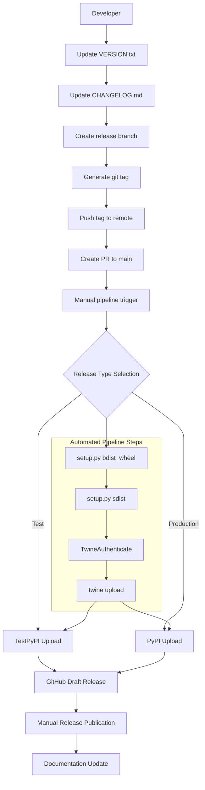
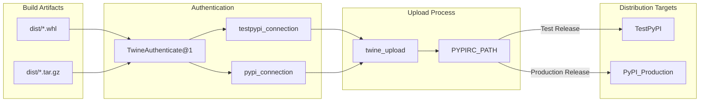
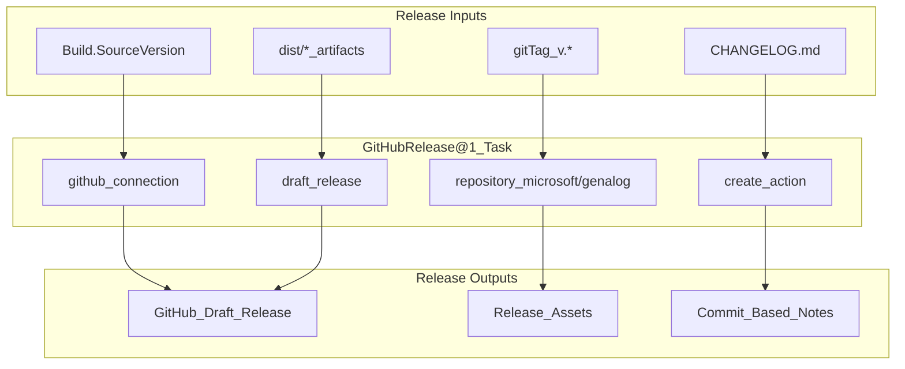

<!-- source: DeepWiki mcp.deepwiki.com · repo microsoft/genalog · page 3.3 Release Process · fetched 2026-10-26 -->

# Release Process

<details>
<summary>Relevant source files</summary>

The following files were used as context for generating this wiki page:

- [RELEASE.md](RELEASE.md)
- [VERSION.txt](VERSION.txt)
- [devops/release.yml](devops/release.yml)

</details>


This document describes the procedures and infrastructure for building, testing, and distributing genalog package releases. It covers the automated release pipeline configuration, version management, and manual release procedures required to publish packages to PyPI and update project documentation.

For information about general CI/CD pipeline infrastructure, see [CI/CD Pipelines](#3.2). For details about test execution and validation, see [Testing Framework](#3.1).

## Release Workflow Overview

The genalog release process follows a hybrid approach combining automated Azure DevOps pipelines with manual preparation steps to ensure quality and control over package distribution.

### End-to-End Release Flow



**Sources:** [RELEASE.md:1-33](), [devops/release.yml:1-78]()

### Release Pipeline Architecture

```mermaid
flowgraph TD
    subgraph "Release Preparation"
        A["VERSION.txt"] --> B["version_bump"]
        C["CHANGELOG.md"] --> D["release_notes"]
        E["git_tag"] --> F["v{version}"]
    end
    
    subgraph "Azure DevOps Pipeline"
        G["UsePythonVersion@0"] --> H["python_3.6"]
        H --> I["pip_install_build_tools"]
        I --> J["setup.py_bdist_wheel"]
        I --> K["setup.py_sdist"]
        J --> L["dist/*.whl"]
        K --> M["dist/*.tar.gz"]
    end
    
    subgraph "Distribution Targets"
        N["TwineAuthenticate@1_testpypi"]
        O["TwineAuthenticate@1_pypi"]
        P["GitHubRelease@1"]
    end
    
    subgraph "Package Outputs"
        Q["TestPyPI_genalog"]
        R["PyPI_genalog"] 
        S["GitHub_Release_Assets"]
    end
    
    L --> N
    M --> N
    L --> O
    M --> O
    L --> P
    M --> P
    
    N --> Q
    O --> R
    P --> S
    
    F --> G
    D --> P
```

**Sources:** [devops/release.yml:27-78](), [RELEASE.md:10-25]()

## Version Management

The genalog project uses semantic versioning with a single source of truth approach for version information.

### Version Storage and Format

| Component | Location | Format | Purpose |
|-----------|----------|--------|---------|
| Primary Version | `VERSION.txt` | `X.Y.Z` | Single source of truth |
| Git Tags | Repository | `vX.Y.Z` | Release marking |
| Package Metadata | `setup.py` | Reads from `VERSION.txt` | Distribution |

The current version is stored in [VERSION.txt:1]() and follows [Semantic Versioning](https://semver.org/) conventions:
- **Major (X)**: Breaking changes
- **Minor (Y)**: New features, backward compatible  
- **Patch (Z)**: Bug fixes, backward compatible

### Version Update Process

Version updates follow a manual process requiring explicit developer action:

1. **Preparation**: Update [VERSION.txt:1]() with new version number
2. **Documentation**: Update [CHANGELOG.md]() with release notes
3. **Tagging**: Create git tag with format `v{version}` using `git tag -a v0.1.0 -m "Initial Release"`
4. **Synchronization**: Push tag to remote repository with `git push origin v0.1.0`

**Sources:** [RELEASE.md:10-14](), [VERSION.txt:1]()

## Build and Packaging Process

The build process uses standard Python packaging tools orchestrated through Azure DevOps pipelines to create distribution packages.

### Build Environment Configuration

The release pipeline [devops/release.yml:18-24]() configures a standardized build environment:

```yaml
strategy:
  matrix:
    linux_x64_py3.6:
      imageName: 'ubuntu-18.04'
      python.version: '3.6'
```

### Package Generation

The build process [devops/release.yml:34-40]() creates two distribution formats:

| Package Type | Command | Output | Purpose |
|--------------|---------|--------|---------|
| Wheel | `python setup.py bdist_wheel` | `dist/*.whl` | Fast installation |
| Source Distribution | `python setup.py sdist` | `dist/*.tar.gz` | Source code archive |

Both packages are generated into the `dist/` directory for subsequent upload operations.

### Build Dependencies

The pipeline installs required build tools [devops/release.yml:35-36]():
- `pip install --upgrade pip`
- `pip install setuptools wheel`

**Sources:** [devops/release.yml:34-40](), [devops/release.yml:18-24]()

## Distribution Pipeline

The distribution system supports dual-environment deployment with separate configurations for testing and production releases.

### PyPI Distribution Architecture



### Release Type Configuration

The pipeline supports parameterized release types [devops/release.yml:8-15]():

| Parameter | Values | Authentication | Target |
|-----------|--------|----------------|--------|
| `releaseType` | `Test` | `testpypi` service connection | TestPyPI |
| `releaseType` | `Production` | `pypi` service connection | PyPI |

### Upload Process

The upload process [devops/release.yml:75-78]() uses `twine` for secure package distribution:

```bash
twine upload --verbose -r genalog --config-file $(PYPIRC_PATH) dist/*.whl
```

Authentication is handled through Azure DevOps service connections configured in [devops/release.yml:63-73]().

**Sources:** [devops/release.yml:8-15](), [devops/release.yml:63-78]()

## Manual Release Procedures

While the core build and upload processes are automated, several manual steps ensure release quality and proper documentation.

### Pre-Release Validation

The manual checklist [RELEASE.md:17-20]() requires full test suite execution:

1. **Test Installation**: `pip install tox`
2. **Test Execution**: `tox -e py -- -m "not azure"`
3. **Azure Test Exclusion**: Deprecated azure tests are skipped

### Release Execution Steps

The release process follows a defined sequence [RELEASE.md:21-28]():

| Step | Action | Location | Purpose |
|------|--------|----------|---------|
| 1 | Trigger release pipeline | Azure DevOps | Build and upload |
| 2 | Test with TestPyPI | `test.pypi.org` | Validation |
| 3 | Production release | `pypi.org` | Distribution |
| 4 | Publish GitHub release | GitHub Releases | Documentation |
| 5 | Verify installation | `pip install genalog` | End-user validation |

### Documentation Update Process

Documentation updates [RELEASE.md:29-33]() follow the release:

1. **Environment Setup**: `cd docs && pip install -r requirements-doc.txt`
2. **Build Documentation**: `jupyter-book build --all genalog_docs`
3. **GitHub Pages Publish**: `ghp-import -n -p -f genalog_docs/_build/html`

**Sources:** [RELEASE.md:17-33]()

## GitHub Release Integration

The pipeline automatically creates GitHub releases with comprehensive artifact management and change documentation.

### GitHub Release Configuration



### Release Task Configuration

The GitHub release task [devops/release.yml:42-56]() includes:

- **Repository Target**: `microsoft/genalog`
- **Tag Pattern**: `v.*` for version tags
- **Release Notes**: Sourced from `CHANGELOG.md`
- **Assets**: All files from `$(Build.SourcesDirectory)/dist/*`
- **Draft Mode**: Releases created as drafts for manual review

### Manual Publication

GitHub releases require manual publication after pipeline completion [RELEASE.md:25](), allowing final review of:
- Release notes accuracy
- Asset completeness  
- Version tag correctness

**Sources:** [devops/release.yml:42-56](), [RELEASE.md:25]()

---

