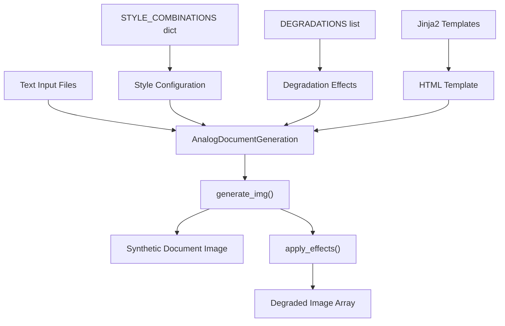
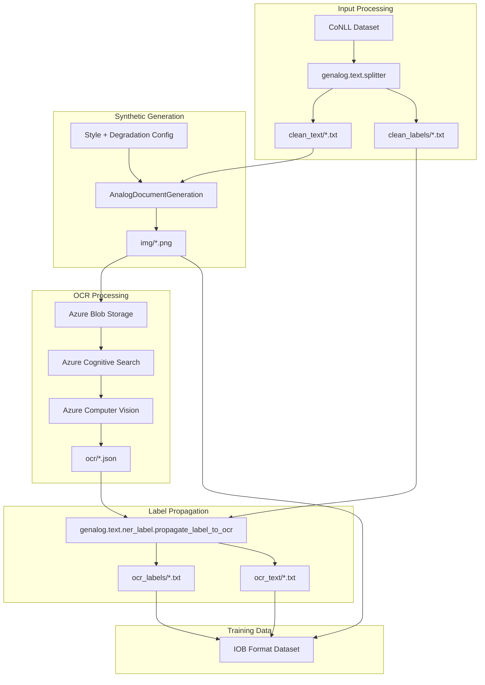
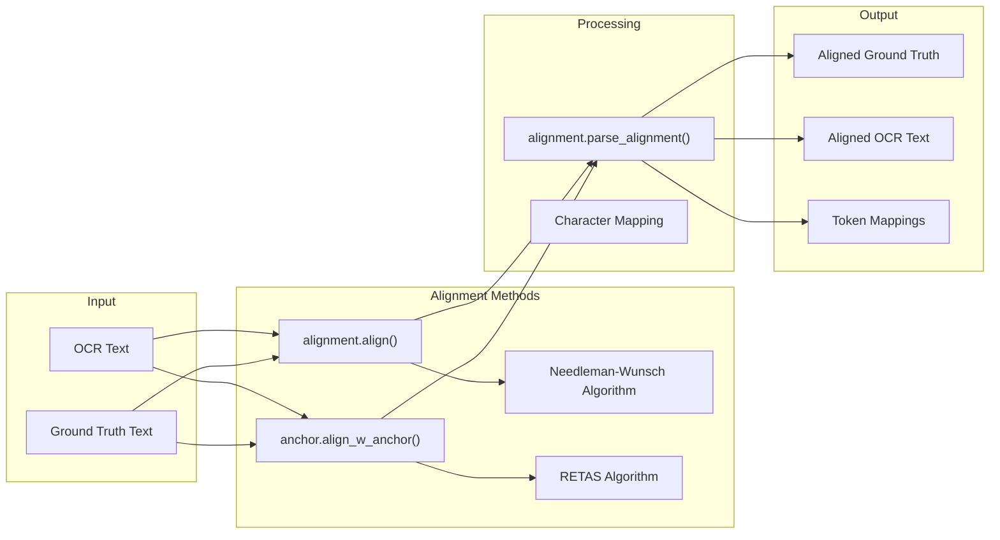
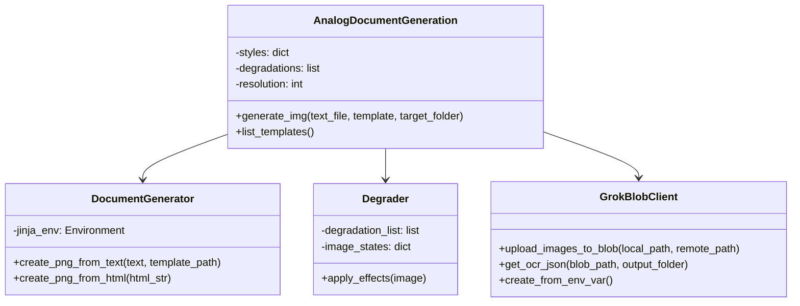
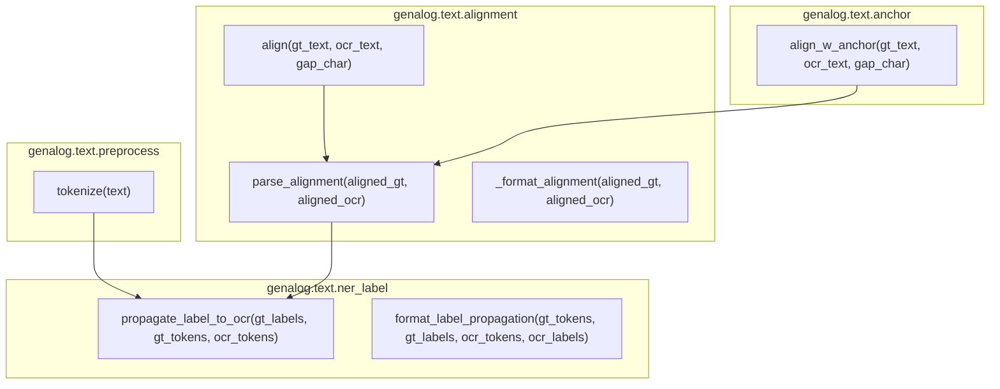

<!-- source: DeepWiki mcp.deepwiki.com · repo microsoft/genalog · page 4 Examples and Tutorials · fetched 2026-10-26 -->

# Examples and Tutorials

<details>
<summary>Relevant source files</summary>

The following files were used as context for generating this wiki page:

- [docs/genalog_docs/_config.yml](docs/genalog_docs/_config.yml)
- [docs/genalog_docs/docstring/genalog.ocr.rst](docs/genalog_docs/docstring/genalog.ocr.rst)
- [docs/genalog_docs/e2e_dataset_pipeline.md](docs/genalog_docs/e2e_dataset_pipeline.md)
- [example/dataset_generation.ipynb](example/dataset_generation.ipynb)
- [example/generation_pipeline.ipynb](example/generation_pipeline.ipynb)
- [example/static/analog_doc_gen_pipeline.png](example/static/analog_doc_gen_pipeline.png)
- [genalog/degradation/README.md](genalog/degradation/README.md)
- [genalog/text/README.md](genalog/text/README.md)

</details>


This page provides practical examples and tutorials demonstrating how to use genalog for synthetic document generation and dataset creation. The examples range from basic document generation to complete end-to-end pipelines for machine learning training data preparation.

For core component documentation, see [Core Components](#2). For development setup and testing, see [Development](#3).

## Basic Document Generation

The simplest way to start with genalog is using the `AnalogDocumentGeneration` class to generate synthetic documents with degradation effects.

### Document Generation Workflow



### Configuration Setup

The basic configuration requires three main components as shown in [example/generation_pipeline.ipynb:54-166]():

**Style Combinations**: Controls document appearance through CSS properties processed by Weasyprint
```python
STYLE_COMBINATIONS = {
    "language": ["en_US"],
    "font_family": ["Segoe UI"], 
    "font_size": ["12px"],
    "text_align": ["justify"],
    "hyphenate": [True, False]
}
```

**Degradation Effects**: Sequential application of image processing effects from `genalog.degradation.effect`
```python
DEGRADATIONS = [
    ("morphology", {"operation": "open", "kernel_shape": (9,9), "kernel_type": "plus"}),
    ("blur", {"radius": 5}),
    ("salt", {"amount": 0.15})
]
```

**HTML Templates**: Jinja2 templates for document layout including `text_block.html.jinja`, `columns.html.jinja`, and `letter.html.jinja`

### Single Document Generation

Basic usage pattern from [example/generation_pipeline.ipynb:175-178]():

```python
from genalog.pipeline import AnalogDocumentGeneration

doc_generation = AnalogDocumentGeneration(
    styles=STYLE_COMBINATIONS, 
    degradations=DEGRADATIONS, 
    resolution=IMG_RESOLUTION
)
img_array = doc_generation.generate_img(sample_file, HTML_TEMPLATE, target_folder=None)
```

### Batch Processing

For generating multiple documents, use `generate_dataset_multiprocess()` from [example/generation_pipeline.ipynb:200-207]():

```python
from genalog.pipeline import generate_dataset_multiprocess

generate_dataset_multiprocess(
    [sample_file], DST_PATH, STYLE_COMBINATIONS, DEGRADATIONS, HTML_TEMPLATE,
    resolution=IMG_RESOLUTION, batch_size=5
)
```

Sources: [example/generation_pipeline.ipynb:1-217](), [genalog/degradation/README.md:1-233]()

## End-to-End Dataset Generation

The complete pipeline transforms clean NER datasets into synthetic OCR training data suitable for machine learning models.

### ML Dataset Pipeline Architecture



### Dataset Structure

The generated dataset follows a standardized file structure as shown in [example/dataset_generation.ipynb:20-57]():

```
<ROOT_FOLDER>/
  <SRC_DATASET_NAME>/
    shared/
      train/clean_text/*.txt
      train/clean_labels/*.txt
    <VERSION_NAME>/
      train/
        img/*.png
        ocr/*.json
        ocr_text/*.txt
        ocr_labels/*.txt
      layout.json
      degradation.json
      ocr_metric.csv
```

### Dataset Preprocessing

Transform CoNLL format data using `genalog.text.splitter` as shown in [example/dataset_generation.ipynb:113-126]():

```bash
python -m genalog.text.splitter $INPUT_FILE $OUTPUT_FOLDER --doc_sep="-DOCSTART-\tO"
```

### Azure OCR Integration

The pipeline integrates with Azure services through deprecated `genalog.ocr` classes from [example/dataset_generation.ipynb:398-418]():

```python
from genalog.ocr.blob_client import GrokBlobClient
from genalog.ocr.rest_client import GrokRestClient

blob_client = GrokBlobClient.create_from_env_var()
grok_rest_client = GrokRestClient.create_from_env_var()
```

### Metrics Generation

OCR quality metrics are calculated using `genalog.ocr.metrics` from [example/dataset_generation.ipynb:586-617]():

```python
from genalog.ocr.metrics import get_metrics, substitution_dict_to_json

df, subs, actions = get_metrics(clean_text_path, ocr_json_path, use_multiprocessing=True)
df.to_csv(output_csv_name)
```

Sources: [example/dataset_generation.ipynb:1-721](), [docs/genalog_docs/e2e_dataset_pipeline.md:1-13]()

## Text Processing Examples

Text alignment and label propagation are core capabilities for processing OCR outputs.

### Text Alignment Workflow



### Alignment Methods

Two alignment algorithms are available based on text length from [genalog/text/README.md:1-29]():

**RETAS Algorithm** (`align_w_anchor()`): Recommended for text longer than 200 characters
**Needleman-Wunsch Algorithm** (`align()`): Optimal for shorter text sequences

Both methods share identical function contracts:

```python
from genalog.text import alignment, anchor

gt_txt = "New York is big"
noise_txt = "New Yo rkis "

aligned_gt, aligned_noise = anchor.align_w_anchor(gt_txt, noise_txt, gap_char="@")
aligned_gt, aligned_noise = alignment.align(gt_txt, noise_txt, gap_char="@")
```

### Label Propagation Process

NER label propagation from clean text to OCR text using `genalog.text.ner_label` from [genalog/text/README.md:55-108]():

```python
from genalog.text import ner_label, preprocess

gt_labels = ["B-P", "I-P", "O", "O"]
gt_tokens = preprocess.tokenize(gt_txt)
ocr_tokens = preprocess.tokenize(ocr_txt)

ocr_labels, aligned_gt, aligned_ocr, gap_char = ner_label.propagate_label_to_ocr(
    gt_labels, gt_tokens, ocr_tokens
)
```

### Alignment Configuration

The Needleman-Wunsch algorithm uses four hyperparameters from [genalog/text/README.md:111-129]():

- `MATCH_REWARD`: Reward for matching characters
- `MISMATCH_PENALTY`: Penalty for character mismatches  
- `GAP_PENALTY`: Penalty for creating gaps
- `GAP_EXT_PENALTY`: Penalty for extending gaps

Sources: [genalog/text/README.md:1-129]()

## Code Entity Mapping

### Pipeline Classes and Methods



### Text Processing Functions



Sources: [example/generation_pipeline.ipynb:49](), [example/dataset_generation.ipynb:269](), [genalog/text/README.md:4-5](), [genalog/text/README.md:72]()

---

