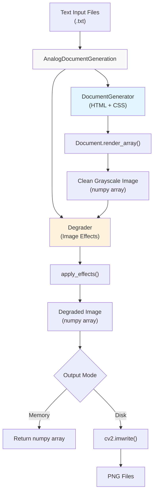
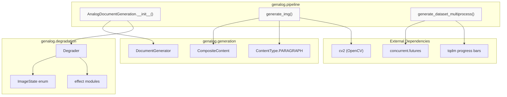
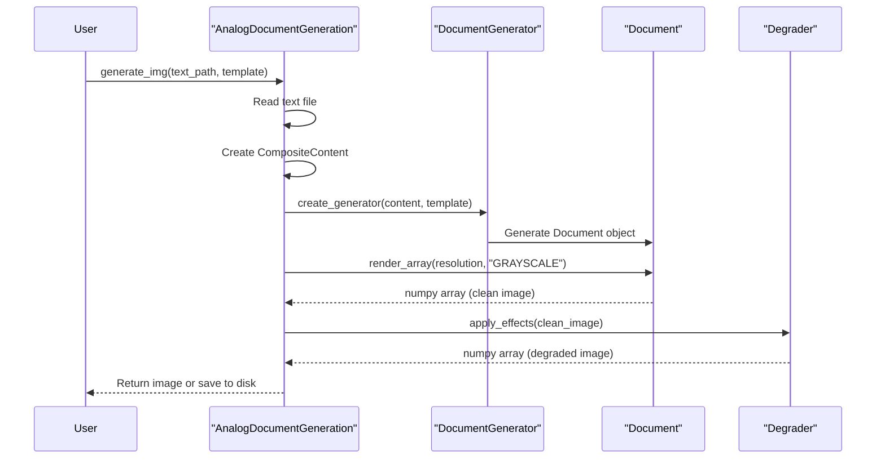
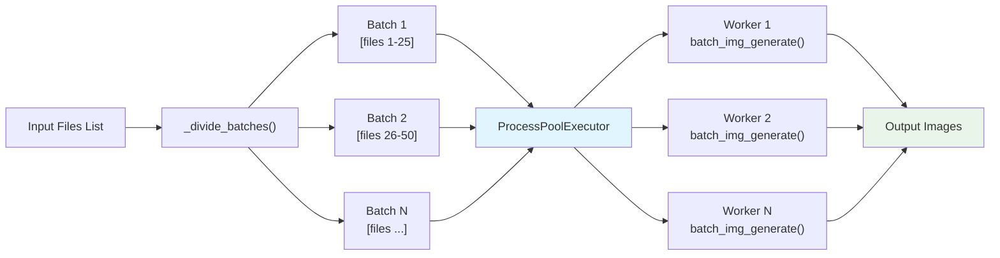

<!-- source: DeepWiki mcp.deepwiki.com · repo microsoft/genalog · page 4.1 Document Generation Pipeline · fetched 2026-10-26 -->

# Document Generation Pipeline

<details>
<summary>Relevant source files</summary>

The following files were used as context for generating this wiki page:

- [example/dataset_generation.ipynb](example/dataset_generation.ipynb)
- [example/generation_pipeline.ipynb](example/generation_pipeline.ipynb)
- [example/static/analog_doc_gen_pipeline.png](example/static/analog_doc_gen_pipeline.png)
- [genalog/degradation/README.md](genalog/degradation/README.md)
- [genalog/pipeline.py](genalog/pipeline.py)
- [genalog/text/README.md](genalog/text/README.md)

</details>


This document provides a step-by-step walkthrough of creating synthetic documents with degradation effects using genalog's document generation pipeline. The pipeline transforms plain text files into synthetic document images with realistic degradation artifacts that can be used for training OCR and document understanding models.

For information about the underlying document generation components, see [Document Generation](#2.1). For details about image degradation effects, see [Image Degradation](#2.2). For dataset creation workflows, see [Dataset Generation](#4.2).

## Purpose and Scope

The document generation pipeline orchestrates the end-to-end process of converting text documents into synthetic images with controlled degradation effects. This pipeline is implemented primarily in the `AnalogDocumentGeneration` class and supporting multiprocessing utilities, enabling both single document generation and large-scale dataset creation.

## Pipeline Architecture

**Pipeline Flow Overview**



**Core Component Integration**



Sources: [genalog/pipeline.py:1-156](), [example/generation_pipeline.ipynb:1-217]()

## Core Components

### AnalogDocumentGeneration Class

The `AnalogDocumentGeneration` class is the primary interface for generating synthetic documents. It encapsulates both document generation and image degradation capabilities.

**Initialization Parameters:**
- `template_path`: Custom HTML template directory path 
- `styles`: Dictionary defining CSS style combinations
- `degradations`: List of degradation effect tuples
- `resolution`: Image resolution in DPI (default: 300)

**Key Methods:**
- `generate_img()`: Generate a single document image
- `list_templates()`: Return available HTML templates

```python
# Example instantiation from notebook
doc_generation = AnalogDocumentGeneration(
    styles=STYLE_COMBINATIONS, 
    degradations=DEGRADATIONS, 
    resolution=IMG_RESOLUTION
)
```

Sources: [genalog/pipeline.py:28-92](), [example/generation_pipeline.ipynb:177-179]()

### Multiprocessing Pipeline

The `generate_dataset_multiprocess()` function provides scalable batch processing capabilities using `concurrent.futures.ProcessPoolExecutor`.

**Function Signature:**
```python
def generate_dataset_multiprocess(
    input_text_files, output_folder,
    styles, degradations, template,
    resolution=300, batch_size=25
)
```

**Processing Flow:**
1. Divide input files into batches using `_divide_batches()`
2. Create argument tuples for each batch via `_set_batch_generate_args()`
3. Execute parallel processing with `ProcessPoolExecutor`
4. Track progress using `tqdm` progress bars

Sources: [genalog/pipeline.py:130-156](), [genalog/pipeline.py:94-128]()

## Configuration Parameters

### Style Combinations

Style combinations define the visual appearance of generated documents using CSS properties. The configuration uses a dictionary where each key represents a CSS property and values are lists of possible settings.

**Example Configuration:**
| Property | Values | Description |
|----------|--------|-------------|
| `language` | `["en_US"]` | Document language |
| `font_family` | `["Segoe UI"]` | Font family name |
| `font_size` | `["12px"]` | Font size in pixels |
| `text_align` | `["justify"]` | Text alignment |
| `hyphenate` | `[True, False]` | Enable/disable hyphenation |

```python
STYLE_COMBINATIONS = {
    "language": ["en_US"],
    "font_family": ["Segoe UI"],
    "font_size": ["12px"],
    "text_align": ["justify"],
    "hyphenate": [True, False],
}
```

Sources: [example/generation_pipeline.ipynb:80-87](), [example/dataset_generation.ipynb:194-200]()

### Degradation Effects

Degradation effects are specified as a list of tuples, where each tuple contains an effect name and its parameters. Effects are applied sequentially in the order specified.

**Common Effect Types:**
- `blur`: Simulates focus issues with `radius` parameter
- `salt`/`pepper`: Adds noise pixels with `amount` parameter  
- `morphology`: Structural changes with `operation`, `kernel_shape`, `kernel_type`
- `bleed_through`: Ink seepage simulation with `alpha`, `offset_x`, `offset_y`
- `overlay`: Combines multiple image states

**Advanced State References:**
The `ImageState` enum allows referencing images at different processing stages:
- `ImageState.ORIGINAL_STATE`: Original clean image
- `ImageState.CURRENT_STATE`: Current processing state

```python
DEGRADATIONS = [
    ("morphology", {"operation": "open", "kernel_shape":(9,9), "kernel_type":"plus"}),
    ("salt", {"amount": 0.7}),
    ("overlay", {
        "src": ImageState.ORIGINAL_STATE,
        "background": ImageState.CURRENT_STATE,
    }),
    ("blur", {"radius": 5}),
]
```

Sources: [example/generation_pipeline.ipynb:117-135](), [genalog/degradation/README.md:37-68]()

### HTML Templates

Templates define document layout structure. genalog includes three default templates:

| Template | Description | Use Case |
|----------|-------------|----------|
| `text_block.html.jinja` | Simple text block | Basic documents |
| `columns.html.jinja` | Multi-column layout | Newspaper-style |
| `letter.html.jinja` | Letter format | Correspondence |

Sources: [example/generation_pipeline.ipynb:140-154]()

## Step-by-Step Workflow

### Single Document Generation

**Document Generation Process**



**Implementation Steps:**

1. **Text Loading**: Read input text file with UTF-8 encoding
2. **Content Creation**: Wrap text in `CompositeContent` with `ContentType.PARAGRAPH`
3. **Document Generation**: Use `DocumentGenerator.create_generator()` to produce styled document
4. **Image Rendering**: Call `Document.render_array()` with specified resolution and grayscale mode
5. **Degradation**: Apply effects using `Degrader.apply_effects()`
6. **Output**: Return numpy array or save to disk using `cv2.imwrite()`

```python
# Core generation logic from pipeline.py lines 66-91
with open(full_text_path, "r", encoding="utf8") as f:
    text = f.read()
content = CompositeContent([text], [ContentType.PARAGRAPH])

generator = self.doc_generator.create_generator(content, [template])
doc = next(generator)
src = doc.render_array(resolution=self.resolution, channel="GRAYSCALE")
dst = self.degrader.apply_effects(src)
```

Sources: [genalog/pipeline.py:49-92]()

### Batch Processing Workflow

**Multiprocessing Architecture**



**Processing Steps:**

1. **Batch Division**: Split input files into chunks using `_divide_batches()` with configurable `batch_size`
2. **Argument Preparation**: Create parameter tuples for each batch via `_set_batch_generate_args()`
3. **Parallel Execution**: Use `ProcessPoolExecutor` to process batches concurrently
4. **Progress Tracking**: Monitor completion with `tqdm` progress bars
5. **Timing**: Measure total processing time with `timeit.default_timer()`

```python
# Batch processing from pipeline.py lines 137-155
batches = list(_divide_batches(input_text_files, batch_size))
batch_img_generate_args = _set_batch_generate_args(
    batches, output_folder, styles, degradations, template, resolution
)

with concurrent.futures.ProcessPoolExecutor() as executor:
    batch_iterator = executor.map(batch_img_generate, batch_img_generate_args)
    for _ in tqdm(batch_iterator, total=len(batch_img_generate_args)):
        pass
```

Sources: [genalog/pipeline.py:130-156](), [genalog/pipeline.py:103-128]()

## Output Management

### File Organization

The pipeline creates organized output directory structures:

```
output_folder/
└── img/
    ├── document1.png
    ├── document2.png
    └── ...
```

**Directory Setup:**
- `_setup_folder()` creates necessary directories including `img/` subfolder
- Output filenames preserve input text filename structure (`.txt` → `.png`)
- Error handling for write failures with informative `RuntimeError` messages

### Memory vs. Disk Output

The `generate_img()` method supports two output modes:

**Memory Mode** (`target_folder=None`):
- Returns numpy array directly for in-memory processing
- Useful for interactive analysis and custom post-processing

**Disk Mode** (`target_folder` specified):
- Saves images to disk using `cv2.imwrite()`
- Enables large-scale dataset generation
- Includes error handling for write failures

Sources: [genalog/pipeline.py:80-92](), [genalog/pipeline.py:99-101]()

## Configuration Serialization

The pipeline includes utilities for preserving generation parameters through the `ImageStateEncoder` class, which handles JSON serialization of `ImageState` enum values.

**JSON Export Support:**
- Style combinations saved as `layout.json`
- Degradation parameters saved as `degradation.json`
- Enables reproducible dataset generation
- Supports dataset versioning and configuration tracking

```python
# From dataset generation notebook
layout_js_str = json.dumps(layout, indent=2)
degrade_js_str = json.dumps(DEGRADATIONS, indent=2, cls=ImageStateEncoder)
```

Sources: [genalog/pipeline.py:21-26](), [example/dataset_generation.ipynb:340-363]()

---

