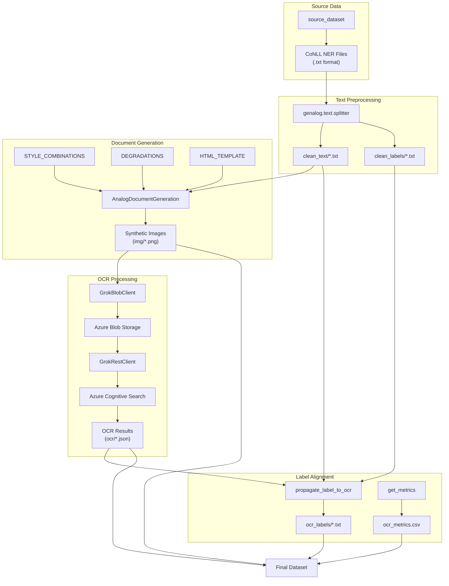
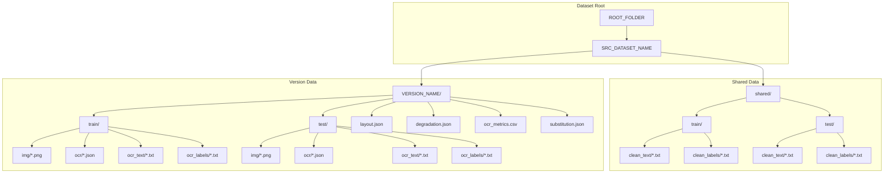
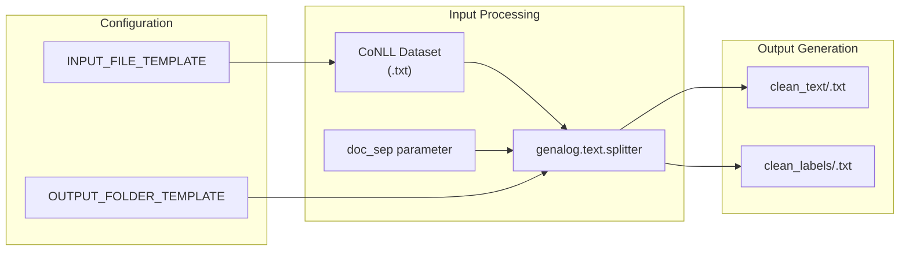
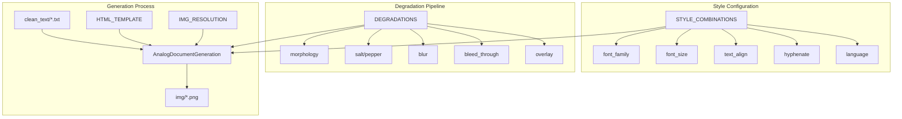
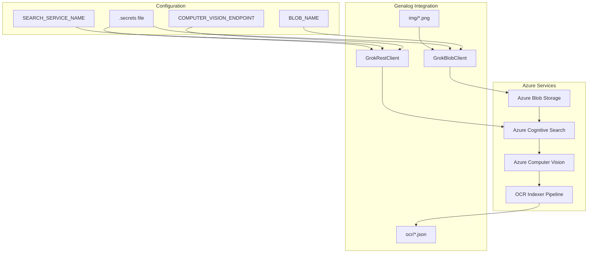
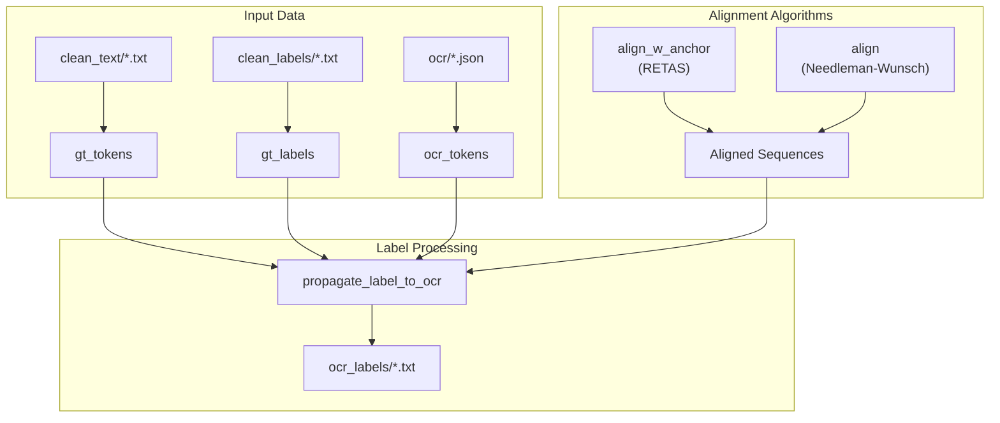
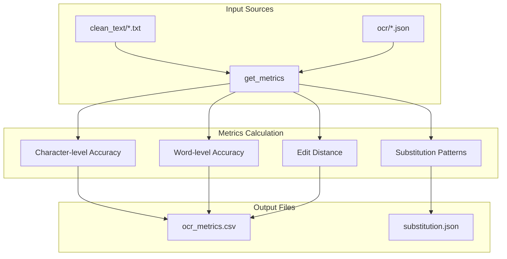
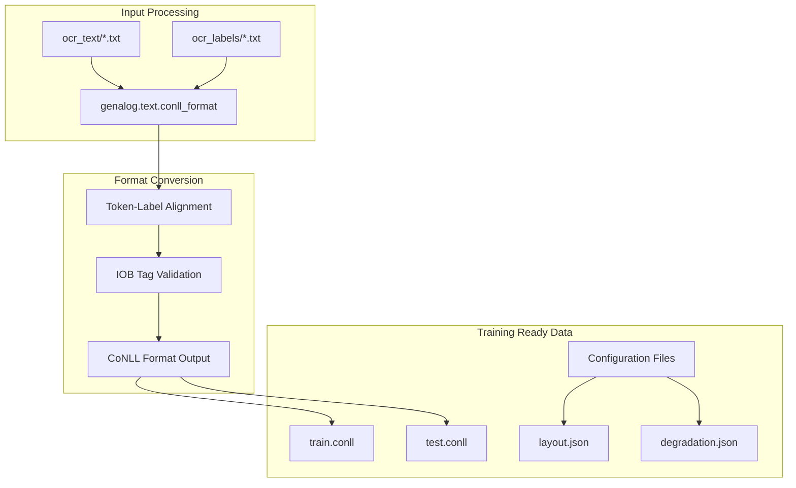

<!-- source: DeepWiki mcp.deepwiki.com · repo microsoft/genalog · page 4.2 Dataset Generation · fetched 2026-10-26 -->

# Dataset Generation

<details>
<summary>Relevant source files</summary>

The following files were used as context for generating this wiki page:

- [docs/genalog_docs/_config.yml](docs/genalog_docs/_config.yml)
- [docs/genalog_docs/docstring/genalog.ocr.rst](docs/genalog_docs/docstring/genalog.ocr.rst)
- [docs/genalog_docs/e2e_dataset_pipeline.md](docs/genalog_docs/e2e_dataset_pipeline.md)
- [example/dataset_generation.ipynb](example/dataset_generation.ipynb)
- [example/generation_pipeline.ipynb](example/generation_pipeline.ipynb)
- [example/static/analog_doc_gen_pipeline.png](example/static/analog_doc_gen_pipeline.png)
- [genalog/degradation/README.md](genalog/degradation/README.md)
- [genalog/text/README.md](genalog/text/README.md)

</details>


This document covers the end-to-end process for creating labeled datasets for machine learning model training, specifically for OCR error correction and robust Named Entity Recognition (NER) tasks. The process transforms clean NER datasets into synthetic document images with controlled degradation effects, processes them through OCR, and propagates labels to create training data that helps models handle real-world OCR errors.

For basic document generation without label propagation, see [Document Generation Pipeline](#4.1). For technical details on text processing algorithms, see [Text Processing](#2.3).

## Dataset Generation Workflow

The dataset generation process follows a multi-stage pipeline that converts clean text with NER labels into synthetic training datasets containing OCR errors and aligned labels.

**Dataset Generation Pipeline Overview**


Sources: [example/dataset_generation.ipynb:1-721](), [docs/genalog_docs/e2e_dataset_pipeline.md:1-13]()

## Dataset File Structure

The generated dataset follows a standardized directory structure that separates shared source data from version-specific synthetic data. This organization supports multiple dataset versions with different degradation configurations.

**Dataset Directory Structure**


| Directory | Purpose | Content |
|-----------|---------|---------|
| `shared/` | Common source data | Clean text and labels from original NER dataset |
| `VERSION_NAME/` | Synthetic dataset version | Images, OCR results, aligned labels, configs |
| `img/` | Generated images | PNG files with degradation effects applied |
| `ocr/` | OCR raw output | JSON files from Azure Cognitive Services |
| `ocr_text/` | Extracted OCR text | Plain text extracted from OCR JSON |
| `ocr_labels/` | Propagated labels | NER labels aligned to OCR text |

Sources: [example/dataset_generation.ipynb:20-58]()

## Source Data Preparation

Dataset generation starts with a standard NER dataset like CoNLL-2003 or CoNLL-2012. The source data must be preprocessed to separate text content from NER labels and split into manageable document fragments.

**Text Splitting Process**


The splitting process uses `genalog.text.splitter` to process CoNLL format files:

```python
# CoNLL-2003 format (with document separators)
python -m genalog.text.splitter $INPUT_FILE $OUTPUT_FOLDER --doc_sep="-DOCSTART-\tO"

# CoNLL-2012 format (without explicit separators) 
python -m genalog.text.splitter $INPUT_FILE $OUTPUT_FOLDER
```

Each text fragment becomes an individual document for synthetic generation, with corresponding label files maintaining the token-to-label mapping.

Sources: [example/dataset_generation.ipynb:108-127](), [genalog/text/README.md:1-129]()

## Synthetic Document Generation

Document generation converts text fragments into synthetic document images using HTML templates and CSS styling. The process applies controlled degradation effects to simulate real-world scanning artifacts.

**Document Generation Configuration**


The generation process uses `AnalogDocumentGeneration` class to coordinate template rendering and degradation:

```python
doc_generation = AnalogDocumentGeneration(
    styles=STYLE_COMBINATIONS, 
    degradations=DEGRADATIONS, 
    resolution=IMG_RESOLUTION
)
```

For parallel processing of large datasets, the `generate_dataset_multiprocess` function provides batch processing capabilities with configurable batch sizes.

Sources: [example/dataset_generation.ipynb:179-229](), [example/generation_pipeline.ipynb:44-208](), [genalog/degradation/README.md:1-233]()

## OCR Processing Pipeline

The OCR processing stage uploads synthetic images to Azure Blob Storage and processes them through Azure Cognitive Services to extract text with realistic OCR errors.

**Azure OCR Integration**


The OCR pipeline requires Azure service configuration through environment variables:

| Variable | Purpose |
|----------|---------|
| `SEARCH_SERVICE_NAME` | Azure Cognitive Search service |
| `COMPUTER_VISION_ENDPOINT` | Azure Computer Vision API endpoint |
| `BLOB_NAME` | Azure Blob Storage account name |
| `COGNITIVE_SERVICE_KEY` | Authentication key |

The `GrokBlobClient` handles image upload and `GrokRestClient` manages the OCR indexing pipeline, including skillset creation and indexer execution.

Sources: [example/dataset_generation.ipynb:396-481](), [genalog/ocr/blob_client.py](), [genalog/ocr/rest_client.py]()

## Text Alignment and Label Propagation

After OCR processing, the system aligns OCR text with ground truth text and propagates NER labels from clean text to OCR text using sophisticated alignment algorithms.

**Label Propagation Process**


The label propagation uses `genalog.text.ner_label.propagate_label_to_ocr()` which internally applies text alignment algorithms:

- **RETAS (Recursive Text Alignment Scheme)**: Used for longer text sequences (>200 characters)
- **Needleman-Wunsch**: Used for shorter sequences, provides optimal alignment

The propagation process maintains label consistency by mapping tokens between aligned sequences and transferring NER tags accordingly.

Sources: [genalog/text/README.md:55-129](), [example/dataset_generation.ipynb:622-653]()

## Dataset Metrics and Evaluation

The system generates comprehensive metrics to evaluate OCR quality and character-level error patterns, providing insights into synthetic data quality and model training effectiveness.

**Metrics Generation Pipeline**


The metrics calculation uses `genalog.ocr.metrics.get_metrics()` to generate:

| Metric Type | Description | Output |
|-------------|-------------|--------|
| Character Accuracy | Per-character comparison accuracy | Individual and average scores |
| Word Accuracy | Whole-word matching accuracy | Percentage correct words |
| Edit Distance | Levenshtein distance metrics | Character insertion/deletion/substitution counts |
| Substitution Patterns | Common OCR error mappings | JSON file with error frequency |

These metrics help evaluate the quality of synthetic OCR errors and tune degradation parameters for realistic training data.

Sources: [example/dataset_generation.ipynb:547-617](), [genalog/ocr/metrics.py]()

## Final Dataset Assembly

The final step converts OCR text and propagated labels into standard IOB (Inside-Outside-Begin) format compatible with NER model training frameworks.

**IOB Format Generation**


The `genalog.text.conll_format` module processes the aligned text and labels to produce training-ready datasets:

```python
python -m genalog.text.conll_format $base_path $version --train_subset
```

The final dataset contains:
- **CoNLL format files**: Space-separated token-label pairs in IOB format
- **Configuration files**: JSON files documenting generation parameters
- **Metrics files**: CSV files with quality assessment data
- **Raw data**: Original images, OCR JSON, and intermediate processing files

This comprehensive dataset structure supports reproducible experiments and enables training of robust NER models that handle OCR errors effectively.

Sources: [example/dataset_generation.ipynb:629-653](), [example/dataset_generation.ipynb:340-363]()

---

