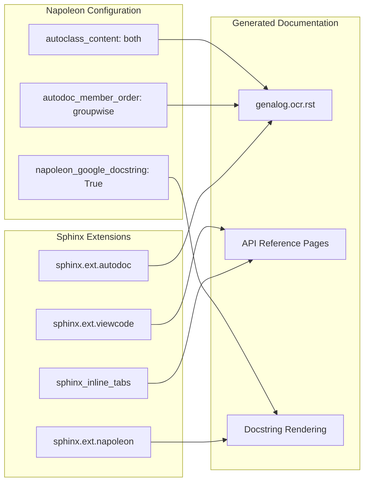
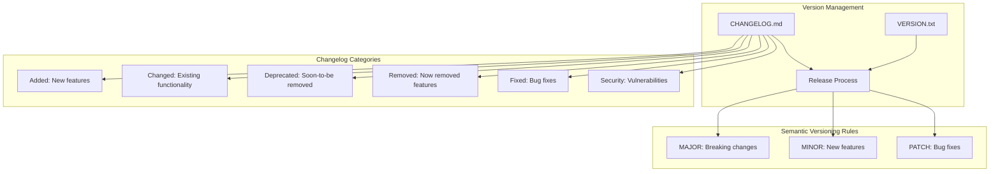
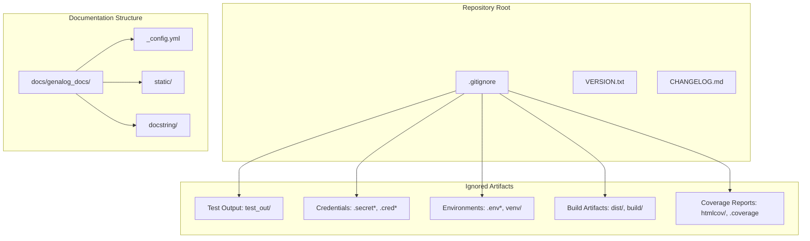
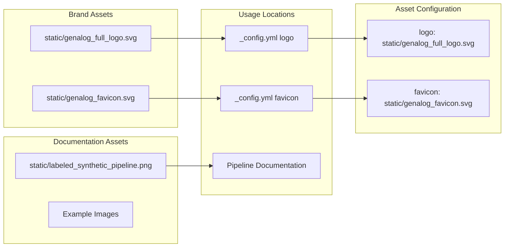
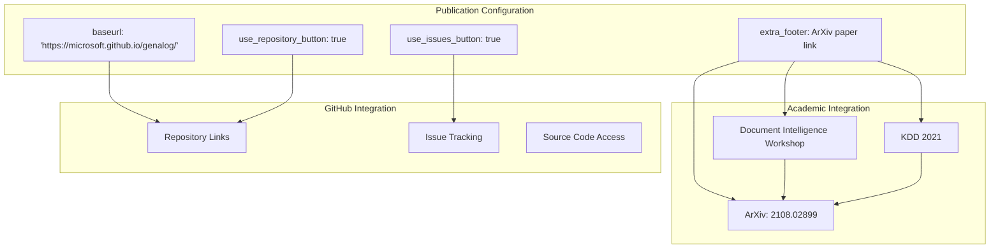
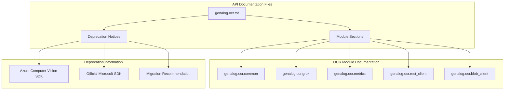

<!-- source: DeepWiki mcp.deepwiki.com · repo microsoft/genalog · page 5 Project Information · fetched 2026-10-26 -->

# Project Information

Relevant source files

The following files were used as context for generating this wiki page:

- [.gitignore](.gitignore)
- [CHANGELOG.md](CHANGELOG.md)
- [VERSION.txt](VERSION.txt)
- [docs/genalog_docs/_config.yml](docs/genalog_docs/_config.yml)
- [docs/genalog_docs/docstring/genalog.ocr.rst](docs/genalog_docs/docstring/genalog.ocr.rst)
- [docs/genalog_docs/e2e_dataset_pipeline.md](docs/genalog_docs/e2e_dataset_pipeline.md)

This document covers the configuration, assets, versioning, and metadata that define the genalog project infrastructure. This includes the Jupyter Book documentation system setup, version management processes, repository organization, and project branding elements.

For information about the core genalog functionality and system architecture, see [System Architecture](#1.2). For development workflow and testing infrastructure, see [Development](#3).

## Documentation System Configuration

The genalog project uses Jupyter Book to generate its documentation website, configured through a centralized YAML configuration file that defines the book structure, execution settings, and publishing parameters.

### Jupyter Book Configuration Structure

```mermaid
graph TB
    subgraph "Documentation Configuration"
        A["_config.yml"]
        B["Book Metadata"]
        C["Execute Settings"]
        D["Repository Integration"]
        E["HTML Settings"]
        F["Sphinx Extensions"]
    end
    
    subgraph "Book Metadata"
        G["title: ''"]
        H["author: 'Jianjie Liu and Amit Gupte'"]
        I["logo: 'static/genalog_full_logo.svg'"]
        J["description: 'Guide for end-to-end synthetic analog document generation'"]
    end
    
    subgraph "Execution Configuration"
        K["execute_notebooks: off"]
        L["notebook_interface: 'notebook'"]
    end
    
    subgraph "Repository Links"
        M["url: 'https://github.com/microsoft/genalog'"]
        N["path_to_book: '/docs/genalog_docs'"]
        O["branch: 'main'"]
    end
    
    subgraph "HTML Output"
        P["favicon: 'static/genalog_favicon.svg'"]
        Q["baseurl: 'https://microsoft.github.io/genalog/'"]
        R["use_repository_button: true"]
        S["use_issues_button: true"]
    end
    
    A --> B
    A --> C
    A --> D
    A --> E
    A --> F
    
    B --> G
    B --> H
    B --> I
    B --> J
    
    C --> K
    C --> L
    
    D --> M
    D --> N
    D --> O
    
    E --> P
    E --> Q
    E --> R
    E --> S
```

The documentation system is configured with notebook execution disabled (`execute_notebooks: off`) to ensure consistent builds and prevent execution dependencies during documentation generation. The configuration enables direct GitHub integration through repository buttons and issue tracking links.

**Sources:** [docs/genalog_docs/_config.yml:1-44]()

### Sphinx API Documentation

The system uses Google-style docstrings (`napoleon_google_docstring: True`) and groups class members logically (`autodoc_member_order: groupwise`). The `autoclass_content: both` setting includes both the class docstring and `__init__` method documentation.

**Sources:** [docs/genalog_docs/_config.yml:34-43](), [docs/genalog_docs/docstring/genalog.ocr.rst:1-35]()

## Version Management and Release Process

The project follows semantic versioning with a centralized version file and structured changelog management.

### Version Control Structure

| Component | Location | Format | Current Value |
|-----------|----------|--------|---------------|
| Version Number | `VERSION.txt` | `x.y.z` | `0.1.0` |
| Release Notes | `CHANGELOG.md` | Keep a Changelog | v0.1.0 |
| Versioning Scheme | - | Semantic Versioning | `MAJOR.MINOR.PATCH` |

The changelog follows the "Keep a Changelog" format with categorized change types. The initial release (v0.1.0) includes HTML document templates, image degradation effects, text alignment algorithms, and end-to-end NER-OCR labeling capabilities.

**Sources:** [VERSION.txt:1](), [CHANGELOG.md:1-23]()

## Repository Structure and Metadata

The repository uses standard Python project conventions with comprehensive gitignore rules for development artifacts, credentials, and build outputs.

### Repository Organization

The gitignore configuration protects sensitive information including secrets (`.secret*`, `.cred*`), environment configurations (`.env*`), and development artifacts like test outputs and coverage reports.

**Sources:** [.gitignore:1-155]()

### Asset Management

Project branding assets are centralized in the `static/` directory and referenced through the Jupyter Book configuration. The logo appears in the documentation header while the favicon provides browser tab identification.

**Sources:** [docs/genalog_docs/_config.yml:3,26](), [docs/genalog_docs/e2e_dataset_pipeline.md:3-4]()

## Publication and Distribution Configuration

The project is configured for publication through GitHub Pages with integration to academic research and PyPI distribution.

### Publication Channels

| Channel | URL | Purpose |
|---------|-----|---------|
| GitHub Pages | `https://microsoft.github.io/genalog/` | Primary documentation |
| ArXiv Paper | `https://arxiv.org/abs/2108.02899` | Academic publication |
| GitHub Repository | `https://github.com/microsoft/genalog` | Source code |
| PyPI Package | `pip install genalog` | Distribution |

The documentation footer prominently links to the academic paper from the Document Intelligence Workshop at KDD 2021, establishing the research context for the synthetic document generation methodology.

**Sources:** [docs/genalog_docs/_config.yml:28-32]()

## API Documentation Generation

The project uses automated API documentation generation through Sphinx with reStructuredText files that define module organization and deprecation notices.

### Module Documentation Structure

The OCR module documentation includes explicit deprecation warnings directing users toward the official Azure Computer Vision SDK, indicating the project's evolution toward standard Microsoft tooling.

**Sources:** [docs/genalog_docs/docstring/genalog.ocr.rst:1-35]()

---

