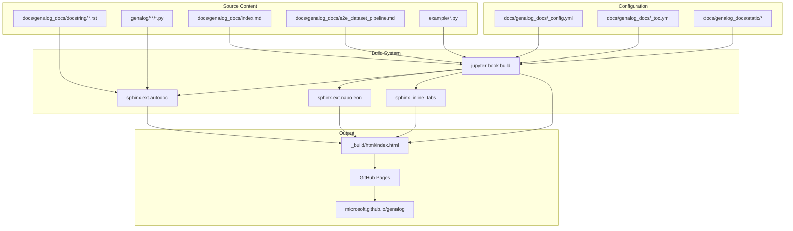
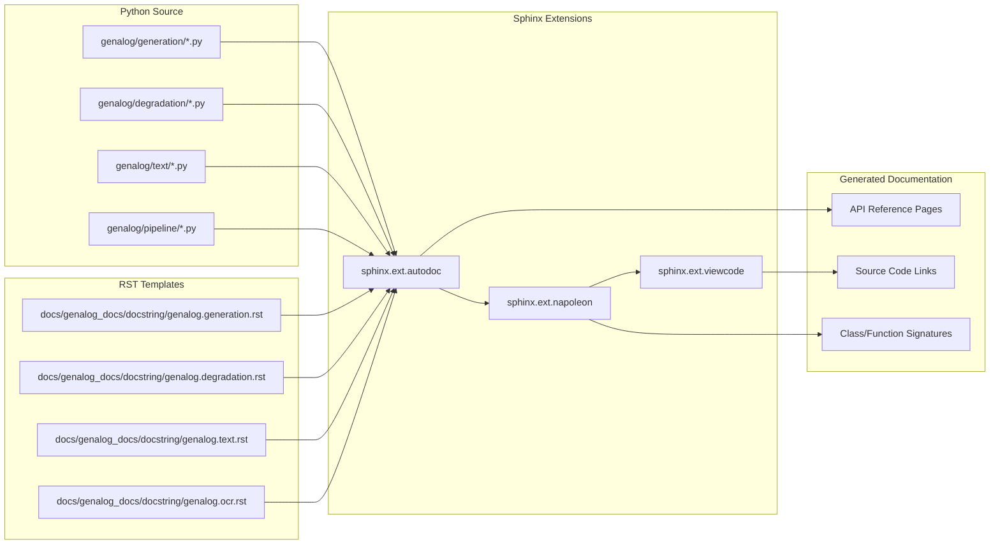

<!-- source: DeepWiki mcp.deepwiki.com · repo microsoft/genalog · page 5.1 Documentation · fetched 2026-10-26 -->

# Documentation

<details>
<summary>Relevant source files</summary>

The following files were used as context for generating this wiki page:

- [docs/genalog_docs/_config.yml](docs/genalog_docs/_config.yml)
- [docs/genalog_docs/docstring/genalog.ocr.rst](docs/genalog_docs/docstring/genalog.ocr.rst)
- [docs/genalog_docs/e2e_dataset_pipeline.md](docs/genalog_docs/e2e_dataset_pipeline.md)
- [docs/genalog_docs/index.md](docs/genalog_docs/index.md)
- [docs/genalog_docs/static/genalog_demo.gif](docs/genalog_docs/static/genalog_demo.gif)
- [example/demo_generate.py](example/demo_generate.py)

</details>


This page covers the documentation system for the genalog project, including Jupyter Book configuration, API reference generation, and the documentation publishing pipeline. The documentation system transforms source code, docstrings, and markdown files into a comprehensive web-based guide hosted on GitHub Pages.

For information about project assets and branding elements, see [Project Assets](#5.2). For examples and tutorials that comprise the user-facing documentation content, see [Examples and Tutorials](#4).

## Documentation Architecture

The genalog documentation system is built using Jupyter Book, which combines Sphinx documentation generation with modern web publishing capabilities. The system automatically generates API references from Python docstrings and integrates tutorial content written in Markdown.



**Documentation Build Architecture**

The documentation system processes multiple content types through Jupyter Book's unified build pipeline, generating a static website that integrates hand-written guides with automatically generated API documentation.

Sources: [docs/genalog_docs/_config.yml:1-44](), [docs/genalog_docs/index.md:1-100](), [docs/genalog_docs/docstring/genalog.ocr.rst:1-36]()

## Jupyter Book Configuration

The documentation system is configured through `_config.yml`, which controls build behavior, publication settings, and Sphinx extensions. The configuration enables several key features for the genalog documentation.

### Core Configuration

| Setting | Value | Purpose |
|---------|--------|---------|
| `title` | `''` | Empty to use logo instead of text title |
| `author` | `"Jianjie Liu and Amit Gupte"` | Primary maintainers |
| `logo` | `static/genalog_full_logo.svg` | Brand identity in navigation |
| `execute_notebooks` | `off` | Prevents execution during build |

### Publication Settings

The documentation is published to GitHub Pages with specific URL configuration:

```yaml
repository:
  url: https://github.com/microsoft/genalog
  path_to_book: /docs/genalog_docs
  branch: main

html:
  baseurl: https://microsoft.github.io/genalog/
  use_repository_button: true
  use_issues_button: true
```

Sources: [docs/genalog_docs/_config.yml:1-44]()

## API Reference Generation

The documentation system automatically generates API references from Python docstrings using Sphinx extensions. This process transforms inline code documentation into structured web pages.



**API Documentation Generation Pipeline**

The system processes Python modules through Sphinx autodoc, which extracts docstrings and generates formatted documentation pages with cross-references and source code links.

### Sphinx Extension Configuration

The documentation system uses several Sphinx extensions for enhanced functionality:

| Extension | Purpose | Configuration |
|-----------|---------|---------------|
| `sphinx.ext.autodoc` | Extracts docstrings from Python modules | `autodoc_member_order: groupwise` |
| `sphinx.ext.napoleon` | Parses Google-style docstrings | `napoleon_google_docstring: True` |
| `sphinx.ext.viewcode` | Adds source code links | Automatic linking enabled |
| `sphinx_inline_tabs` | Enables tabbed content | Used for examples and comparisons |

Sources: [docs/genalog_docs/_config.yml:34-44](), [docs/genalog_docs/docstring/genalog.ocr.rst:1-36]()

## Static Assets and Branding

The documentation includes several static assets that provide branding and visual elements throughout the site.

### Asset Configuration

| Asset Type | File Path | Usage |
|------------|-----------|--------|
| Logo | `static/genalog_full_logo.svg` | Main navigation logo |
| Favicon | `static/genalog_favicon.svg` | Browser tab icon |
| Demo Animation | `static/genalog_demo.gif` | Landing page demonstration |
| Example Images | `static/*.png` | Template and degradation examples |

### Visual Content Organization

The documentation uses tabbed interfaces to organize visual examples effectively:

```markdown
````{tab} Multi-Column
```{figure} static/columns_Times_11px.png
:width: 60%
Document template with 2 columns 
```
````
```

This pattern allows users to compare different document templates and degradation effects within a compact interface.

Sources: [docs/genalog_docs/index.md:21-96](), [docs/genalog_docs/_config.yml:25-26]()

## Integration with Development Workflow

The documentation system integrates with the broader development infrastructure to ensure consistency and accuracy.

### Build Integration

The documentation build process connects with several development components:

- **Version Control**: Documentation tracks with main branch changes
- **CI/CD Pipelines**: Automated builds on documentation changes  
- **Package Releases**: API documentation reflects current codebase state
- **Example Code**: Tutorial notebooks reference actual working examples

### Content Synchronization

The system maintains consistency between code and documentation through:

| Mechanism | Implementation | Purpose |
|-----------|----------------|---------|
| Autodoc | Sphinx extension | Syncs API docs with source code |
| Example Scripts | `example/*.py` files | Provides working code samples |
| Version Tracking | `VERSION.txt` integration | Matches docs to software versions |

Sources: [docs/genalog_docs/_config.yml:16-20](), [example/demo_generate.py:1-39]()

## Documentation Maintenance

The documentation system requires minimal maintenance but benefits from regular updates to ensure accuracy and completeness.

### Content Updates

Documentation content updates follow these patterns:

1. **API Changes**: Automatically reflected through autodoc regeneration
2. **Tutorial Updates**: Manual updates to markdown files as features evolve  
3. **Example Scripts**: Periodic validation that examples execute correctly
4. **Asset Updates**: Replacement of images when visual changes occur

### Publication Process

The documentation publishes automatically to GitHub Pages when changes are committed to the main branch. The build process generates static HTML files that are served directly from the repository.

Sources: [docs/genalog_docs/_config.yml:28-32](), [docs/genalog_docs/e2e_dataset_pipeline.md:1-13]()

---

