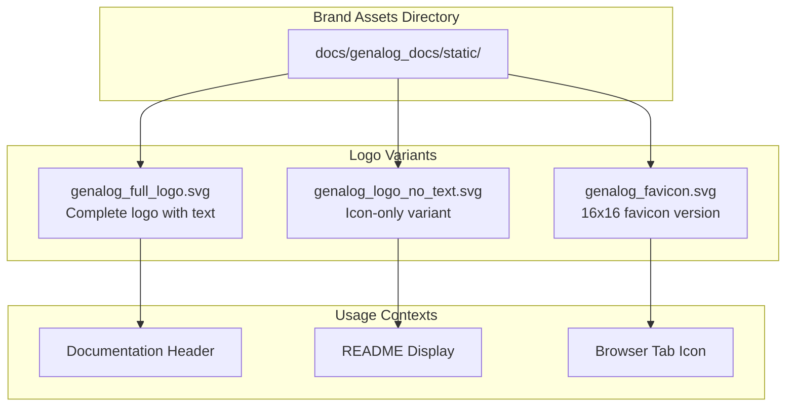
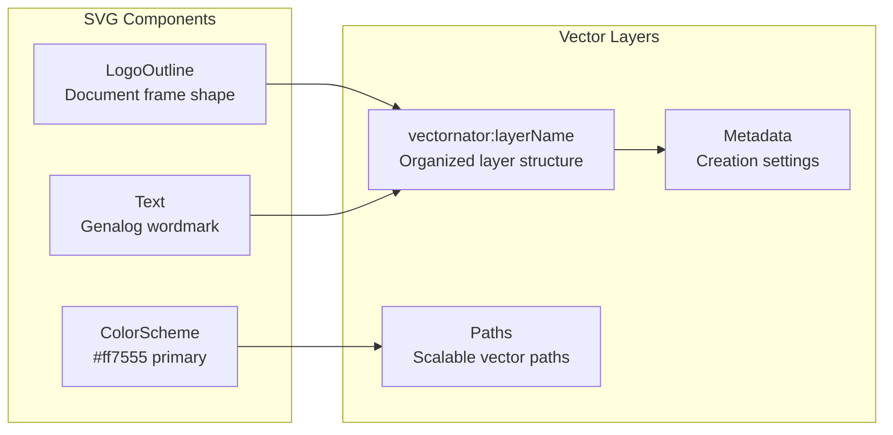
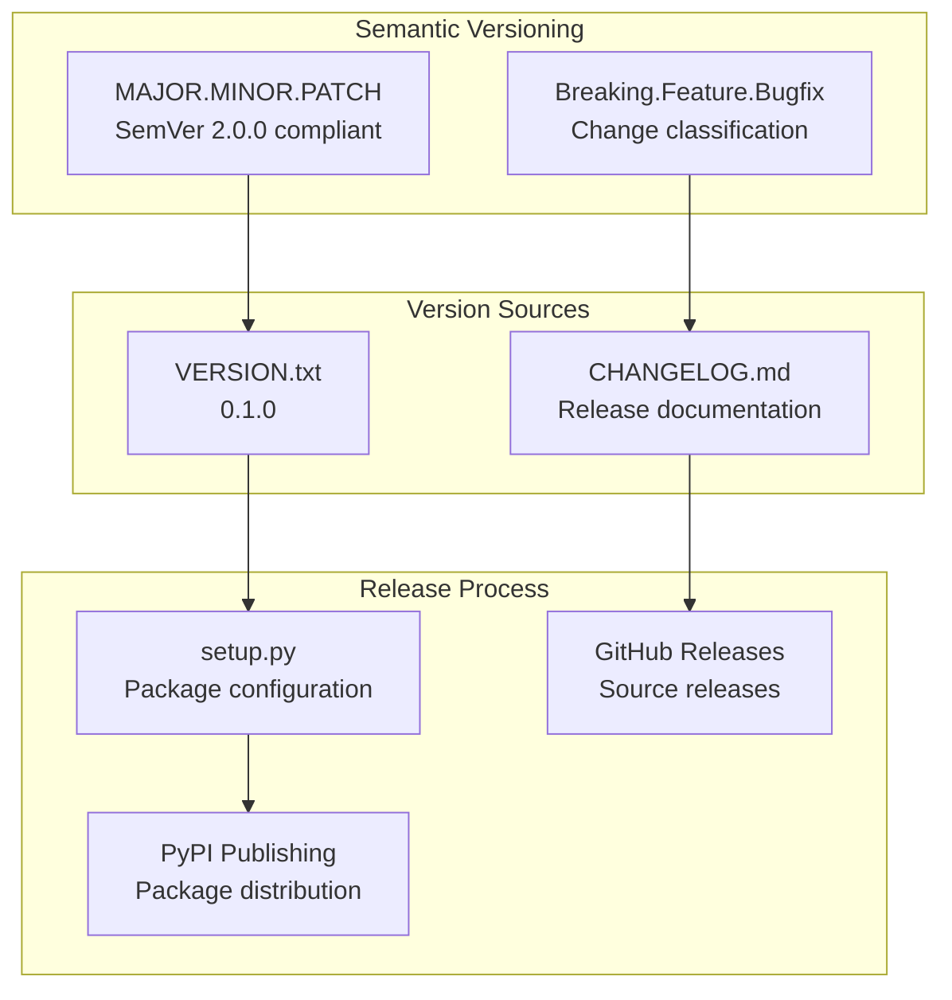
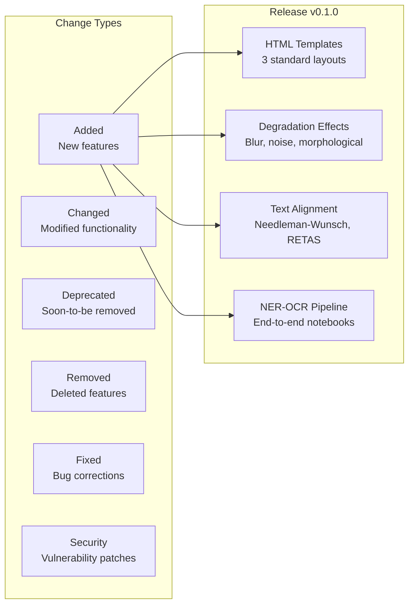
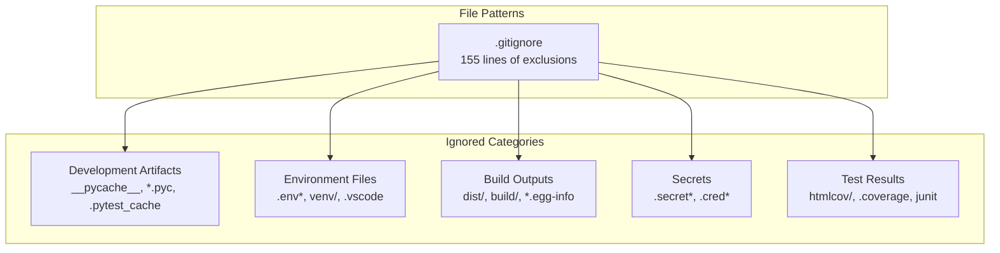
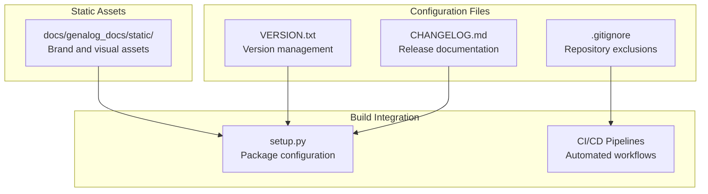

<!-- source: DeepWiki mcp.deepwiki.com · repo microsoft/genalog · page 5.2 Project Assets · fetched 2026-10-26 -->

# Project Assets

Relevant source files

The following files were used as context for generating this wiki page:

- [.gitignore](.gitignore)
- [CHANGELOG.md](CHANGELOG.md)
- [VERSION.txt](VERSION.txt)
- [docs/genalog_docs/static/genalog_favicon.svg](docs/genalog_docs/static/genalog_favicon.svg)
- [docs/genalog_docs/static/genalog_full_logo.svg](docs/genalog_docs/static/genalog_full_logo.svg)
- [docs/genalog_docs/static/genalog_logo_no_text.svg](docs/genalog_docs/static/genalog_logo_no_text.svg)

This document covers the visual branding elements, versioning scheme, and repository configuration files that support the genalog project infrastructure. These assets include logos, version management files, and development configuration.

For information about documentation build configuration, see [Documentation](#5.1). For CI/CD pipeline assets, see [CI/CD Pipelines](#3.2).

## Brand Identity

The genalog project maintains a consistent visual identity through a set of SVG-based logo assets stored in the documentation static files directory.

### Logo Variants

The logo design features a stylized document icon with the "genalog" wordmark, using the primary brand color `#ff7555` (orange-red). Each variant serves specific display contexts:

| Asset | Dimensions | Purpose |
|-------|------------|---------|
| `genalog_full_logo.svg` | 1600x800 | Main documentation and promotional use |
| `genalog_logo_no_text.svg` | 1200x800 | Compact spaces where text is separate |
| `genalog_favicon.svg` | 16x16 | Browser favicon and small icon contexts |

Sources: [docs/genalog_docs/static/genalog_full_logo.svg:1-63](), [docs/genalog_docs/static/genalog_logo_no_text.svg:1-155](), [docs/genalog_docs/static/genalog_favicon.svg:1-44]()

### Logo Structure

All logos are created as scalable vector graphics with organized layer structures, ensuring consistent reproduction across different sizes and contexts.

Sources: [docs/genalog_docs/static/genalog_full_logo.svg:22-62](), [docs/genalog_docs/static/genalog_logo_no_text.svg:22-47]()

## Version Management

The project implements semantic versioning through a centralized version file and comprehensive changelog tracking.

### Version System Architecture

### Version File Structure

The version is maintained in a single source file for consistency across the build system:

| File | Content | Purpose |
|------|---------|---------|
| `VERSION.txt` | `0.1.0` | Canonical version string |
| `CHANGELOG.md` | Structured release notes | Human-readable change documentation |

Sources: [VERSION.txt:1](), [CHANGELOG.md:1-23]()

### Changelog Format

The changelog follows the [Keep a Changelog](https://keepachangelog.com/en/1.0.0/) standard with categorized changes:

Sources: [CHANGELOG.md:15-22]()

## Repository Configuration

The project maintains development standards through configuration files that define ignored files, build artifacts, and development environment settings.

### Gitignore Configuration

### Configuration Categories

| Category | Patterns | Purpose |
|----------|----------|---------|
| Python artifacts | `__pycache__/`, `*.py[cod]`, `*.egg-info/` | Compiled Python files |
| Virtual environments | `venv/`, `.env*`, `env.bak/` | Local development isolation |
| IDE files | `.vscode`, `.spyderproject` | Editor-specific configurations |
| Security | `.secret*`, `.cred*` | Credential protection |
| Testing | `.pytest_cache`, `htmlcov/`, `.coverage` | Test execution artifacts |
| Documentation | `docs/_build/`, `/site` | Generated documentation |

Sources: [.gitignore:1-155]()

### Asset Organization

The project assets are organized to support both development workflows and package distribution, with clear separation between visual branding, version management, and repository configuration concerns.

Sources: [docs/genalog_docs/static/genalog_full_logo.svg:1](), [VERSION.txt:1](), [CHANGELOG.md:1](), [.gitignore:1]()