# Page: Overview

# Overview

<details>
<summary>Relevant source files</summary>

The following files were used as context for generating this wiki page:

- [README.md](README.md)
- [docs/genalog_docs/index.md](docs/genalog_docs/index.md)
- [docs/genalog_docs/static/genalog_demo.gif](docs/genalog_docs/static/genalog_demo.gif)
- [example/demo_generate.py](example/demo_generate.py)

</details>


## Purpose and Scope

This document provides a high-level introduction to genalog, a Python package for generating synthetic document images that simulate the characteristics of scanned analog documents. Genalog enables researchers and developers to create realistic training datasets for optical character recognition (OCR) and natural language processing (NLP) models by applying controlled degradations to clean text documents.

For installation instructions and quick start examples, see [Getting Started](#1.1). For detailed system design and module relationships, see [System Architecture](#1.2).

## System Capabilities

Genalog provides four core capabilities for synthetic document generation and analysis:

| Capability | Description | Primary Module |
|------------|-------------|----------------|
| **Flexible Image Generation** | Convert text to document images using HTML templates with customizable styling | `genalog.generation` |
| **Custom Image Degradation** | Apply synthetic noise, blur, artifacts, and other degradations to simulate scanning effects | `genalog.degradation` |
| **OCR Text Extraction** | Extract text from images using Azure Cognitive Search pipeline | `genalog.ocr` (deprecated) |
| **Text Alignment & Metrics** | Align OCR output with ground truth text and calculate performance metrics | `genalog.text` |

The system operates in maintenance mode with limited support, focusing on providing a stable platform for synthetic document research.

Sources: [README.md:13-19](), [README.md:5](), [README.md:9]()

## Core System Architecture

The following diagram shows the main modules and their relationships within the genalog system:

### Genalog Module Architecture

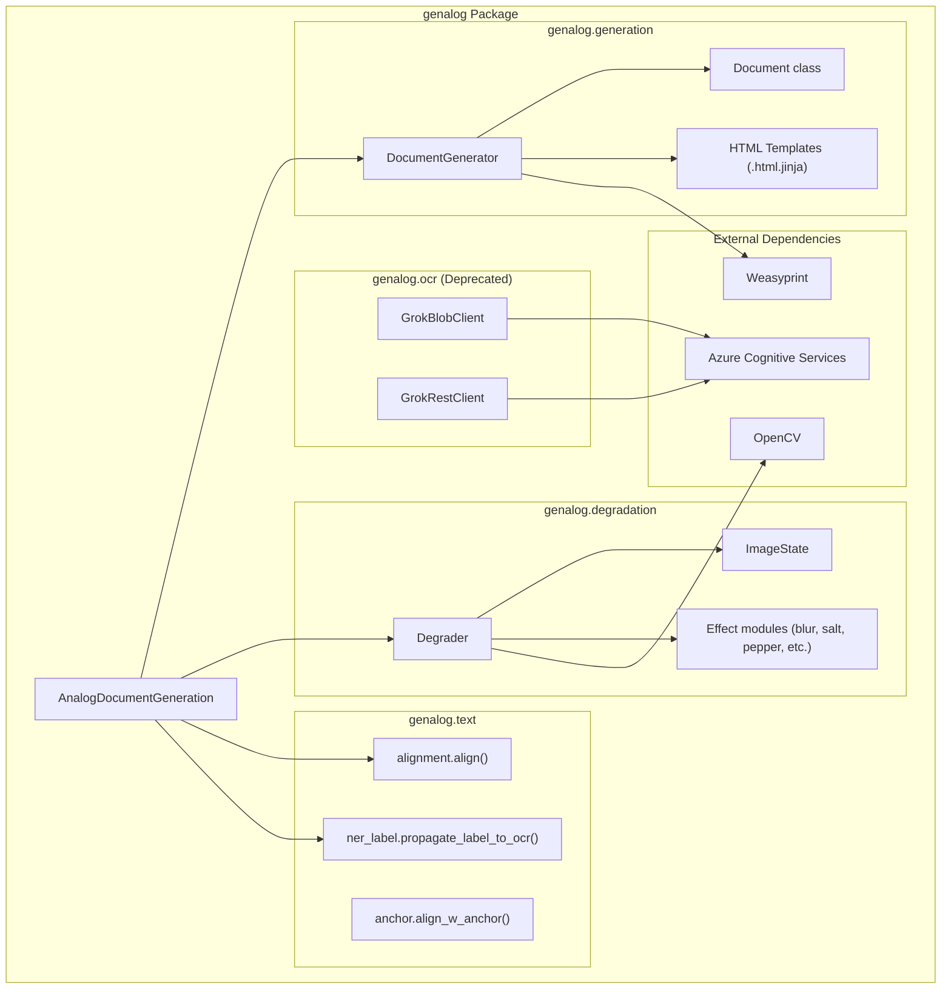

The `AnalogDocumentGeneration` class serves as the main orchestrator, coordinating document generation through `DocumentGenerator`, applying degradations via `Degrader`, and enabling text processing through the `genalog.text` module.

Sources: [example/demo_generate.py:2](), [README.md:102-106](), [example/demo_generate.py:30]()

## Data Processing Pipeline

### End-to-End Document Generation Flow

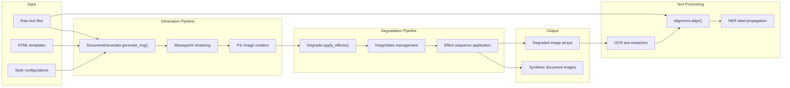

This pipeline transforms clean text through HTML template rendering, applies realistic degradations, and provides tools for aligning the resulting OCR output with ground truth text for training data generation.

Sources: [example/demo_generate.py:31](), [example/demo_generate.py:18-28](), [README.md:47-64]()

## Key Use Cases and Applications

### Primary Application Scenarios

1. **Synthetic Dataset Generation**: Create labeled training datasets for OCR and NER models by generating clean documents, applying degradations, and propagating labels through the text alignment process.

2. **OCR Model Evaluation**: Generate test datasets with known ground truth to benchmark OCR system performance under various degradation conditions.

3. **Document Understanding Research**: Develop robust NLP models that can handle real-world OCR errors by training on synthetic data with controlled noise characteristics.

### Configuration Example

The system uses declarative configuration for document generation:

```python
# Style combinations for document generation
STYLE_COMBINATIONS = {
    "font_family": ["Times"],
    "font_size": ["12px"], 
    "text_align": ["justify"],
    "language": ["en_US"],
    "hyphenate": [True],
}

# Degradation effects applied sequentially
DEGRADATIONS = [
    ("blur", {"radius": 5}),
    ("bleed_through", {"alpha": 0.8}),
    ("morphology", {"operation": "open"}),
    ("pepper", {"amount": 0.05}),
]
```

This configuration-driven approach enables systematic exploration of document variations and degradation effects for research purposes.

Sources: [example/demo_generate.py:8-14](), [example/demo_generate.py:18-28](), [README.md:66-74]()

## Integration Requirements

Genalog integrates with several external systems and services:

- **Weasyprint**: HTML-to-image rendering engine requiring system-level dependencies (`Pango`, `cairo`, `GDK-PixBuf`)
- **Azure Cognitive Services**: Cloud-based OCR processing (optional, through deprecated `genalog.ocr` module)
- **OpenCV**: Image processing and degradation effects
- **BioPython**: Sequence alignment algorithms for text processing

The package supports Python 3.6+ and is primarily tested on Linux-64 platforms, with additional installation steps required for macOS and Windows environments.

Sources: [README.md:32-38](), [README.md:3](), [README.md:79-83]()

---

# Page: Getting Started

# Getting Started

<details>
<summary>Relevant source files</summary>

The following files were used as context for generating this wiki page:

- [README.md](README.md)
- [example/dataset_generation.ipynb](example/dataset_generation.ipynb)
- [example/generation_pipeline.ipynb](example/generation_pipeline.ipynb)
- [example/static/analog_doc_gen_pipeline.png](example/static/analog_doc_gen_pipeline.png)
- [genalog/degradation/README.md](genalog/degradation/README.md)
- [genalog/text/README.md](genalog/text/README.md)

</details>


This document provides installation instructions, basic usage examples, and a quick start guide for new users of genalog. It covers the essential steps to generate synthetic document images with degradation effects that mimic real-world scanned documents.

For detailed information about individual system components, see [Core Components](#2). For development workflows and testing, see [Development](#3). For comprehensive examples and tutorials, see [Examples and Tutorials](#4).

## Purpose and Overview

Genalog is a synthetic document generation system that creates document images with realistic noise and degradation effects. The system transforms clean text into document images through HTML rendering, applies controlled degradation effects, and provides tools for OCR processing and text alignment to create training datasets for document understanding models.

**Quick Start Pipeline Diagram**
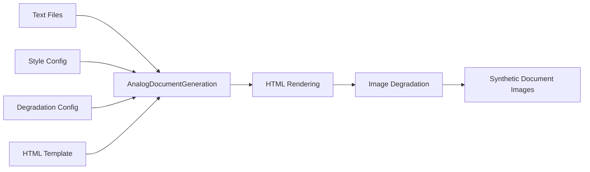

Sources: [README.md:5-20](), [example/generation_pipeline.ipynb:32-39]()

## Installation

### Basic Installation

Install the latest release from PyPI:

```bash
pip install genalog
```

### System Dependencies

Genalog depends on Weasyprint for HTML-to-image rendering, which requires additional system libraries:

| Operating System | Requirements |
|------------------|--------------|
| Ubuntu 18.04+ | Libraries available by default |
| macOS/Windows | Install Pango, cairo, and GDK-PixBuf separately |

For detailed installation instructions for non-Ubuntu systems, refer to the [WeasyPrint documentation](https://weasyprint.readthedocs.io/en/stable/install.html).

**Common Installation Issues:**
- Error: `no library called "libcairo-2" was found` indicates missing system dependencies

Sources: [README.md:24-38]()

## Quick Start Example

### Basic Document Generation

The following example demonstrates the core genalog workflow using the `AnalogDocumentGeneration` class:

```python
from genalog.pipeline import AnalogDocumentGeneration

# Define document styling
STYLE_COMBINATIONS = {
    "language": ["en_US"],
    "font_family": ["Segoe UI"],
    "font_size": ["12px"],
    "text_align": ["justify"],
    "hyphenate": [True, False],
}

# Define degradation effects sequence
DEGRADATIONS = [
    ("blur", {"radius": 3}),
    ("bleed_through", {"alpha": 0.8}),
    ("morphology", {"operation": "open", "kernel_shape": (3,3), "kernel_type": "ones"}),
]

# Initialize pipeline
doc_generation = AnalogDocumentGeneration(
    styles=STYLE_COMBINATIONS,
    degradations=DEGRADATIONS,
    resolution=300  # DPI
)

# Generate image from text file
img_array = doc_generation.generate_img(
    "path/to/text_file.txt",
    "text_block.html.jinja",
    target_folder=None  # Returns image array instead of saving
)
```

**Core Classes and Methods Diagram**
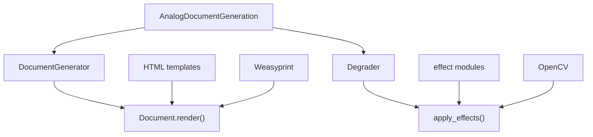

Sources: [example/generation_pipeline.ipynb:49-87](), [example/generation_pipeline.ipynb:115-136]()

### Batch Processing

For processing multiple files efficiently:

```python
from genalog.pipeline import generate_dataset_multiprocess

# Process multiple text files
text_files = ["file1.txt", "file2.txt", "file3.txt"]
output_directory = "output/images/"

generate_dataset_multiprocess(
    text_files,
    output_directory,
    STYLE_COMBINATIONS,
    DEGRADATIONS,
    "text_block.html.jinja",
    resolution=300,
    batch_size=5
)
```

Sources: [example/generation_pipeline.ipynb:200-208]()

## Core Workflow Components

### 1. Style Configuration

The `STYLE_COMBINATIONS` dictionary defines CSS properties applied to documents:

| Parameter | Description | Example Values |
|-----------|-------------|----------------|
| `font_family` | CSS font family | `["Times", "Arial", "Segoe UI"]` |
| `font_size` | CSS font size | `["10px", "12px", "14px"]` |
| `text_align` | Text alignment | `["left", "center", "justify"]` |
| `hyphenate` | Enable hyphenation | `[True, False]` |
| `language` | Document language | `["en_US", "en_GB"]` |

### 2. Degradation Effects

The `DEGRADATIONS` list applies effects sequentially. Each effect is a tuple of `(effect_name, parameters)`:

```python
from genalog.degradation.degrader import ImageState

DEGRADATIONS = [
    ("morphology", {"operation": "open", "kernel_shape": (9,9), "kernel_type": "plus"}),
    ("salt", {"amount": 0.7}),
    ("overlay", {
        "src": ImageState.ORIGINAL_STATE,
        "background": ImageState.CURRENT_STATE,
    }),
    ("blur", {"radius": 5}),
]
```

**Degradation Pipeline Diagram**
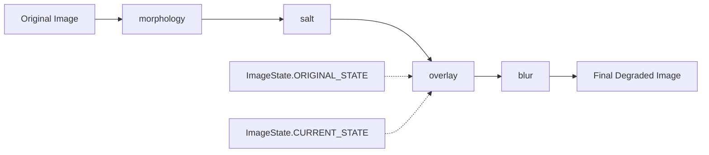

### 3. HTML Templates

Built-in templates available in [genalog/generation/templates/](genalog/generation/templates/):

- `text_block.html.jinja` - Simple text block layout
- `columns.html.jinja` - Multi-column layout  
- `letter.html.jinja` - Letter format layout

Sources: [example/generation_pipeline.ipynb:140-155](), [example/dataset_generation.ipynb:169-175]()

## End-to-End Dataset Generation

For complete synthetic dataset creation including OCR and label propagation:

**Complete Dataset Pipeline Diagram**
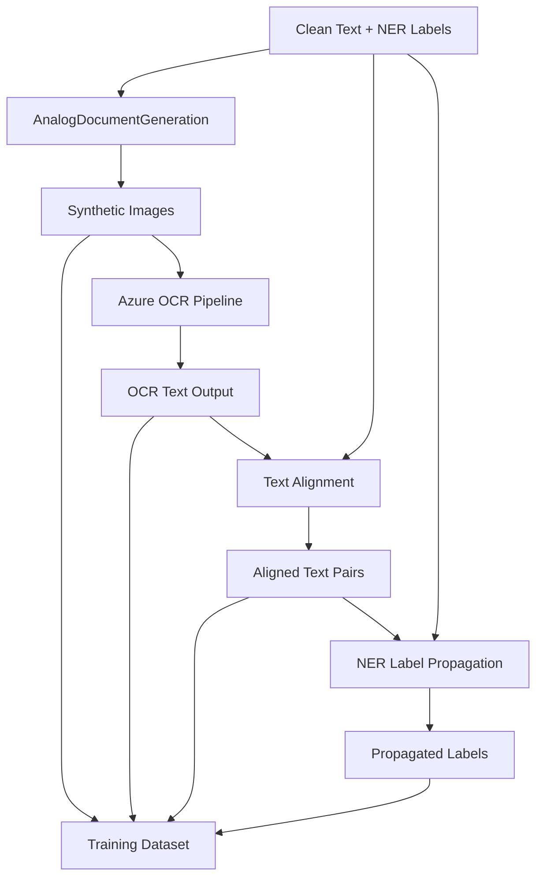

Key classes for advanced workflows:
- `genalog.text.alignment.align()` - Needleman-Wunsch alignment
- `genalog.text.anchor.align_w_anchor()` - RETAS alignment for longer texts
- `genalog.text.ner_label.propagate_label_to_ocr()` - Label propagation

Sources: [example/dataset_generation.ipynb:7-13](), [genalog/text/README.md:1-11]()

## Available Templates and Effects

### HTML Templates

Template files in [genalog/generation/templates/](genalog/generation/templates/):
- `columns.html.jinja`
- `letter.html.jinja` 
- `text_block.html.jinja`

### Degradation Effects

Effect modules in [genalog/degradation/effect/](genalog/degradation/effect/):
- `blur()` - Document blurring
- `bleed_through()` - Ink seepage simulation
- `salt()` and `pepper()` - Salt and pepper noise
- `morphology()` - Erosion, dilation, opening, closing
- `overlay()` - Image overlay operations

Sources: [genalog/degradation/README.md:74-233]()

## Next Steps

1. **Explore Core Components**: See [Document Generation](#2.1) for HTML template customization
2. **Advanced Degradation**: See [Image Degradation](#2.2) for complex effect configurations  
3. **Text Processing**: See [Text Processing](#2.3) for alignment and NER label propagation
4. **Complete Examples**: See [Examples and Tutorials](#4) for end-to-end workflows
5. **Development Setup**: See [Development](#3) for contributing to the project

For Azure OCR integration and metrics calculation, the system provides deprecated modules in [genalog/ocr/](genalog/ocr/) that are now superseded by direct Azure SDK integration.

Sources: [README.md:40-75](), [example/generation_pipeline.ipynb:1-218]()

---

# Page: System Architecture

# System Architecture

<details>
<summary>Relevant source files</summary>

The following files were used as context for generating this wiki page:

- [README.md](README.md)
- [genalog/pipeline.py](genalog/pipeline.py)

</details>


This document describes the overall system design, module relationships, and data flow patterns within the genalog codebase. It covers the core architectural components, their interactions, and how data flows through the synthetic document generation pipeline.

For installation and basic usage information, see [Getting Started](#1.1). For detailed module-specific documentation, see [Core Components](#2).

## Overview

Genalog implements a modular pipeline architecture for synthetic document generation, consisting of four primary processing stages coordinated by a central orchestration layer. The system transforms input text through document generation, image degradation, OCR processing, and text alignment to produce labeled training datasets for machine learning applications.

**Sources:** [README.md:101-113](), [genalog/pipeline.py:28-38]()

## Core Module Architecture

The system is organized into distinct functional modules, each responsible for a specific stage of the document processing pipeline:

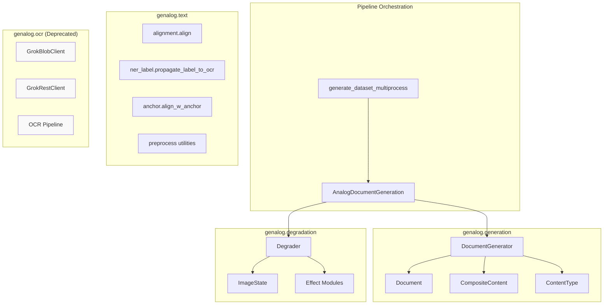

**Module Responsibilities:**

| Module | Primary Classes | Purpose |
|--------|----------------|---------|
| `genalog.pipeline` | `AnalogDocumentGeneration` | Orchestrates end-to-end document generation workflow |
| `genalog.generation` | `DocumentGenerator`, `Document` | Renders HTML templates into document images |
| `genalog.degradation` | `Degrader`, `ImageState` | Applies synthetic noise and artifacts to images |
| `genalog.text` | `align`, `propagate_label_to_ocr` | Handles text alignment and NER label propagation |
| `genalog.ocr` | `GrokBlobClient`, `GrokRestClient` | Legacy Azure OCR integration (deprecated) |

**Sources:** [README.md:102-106](), [genalog/pipeline.py:15-18](), [genalog/pipeline.py:28-35]()

## Data Flow Pipeline

The core data transformation pipeline follows a linear progression from text input to labeled synthetic datasets:

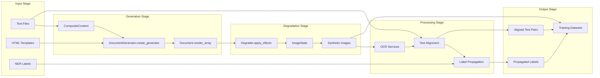

**Key Data Transformations:**

1. **Text → Document**: [genalog/pipeline.py:66-73]() converts raw text files into `CompositeContent` objects
2. **Document → Image**: [genalog/pipeline.py:76]() renders documents as grayscale arrays at specified resolution
3. **Image → Degraded Image**: [genalog/pipeline.py:78]() applies synthetic degradation effects
4. **Image → OCR Text**: External OCR services extract text from degraded images
5. **Text Alignment**: Algorithms align ground truth with OCR output for training data

**Sources:** [genalog/pipeline.py:49-92](), [README.md:15-20]()

## Orchestration Layer

The `AnalogDocumentGeneration` class serves as the primary orchestration component, coordinating the document generation pipeline:

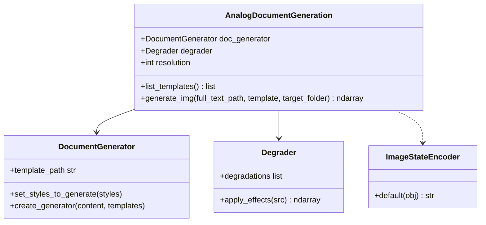

**Core Methods:**

- `generate_img()`: [genalog/pipeline.py:49-92]() - Single document processing pipeline
- `list_templates()`: [genalog/pipeline.py:39-45]() - Available template enumeration
- `generate_dataset_multiprocess()`: [genalog/pipeline.py:130-156]() - Batch processing with parallelization

**Sources:** [genalog/pipeline.py:28-92](), [genalog/pipeline.py:130-156]()

## External Dependencies

The system integrates with several external services and libraries for core functionality:

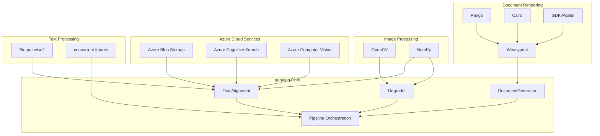

**Critical Dependencies:**

| Component | Purpose | Required For |
|-----------|---------|--------------|
| `Weasyprint` | HTML to image conversion | Document generation |
| `OpenCV` | Image processing operations | Degradation effects |
| `Azure SDK` | Cloud OCR services | Text extraction |
| `Bio.pairwise2` | Sequence alignment algorithms | Text alignment |
| `concurrent.futures` | Parallel processing | Batch operations |

**Sources:** [README.md:32-38](), [README.md:79-83](), [genalog/pipeline.py:7-13]()

## Processing Patterns

### Batch Processing Architecture

The system implements a parallel batch processing pattern for large-scale dataset generation:

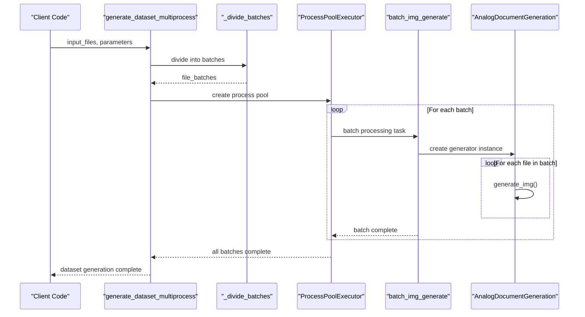

**Key Functions:**

- `_divide_batches()`: [genalog/pipeline.py:94-96]() - Splits input files into processing batches
- `batch_img_generate()`: [genalog/pipeline.py:103-110]() - Worker function for parallel processing
- `_set_batch_generate_args()`: [genalog/pipeline.py:112-127]() - Prepares arguments for parallel execution

**Sources:** [genalog/pipeline.py:130-156](), [genalog/pipeline.py:94-127]()

### Error Handling and Resource Management

The pipeline implements defensive programming patterns for file I/O and resource management:

- **File Operations**: [genalog/pipeline.py:66-67]() uses UTF-8 encoding with explicit file handling
- **Directory Management**: [genalog/pipeline.py:99-100]() ensures output directories exist before writing
- **Error Propagation**: [genalog/pipeline.py:89-90]() raises `RuntimeError` for failed image writes
- **Resource Cleanup**: Process pools automatically manage worker lifecycle and cleanup

**Sources:** [genalog/pipeline.py:66-67](), [genalog/pipeline.py:89-90](), [genalog/pipeline.py:99-100]()

---

# Page: Core Components

# Core Components

<details>
<summary>Relevant source files</summary>

The following files were used as context for generating this wiki page:

- [README.md](README.md)
- [genalog/pipeline.py](genalog/pipeline.py)

</details>


This page documents the main functional modules that comprise the genalog system for synthetic document generation and processing. It covers the implementation architecture, key classes, and integration patterns of the core processing pipeline.

For high-level system architecture and data flow, see [System Architecture](#1.2). For specific module usage examples, see [Examples and Tutorials](#4).

## Component Overview

The genalog system consists of five primary modules that work together to transform text into synthetic documents with controlled degradations:

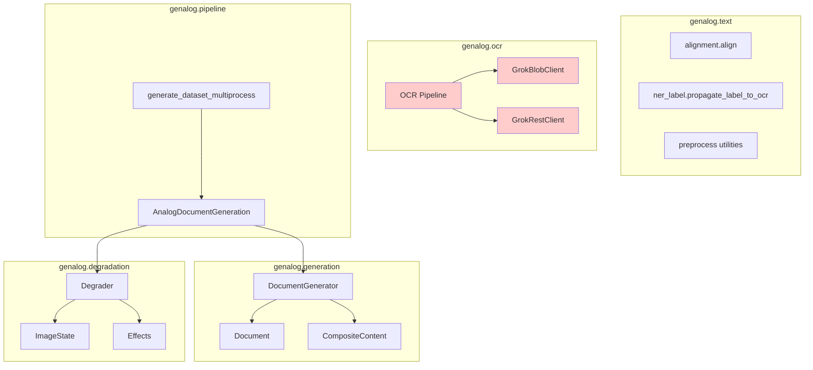

Sources: [README.md:101-114](), [genalog/pipeline.py:15-18]()

## Processing Pipeline Architecture

The core processing flow follows a clear sequence from text input to final output, with each component handling specific transformations:

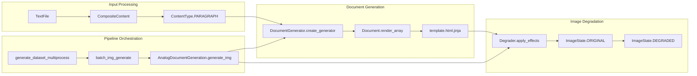

Sources: [genalog/pipeline.py:49-91](), [genalog/pipeline.py:130-156]()

## Document Generation Module

The `genalog.generation` module handles conversion from text content to rendered document images using HTML templates and styling systems.

### Key Components

| Class | Purpose | Key Methods |
|-------|---------|-------------|
| `DocumentGenerator` | Orchestrates document creation from templates | `create_generator()`, `set_styles_to_generate()` |
| `Document` | Represents a styled document instance | `render_array()` |
| `CompositeContent` | Structures input text with content types | Constructor with text arrays and types |

The generation process follows this pattern:

1. Text files are loaded and wrapped in `CompositeContent` with `ContentType.PARAGRAPH`
2. `DocumentGenerator.create_generator()` creates a generator for style combinations
3. `Document.render_array()` produces numpy arrays with specified resolution and channel settings

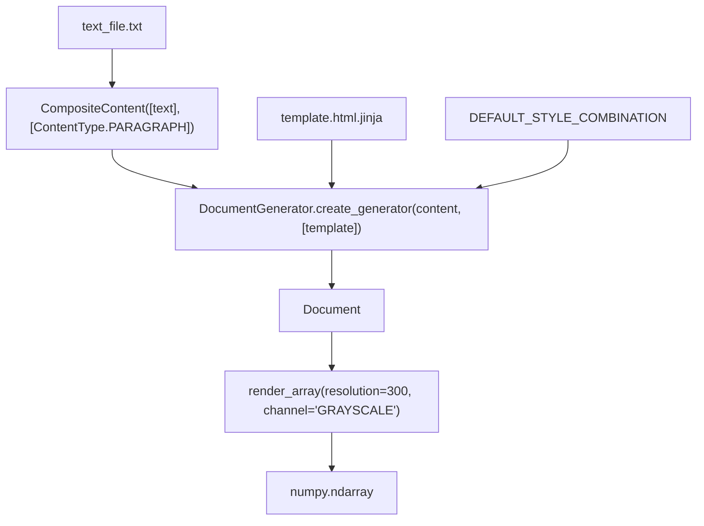

Sources: [genalog/pipeline.py:66-76](), [genalog/pipeline.py:17-18](), [README.md:60]()

## Image Degradation Module

The `genalog.degradation` module applies synthetic noise and artifacts to document images to simulate real-world scanning conditions.

### Key Components

| Class | Purpose | Key Methods |
|-------|---------|-------------|
| `Degrader` | Applies degradation effects to images | `apply_effects()` |
| `ImageState` | Enum tracking degradation pipeline state | `ORIGINAL`, `DEGRADED` values |

The degradation system operates on numpy arrays representing grayscale images:

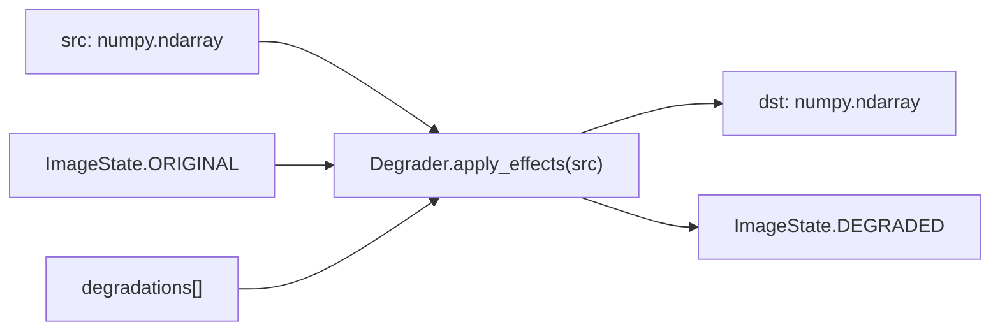

The `ImageStateEncoder` class provides JSON serialization support for `ImageState` enums.

Sources: [genalog/pipeline.py:15](), [genalog/pipeline.py:21-26](), [genalog/pipeline.py:77-78]()

## Pipeline Orchestration Module

The `genalog.pipeline` module coordinates the entire document processing workflow and provides batch processing capabilities.

### Key Components

| Class/Function | Purpose | Key Parameters |
|----------------|---------|----------------|
| `AnalogDocumentGeneration` | Main pipeline coordinator | `template_path`, `styles`, `degradations`, `resolution` |
| `generate_dataset_multiprocess` | Batch processing with multiprocessing | `input_text_files`, `output_folder`, `batch_size` |
| `batch_img_generate` | Worker function for parallel processing | Processes file batches |

### Processing Flow

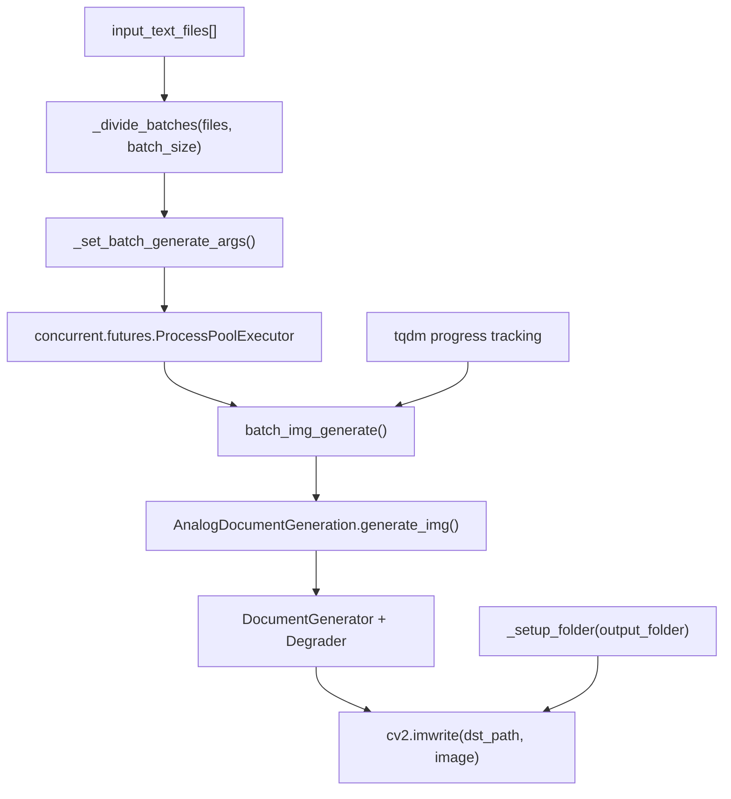

The pipeline supports both single image generation and batch processing:

- **Single generation**: `AnalogDocumentGeneration.generate_img()` returns numpy arrays or writes to disk
- **Batch processing**: `generate_dataset_multiprocess()` uses process pools for parallel execution

### Configuration Parameters

| Parameter | Default | Purpose |
|-----------|---------|---------|
| `resolution` | 300 | DPI for image rendering |
| `batch_size` | 25 | Files per process batch |
| `styles` | `DEFAULT_STYLE_COMBINATION` | Document styling options |
| `degradations` | `[]` | List of degradation effects |

Sources: [genalog/pipeline.py:28-38](), [genalog/pipeline.py:130-156](), [genalog/pipeline.py:103-110]()

## Text Processing Module

The `genalog.text` module provides text alignment algorithms and NER label propagation functionality for mapping between clean text and OCR output.

### Key Components

Based on the system diagrams, this module contains:

| Component | Purpose |
|-----------|---------|
| `alignment.align` | Implements sequence alignment algorithms |
| `ner_label.propagate_label_to_ocr` | Transfers NER labels from ground truth to OCR text |
| `anchor.align_w_anchor` | Anchor-based alignment methods |
| `preprocess utilities` | Text preprocessing functions |

The text processing module uses sequence alignment algorithms (Needleman-Wunsch, RETAS) to establish correspondence between original text and OCR output, enabling label propagation for training datasets.

Sources: [README.md:63-64](), System overview diagrams

## OCR Integration Module

The `genalog.ocr` module provides integration with Azure Cognitive Services for text extraction from document images. **Note: This module is deprecated** in favor of official Azure SDK integration.

### Legacy Components

| Component | Purpose | Status |
|-----------|---------|---------|
| `GrokBlobClient` | Azure Blob Storage integration | Deprecated |
| `GrokRestClient` | Azure REST API client | Deprecated |
| OCR Pipeline | End-to-end text extraction | Deprecated |

The system now recommends using Azure Computer Vision and Azure Cognitive Search services directly through official SDKs rather than the legacy `genalog.ocr` module.

Sources: [README.md:79-84](), System architecture diagrams

## Integration Patterns

The core components integrate through well-defined interfaces:

1. **Pipeline Coordination**: `AnalogDocumentGeneration` orchestrates `DocumentGenerator` and `Degrader` instances
2. **Content Flow**: Text → `CompositeContent` → `Document` → numpy array → degraded array
3. **Batch Processing**: Multiprocessing with `concurrent.futures.ProcessPoolExecutor` for scalability
4. **File I/O**: OpenCV `cv2.imwrite()` for image output, text file reading for input
5. **Progress Tracking**: `tqdm` integration for batch operation monitoring

The modular design allows individual components to be used independently or as part of the full pipeline workflow.

Sources: [genalog/pipeline.py:1-156](), [README.md:101-114]()

---

# Page: Document Generation

# Document Generation

<details>
<summary>Relevant source files</summary>

The following files were used as context for generating this wiki page:

- [genalog/generation/document.py](genalog/generation/document.py)
- [tests/e2e/test_generaton_n_degradation.py](tests/e2e/test_generaton_n_degradation.py)
- [tests/e2e/test_splitter.py](tests/e2e/test_splitter.py)

</details>


## Purpose and Scope

The Document Generation module provides the core functionality for converting raw text content into styled HTML documents and rendering them as images. This module transforms input text through a template-based system to create synthetic documents that simulate real-world document layouts and typography. 

For information about applying degradation effects to generated documents, see [Image Degradation](#2.2). For text processing and alignment after OCR, see [Text Processing](#2.3).

## Core Components

The document generation system consists of two primary classes that work together to create styled documents from templates and content:

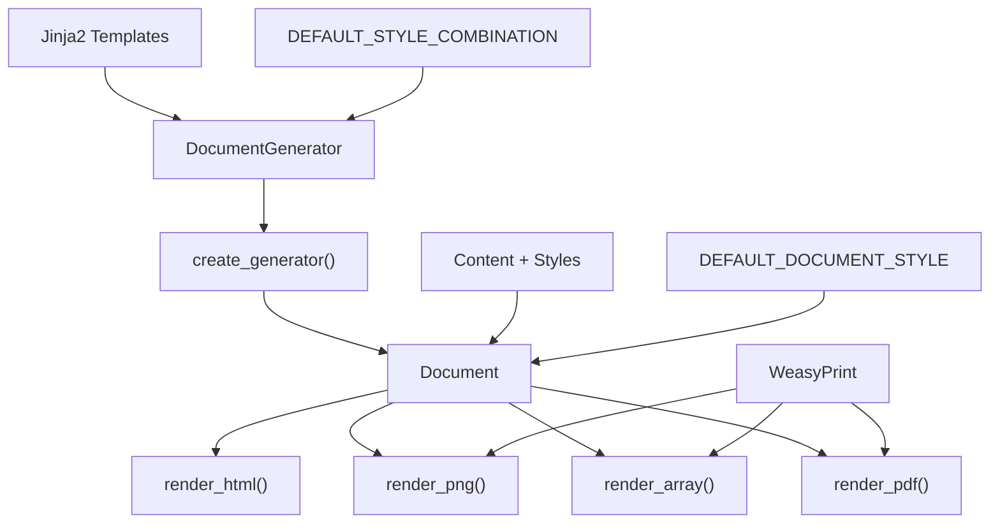

**Document Generation Class Hierarchy**

Sources: [genalog/generation/document.py:29-371]()

### Document Class

The `Document` class represents a single document instance with specific content, template, and styling. It encapsulates the rendering pipeline from HTML generation to various output formats.

| Method | Purpose | Output Format |
|--------|---------|---------------|
| `render_html()` | Generate HTML string from template | HTML string |
| `render_pdf()` | Create PDF document | PDF bytes |
| `render_png()` | Generate PNG image | PNG bytes |
| `render_array()` | Convert to numpy array | numpy.ndarray |

The class maintains internal state including the compiled HTML and WeasyPrint document object for efficient rendering:

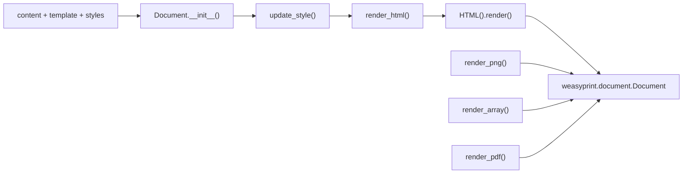

**Document Rendering Pipeline**

Sources: [genalog/generation/document.py:70-198]()

### DocumentGenerator Class

The `DocumentGenerator` class manages template loading and provides a factory interface for creating multiple `Document` instances with different style combinations.

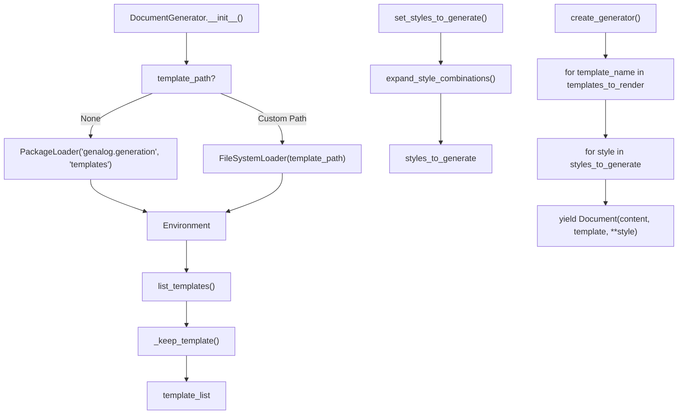

**DocumentGenerator Template and Style Processing**

Sources: [genalog/generation/document.py:201-303]()

## Template System

The template system uses Jinja2 templates with automatic HTML/XML escaping. Templates can be loaded from custom directories or from the built-in package templates.

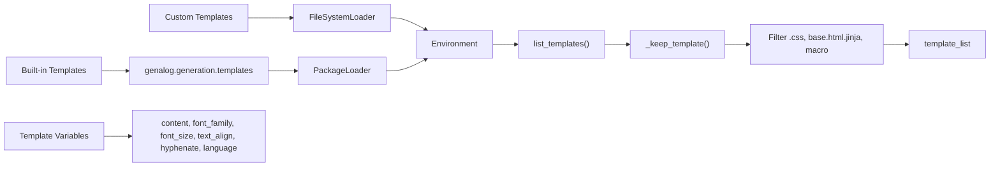

**Template Loading and Filtering**

The `_keep_template()` method filters out non-renderable templates to ensure only valid HTML templates are available for document generation.

Sources: [genalog/generation/document.py:213-246]()

## Style Management

The style system provides combinatorial generation of document variations through parameterized styling options:

```mermaid
graph TD
    A["DEFAULT_STYLE_COMBINATION"] --> B["expand_style_combinations()"]
    B --> C["itertools.product()"]
    C --> D["Style Combinations List"]
    
    E["font_family: ['Segoe UI']"] --> A
    F["font_size: ['12px']"] --> A
    G["text_align: ['left']"] --> A
    H["hyphenate: [False]"] --> A
    I["language: ['en_US']"] --> A
    
    D --> J["Document.__init__(**style)"]
    
    K["Custom Style Dict"] --> L["set_styles_to_generate()"]
    L --> B
```

**Style Combination Generation**

| Default Style Property | Value | Purpose |
|----------------------|--------|---------|
| `language` | `"en_US"` | Text hyphenation rules |
| `font_family` | `"Segoe UI"` | Typography family |
| `font_size` | `"12px"` | Text size |
| `text_align` | `"left"` | Text alignment |
| `hyphenate` | `False` | Word breaking behavior |

The `expand_style_combinations()` method generates the Cartesian product of all style values to create comprehensive style variations.

Sources: [genalog/generation/document.py:11-26](), [genalog/generation/document.py:304-370]()

## Rendering Pipeline

The document rendering process converts templates and content through multiple stages to produce final output formats:

```mermaid
graph TD
    A["Raw Text Content"] --> B["Jinja2 Template"]
    B --> C["render_html()"]
    C --> D["Compiled HTML String"]
    
    D --> E["WeasyPrint HTML()"]
    E --> F["HTML.render()"]
    F --> G["weasyprint.Document"]
    
    G --> H["write_png()"]
    G --> I["write_pdf()"]
    G --> J["write_image_surface()"]
    
    H --> K["PNG Bytes"]
    I --> L["PDF Bytes"]
    J --> M["cairocffi.ImageSurface"]
    
    M --> N["numpy.ndarray"]
    N --> O["cv2.cvtColor()"]
    O --> P["Channel Conversion"]
    P --> Q["GRAYSCALE, RGB, RGBA, BGR, BGRA"]
```

**Multi-Format Rendering Pipeline**

The `render_array()` method provides the most flexibility for image processing workflows, supporting multiple color channel configurations for downstream processing.

Sources: [genalog/generation/document.py:127-174]()

## Integration Patterns

The Document Generation module integrates with other genalog components through standardized interfaces:

```mermaid
graph LR
    A["CompositeContent"] --> B["DocumentGenerator.create_generator()"]
    B --> C["Document.render_array()"]
    C --> D["numpy.ndarray"]
    
    D --> E["Degrader.apply_effects()"]
    E --> F["Degraded Image"]
    
    G["Template List"] --> H["DEFAULT_TEMPLATE"]
    H --> I["text_block.html.jinja"]
    
    J["Resolution=100"] --> C
    K["channel='GRAYSCALE'"] --> C
```

**E2E Integration Example**

This pattern demonstrates how the generation module serves as the entry point for the genalog pipeline, producing numpy arrays that feed into degradation and subsequent processing stages.

Sources: [tests/e2e/test_generaton_n_degradation.py:23-37]()

---

# Page: Image Degradation

# Image Degradation

<details>
<summary>Relevant source files</summary>

The following files were used as context for generating this wiki page:

- [example/dataset_generation.ipynb](example/dataset_generation.ipynb)
- [example/generation_pipeline.ipynb](example/generation_pipeline.ipynb)
- [example/static/analog_doc_gen_pipeline.png](example/static/analog_doc_gen_pipeline.png)
- [genalog/degradation/README.md](genalog/degradation/README.md)
- [genalog/degradation/degrader.py](genalog/degradation/degrader.py)
- [genalog/degradation/effect.py](genalog/degradation/effect.py)
- [genalog/text/README.md](genalog/text/README.md)

</details>


This module provides synthetic image degradation capabilities that simulate real-world document scanning artifacts and quality issues. The image degradation system applies controlled noise, blur, and other visual distortions to clean synthetic documents to create realistic training data for OCR and document understanding models.

For document generation (creating the initial clean images), see [Document Generation](#2.1). For text processing after OCR, see [Text Processing](#2.3).

## Core Architecture

The degradation system consists of three main components: the `Degrader` orchestrator class, the `ImageState` enumeration for managing image states during processing, and a collection of individual effect functions.

```mermaid
graph TB
    subgraph "genalog.degradation"
        A["Degrader"] --> B["ImageState.ORIGINAL_STATE"]
        A --> C["ImageState.CURRENT_STATE"] 
        A --> D["effect module"]
        
        subgraph "effect functions"
            D --> E["blur()"]
            D --> F["salt()"]
            D --> G["pepper()"]
            D --> H["morphology()"]
            D --> I["bleed_through()"]
            D --> J["overlay()"]
            D --> K["translation()"]
        end
    end
    
    subgraph "Input/Output"
        L["Clean Document Image"] --> A
        A --> M["Degraded Document Image"]
    end
```

**Degradation System Architecture**

Sources: [genalog/degradation/degrader.py:20-151](), [genalog/degradation/effect.py:1-374]()

## Degrader Class

The `Degrader` class serves as the main orchestrator for applying multiple degradation effects in sequence. It manages image state transitions and validates effect configurations.

### Configuration Structure

The `Degrader` accepts a list of effect tuples, where each tuple contains a method name and its keyword arguments:

| Component | Type | Description |
|-----------|------|-------------|
| method_name | str | Function name from `genalog.degradation.effect` |
| method_kwargs | dict | Keyword arguments for the effect function |

```mermaid
graph LR
    A["effects list"] --> B["validate_effects()"]
    B --> C["_add_default_method_param()"]
    C --> D["apply_effects()"]
    
    subgraph "Effect Tuple Structure"
        E["('blur', {'radius': 5})"]
        F["('salt', {'amount': 0.1})"]
        G["('morphology', {'operation': 'open'})"]
    end
    
    A --> E
    A --> F
    A --> G
```

**Degrader Configuration Flow**

Sources: [genalog/degradation/degrader.py:23-48](), [genalog/degradation/degrader.py:51-97]()

### Effect Validation

The `validate_effects()` method ensures all specified effects exist and have valid parameters:

- Verifies method names exist in `genalog.degradation.effect` module [genalog/degradation/degrader.py:76-84]()
- Validates parameter names match function signatures [genalog/degradation/degrader.py:85-96]()
- Raises `ValueError` for invalid configurations

Sources: [genalog/degradation/degrader.py:50-97]()

## ImageState Management

The `ImageState` enumeration provides a mechanism to reference different image states during the degradation process, enabling complex effect compositions.

```mermaid
stateDiagram-v2
    [*] --> ORIGINAL_STATE: Input image
    ORIGINAL_STATE --> CURRENT_STATE: First effect applied
    CURRENT_STATE --> CURRENT_STATE: Subsequent effects
    
    note right of ORIGINAL_STATE: Immutable reference to input
    note right of CURRENT_STATE: Updates after each effect
```

**ImageState Lifecycle**

The `insert_image_state()` method replaces enum references with actual image arrays:

| ImageState | Usage | Description |
|------------|-------|-------------|
| `ORIGINAL_STATE` | Reference clean image | Preserves original for comparison effects |
| `CURRENT_STATE` | Reference latest state | Default source for next effect |

Sources: [genalog/degradation/degrader.py:15-18](), [genalog/degradation/degrader.py:132-150]()

## Degradation Effects

The `genalog.degradation.effect` module provides individual degradation functions that simulate common document scanning artifacts.

### Blur Effects

Simulates scanner focus issues and motion blur:

```mermaid
graph LR
    A["blur(src, radius=5)"] --> B["cv2.GaussianBlur()"]
    B --> C["Blurred image"]
    
    D["radius parameter"] --> A
    D --> E["Larger radius = more blur"]
```

**Blur Effect Implementation**

- Uses OpenCV Gaussian blur [genalog/degradation/effect.py:12-23]()
- Radius parameter controls blur intensity
- Must be odd integer for kernel size

Sources: [genalog/degradation/effect.py:12-23]()

### Salt and Pepper Noise

Simulates ink degradation and page damage through random pixel modifications:

| Effect | Function | Parameters | Description |
|--------|----------|------------|-------------|
| Salt | `salt(src, amount=0.3)` | amount: float [0,1] | Adds white pixels |
| Pepper | `pepper(src, amount=0.05)` | amount: float [0,1] | Adds black pixels |
| Combined | `salt_then_pepper()` | salt_amount, pepper_amount | Sequential application |

The noise functions generate random pixel locations and apply color changes:

```mermaid
graph TB
    A["Random noise matrix"] --> B["noise < amount threshold"]
    B --> C["Apply pixel modification"]
    
    D["salt(): pixels = 255"] --> C
    E["pepper(): pixels = 0"] --> C
```

**Salt and Pepper Noise Generation**

Sources: [genalog/degradation/effect.py:104-183]()

### Morphological Operations

Implements structural degradations using OpenCV morphological operations with customizable kernels:

```mermaid
graph TB
    A["morphology(src, operation, kernel_shape, kernel_type)"] --> B["create_2D_kernel()"]
    B --> C["Kernel Generation"]
    
    C --> D["ones"]
    C --> E["ellipse"] 
    C --> F["upper_triangle"]
    C --> G["x"]
    C --> H["plus"]
    
    A --> I["Operation Selection"]
    I --> J["open"]
    I --> K["close"]
    I --> L["dilate"]
    I --> M["erode"]
```

**Morphological Operations Structure**

The `create_2D_kernel()` function supports multiple kernel types for different structural effects [genalog/degradation/effect.py:186-264]().

Sources: [genalog/degradation/effect.py:267-373](), [genalog/degradation/effect.py:186-264]()

### Bleed Through Effects

Simulates ink seepage from reverse side of document pages:

```mermaid
graph LR
    A["bleed_through(src, background, alpha, offset_x, offset_y)"] --> B["cv2.flip(background, 1)"]
    B --> C["translation(background, offset_x, offset_y)"]
    C --> D["overlay_weighted(src, background, alpha, beta)"]
    D --> E["Bleed through result"]
```

**Bleed Through Processing Pipeline**

- Horizontally flips background image [genalog/degradation/effect.py:98]()
- Applies spatial translation [genalog/degradation/effect.py:99]()
- Performs weighted overlay with `alpha` and `beta = 1 - alpha` [genalog/degradation/effect.py:100-101]()

Sources: [genalog/degradation/effect.py:79-101]()

## Pipeline Integration

The degradation system integrates with the broader genalog pipeline through the `AnalogDocumentGeneration` class:

```mermaid
graph TB
    A["Document Generation"] --> B["Clean PNG Image"]
    B --> C["Degrader.apply_effects()"]
    C --> D["Degraded Image"]
    D --> E["OCR Processing"]
    
    F["DEGRADATIONS config"] --> C
    G["ImageState references"] --> C
    
    subgraph "Degradation Sequence"
        H["Effect 1"] --> I["Effect 2"]
        I --> J["Effect N"]
    end
    
    C --> H
```

**Degradation in Document Generation Pipeline**

The degradation configuration is passed to `AnalogDocumentGeneration` and applied after document rendering but before OCR processing.

Sources: [example/generation_pipeline.ipynb:117-135](), [example/dataset_generation.ipynb:202-221]()

## Usage Examples

### Basic Degradation Configuration

```python
from genalog.degradation.degrader import Degrader

degradations = [
    ("blur", {"radius": 3}),
    ("bleed_through", {"alpha": 0.8}),
    ("salt", {"amount": 0.5}),
]

degrader = Degrader(degradations)
degraded_image = degrader.apply_effects(source_image)
```

### Advanced State Management

```python
from genalog.degradation.degrader import Degrader, ImageState

degradations = [
    ("morphology", {"operation": "open", "kernel_shape": (9,9)}),
    ("salt", {"amount": 0.7}),
    ("overlay", {
        "src": ImageState.ORIGINAL_STATE,
        "background": ImageState.CURRENT_STATE,
    }),
    ("bleed_through", {
        "src": ImageState.CURRENT_STATE,
        "background": ImageState.ORIGINAL_STATE,
        "alpha": 0.8,
    }),
]
```

This configuration demonstrates using `ImageState` references to combine the original clean image with intermediate degradation results.

Sources: [example/generation_pipeline.ipynb:117-135](), [example/dataset_generation.ipynb:202-221](), [genalog/degradation/README.md:42-68]()

---

# Page: Text Processing

# Text Processing

<details>
<summary>Relevant source files</summary>

The following files were used as context for generating this wiki page:

- [genalog/text/alignment.py](genalog/text/alignment.py)
- [genalog/text/anchor.py](genalog/text/anchor.py)
- [genalog/text/ner_label.py](genalog/text/ner_label.py)
- [genalog/text/preprocess.py](genalog/text/preprocess.py)

</details>


The text processing module provides core algorithms for aligning ground truth text with OCR output and propagating Named Entity Recognition (NER) labels from clean text to noisy OCR text. This module is essential for creating high-quality training datasets where ground truth annotations must be accurately transferred to synthetic OCR data that contains recognition errors.

For document generation capabilities, see [Document Generation](#2.1). For OCR integration details, see [OCR Integration](#2.4). For comprehensive alignment and label propagation workflows, see [Text Alignment](#2.3.1) and [NER Label Propagation](#2.3.2).

## Text Processing Architecture

The text processing module consists of four main components that work together to align text and transfer labels between clean and noisy text versions.

```mermaid
graph TB
    subgraph "Input Data"
        A["gt_text"]
        B["ocr_text"] 
        C["gt_labels"]
    end
    
    subgraph "genalog.text.preprocess"
        D["tokenize()"]
        E["join_tokens()"]
        F["remove_non_ascii()"]
    end
    
    subgraph "genalog.text.alignment" 
        G["align()"]
        H["_align_seg()"]
        I["parse_alignment()"]
    end
    
    subgraph "genalog.text.anchor"
        J["align_w_anchor()"]
        K["find_anchor_recur()"]
        L["get_anchor_map()"]
    end
    
    subgraph "genalog.text.ner_label"
        M["propagate_label_to_ocr()"]
        N["_propagate_label_to_ocr()"]
        O["correct_ner_labels()"]
    end
    
    subgraph "Output Data"
        P["aligned_gt"]
        Q["aligned_ocr"]
        R["ocr_labels"]
    end
    
    A --> D
    B --> D
    D --> G
    D --> J
    
    G --> H
    G --> I
    J --> K
    J --> L
    
    C --> M
    G --> M
    J --> M
    M --> N
    N --> O
    
    I --> P
    I --> Q
    M --> R
    
    style G fill:#f9f9f9
    style J fill:#f9f9f9
    style M fill:#f9f9f9
```

**Sources:** [genalog/text/alignment.py:1-471](), [genalog/text/anchor.py:1-310](), [genalog/text/ner_label.py:1-528](), [genalog/text/preprocess.py:1-68]()

## Text Alignment Algorithms

The module provides two text alignment approaches: a precise but slower algorithm for short texts and a faster anchor-based algorithm for longer documents.

### Basic Sequence Alignment

The core alignment functionality uses the Needleman-Wunsch global sequence alignment algorithm via BioPython's `pairwise2` module. The `align()` function is the primary entry point for text alignment.

```mermaid
graph LR
    subgraph "Input Processing"
        A["gt_text"]
        B["ocr_text"]
    end
    
    subgraph "alignment._align_seg()"
        C["tokenize inputs"]
        D["pairwise2.align.globalcs()"]
        E["_join_char_list()"]
    end
    
    subgraph "alignment._select_alignment_candidates()"
        F["filter by token count"]
        G["validate length invariants"]
    end
    
    subgraph "Output"
        H["aligned_gt"]
        I["aligned_ocr"]
    end
    
    A --> C
    B --> C
    C --> D
    D --> E
    E --> F
    F --> G
    G --> H
    G --> I
    
    style D fill:#f9f9f9
    style F fill:#f9f9f9
```

The alignment algorithm ensures two critical invariants:
1. `len(aligned_gt) == len(aligned_ocr)`  
2. `number of tokens in gt == number of tokens in aligned_gt`

**Sources:** [genalog/text/alignment.py:149-194](), [genalog/text/alignment.py:28-86](), [genalog/text/alignment.py:88-147]()

### Anchor-Based Fast Alignment

For longer documents, the `align_w_anchor()` function provides a faster O(n) alternative by breaking text into smaller segments using common unique words as anchor points.

```mermaid
graph TB
    subgraph "Anchor Discovery"
        A["get_unique_words()"]
        B["get_anchor_map()"]
        C["LCS.get_str()"]
    end
    
    subgraph "Recursive Segmentation" 
        D["find_anchor_recur()"]
        E["segment_len() > MAX_ALIGN_SEGMENT_LENGTH"]
        F["split at anchor points"]
    end
    
    subgraph "Segment Alignment"
        G["alignment.align() per segment"]
        H["join aligned segments"]
    end
    
    A --> B
    B --> C
    C --> D
    D --> E
    E --> F
    F --> G
    G --> H
    
    style D fill:#f9f9f9
    style G fill:#f9f9f9
```

The algorithm identifies unique words that appear in both texts, finds their longest common subsequence, and uses these as breakpoints for smaller alignment operations.

**Sources:** [genalog/text/anchor.py:232-310](), [genalog/text/anchor.py:84-155](), [genalog/text/anchor.py:157-230]()

## NER Label Propagation

The NER label propagation system transfers named entity labels from clean ground truth text to noisy OCR text through careful alignment and label correction.

### Propagation Algorithm Flow

```mermaid
graph TD
    subgraph "Input Validation"
        A["validate gt_labels length"]
        B["validate token atomicity"] 
        C["check gap_char conflicts"]
    end
    
    subgraph "Text Alignment"
        D["choose alignment method"]
        E["alignment.align() or anchor.align_w_anchor()"]
        F["parse_alignment()"]
    end
    
    subgraph "Label Transfer"
        G["_select_from_multiple_ner_labels()"]
        H["handle one-to-many mappings"]
        I["handle many-to-one mappings"]
    end
    
    subgraph "Label Correction"
        J["convert trailing B-labels to I-labels"]
        K["correct_ner_labels()"]
        L["fix missing B-labels"]
    end
    
    A --> B
    B --> C
    C --> D
    D --> E
    E --> F
    F --> G
    G --> H
    H --> I
    I --> J
    J --> K
    K --> L
    
    style E fill:#f9f9f9
    style G fill:#f9f9f9
    style K fill:#f9f9f9
```

**Sources:** [genalog/text/ner_label.py:239-430](), [genalog/text/ner_label.py:190-237]()

### Label Mapping Cases

The propagation algorithm handles five distinct mapping scenarios between ground truth and OCR tokens:

| Case | GT→OCR Mapping | Label Handling | Example |
|------|---------------|----------------|---------|
| One-to-many | 1 GT → N OCR | First OCR gets B-label, rest get I-labels | "New York" → "New", "Yo", "rk" |
| Many-to-one | N GT → 1 OCR | OCR gets label from first GT token | "New", "York" → "NewYork" |
| Many-to-many | N GT → M OCR | Combined handling of above cases | "New York" → "N", "ewYork" |
| Missing tokens (GT) | GT → ∅ | No OCR token to label | "New York" → "New", ∅ |
| Missing tokens (OCR) | ∅ → OCR | Missing B-label correction applied | ∅ → "York" gets B-label |

**Sources:** [genalog/text/ner_label.py:252-279](), [genalog/text/ner_label.py:416-428]()

### Multi-Token Label Correction

The system includes sophisticated logic for correcting BIO (Begin-Inside-Outside) label sequences that become malformed during alignment:

```mermaid
graph LR
    subgraph "Label Patterns"
        A["_is_begin_label()"]
        B["_is_inside_label()"] 
        C["_is_multi_token_label()"]
    end
    
    subgraph "Correction Logic"
        D["_is_missing_begin_label()"]
        E["_convert_to_begin_label()"]
        F["_convert_to_inside_label()"]
    end
    
    subgraph "Application"
        G["correct_ner_labels()"]
        H["fix I-PLACE without B-PLACE"]
        I["fix B-PLACE B-PLACE sequences"]
    end
    
    A --> D
    B --> D
    C --> G
    D --> E
    E --> H
    F --> I
    G --> H
    G --> I
    
    style G fill:#f9f9f9
    style D fill:#f9f9f9
```

**Sources:** [genalog/text/ner_label.py:113-138](), [genalog/text/ner_label.py:36-84](), [genalog/text/ner_label.py:86-111]()

## Text Preprocessing Utilities

The preprocessing module provides essential text manipulation functions used throughout the text processing pipeline.

| Function | Purpose | Usage |
|----------|---------|-------|
| `tokenize(s)` | Split text into space-separated tokens | Used before alignment operations |
| `join_tokens(tokens)` | Rejoin token list into space-separated string | Used after token-level processing |
| `remove_non_ascii(token)` | Replace non-ASCII characters with underscore | Ensures compatibility with alignment algorithms |
| `_is_spacing(c)` | Check if character is whitespace | Used in token boundary detection |
| `split_sentences(text)` | Split text at sentence boundaries | Text segmentation for processing |

**Sources:** [genalog/text/preprocess.py:30-41](), [genalog/text/preprocess.py:43-53](), [genalog/text/preprocess.py:12-28](), [genalog/text/preprocess.py:55-58]()

## Integration with Pipeline Components

The text processing module integrates with other genalog components to enable end-to-end synthetic dataset generation:

```mermaid
graph LR
    subgraph "Pipeline Integration"
        A["AnalogDocumentGeneration"]
        B["Document.ocr_text"]
        C["Document.ground_truth_text"] 
    end
    
    subgraph "Text Processing"
        D["alignment.align()"]
        E["ner_label.propagate_label_to_ocr()"]
    end
    
    subgraph "Dataset Output"
        F["aligned text pairs"]
        G["propagated labels"]
        H["training datasets"]
    end
    
    A --> B
    A --> C
    B --> D
    C --> D
    D --> E
    E --> F
    E --> G
    F --> H
    G --> H
    
    style A fill:#f9f9f9
    style D fill:#f9f9f9
    style E fill:#f9f9f9
```

The module's alignment and label propagation capabilities are essential for creating training datasets where synthetic document images are processed through OCR and the resulting noisy text must be accurately aligned with ground truth for machine learning model training.

**Sources:** [genalog/text/alignment.py:1-25](), [genalog/text/ner_label.py:1-12](), [genalog/text/anchor.py:1-26]()

---

# Page: Text Alignment

# Text Alignment

<details>
<summary>Relevant source files</summary>

The following files were used as context for generating this wiki page:

- [genalog/text/alignment.py](genalog/text/alignment.py)
- [genalog/text/anchor.py](genalog/text/anchor.py)
- [genalog/text/ner_label.py](genalog/text/ner_label.py)

</details>


This document covers the text alignment algorithms implemented in genalog for aligning ground truth text with OCR output text. The alignment functionality enables comparison and analysis of OCR accuracy by establishing character-level and token-level correspondences between clean and noisy text versions.

For information about NER label propagation that uses text alignment, see [NER Label Propagation](#2.3.2). For broader text processing utilities, see [Text Processing](#2.3).

## Algorithm Overview

The genalog text alignment system provides two primary alignment strategies:

1. **Global Sequence Alignment**: Direct implementation using the Needleman-Wunsch algorithm via Bio.pairwise2
2. **Anchor-based Alignment**: Fast alignment scheme for longer documents using the RETAS approach

Both algorithms produce aligned text pairs where gaps are inserted to maintain character-level correspondence between ground truth and OCR text.

### Core Alignment Flow

```mermaid
graph TD
    A["Ground Truth Text"] --> B["tokenize()"]
    C["OCR Text"] --> D["tokenize()"]
    B --> E["align() or align_w_anchor()"]
    D --> E
    E --> F["Aligned GT String"]
    E --> G["Aligned OCR String"]
    F --> H["parse_alignment()"]
    G --> H
    H --> I["Token Mappings"]
    H --> J["Character Correspondences"]
```

Sources: [genalog/text/alignment.py:149-194](), [genalog/text/anchor.py:232-309]()

## Needleman-Wunsch Global Alignment

The core alignment algorithm implements global sequence alignment using the Needleman-Wunsch dynamic programming approach through the Bio.pairwise2 library.

### Alignment Configuration

| Parameter | Default Value | Purpose |
|-----------|---------------|---------|
| `MATCH_REWARD` | 1 | Reward for matching characters |
| `MISMATCH_PENALTY` | -0.5 | Penalty for character substitutions |
| `GAP_PENALTY` | -0.5 | Penalty for insertions/deletions |
| `GAP_EXT_PENALTY` | -0.5 | Penalty for extending gaps |
| `SPACE_MISMATCH_PENALTY` | 0.1 | Additional penalty for space mismatches |
| `GAP_CHAR` | "@" | Character used to represent gaps |

Sources: [genalog/text/alignment.py:12-20]()

### Alignment Algorithm Implementation

```mermaid
graph TB
    A["align(gt, noise, gap_char)"] --> B["tokenize(gt)"]
    A --> C["tokenize(noise)"]
    B --> D["_align_seg(gt, noise)"]
    C --> D
    D --> E["pairwise2.align.globalcs()"]
    E --> F["_select_alignment_candidates()"]
    F --> G["Aligned GT, Aligned OCR"]
    
    H["_align_seg()"] --> I["match_reward_fn()"]
    H --> J["Unicode Support<br/>(char list conversion)"]
    I --> K["Bio.pairwise2<br/>Needleman-Wunsch"]
    J --> K
    K --> L["_join_char_list()"]
```

The `align()` function in [genalog/text/alignment.py:149-194]() serves as the main entry point, ensuring that:
- Input validation handles empty strings appropriately
- Token count invariants are maintained between input and output
- Multiple alignment candidates are filtered to preserve ground truth token count

Sources: [genalog/text/alignment.py:28-86](), [genalog/text/alignment.py:88-147]()

## Fast Alignment with Anchors

For longer documents where O(N²) complexity becomes prohibitive, the anchor-based alignment scheme provides significant performance improvements by breaking text into smaller segments.

### RETAS Algorithm Implementation

```mermaid
graph TD
    A["align_w_anchor(gt, ocr)"] --> B["tokenize(gt, ocr)"]
    B --> C["find_anchor_recur()"]
    C --> D["get_anchor_map()"]
    D --> E["get_unique_words()"]
    E --> F["LCS(unique_words_gt, unique_words_ocr)"]
    F --> G["Anchor Points"]
    G --> H["Split into Segments"]
    H --> I["align() on each segment"]
    I --> J["Concatenate Results"]
    
    K["get_anchor_map()"] --> L["Counter(tokens)"]
    L --> M["unique_words.intersection()"]
    M --> N["get_word_map()"]
    N --> O["LCS.get_str()"]
```

The anchor-based approach uses the following strategy:

1. **Unique Word Identification**: Extract words that appear only once in each text
2. **Common Anchor Detection**: Find unique words present in both ground truth and OCR text
3. **LCS-based Filtering**: Use Longest Common Subsequence to identify reliable anchor points
4. **Recursive Segmentation**: Split long segments recursively until manageable sizes
5. **Segment Alignment**: Apply standard Needleman-Wunsch to each segment pair

Sources: [genalog/text/anchor.py:84-154](), [genalog/text/anchor.py:157-229](), [genalog/text/anchor.py:232-309]()

### Anchor Selection Criteria

```mermaid
graph LR
    A["All Tokens"] --> B["get_unique_words()"]
    B --> C["Counter < 2"]
    C --> D["Case Insensitive Filtering"]
    D --> E["Intersection GT ∩ OCR"]
    E --> F["LCS Filtering"]
    F --> G["Final Anchor Set"]
    
    H["Segment Length Check"] --> I["segment_len() > MAX_ALIGN_SEGMENT_LENGTH"]
    I --> J["find_anchor_recur()"]
    J --> K["Recursive Subdivision"]
```

Sources: [genalog/text/anchor.py:33-51](), [genalog/text/anchor.py:53-62]()

## Alignment Parsing and Token Mapping

After alignment, the `parse_alignment()` function converts character-level alignments into token-level mappings that support downstream applications like NER label propagation.

### Token Mapping Generation

```mermaid
graph TD
    A["parse_alignment(aligned_gt, aligned_noise)"] --> B["tokenize(aligned_gt)"]
    A --> C["tokenize(aligned_noise)"]
    B --> D["Token Boundary Detection"]
    C --> D
    D --> E["_find_next_token()"]
    E --> F["_is_valid_token()"]
    F --> G["Mapping Construction"]
    G --> H["gt_to_noise_mapping"]
    G --> I["noise_to_gt_mapping"]
    
    J["Token Relationships"] --> K["One-to-One"]
    J --> L["One-to-Many"]
    J --> M["Many-to-One"]
    J --> N["Many-to-Many"]
    J --> O["Missing Tokens"]
```

The parsing algorithm handles five distinct token relationship patterns:

1. **One-to-One**: Single GT token aligns to single OCR token
2. **One-to-Many**: Single GT token splits into multiple OCR tokens  
3. **Many-to-One**: Multiple GT tokens merge into single OCR token
4. **Many-to-Many**: Complex relationships requiring careful mapping
5. **Missing Tokens**: GT or OCR tokens with no correspondence

Sources: [genalog/text/alignment.py:322-471](), [genalog/text/alignment.py:224-297]()

### Token Validation and Gap Handling

```mermaid
graph LR
    A["_is_valid_token(token, gap_char)"] --> B["INVALID_TOKEN_REGEX"]
    B --> C["Match Gap Patterns"]
    C --> D["^\s*@*\s*$"]
    D --> E["Empty Strings"]
    E --> F["Whitespace Only"]
    F --> G["Valid Token Boolean"]
    
    H["Gap Character Selection"] --> I["GAP_CHAR_SET"]
    I --> J["Exclude SPECIAL_CHAR"]
    J --> K["Input Character Set"]
    K --> L["Set Difference"]
    L --> M["Available Gap Characters"]
```

The token validation ensures alignment integrity by identifying invalid tokens composed entirely of gap characters, whitespace, or empty strings. The gap character selection mechanism automatically chooses suitable gap characters that don't conflict with input text characters.

Sources: [genalog/text/alignment.py:299-320](), [genalog/text/ner_label.py:169-188]()

## Integration with NER Label Propagation

The alignment functionality serves as the foundation for NER label propagation, where named entity labels from clean ground truth text are transferred to corresponding OCR tokens.

### Alignment-Based Label Transfer

```mermaid
graph TD
    A["propagate_label_to_ocr()"] --> B["preprocess.join_tokens()"]
    B --> C["align_w_anchor() or align()"]
    C --> D["parse_alignment()"]
    D --> E["gt_to_ocr_mapping"]
    D --> F["ocr_to_gt_mapping"]
    E --> G["Label Propagation Logic"]
    F --> G
    G --> H["correct_ner_labels()"]
    H --> I["Corrected OCR Labels"]
    
    J["Label Relationship Handling"] --> K["B-Label Splitting"]
    J --> L["I-Label Correction"]
    J --> M["Missing Label Detection"]
```

The label propagation process leverages both mapping directions to handle complex multi-token entity scenarios where entity boundaries may shift between ground truth and OCR text.

Sources: [genalog/text/ner_label.py:190-237](), [genalog/text/ner_label.py:239-431]()

## Performance Characteristics

### Algorithm Complexity Comparison

| Algorithm | Time Complexity | Space Complexity | Best Use Case |
|-----------|----------------|------------------|---------------|
| `align()` | O(N²) | O(N²) | Short text segments (< 100 chars) |
| `align_w_anchor()` | O(N log N) typical | O(N) | Long documents, books, articles |

### Configuration Constants

The alignment behavior can be tuned through several configuration parameters defined in [genalog/text/alignment.py:12-20]():

- **MAX_ALIGN_SEGMENT_LENGTH**: 100 characters - threshold for triggering anchor-based segmentation
- **Scoring Parameters**: Control alignment quality vs. gap insertion tradeoffs
- **Gap Character Handling**: Automatic selection from printable ASCII excluding whitespace

Sources: [genalog/text/anchor.py:30](), [genalog/text/alignment.py:12-20]()

---

# Page: NER Label Propagation

# NER Label Propagation

<details>
<summary>Relevant source files</summary>

The following files were used as context for generating this wiki page:

- [genalog/ocr/metrics.py](genalog/ocr/metrics.py)
- [genalog/text/alignment.py](genalog/text/alignment.py)
- [genalog/text/conll_format.py](genalog/text/conll_format.py)
- [genalog/text/ner_label.py](genalog/text/ner_label.py)

</details>


## Purpose and Scope

This document covers the Named Entity Recognition (NER) label propagation system in genalog, which transfers NER labels from clean ground truth text to OCR'd text containing recognition errors. This process is essential for creating labeled training datasets that enable robust NER models to handle real-world OCR noise.

For information about the underlying text alignment algorithms, see [Text Alignment](#2.3.1). For broader text processing utilities, see [Text Processing](#2.3).

## Overview

NER label propagation solves a critical challenge in synthetic dataset generation: when clean text with NER labels is processed through document generation and OCR, the resulting text contains errors that misalign with the original labels. The propagation system uses sequence alignment to map tokens between clean and OCR'd text, then transfers labels while handling complex cases like token splitting, merging, and missing tokens.

**Core Process Flow**

```mermaid
graph TD
    A["gt_labels: ['B-PLACE', 'I-PLACE', 'O']"] --> D[propagate_label_to_ocr]
    B["gt_tokens: ['New', 'York', 'is']"] --> D
    C["ocr_tokens: ['N', 'ewYork', 'is']"] --> D
    
    D --> E[_find_gap_char_candidates]
    E --> F[align_w_anchor or alignment.align]
    F --> G[alignment.parse_alignment]
    G --> H[Label Propagation Step 1]
    H --> I[Label Propagation Step 2a: Fix Trailing B-labels]
    I --> J[Label Propagation Step 2b: correct_ner_labels]
    J --> K["ocr_labels: ['B-PLACE', 'I-PLACE', 'O']"]
    K --> L["aligned_gt: 'N@ew York is'"]
    L --> M["aligned_ocr: 'N ew@York is'"]
```

Sources: [genalog/text/ner_label.py:190-431]()

## Core Algorithm Implementation

The main entry point `propagate_label_to_ocr()` handles gap character selection and delegates to the core implementation `_propagate_label_to_ocr()`. The algorithm operates in three phases:

### Phase 1: Text Alignment and Mapping

```mermaid
graph LR
    A[gt_tokens] --> B[preprocess.join_tokens]
    C[ocr_tokens] --> D[preprocess.join_tokens]
    B --> E[gt_txt]
    D --> F[ocr_txt]
    E --> G[align_w_anchor or alignment.align]
    F --> G
    G --> H[aligned_gt]
    G --> I[aligned_ocr]
    H --> J[alignment.parse_alignment]
    I --> J
    J --> K[gt_to_ocr_mapping]
    J --> L[ocr_to_gt_mapping]
```

The system first reconstructs full text strings from token lists, performs sequence alignment using either the anchor-based method or standard Needleman-Wunsch algorithm, then parses the alignment to create bidirectional token mappings.

Sources: [genalog/text/ner_label.py:384-402]()

### Phase 2: Naive Label Propagation

```mermaid
graph TD
    A[ocr_to_gt_mapping] --> B["for each OCR token mapping"]
    B --> C{"mapping empty?"}
    C -->|Yes| D["No label (missing token)"]
    C -->|No| E[_select_from_multiple_ner_labels]
    E --> F["Use first GT token's label"]
    F --> G[Append to ocr_labels]
    D --> G
```

For each OCR token, the system looks up which ground truth tokens it maps to. If multiple ground truth tokens map to one OCR token, `_select_from_multiple_ner_labels()` selects the first token's label as the representative.

Sources: [genalog/text/ner_label.py:405-414](), [genalog/text/ner_label.py:140-167]()

### Phase 3: Multi-Token Label Correction

The system addresses two critical issues with multi-token NER labels (B-LABEL, I-LABEL sequences):

**Step 2a: Trailing B-label Correction**
When one ground truth token splits into multiple OCR tokens, all OCR tokens initially receive the same label. For B-labels, only the first OCR token should keep the B-label; subsequent tokens should be converted to I-labels.

**Step 2b: Missing B-label Correction**
The `correct_ner_labels()` function scans for I-labels that lack proper B-label prefixes and converts them to B-labels when necessary.

Sources: [genalog/text/ner_label.py:416-428](), [genalog/text/ner_label.py:113-137]()

## Label Types and Conversion Functions

The system handles standard IOB (Inside-Outside-Begin) tagging with specific regex patterns and conversion utilities:

| Function | Purpose | Pattern |
|----------|---------|---------|
| `_is_begin_label()` | Identifies B-labels | `^\s*(B-)([a-z\|A-Z]+)\s*$` |
| `_is_inside_label()` | Identifies I-labels | `^\s*(I-)([a-z\|A-Z]+)\s*$` |
| `_convert_to_begin_label()` | I-label → B-label | Replace `I-` with `B-` |
| `_convert_to_inside_label()` | B-label → I-label | Replace `B-` with `I-` |

```mermaid
graph LR
    A["I-PLACE"] --> B[_convert_to_begin_label]
    B --> C["B-PLACE"]
    D["B-PLACE"] --> E[_convert_to_inside_label]
    E --> F["I-PLACE"]
    
    G["I-PLACE"] --> H[_is_inside_label]
    H --> I["True"]
    J["B-PLACE"] --> K[_is_begin_label]
    K --> L["True"]
```

Sources: [genalog/text/ner_label.py:19-83]()

## Gap Character Management

The propagation system requires a gap character for sequence alignment that doesn't appear in the input text. The `_find_gap_char_candidates()` function ensures alignment integrity:

```mermaid
graph TD
    A[gt_tokens + ocr_tokens] --> B["Extract all characters: input_char_set"]
    C[GAP_CHAR_SET] --> D["Available gap characters"]
    B --> E[gap_char_set.difference]
    D --> E
    E --> F[gap_char_candidates]
    F --> G{"alignment.GAP_CHAR available?"}
    G -->|Yes| H["Use default '@'"]
    G -->|No| I["Use any available candidate"]
    H --> J[Return selected gap_char]
    I --> J
```

If no suitable gap characters exist, the system raises `GapCharError` indicating the input character set is too large.

Sources: [genalog/text/ner_label.py:169-236](), [genalog/text/ner_label.py:25-33]()

## Integration with Text Alignment

NER label propagation depends heavily on the text alignment infrastructure. The system supports two alignment strategies:

| Strategy | Function | Use Case |
|----------|----------|----------|
| Standard | `alignment.align()` | Small text segments (O(N²) complexity) |
| Anchor-based | `anchor.align_w_anchor()` | Longer texts with anchor points |

The `use_anchor` parameter in `propagate_label_to_ocr()` controls which alignment method is used, defaulting to the faster anchor-based approach.

Sources: [genalog/text/ner_label.py:388-393]()

## Complex Mapping Scenarios

The propagation system handles various alignment patterns between ground truth and OCR tokens:

**Case Analysis from Code Comments**

```mermaid
graph TB
    subgraph "Multi-Token Labels"
        A1["Case 1: one-to-many<br/>gt: 'New York'<br/>ocr: 'New Yo rk'<br/>labels: B-p → B-p I-p I-p"]
        A2["Case 2: many-to-one<br/>gt: 'New York'<br/>ocr: 'NewYork'<br/>labels: B-p I-p → B-p"]
        A3["Case 3: many-to-many<br/>gt: 'New York'<br/>ocr: 'N ew York'<br/>labels: B-p I-p → B-p I-p"]
        A4["Case 4: missing I-tokens<br/>gt: 'New York'<br/>ocr: 'New'<br/>labels: B-p I-p → B-p"]
        A5["Case 5: missing B-tokens<br/>gt: 'New York City'<br/>ocr: 'York City'<br/>labels: B-p I-p I-p → B-p I-p"]
    end
    
    subgraph "Single-Token Labels"
        B1["Case 1: one-to-many<br/>gt: 'something'<br/>ocr: 'so me thing'<br/>labels: O → O O O"]
        B2["Case 2: many-to-one<br/>gt: 'is big'<br/>ocr: 'isbig'<br/>labels: V O → V"]
        B3["Case 3: many-to-many<br/>gt: 'this is huge'<br/>ocr: 'th isi shuge'<br/>labels: O V W → O O V"]
        B4["Case 4: missing tokens<br/>gt: 'is big'<br/>ocr: 'is'<br/>labels: O O → O"]
    end
```

Sources: [genalog/text/ner_label.py:252-279]()

## Usage in Dataset Generation

The propagation system integrates with the broader genalog pipeline through `conll_format.py`, which processes entire datasets:

```mermaid
graph LR
    A[clean_labels_dir] --> B[propagate_labels_sentences_multiprocess]
    C[ocr_text_dir] --> B
    B --> D[propagate_labels_sentence_single_file]
    D --> E[propagate_labels_sentences]
    E --> F[ner_label.propagate_label_to_ocr]
    F --> G[CoNLL formatted output]
    
    H[ProcessPoolExecutor] --> I[Parallel processing]
    I --> D
```

The `propagate_labels_sentences()` function extends basic label propagation to handle sentence boundaries, ensuring that OCR text is properly segmented to match the original sentence structure.

Sources: [genalog/text/conll_format.py:61-158](), [genalog/text/conll_format.py:244-280]()

## Error Handling and Validation

The system includes comprehensive validation for input data integrity:

| Validation | Error Type | Description |
|------------|------------|-------------|
| Token count mismatch | `ValueError` | `gt_tokens` and `gt_labels` have different lengths |
| Non-atomic tokens | `ValueError` | Tokens contain spaces (not atomic) |
| Invalid tokens | `ValueError` | Empty strings or whitespace-only tokens |
| Gap character conflicts | `GapCharError` | Tokens contain the gap character |
| Alignment failures | `ValueError` | Alignment produces wrong token count |

Sources: [genalog/text/ner_label.py:365-383]()

## Display and Formatting Utilities

The module provides utilities for visualizing label propagation results:

- `format_labels()`: Aligns tokens and labels for display
- `format_label_propagation()`: Shows complete propagation results with optional alignment visualization
- `_format_alignment()`: Displays character-level alignment with match indicators

These functions support debugging and validation of the propagation process by making the token-to-label mappings visually apparent.

Sources: [genalog/text/ner_label.py:433-527]()

---

# Page: OCR Integration

# OCR Integration

<details>
<summary>Relevant source files</summary>

The following files were used as context for generating this wiki page:

- [genalog/ocr/blob_client.py](genalog/ocr/blob_client.py)
- [genalog/ocr/grok.py](genalog/ocr/grok.py)
- [genalog/ocr/metrics.py](genalog/ocr/metrics.py)
- [genalog/ocr/rest_client.py](genalog/ocr/rest_client.py)
- [genalog/text/conll_format.py](genalog/text/conll_format.py)
- [tests/e2e/test_ocr_e2e.py](tests/e2e/test_ocr_e2e.py)

</details>


This section documents the Azure-based OCR processing pipeline implemented in the `genalog.ocr` module. This module provides integration with Azure Cognitive Search and Azure Blob Storage to perform batch OCR processing on document images, though it is currently deprecated in favor of the official Azure Python SDK.

**Note**: This module is being deprecated. For current OCR integration approaches, see the official Azure Computer Vision SDK documentation. For text processing and alignment capabilities that work with OCR output, see [Text Processing](#2.3).

## Architecture Overview

The OCR integration system consists of three main components that work together to upload images to Azure Blob Storage, process them through Azure Cognitive Search with OCR capabilities, and retrieve the results.

**OCR Integration System Architecture**

```mermaid
graph TB
    subgraph "Local Environment"
        A[/"Document Images"/]
        B[/"OCR JSON Results"/]
    end
    
    subgraph "genalog.ocr Module"
        C["GrokBlobClient"]
        D["GrokRestClient"] 
        E["Grok"]
        F["metrics.py"]
    end
    
    subgraph "Azure Services"
        G["Azure Blob Storage"]
        H["Azure Cognitive Search"]
        I["Azure Computer Vision"]
    end
    
    subgraph "Processing Pipeline"
        J["Datasource Container"]
        K["Projections Container"]
        L["Search Index"]
        M["Skillset with OCR"]
        N["Indexer"]
    end
    
    A --> C
    C --> G
    G --> J
    J --> H
    H --> M
    M --> I
    I --> L
    L --> K
    K --> C
    C --> B
    
    D --> H
    D --> M
    D --> L
    D --> N
    
    E --> C
    E --> D
    
    B --> F
```

Sources: [genalog/ocr/grok.py:12-108](), [genalog/ocr/blob_client.py:33-408](), [genalog/ocr/rest_client.py:26-305]()

## Core Components

### GrokBlobClient

The `GrokBlobClient` class handles all Azure Blob Storage operations for the OCR pipeline, including uploading images and downloading OCR results.

| Method | Purpose | Key Features |
|--------|---------|--------------|
| `upload_images_to_blob()` | Upload images to Azure Blob Storage | Async/sync support, folder hashing, cache checking |
| `get_ocr_json()` | Download OCR results from projections container | Base64 projection path handling |
| `delete_blobs_folder()` | Clean up uploaded images | Batch deletion support |
| `get_folder_hash()` | Generate MD5 hash for folder naming | Deterministic folder naming |

**Key Configuration Parameters**:
- `DATASOURCE_CONTAINER_NAME`: Container for input images
- `PROJECTIONS_CONTAINER_NAME`: Container for OCR output projections  
- `BLOB_NAME`: Azure Storage account name
- `BLOB_KEY`: Azure Storage account key

Sources: [genalog/ocr/blob_client.py:33-82](), [genalog/ocr/blob_client.py:84-179](), [genalog/ocr/blob_client.py:248-311]()

### GrokRestClient

The `GrokRestClient` class uses the Azure Search Service REST API to create and manage the OCR processing pipeline.

**REST API Pipeline Components**

```mermaid
graph LR
    A["create_datasource()"] --> B["create_skillset()"]
    B --> C["create_index()"]
    C --> D["create_indexer()"]
    D --> E["run_indexer()"]
    E --> F["poll_indexer_till_complete()"]
    
    G["Datasource"] --> H["Skillset with OCR"]
    H --> I["Search Index"]
    I --> J["Indexer"]
    
    K["templates/datasource.json"] --> A
    L["templates/skillset.json"] --> B
    M["templates/index.json"] --> C
    N["templates/indexer.json"] --> D
```

**Core Methods**:
- `create_indexing_pipeline()`: Sets up the complete OCR pipeline [genalog/ocr/rest_client.py:230-237]()
- `run_indexer()`: Triggers OCR processing [genalog/ocr/rest_client.py:259-269]()
- `poll_indexer_till_complete()`: Monitors processing status [genalog/ocr/rest_client.py:271-290]()
- `delete_indexer_pipeline()`: Cleanup all pipeline resources [genalog/ocr/rest_client.py:239-257]()

Sources: [genalog/ocr/rest_client.py:127-237](), [genalog/ocr/rest_client.py:259-300]()

### Grok Orchestrator

The `Grok` class coordinates the entire OCR workflow by combining blob storage operations with the search service pipeline.

**OCR Processing Workflow**

```mermaid
sequenceDiagram
    participant Client
    participant Grok
    participant GrokBlobClient
    participant GrokRestClient
    participant Azure
    
    Client->>Grok: run_grok(src_folder, dest_folder)
    Grok->>GrokBlobClient: upload_images_to_blob()
    GrokBlobClient->>Azure: Upload images
    Grok->>GrokRestClient: create_indexing_pipeline()
    GrokRestClient->>Azure: Setup OCR pipeline
    Grok->>GrokRestClient: run_indexer()
    GrokRestClient->>Azure: Start OCR processing
    Grok->>GrokRestClient: poll_indexer_till_complete()
    GrokRestClient->>Azure: Monitor progress
    Azure-->>GrokRestClient: Processing complete
    Grok->>GrokBlobClient: get_ocr_json()
    GrokBlobClient->>Azure: Download OCR results
    Azure-->>Client: OCR JSON files
    
    opt cleanup=True
        Grok->>Grok: cleanup()
        Grok->>GrokBlobClient: delete_blobs_folder()
        Grok->>GrokRestClient: delete_indexer_pipeline()
    end
```

Key parameters for `run_grok()`:
- `src_folder_path`: Local directory containing images
- `dest_folder_path`: Output directory for OCR JSON files  
- `blob_dest_folder`: Optional custom folder name in blob storage
- `cleanup`: Whether to delete resources after processing
- `use_async`: Enable asynchronous operations

Sources: [genalog/ocr/grok.py:30-98](), [genalog/ocr/grok.py:99-107]()

## OCR Metrics and Quality Assessment

The `metrics.py` module provides comprehensive analysis tools for OCR output quality assessment and alignment statistics.

### Metrics Calculation Pipeline

```mermaid
graph TD
    A[/"Source Text Files"/] --> D["get_file_metrics()"]
    B[/"OCR JSON Files"/] --> D
    
    D --> E["get_stats()"]
    E --> F["align_w_anchor()"]
    E --> G["get_align_stats()"]
    E --> H["get_editops_stats()"]
    
    F --> I["Character Alignment"]
    G --> J["Word/Character Accuracy"]
    H --> K["Edit Operations Count"]
    
    I --> L["Substitution Mappings"]
    J --> M["Accuracy Metrics"]
    K --> N["Edit Distance Stats"]
    
    subgraph "Output Metrics"
        M --> O["word_accuracy"]
        M --> P["char_accuracy"] 
        M --> Q["alnum_word_accuracy"]
        N --> R["edit_insert"]
        N --> S["edit_delete"]
        N --> T["edit_replace"]
        L --> U["substitution_dict"]
    end
```

**Key Metric Types**:

| Category | Metrics | Description |
|----------|---------|-------------|
| Accuracy | `word_accuracy`, `char_accuracy`, `alnum_word_accuracy` | Percentage of correctly recognized elements |
| Edit Operations | `edit_insert`, `edit_delete`, `edit_replace` | Character-level edit counts |
| Alignment | `insert`, `delete`, `replace`, `spacing` | Substring-level alignment operations |
| Substitutions | `substitution_dict` | Mapping of character/word replacements |

Sources: [genalog/ocr/metrics.py:430-482](), [genalog/ocr/metrics.py:400-427](), [genalog/ocr/metrics.py:324-371]()

## Integration with Text Processing Pipeline

The OCR module integrates with the text processing pipeline through CoNLL format utilities and label propagation.

**OCR to Text Processing Data Flow**

```mermaid
graph LR
    subgraph "OCR Output"
        A[/"OCR JSON Files"/]
        B["extract_ocr_text()"]
    end
    
    subgraph "CoNLL Processing"
        C[/"OCR Text Files"/]
        D["propagate_labels_sentences()"]
        E[/"Clean Labels"/]
    end
    
    subgraph "Text Alignment"
        F["ner_label.propagate_label_to_ocr()"]
        G["alignment.parse_alignment()"]
    end
    
    subgraph "Output"
        H[/"CoNLL OCR Labels"/]
        I[/"Training Datasets"/]
    end
    
    A --> B
    B --> C
    C --> D
    E --> D
    D --> F
    F --> G
    G --> H
    H --> I
```

The `conll_format.py` utility extracts text from OCR JSON output and creates CoNLL-formatted training data:

- `extract_ocr_text()`: Extracts text from Grok OCR JSON format [genalog/text/conll_format.py:282-303]()
- `propagate_labels_sentences()`: Aligns clean labels with OCR tokens and preserves sentence boundaries [genalog/text/conll_format.py:61-158]()
- `propagate_labels_sentences_multiprocess()`: Parallel processing for large datasets [genalog/text/conll_format.py:244-279]()

Sources: [genalog/text/conll_format.py:282-303](), [genalog/text/conll_format.py:61-158](), [genalog/text/conll_format.py:424-471]()

## Environment Configuration

The OCR integration requires the following environment variables:

| Variable | Purpose | Component |
|----------|---------|-----------|
| `COGNITIVE_SERVICE_KEY` | Azure Cognitive Services API key | GrokRestClient |
| `SEARCH_SERVICE_KEY` | Azure Search Service API key | GrokRestClient |
| `SEARCH_SERVICE_NAME` | Azure Search Service name | GrokRestClient |
| `BLOB_NAME` | Azure Storage account name | GrokBlobClient |
| `BLOB_KEY` | Azure Storage account key | GrokBlobClient |
| `DATASOURCE_CONTAINER_NAME` | Blob container for input images | GrokBlobClient |
| `PROJECTIONS_CONTAINER_NAME` | Blob container for OCR projections | GrokBlobClient |

All components support initialization via `create_from_env_var()` factory methods for easy configuration management.

Sources: [genalog/ocr/rest_client.py:96-125](), [genalog/ocr/blob_client.py:64-82]()

## Deprecation Notice

**Important**: This OCR module is deprecated and marked for removal. The test suite shows it as flaky and recommends migration to the official Azure Computer Vision Python SDK.

**Migration Path**:
1. Replace `genalog.ocr` usage with [Azure Computer Vision SDK](https://docs.microsoft.com/en-us/azure/cognitive-services/computer-vision/quickstarts-sdk/client-library?tabs=visual-studio&pivots=programming-language-python)
2. Continue using `genalog.text` modules for alignment and label propagation with OCR results
3. Use `genalog.ocr.metrics` for OCR quality assessment if needed

Sources: [tests/e2e/test_ocr_e2e.py:51-54]()

---

# Page: Pipeline Orchestration

# Pipeline Orchestration

<details>
<summary>Relevant source files</summary>

The following files were used as context for generating this wiki page:

- [genalog/pipeline.py](genalog/pipeline.py)
- [tests/e2e/test_document_generation.py](tests/e2e/test_document_generation.py)
- [tests/e2e/test_pipeline.py](tests/e2e/test_pipeline.py)

</details>


This document covers the main pipeline orchestration system in genalog that coordinates document generation, image degradation, and batch processing workflows. The pipeline serves as the primary entry point for users to generate synthetic document datasets at scale.

For document generation specifics, see [Document Generation](#2.1). For image degradation effects, see [Image Degradation](#2.2). For text processing and alignment, see [Text Processing](#2.3).

## Main Pipeline Class

The `AnalogDocumentGeneration` class serves as the central orchestrator that coordinates the entire synthetic document generation pipeline. This class integrates document generation, image degradation, and file management into a unified interface.

### Class Structure and Dependencies

```mermaid
graph TD
    subgraph "AnalogDocumentGeneration Pipeline"
        A["AnalogDocumentGeneration"]
        B["DocumentGenerator"]
        C["Degrader"]
        D["generate_img()"]
        E["list_templates()"]
    end
    
    subgraph "External Dependencies"
        F["CompositeContent"]
        G["ContentType"]
        H["ImageState"]
        I["cv2"]
        J["concurrent.futures"]
    end
    
    subgraph "File System"
        K["Input Text Files"]
        L["Output PNG Images"]
        M["Template Files"]
    end
    
    A --> B
    A --> C
    A --> D
    A --> E
    
    B --> F
    B --> G
    B --> M
    
    C --> H
    
    D --> I
    D --> K
    D --> L
    
    J --> A
```

**Pipeline Orchestration Class Dependencies**

The `AnalogDocumentGeneration` class is initialized with several key parameters:

| Parameter | Type | Purpose | Default |
|-----------|------|---------|---------|
| `template_path` | str | Path to HTML template directory | None (uses built-in templates) |
| `styles` | dict | Style combinations for document generation | `DEFAULT_STYLE_COMBINATION` |
| `degradations` | list | Degradation effects to apply | `[]` (empty list) |
| `resolution` | int | Image resolution in DPI | 300 |

Sources: [genalog/pipeline.py:28-37]()

### Core Pipeline Workflow

The main pipeline workflow is implemented in the `generate_img()` method, which orchestrates the complete process from text input to degraded synthetic document image.

```mermaid
sequenceDiagram
    participant C as "Client Code"
    participant A as "AnalogDocumentGeneration"
    participant DG as "DocumentGenerator"
    participant D as "Degrader"
    participant CV as "cv2"
    participant FS as "File System"
    
    C->>A: "generate_img(full_text_path, template, target_folder)"
    A->>FS: "open(full_text_path, 'r')"
    FS-->>A: "text content"
    A->>A: "CompositeContent([text], [ContentType.PARAGRAPH])"
    A->>DG: "create_generator(content, [template])"
    DG-->>A: "generator"
    A->>DG: "next(generator)"
    DG-->>A: "Document object"
    A->>DG: "doc.render_array(resolution, channel='GRAYSCALE')"
    DG-->>A: "numpy array (src)"
    A->>D: "degrader.apply_effects(src)"
    D-->>A: "degraded array (dst)"
    alt target_folder is None
        A-->>C: "return dst (numpy array)"
    else target_folder provided
        A->>A: "generate output filename"
        A->>CV: "cv2.imwrite(img_dst_path, dst)"
        A-->>C: "return None"
    end
```

**Single Document Generation Pipeline**

The pipeline processes individual text documents through the following stages:

1. **Text Loading**: Reads input text file with UTF-8 encoding
2. **Content Wrapping**: Creates `CompositeContent` with `ContentType.PARAGRAPH`
3. **Document Generation**: Uses `DocumentGenerator` to create styled HTML document
4. **Image Rendering**: Renders document as grayscale numpy array at specified resolution
5. **Image Degradation**: Applies configured degradation effects using `Degrader`
6. **Output Handling**: Returns array or saves PNG file to disk

Sources: [genalog/pipeline.py:49-91]()

## Batch Processing and Multiprocessing

The pipeline provides multiprocessing capabilities for generating large datasets efficiently through the `generate_dataset_multiprocess()` function.

### Multiprocessing Architecture

```mermaid
graph TB
    subgraph "Main Process"
        A["generate_dataset_multiprocess()"]
        B["_divide_batches()"]
        C["_set_batch_generate_args()"]
        D["ProcessPoolExecutor"]
        E["tqdm Progress Bar"]
    end
    
    subgraph "Worker Process 1"
        F1["batch_img_generate()"]
        G1["AnalogDocumentGeneration"]
        H1["generate_img() loop"]
    end
    
    subgraph "Worker Process 2"
        F2["batch_img_generate()"]
        G2["AnalogDocumentGeneration"]
        H2["generate_img() loop"]
    end
    
    subgraph "Worker Process N"
        F3["batch_img_generate()"]
        G3["AnalogDocumentGeneration"]
        H3["generate_img() loop"]
    end
    
    subgraph "Shared Resources"
        I["Input Text Files"]
        J["Output Directory"]
        K["Configuration Parameters"]
    end
    
    A --> B
    B --> C
    C --> D
    D --> E
    
    D --> F1
    D --> F2
    D --> F3
    
    F1 --> G1
    F2 --> G2
    F3 --> G3
    
    G1 --> H1
    G2 --> H2
    G3 --> H3
    
    I --> A
    K --> A
    H1 --> J
    H2 --> J
    H3 --> J
```

**Multiprocessing Pipeline Architecture**

The batch processing system implements the following workflow:

| Function | Purpose | Input | Output |
|----------|---------|-------|--------|
| `generate_dataset_multiprocess()` | Main orchestrator for batch processing | File list, config parameters | Processed dataset |
| `_divide_batches()` | Splits file list into manageable chunks | File list, batch_size | Generator of file batches |
| `_set_batch_generate_args()` | Prepares arguments for worker processes | Batches, configuration | List of argument tuples |
| `batch_img_generate()` | Worker function processing single batch | Argument tuple | Side effect: generated images |

Sources: [genalog/pipeline.py:130-155](), [genalog/pipeline.py:94-127]()

### Batch Processing Configuration

The multiprocessing system accepts the following parameters:

```mermaid
graph LR
    subgraph "Input Parameters"
        A["input_text_files"]
        B["output_folder"] 
        C["styles"]
        D["degradations"]
        E["template"]
        F["resolution"]
        G["batch_size"]
    end
    
    subgraph "Processing Logic"
        H["_divide_batches()"]
        I["ProcessPoolExecutor"]
        J["concurrent.futures.map()"]
    end
    
    subgraph "Worker Execution"
        K["batch_img_generate()"]
        L["AnalogDocumentGeneration instance"]
        M["generate_img() per file"]
    end
    
    A --> H
    G --> H
    H --> I
    
    B --> J
    C --> J
    D --> J
    E --> J
    F --> J
    
    I --> J
    J --> K
    K --> L
    L --> M
```

**Batch Processing Parameter Flow**

Key processing parameters:

- **batch_size**: Default 25 files per batch, balancing memory usage and processing efficiency
- **ProcessPoolExecutor**: Uses all available CPU cores by default
- **Progress tracking**: `tqdm` provides real-time progress reporting
- **Timing**: Built-in execution time measurement

Sources: [genalog/pipeline.py:130-155]()

## Pipeline Integration Points

The pipeline orchestration integrates with several core genalog modules to provide end-to-end functionality.

### Module Integration Map

```mermaid
graph TD
    subgraph "Pipeline Module"
        A["AnalogDocumentGeneration"]
        B["generate_dataset_multiprocess()"]
        C["ImageStateEncoder"]
    end
    
    subgraph "Generation Module"
        D["DocumentGenerator"]
        E["CompositeContent"]
        F["ContentType.PARAGRAPH"]
        G["DEFAULT_STYLE_COMBINATION"]
    end
    
    subgraph "Degradation Module"
        H["Degrader"]
        I["ImageState"]
        J["Effect modules"]
    end
    
    subgraph "System Dependencies"
        K["concurrent.futures"]
        L["cv2"]
        M["tqdm"]
        N["timeit"]
        O["os"]
    end
    
    A --> D
    A --> E
    A --> F
    A --> G
    A --> H
    A --> I
    
    B --> A
    B --> K
    B --> M
    B --> N
    B --> O
    
    C --> I
    
    D --> L
    H --> J
```

**Pipeline Integration with Core Modules**

The pipeline serves as the integration layer between:

1. **Document Generation**: Creates styled HTML documents from text content
2. **Image Degradation**: Applies realistic document scanning artifacts  
3. **File Management**: Handles input/output operations and directory structure
4. **Parallel Processing**: Enables scalable dataset generation

Sources: [genalog/pipeline.py:15-18](), [genalog/pipeline.py:7-13]()

## Error Handling and Validation

The pipeline implements several error handling mechanisms to ensure robust operation:

### Error Scenarios and Handling

| Error Type | Location | Handling Strategy |
|------------|----------|-------------------|
| File write failure | `generate_img()` | Raises `RuntimeError` with specific path |
| Template not found | Document generation | Propagates `FileNotFoundError` |
| Empty style combinations | Style expansion | Returns `None` from generator |
| Invalid file paths | File operations | Standard Python I/O exceptions |

```mermaid
graph TD
    subgraph "Error Handling Flow"
        A["generate_img()"]
        B["cv2.imwrite() failure"]
        C["RuntimeError raised"]
        D["File system check"]
        E["Template validation"]
        F["Style combination check"]
    end
    
    A --> D
    A --> E  
    A --> F
    A --> B
    B --> C
    
    E -.-> "FileNotFoundError"
    F -.-> "Returns None"
    D -.-> "IOError family"
```

**Pipeline Error Handling Strategy**

Sources: [genalog/pipeline.py:89-90]()

## Configuration and Customization

The pipeline supports extensive customization through initialization parameters and runtime configuration.

### Template and Style Management

The `AnalogDocumentGeneration` class provides template discovery and style configuration:

- **Template listing**: `list_templates()` method returns available HTML templates
- **Style combinations**: Supports complex style parameter combinations
- **Resolution control**: Configurable DPI for output image quality
- **Degradation effects**: Flexible degradation pipeline configuration

### Output Directory Structure

The pipeline automatically creates the following directory structure:

```
output_folder/
└── img/
    ├── document1.png
    ├── document2.png
    └── ...
```

This structure is created by the `_setup_folder()` helper function and maintained consistently across both single and batch processing modes.

Sources: [genalog/pipeline.py:39-45](), [genalog/pipeline.py:99-100]()

---

# Page: Development

# Development

<details>
<summary>Relevant source files</summary>

The following files were used as context for generating this wiki page:

- [devops/nightly.yml](devops/nightly.yml)
- [devops/pr-gate.yml](devops/pr-gate.yml)
- [requirements-dev.txt](requirements-dev.txt)
- [tests/unit/text/test_alignment.py](tests/unit/text/test_alignment.py)
- [tox.ini](tox.ini)

</details>


This document covers the development infrastructure, testing framework, and continuous integration setup for the genalog project. It provides guidance for contributors on setting up development environments, running tests, and understanding the automated quality gates.

For information about the overall system architecture, see [System Architecture](#1.2). For details about building and releasing packages, see [Release Process](#3.3).

## Testing Framework

Genalog uses `tox` as the primary test orchestration tool, which manages multiple Python environments and test execution. The test suite is built on `pytest` with comprehensive coverage reporting and custom test markers for different test categories.

### Test Environment Configuration

The test environment is configured through `tox.ini` which defines multiple test environments and execution parameters:

```mermaid
graph TB
    subgraph "Test Execution Flow"
        A["tox.ini"] --> B["testenv"]
        A --> C["testenv:flake8"]
        
        B --> D["pytest"]
        D --> E["Unit Tests"]
        D --> F["Integration Tests"]
        D --> G["E2E Tests"]
        
        C --> H["flake8 ."]
        
        E --> I["Coverage Report"]
        F --> I
        G --> I
        
        I --> J["HTML Report"]
        I --> K["XML Report"]
        I --> L["Terminal Output"]
    end
    
    subgraph "Test Markers"
        M["@pytest.mark.slow"]
        N["@pytest.mark.azure"]
        O["@pytest.mark.io"]
    end
    
    E --> M
    F --> N
    G --> O
```

**Test Environment Setup and Execution**

*Sources: [tox.ini:1-63]()*

The testing framework supports multiple Python versions (3.6, 3.7, 3.8) and uses custom pytest markers to categorize tests:

| Marker | Purpose | Usage |
|--------|---------|-------|
| `slow` | Long-running tests | `pytest -m "not slow"` |
| `azure` | Azure service integration tests | `pytest -m "not azure"` |
| `io` | I/O operations (disk, network) | `pytest -m "not io"` |

Environment variables are passed through for Azure service testing, including `BLOB_KEY`, `COGNITIVE_SERVICE_KEY`, and `COMPUTER_VISION_SUBSCRIPTION_KEY`.

### Coverage Reporting

Test coverage is configured to generate multiple report formats with comprehensive tracking:

```mermaid
graph LR
    subgraph "Coverage Configuration"
        A["pytest execution"] --> B["--cov=genalog"]
        B --> C["--cov-report=html"]
        B --> D["--cov-report=xml"] 
        B --> E["--cov-report=term-missing"]
        B --> F["--junitxml=junit/test-results.xml"]
        
        C --> G["HTML Coverage Report"]
        D --> H["XML Coverage Report"]
        E --> I["Terminal Coverage"]
        F --> J["JUnit XML Results"]
    end
```

**Coverage Reporting Configuration**

*Sources: [tox.ini:47-50]()*

## Code Quality Tools

The project enforces code quality through automated linting and formatting tools integrated into the development workflow.

### Flake8 Configuration

Static code analysis is performed using `flake8` with import order checking:

```mermaid
graph TB
    subgraph "Code Quality Pipeline"
        A["Source Code"] --> B["flake8"]
        B --> C["Style Checking"]
        B --> D["Import Order Validation"]
        B --> E["Line Length Enforcement"]
        
        C --> F["PEP 8 Compliance"]
        D --> G["flake8-import-order"]
        E --> H["max-line-length = 140"]
        
        F --> I["Quality Gate"]
        G --> I
        H --> I
    end
```

**Flake8 Quality Enforcement**

*Sources: [tox.ini:53-63]()*

The flake8 configuration enforces:
- Maximum line length of 140 characters
- Import order style using `edited` format
- Application import names: `genalog`, `tests`
- Exclusion of build artifacts and virtual environments

## CI/CD Pipeline Architecture

The project uses Azure DevOps pipelines for continuous integration with separate configurations for pull request validation and nightly builds.

### Pipeline Structure

```mermaid
graph TB
    subgraph "PR Gate Pipeline"
        A["pr-gate.yml"] --> B["static_analysis"]
        B --> C["unit_tests"]
        B --> D["e2e_tests"]
        C --> E["collect_final_code_coverage"]
        D --> E
        
        B --> F["flake8_linux_py36"]
        F --> G["ComponentGovernanceComponentDetection"]
        
        C --> H["Python 3.6, 3.7, 3.8"]
        C --> I["ubuntu-18.04"]
        C --> J["unit + io tests"]
        
        D --> K["Python 3.6 only"]
        D --> L["e2e tests"]
    end
    
    subgraph "Nightly Pipeline"
        M["nightly.yml"] --> N["static_analysis"]
        N --> O["unit_tests"]
        N --> P["e2e_tests"]
        O --> Q["collect_final_code_coverage"]
        P --> Q
        Q --> R["publish_artifacts"]
        
        O --> S["Python 3.6, 3.7, 3.8"]
        P --> T["Python 3.6, 3.7, 3.8"]
        R --> U["build_wheel_n_sdist"]
        R --> V["PublishBuildArtifacts"]
    end
```

**CI/CD Pipeline Architecture**

*Sources: [devops/pr-gate.yml:1-52](), [devops/nightly.yml:1-66]()*

### Pipeline Stages

The CI/CD system implements a multi-stage approach with dependency management:

| Stage | PR Gate | Nightly | Purpose |
|-------|---------|---------|---------|
| `static_analysis` | ✓ | ✓ | Flake8 linting and component governance |
| `unit_tests` | ✓ | ✓ | Unit and I/O integration tests |
| `e2e_tests` | ✓ | ✓ | End-to-end Azure integration tests |
| `collect_final_code_coverage` | ✓ | ✓ | Merge coverage reports |
| `publish_artifacts` | ✗ | ✓ | Build and publish distribution packages |

### Azure Resource Integration

Both pipelines integrate with Azure services for testing:

```mermaid
graph LR
    subgraph "Azure Resources"
        A["azureResourceKeys"] --> B["BLOB_KEY"]
        A --> C["COGNITIVE_SERVICE_KEY"]
        A --> D["COMPUTER_VISION_SUBSCRIPTION_KEY"]
        A --> E["SEARCH_SERVICE_KEY"]
    end
    
    subgraph "Pipeline Variables"
        B --> F["E2E Tests"]
        C --> F
        D --> F
        E --> F
    end
    
    subgraph "Test Execution"
        F --> G["Azure OCR Integration"]
        F --> H["Blob Storage Tests"]
        F --> I["Cognitive Search Tests"]
    end
```

**Azure Service Integration for Testing**

*Sources: [devops/pr-gate.yml:13-14](), [devops/nightly.yml:12-14]()*

## Development Dependencies

The development environment requires specific packages for testing, linting, and development workflows:

```mermaid
graph TB
    subgraph "Development Dependencies"
        A["requirements-dev.txt"] --> B["Testing Framework"]
        A --> C["Code Quality"]
        A --> D["Build Tools"]
        
        B --> E["pytest"]
        B --> F["pytest-cov"]
        B --> G["pytest-mock"]
        B --> H["pytest-xdist[psutil]"]
        B --> I["pytest-lazy-fixture"]
        
        C --> J["flake8"]
        C --> K["flake8-import-order"]
        
        D --> L["tox"]
    end
```

**Development Dependency Structure**

*Sources: [requirements-dev.txt:1-9]()*

### Test Framework Components

The pytest ecosystem provides comprehensive testing capabilities:

| Package | Purpose |
|---------|---------|
| `pytest` | Core testing framework |
| `pytest-cov` | Coverage reporting integration |
| `pytest-mock` | Mocking utilities for unit tests |
| `pytest-xdist[psutil]` | Parallel test execution |
| `pytest-lazy-fixture` | Advanced fixture management |

## Development Workflow

### Local Development Setup

To set up a development environment:

1. Install development dependencies: `pip install -r requirements-dev.txt`
2. Install tox for environment management: `pip install tox`
3. Run the full test suite: `tox`
4. Run specific test categories: `tox -- -m "not azure and not slow"`

### Test Execution Patterns

```mermaid
graph TB
    subgraph "Local Development"
        A["Developer"] --> B["tox"]
        A --> C["tox -- -m 'not azure'"]
        A --> D["pytest tests/unit/"]
        
        B --> E["Full Test Suite"]
        C --> F["Fast Local Tests"]
        D --> G["Unit Tests Only"]
    end
    
    subgraph "CI Environment"
        H["PR Trigger"] --> I["pr-gate.yml"]
        J["Nightly Schedule"] --> K["nightly.yml"]
        
        I --> L["Quality Gates"]
        K --> M["Full Integration + Artifacts"]
    end
```

**Development and CI Test Execution Patterns**

*Sources: [tox.ini:16-23](), [devops/pr-gate.yml:10-12](), [devops/nightly.yml:8-10]()*

### Test Categories and Execution

The test suite supports selective execution based on markers:

- **Fast feedback loop**: `tox -- -m "not slow and not azure"` 
- **Integration testing**: `tox -- -m "azure"`
- **I/O testing**: `tox -- -m "io"`
- **Full suite**: `tox` (no arguments)

This structure allows developers to get rapid feedback during development while ensuring comprehensive testing in CI environments.

---

# Page: Testing Framework

# Testing Framework

<details>
<summary>Relevant source files</summary>

The following files were used as context for generating this wiki page:

- [devops/templates/base/run-tests.yml](devops/templates/base/run-tests.yml)
- [devops/templates/install-dependencies.yml](devops/templates/install-dependencies.yml)
- [devops/templates/merge-cov-reports.yml](devops/templates/merge-cov-reports.yml)
- [requirements-dev.txt](requirements-dev.txt)
- [tests/unit/text/test_alignment.py](tests/unit/text/test_alignment.py)
- [tox.ini](tox.ini)

</details>


## Purpose and Scope

The Testing Framework provides comprehensive test automation, coverage reporting, and quality assurance for the genalog codebase. This framework orchestrates unit tests, integration tests, static analysis, and coverage measurement across multiple Python versions and environments. The system supports both local development workflows and CI/CD pipeline execution.

For information about the CI/CD pipeline configuration that utilizes this testing framework, see [CI/CD Pipelines](#3.2).

## Test Framework Architecture

The genalog testing framework is built around `tox` as the primary test orchestrator, which manages virtual environments, dependencies, and test execution across different Python versions and test categories.

### Core Testing Infrastructure

```mermaid
graph TB
    subgraph "Test Orchestration"
        tox["tox.ini<br/>Environment Manager"]
        pytest["pytest<br/>Test Runner"]
        flake8["flake8<br/>Static Analysis"]
    end
    
    subgraph "Test Categories"
        unit["Unit Tests<br/>tests/unit/"]
        e2e["E2E Tests<br/>tests/e2e/"]
        azure["Azure Integration<br/>@pytest.mark.azure"]
        slow["Slow Tests<br/>@pytest.mark.slow"]
        io["I/O Tests<br/>@pytest.mark.io"]
    end
    
    subgraph "Coverage & Reporting"
        coverage["pytest-cov<br/>Coverage Collection"]
        html["HTML Reports<br/>htmlcov/"]
        xml["XML Reports<br/>coverage.xml"]
        junit["JUnit XML<br/>junit/test-results.xml"]
    end
    
    subgraph "Dependencies"
        reqdev["requirements-dev.txt<br/>Test Dependencies"]
        mock["pytest-mock<br/>Mocking Framework"]
        xdist["pytest-xdist<br/>Parallel Execution"]
        lazy["pytest-lazy-fixture<br/>Fixture Management"]
    end
    
    tox --> pytest
    tox --> flake8
    pytest --> unit
    pytest --> e2e
    pytest --> azure
    pytest --> slow
    pytest --> io
    pytest --> coverage
    coverage --> html
    coverage --> xml
    coverage --> junit
    reqdev --> mock
    reqdev --> xdist
    reqdev --> lazy
```

**Sources:** [tox.ini:1-63](), [requirements-dev.txt:1-9]()

## Test Configuration

### Tox Environment Configuration

The `tox.ini` file defines multiple test environments and configurations:

| Environment | Purpose | Configuration |
|-------------|---------|---------------|
| `py` | Main test environment | Runs pytest with coverage reporting |
| `flake8` | Static analysis | Code style and import order checking |

The main test environment (`[testenv]`) is configured with:

- **Environment Variables**: Azure service keys for integration testing ([tox.ini:6-12]())
- **Dependencies**: Development requirements from `requirements-dev.txt` ([tox.ini:15]())
- **Command Execution**: Flexible pytest execution with positional arguments ([tox.ini:16-23]())

### Pytest Configuration

The pytest configuration section defines comprehensive test execution parameters:

```mermaid
graph LR
    subgraph "Test Discovery"
        testpaths["testpaths: tests/"]
        markers["Custom Markers<br/>slow, azure, io"]
    end
    
    subgraph "Reporting Options"
        addopts["addopts Configuration"]
        coverage_opts["Coverage Options<br/>--cov=genalog"]
        junit_opts["JUnit XML Output<br/>--junitxml"]
        report_opts["Report Formats<br/>html, term-missing, xml"]
    end
    
    subgraph "Output Formats"
        html_report["HTML Coverage<br/>htmlcov/"]
        xml_coverage["XML Coverage<br/>coverage.xml"]
        junit_xml["JUnit Results<br/>junit/test-results.xml"]
    end
    
    testpaths --> addopts
    markers --> addopts
    addopts --> coverage_opts
    addopts --> junit_opts
    addopts --> report_opts
    coverage_opts --> html_report
    coverage_opts --> xml_coverage
    junit_opts --> junit_xml
```

**Sources:** [tox.ini:33-51]()

## Test Categories and Markers

The framework uses pytest markers to categorize tests by execution characteristics and resource requirements:

### Test Markers

| Marker | Purpose | Usage Example |
|--------|---------|---------------|
| `slow` | Long-running tests | `pytest -m "not slow"` |
| `azure` | Azure integration tests | `pytest -m "not azure"` |
| `io` | I/O dependent tests | `pytest -m "io"` |

### Test Execution Patterns

```mermaid
graph TD
    subgraph "Test Selection Strategies"
        all_tests["All Tests<br/>tox -e py"]
        fast_tests["Fast Tests<br/>tox -- -m 'not slow and not azure'"]
        unit_only["Unit Tests Only<br/>tox -- tests/unit"]
        azure_only["Azure Tests<br/>tox -- -m azure"]
        e2e_only["E2E Tests<br/>tox -- tests/e2e"]
    end
    
    subgraph "Environment Variables Required"
        azure_env["BLOB_KEY<br/>SEARCH_SERVICE_KEY<br/>COGNITIVE_SERVICE_KEY<br/>COMPUTER_VISION_SUBSCRIPTION_KEY"]
    end
    
    azure_only --> azure_env
    all_tests --> azure_env
```

**Sources:** [tox.ini:38-44](), [devops/templates/base/run-tests.yml:33-38]()

## Coverage Reporting

The framework implements comprehensive coverage measurement and reporting:

### Coverage Configuration

Coverage is configured through pytest addopts ([tox.ini:50]()):
- `--cov-append`: Append to existing coverage data
- `--cov=genalog`: Measure coverage for genalog package
- `--cov-report=html`: Generate HTML coverage reports
- `--cov-report=term-missing`: Show missing lines in terminal
- `--cov-report=xml`: Generate XML coverage reports for CI/CD

### Coverage Report Merging

For CI/CD scenarios with multiple test jobs, coverage reports can be merged:

```mermaid
graph TB
    subgraph "Multi-Job Coverage Collection"
        job1[".coverage.job1<br/>Unit Tests"]
        job2[".coverage.job2<br/>E2E Tests"]
        job3[".coverage.job3<br/>Integration Tests"]
    end
    
    subgraph "Coverage Merging Pipeline"
        download["Download Artifacts<br/>Pipeline.Workspace/**/.coverage*"]
        combine["coverage combine<br/>Merge All Reports"]
        report["coverage report<br/>Terminal Output"]
        xml_gen["coverage xml<br/>Generate XML"]
    end
    
    subgraph "Publication"
        publish["PublishCodeCoverageResults@1<br/>Azure DevOps"]
        cobertura["Cobertura Format<br/>coverage.xml"]
    end
    
    job1 --> download
    job2 --> download
    job3 --> download
    download --> combine
    combine --> report
    combine --> xml_gen
    xml_gen --> cobertura
    cobertura --> publish
```

**Sources:** [devops/templates/merge-cov-reports.yml:32-46]()

## Static Analysis

### Flake8 Configuration

The framework includes comprehensive static analysis through flake8:

| Configuration | Value | Purpose |
|---------------|-------|---------|
| `import-order-style` | `edited` | Enforce import ordering |
| `application-import-names` | `genalog, tests` | Define local imports |
| `max-line-length` | `140` | Line length limit |
| `exclude` | `build, dist, docs, example, .env*, .venv*, .tox` | Excluded directories |

**Sources:** [tox.ini:53-62]()

## CI/CD Integration

### Test Execution Templates

The testing framework integrates with Azure DevOps through parameterized templates:

```mermaid
graph LR
    subgraph "Test Type Parameters"
        unit_param["unit: tests/unit"]
        e2e_param["e2e: tests/e2e"]
        slow_param["slow: -m slow"]
        azure_param["azure: -m azure"]
        io_param["io: -m io"]
        all_param["all: (no filter)"]
    end
    
    subgraph "Execution Logic"
        bash_script["Bash Script<br/>run-tests.yml"]
        tox_cmd["tox -e py --"]
        pytest_args["Dynamic pytest Arguments"]
    end
    
    subgraph "Environment Setup"
        env_vars["Azure Service Keys<br/>From Variable Group"]
        working_dir["Build.SourcesDirectory"]
    end
    
    unit_param --> bash_script
    e2e_param --> bash_script
    slow_param --> bash_script
    azure_param --> bash_script
    io_param --> bash_script
    all_param --> bash_script
    
    bash_script --> tox_cmd
    tox_cmd --> pytest_args
    env_vars --> bash_script
    working_dir --> bash_script
```

**Sources:** [devops/templates/base/run-tests.yml:19-40]()

## Test Implementation Patterns

### Example Test Structure

The framework supports comprehensive testing patterns as demonstrated in the text alignment tests:

```mermaid
graph TB
    subgraph "Test Organization"
        fixtures["pytest.fixture<br/>Setup & Teardown"]
        mocks["pytest-mock<br/>External Dependencies"]
        parametrize["pytest.mark.parametrize<br/>Data-Driven Tests"]
    end
    
    subgraph "Test Categories in test_alignment.py"
        unit_functions["_align_seg()<br/>_select_alignment_candidates()<br/>_find_token_start()"]
        integration_tests["parse_alignment()<br/>align()"]
        regression_tests["ALIGNMENT_REGRESSION_TEST_CASES<br/>PARSE_ALIGNMENT_REGRESSION_TEST_CASES"]
    end
    
    subgraph "Mocking Strategy"
        bio_mock["Bio.pairwise2.align.globalcs<br/>External Library Mock"]
        monkeypatch["monkeypatch.setattr<br/>Dependency Injection"]
    end
    
    fixtures --> unit_functions
    mocks --> bio_mock
    parametrize --> regression_tests
    bio_mock --> monkeypatch
    integration_tests --> regression_tests
```

**Sources:** [tests/unit/text/test_alignment.py:14-50](), [tests/unit/text/test_alignment.py:177-207]()

## Test Execution Commands

### Local Development

| Command | Purpose |
|---------|---------|
| `tox` | Run all tests with flake8 |
| `tox -e py` | Run tests only |
| `tox -e flake8` | Run static analysis only |
| `tox -- -m "not slow"` | Skip slow tests |
| `tox -- tests/unit` | Run unit tests only |
| `tox -- -k test_align` | Run specific test pattern |

### Dependency Management

Dependencies are managed through `requirements-dev.txt` and installed via the dependency template:

**Key Testing Dependencies:**
- `pytest`: Core testing framework
- `pytest-cov`: Coverage measurement
- `pytest-mock`: Mocking capabilities
- `pytest-xdist[psutil]`: Parallel test execution
- `pytest-lazy-fixture`: Advanced fixture management
- `flake8` + `flake8-import-order`: Static analysis
- `tox`: Environment management

**Sources:** [requirements-dev.txt:1-9](), [devops/templates/install-dependencies.yml:8-12]()

---

# Page: CI/CD Pipelines

# CI/CD Pipelines

<details>
<summary>Relevant source files</summary>

The following files were used as context for generating this wiki page:

- [devops/nightly.yml](devops/nightly.yml)
- [devops/pr-gate.yml](devops/pr-gate.yml)
- [devops/templates/base/run-tests.yml](devops/templates/base/run-tests.yml)

</details>


This document covers the continuous integration and continuous deployment (CI/CD) infrastructure for the genalog project. It details the Azure DevOps pipeline configurations, test execution strategies, quality gates, and artifact management processes that ensure code quality and reliable releases.

For information about the testing framework configuration and test execution procedures, see [Testing Framework](#3.1). For details about package building and PyPI publishing, see [Release Process](#3.3).

## Pipeline Overview

The genalog project uses Azure DevOps for CI/CD automation with two primary pipeline configurations that orchestrate code validation, testing, and artifact generation.

```mermaid
graph TB
    subgraph "Pipeline Triggers"
        A["Pull Request to main"]
        B["Scheduled Nightly Build"]
    end
    
    subgraph "pr-gate.yml"
        C["static_analysis"]
        D["unit_tests"]
        E["e2e_tests"]
        F["collect_final_code_coverage"]
    end
    
    subgraph "nightly.yml"
        G["static_analysis"]
        H["unit_tests"]
        I["e2e_tests"]
        J["collect_final_code_coverage"]
        K["publish_artifacts"]
    end
    
    subgraph "Shared Templates"
        L["templates/base/run-linter.yml"]
        M["templates/run-tests-on-multiple-os-py.yml"]
        N["templates/merge-cov-reports.yml"]
        O["templates/build_wheel_n_sdist.yml"]
    end
    
    A --> C
    B --> G
    
    C --> D
    D --> E
    E --> F
    
    G --> H
    H --> I
    I --> J
    J --> K
    
    C --> L
    D --> M
    E --> M
    F --> N
    K --> O
```

**Pipeline Architecture Overview**

Sources: [devops/pr-gate.yml:1-52](), [devops/nightly.yml:1-66]()

## Pull Request Gate Pipeline

The `pr-gate.yml` pipeline validates all pull requests targeting the main branch through a multi-stage quality gate process. This pipeline prioritizes speed while maintaining comprehensive validation.

| Stage | Purpose | Dependencies |
|-------|---------|--------------|
| `static_analysis` | Code linting and governance | None |
| `unit_tests` | Fast unit and IO tests | `static_analysis` |
| `e2e_tests` | End-to-end integration tests | `static_analysis` |
| `collect_final_code_coverage` | Coverage aggregation | `unit_tests`, `e2e_tests` |

### Stage Configuration

The pull request pipeline uses optimized configurations to balance thoroughness with execution speed:

- **Python Versions**: Tests run on Python 3.6, 3.7, and 3.8 for unit tests, but only Python 3.6 for e2e tests
- **Operating Systems**: Limited to `ubuntu-18.04` due to dependency constraints  
- **Test Types**: Includes `unit` and `io` test categories for comprehensive coverage
- **Trigger**: Activated automatically on pull requests to main branch

```mermaid
graph LR
    subgraph "PR Trigger"
        A["Pull Request → main"]
    end
    
    subgraph "flake8_linux_py36"
        B["run-linter.yml"]
        C["ComponentGovernanceComponentDetection"]
    end
    
    subgraph "Unit Tests Matrix"
        D["Python 3.6 + unit,io"]
        E["Python 3.7 + unit,io"] 
        F["Python 3.8 + unit,io"]
    end
    
    subgraph "E2E Tests"
        G["Python 3.6 + e2e"]
    end
    
    A --> B
    B --> C
    B --> D
    B --> E
    B --> F
    B --> G
    
    D --> H["merge-cov-reports.yml"]
    E --> H
    F --> H
    G --> H
```

**Pull Request Validation Flow**

Sources: [devops/pr-gate.yml:10-11](), [devops/pr-gate.yml:16-27](), [devops/pr-gate.yml:28-35](), [devops/pr-gate.yml:37-44]()

## Nightly Build Pipeline

The `nightly.yml` pipeline executes comprehensive testing and artifact generation on a scheduled basis. This pipeline runs more extensive validation and produces distribution artifacts.

### Enhanced Test Coverage

The nightly pipeline provides broader test coverage compared to the PR gate:

- **E2E Testing**: Runs on all supported Python versions (3.6, 3.7, 3.8)
- **Artifact Generation**: Builds wheel and source distribution packages
- **Extended Validation**: Full component governance scanning
- **Trigger Strategy**: Scheduled execution with `trigger: none` and `pr: none`

### Artifact Publishing Stage

The nightly pipeline includes the `publish_artifacts` stage that generates distribution packages:

```mermaid
graph TB
    subgraph "Archive Artifacts Job"
        A["build_wheel_n_sdist.yml"]
        B["Generate wheel package"]
        C["Generate source distribution"]
        D["PublishBuildArtifacts@1"]
    end
    
    subgraph "Artifact Outputs"
        E["distribution_artifacts container"]
        F["Build.SourcesDirectory/dist"]
    end
    
    A --> B
    A --> C
    B --> D
    C --> D
    D --> E
    D --> F
```

**Nightly Artifact Generation Process**

Sources: [devops/nightly.yml:52-65](), [devops/nightly.yml:58-64]()

## Test Execution Framework

The pipeline system leverages a parameterized template system for consistent test execution across different environments and configurations.

### Test Type Categories

The `run-tests.yml` template supports multiple test categorizations:

| Test Type | Command | Purpose |
|-----------|---------|---------|
| `unit` | `tox -e py -- tests/unit` | Fast unit tests |
| `e2e` | `tox -e py -- tests/e2e` | End-to-end integration tests |
| `io` | `tox -e py -- -m "io"` | I/O and file system tests |
| `slow` | `tox -e py -- -m "slow"` | Long-running tests |
| `azure` | `tox -e py -- -m "azure"` | Azure service integration tests |
| `all` | `tox -e py` | Complete test suite |

### Environment Configuration

Azure service integration requires secure environment variables from the `azureResourceKeys` variable group:

```mermaid
graph LR
    subgraph "Azure Resource Keys"
        A["BLOB_KEY"]
        B["SEARCH_SERVICE_KEY"] 
        C["COGNITIVE_SERVICE_KEY"]
        D["COMPUTER_VISION_SUBSCRIPTION_KEY"]
    end
    
    subgraph "Test Execution"
        E["tox -e py"]
        F["pytest test runner"]
    end
    
    subgraph "Azure Services"
        G["Azure Blob Storage"]
        H["Azure Cognitive Search"]
        I["Azure Cognitive Services"]
        J["Azure Computer Vision"]
    end
    
    A --> E
    B --> E
    C --> E
    D --> E
    
    E --> F
    
    F --> G
    F --> H
    F --> I
    F --> J
```

**Azure Service Integration in Test Pipeline**

Sources: [devops/templates/base/run-tests.yml:33-38](), [devops/templates/base/run-tests.yml:20-32]()

## Quality Gates and Validation

### Static Analysis Stage

Both pipelines implement consistent static analysis through the `flake8_linux_py36` job:

- **Linting**: Python code style validation using flake8
- **Component Governance**: Dependency security scanning via `ComponentGovernanceComponentDetection@0`
- **Python Version**: Standardized on Python 3.6 for consistency
- **Platform**: Ubuntu-latest for Linux-based validation

### Coverage Collection

The `collect_final_code_coverage` stage aggregates test coverage data from multiple test runs using the `merge-cov-reports.yml` template. This stage depends on completion of both unit and e2e test stages.

Sources: [devops/pr-gate.yml:22-26](), [devops/nightly.yml:22-26](), [devops/pr-gate.yml:46-51](), [devops/nightly.yml:45-50]()

## Pipeline Templates and Reusability

The pipeline architecture emphasizes reusability through parameterized templates:

### Template Structure

```mermaid
graph TB
    subgraph "Base Templates"
        A["templates/base/run-linter.yml"]
        B["templates/base/run-tests.yml"]
    end
    
    subgraph "Composite Templates"
        C["templates/run-tests-on-multiple-os-py.yml"]
        D["templates/merge-cov-reports.yml"]
        E["templates/build_wheel_n_sdist.yml"]
    end
    
    subgraph "Pipeline Files"
        F["pr-gate.yml"]
        G["nightly.yml"]
    end
    
    B --> C
    A --> F
    A --> G
    C --> F
    C --> G
    D --> F
    D --> G
    E --> G
```

**Template Dependency Hierarchy**

### Parameter Customization

The `run-tests-on-multiple-os-py.yml` template accepts parameters for flexible configuration:

- `pyVersions`: Array of Python versions to test against
- `testTypes`: Array of test categories to execute  
- `imageOSs`: Array of operating system images (currently limited to Ubuntu)

Sources: [devops/templates/base/run-tests.yml:7-17](), [devops/pr-gate.yml:30-35](), [devops/nightly.yml:30-34]()

---

# Page: Release Process

# Release Process

<details>
<summary>Relevant source files</summary>

The following files were used as context for generating this wiki page:

- [RELEASE.md](RELEASE.md)
- [VERSION.txt](VERSION.txt)
- [devops/release.yml](devops/release.yml)

</details>


This document describes the procedures and infrastructure for building, testing, and distributing genalog package releases. It covers the automated release pipeline configuration, version management, and manual release procedures required to publish packages to PyPI and update project documentation.

For information about general CI/CD pipeline infrastructure, see [CI/CD Pipelines](#3.2). For details about test execution and validation, see [Testing Framework](#3.1).

## Release Workflow Overview

The genalog release process follows a hybrid approach combining automated Azure DevOps pipelines with manual preparation steps to ensure quality and control over package distribution.

### End-to-End Release Flow

```mermaid
flowchart TD
    A["Developer"] --> B["Update VERSION.txt"]
    B --> C["Update CHANGELOG.md"]
    C --> D["Create release branch"]
    D --> E["Generate git tag"]
    E --> F["Push tag to remote"]
    F --> G["Create PR to main"]
    
    G --> H["Manual pipeline trigger"]
    H --> I{"Release Type Selection"}
    I -->|Test| J["TestPyPI Upload"]
    I -->|Production| K["PyPI Upload"]
    
    J --> L["GitHub Draft Release"]
    K --> L
    L --> M["Manual Release Publication"]
    M --> N["Documentation Update"]
    
    subgraph "Automated Pipeline Steps"
        O["setup.py bdist_wheel"]
        P["setup.py sdist"] 
        Q["TwineAuthenticate"]
        R["twine upload"]
    end
    
    I --> O
    O --> P
    P --> Q
    Q --> R
    R --> J
    R --> K
```

**Sources:** [RELEASE.md:1-33](), [devops/release.yml:1-78]()

### Release Pipeline Architecture

```mermaid
flowgraph TD
    subgraph "Release Preparation"
        A["VERSION.txt"] --> B["version_bump"]
        C["CHANGELOG.md"] --> D["release_notes"]
        E["git_tag"] --> F["v{version}"]
    end
    
    subgraph "Azure DevOps Pipeline"
        G["UsePythonVersion@0"] --> H["python_3.6"]
        H --> I["pip_install_build_tools"]
        I --> J["setup.py_bdist_wheel"]
        I --> K["setup.py_sdist"]
        J --> L["dist/*.whl"]
        K --> M["dist/*.tar.gz"]
    end
    
    subgraph "Distribution Targets"
        N["TwineAuthenticate@1_testpypi"]
        O["TwineAuthenticate@1_pypi"]
        P["GitHubRelease@1"]
    end
    
    subgraph "Package Outputs"
        Q["TestPyPI_genalog"]
        R["PyPI_genalog"] 
        S["GitHub_Release_Assets"]
    end
    
    L --> N
    M --> N
    L --> O
    M --> O
    L --> P
    M --> P
    
    N --> Q
    O --> R
    P --> S
    
    F --> G
    D --> P
```

**Sources:** [devops/release.yml:27-78](), [RELEASE.md:10-25]()

## Version Management

The genalog project uses semantic versioning with a single source of truth approach for version information.

### Version Storage and Format

| Component | Location | Format | Purpose |
|-----------|----------|--------|---------|
| Primary Version | `VERSION.txt` | `X.Y.Z` | Single source of truth |
| Git Tags | Repository | `vX.Y.Z` | Release marking |
| Package Metadata | `setup.py` | Reads from `VERSION.txt` | Distribution |

The current version is stored in [VERSION.txt:1]() and follows [Semantic Versioning](https://semver.org/) conventions:
- **Major (X)**: Breaking changes
- **Minor (Y)**: New features, backward compatible  
- **Patch (Z)**: Bug fixes, backward compatible

### Version Update Process

Version updates follow a manual process requiring explicit developer action:

1. **Preparation**: Update [VERSION.txt:1]() with new version number
2. **Documentation**: Update [CHANGELOG.md]() with release notes
3. **Tagging**: Create git tag with format `v{version}` using `git tag -a v0.1.0 -m "Initial Release"`
4. **Synchronization**: Push tag to remote repository with `git push origin v0.1.0`

**Sources:** [RELEASE.md:10-14](), [VERSION.txt:1]()

## Build and Packaging Process

The build process uses standard Python packaging tools orchestrated through Azure DevOps pipelines to create distribution packages.

### Build Environment Configuration

The release pipeline [devops/release.yml:18-24]() configures a standardized build environment:

```yaml
strategy:
  matrix:
    linux_x64_py3.6:
      imageName: 'ubuntu-18.04'
      python.version: '3.6'
```

### Package Generation

The build process [devops/release.yml:34-40]() creates two distribution formats:

| Package Type | Command | Output | Purpose |
|--------------|---------|--------|---------|
| Wheel | `python setup.py bdist_wheel` | `dist/*.whl` | Fast installation |
| Source Distribution | `python setup.py sdist` | `dist/*.tar.gz` | Source code archive |

Both packages are generated into the `dist/` directory for subsequent upload operations.

### Build Dependencies

The pipeline installs required build tools [devops/release.yml:35-36]():
- `pip install --upgrade pip`
- `pip install setuptools wheel`

**Sources:** [devops/release.yml:34-40](), [devops/release.yml:18-24]()

## Distribution Pipeline

The distribution system supports dual-environment deployment with separate configurations for testing and production releases.

### PyPI Distribution Architecture

```mermaid
flowchart LR
    subgraph "Build Artifacts"
        A["dist/*.whl"]
        B["dist/*.tar.gz"]
    end
    
    subgraph "Authentication"
        C["TwineAuthenticate@1"]
        D["testpypi_connection"]
        E["pypi_connection"]
    end
    
    subgraph "Distribution Targets"
        F["TestPyPI"]
        G["PyPI_Production"]
    end
    
    subgraph "Upload Process"
        H["twine_upload"]
        I["PYPIRC_PATH"]
    end
    
    A --> C
    B --> C
    C --> D
    C --> E
    
    D --> H
    E --> H
    H --> I
    
    I -->|Test Release| F
    I -->|Production Release| G
```

### Release Type Configuration

The pipeline supports parameterized release types [devops/release.yml:8-15]():

| Parameter | Values | Authentication | Target |
|-----------|--------|----------------|--------|
| `releaseType` | `Test` | `testpypi` service connection | TestPyPI |
| `releaseType` | `Production` | `pypi` service connection | PyPI |

### Upload Process

The upload process [devops/release.yml:75-78]() uses `twine` for secure package distribution:

```bash
twine upload --verbose -r genalog --config-file $(PYPIRC_PATH) dist/*.whl
```

Authentication is handled through Azure DevOps service connections configured in [devops/release.yml:63-73]().

**Sources:** [devops/release.yml:8-15](), [devops/release.yml:63-78]()

## Manual Release Procedures

While the core build and upload processes are automated, several manual steps ensure release quality and proper documentation.

### Pre-Release Validation

The manual checklist [RELEASE.md:17-20]() requires full test suite execution:

1. **Test Installation**: `pip install tox`
2. **Test Execution**: `tox -e py -- -m "not azure"`
3. **Azure Test Exclusion**: Deprecated azure tests are skipped

### Release Execution Steps

The release process follows a defined sequence [RELEASE.md:21-28]():

| Step | Action | Location | Purpose |
|------|--------|----------|---------|
| 1 | Trigger release pipeline | Azure DevOps | Build and upload |
| 2 | Test with TestPyPI | `test.pypi.org` | Validation |
| 3 | Production release | `pypi.org` | Distribution |
| 4 | Publish GitHub release | GitHub Releases | Documentation |
| 5 | Verify installation | `pip install genalog` | End-user validation |

### Documentation Update Process

Documentation updates [RELEASE.md:29-33]() follow the release:

1. **Environment Setup**: `cd docs && pip install -r requirements-doc.txt`
2. **Build Documentation**: `jupyter-book build --all genalog_docs`
3. **GitHub Pages Publish**: `ghp-import -n -p -f genalog_docs/_build/html`

**Sources:** [RELEASE.md:17-33]()

## GitHub Release Integration

The pipeline automatically creates GitHub releases with comprehensive artifact management and change documentation.

### GitHub Release Configuration

```mermaid
flowchart TD
    subgraph "Release Inputs"
        A["Build.SourceVersion"]
        B["gitTag_v.*"]
        C["CHANGELOG.md"]
        D["dist/*_artifacts"]
    end
    
    subgraph "GitHubRelease@1_Task"
        E["github_connection"]
        F["repository_microsoft/genalog"]
        G["create_action"]
        H["draft_release"]
    end
    
    subgraph "Release Outputs"
        I["GitHub_Draft_Release"]
        J["Release_Assets"]
        K["Commit_Based_Notes"]
    end
    
    A --> E
    B --> F
    C --> G
    D --> H
    
    E --> I
    F --> J
    G --> K
    H --> I
```

### Release Task Configuration

The GitHub release task [devops/release.yml:42-56]() includes:

- **Repository Target**: `microsoft/genalog`
- **Tag Pattern**: `v.*` for version tags
- **Release Notes**: Sourced from `CHANGELOG.md`
- **Assets**: All files from `$(Build.SourcesDirectory)/dist/*`
- **Draft Mode**: Releases created as drafts for manual review

### Manual Publication

GitHub releases require manual publication after pipeline completion [RELEASE.md:25](), allowing final review of:
- Release notes accuracy
- Asset completeness  
- Version tag correctness

**Sources:** [devops/release.yml:42-56](), [RELEASE.md:25]()

---

# Page: Examples and Tutorials

# Examples and Tutorials

<details>
<summary>Relevant source files</summary>

The following files were used as context for generating this wiki page:

- [docs/genalog_docs/_config.yml](docs/genalog_docs/_config.yml)
- [docs/genalog_docs/docstring/genalog.ocr.rst](docs/genalog_docs/docstring/genalog.ocr.rst)
- [docs/genalog_docs/e2e_dataset_pipeline.md](docs/genalog_docs/e2e_dataset_pipeline.md)
- [example/dataset_generation.ipynb](example/dataset_generation.ipynb)
- [example/generation_pipeline.ipynb](example/generation_pipeline.ipynb)
- [example/static/analog_doc_gen_pipeline.png](example/static/analog_doc_gen_pipeline.png)
- [genalog/degradation/README.md](genalog/degradation/README.md)
- [genalog/text/README.md](genalog/text/README.md)

</details>


This page provides practical examples and tutorials demonstrating how to use genalog for synthetic document generation and dataset creation. The examples range from basic document generation to complete end-to-end pipelines for machine learning training data preparation.

For core component documentation, see [Core Components](#2). For development setup and testing, see [Development](#3).

## Basic Document Generation

The simplest way to start with genalog is using the `AnalogDocumentGeneration` class to generate synthetic documents with degradation effects.

### Document Generation Workflow

```mermaid
flowchart TD
    A["Text Input Files"] --> B["AnalogDocumentGeneration"]
    C["Style Configuration"] --> B
    D["Degradation Effects"] --> B
    E["HTML Template"] --> B
    B --> F["generate_img()"]
    F --> G["Synthetic Document Image"]
    F --> H["apply_effects()"]
    H --> I["Degraded Image Array"]
    
    J["STYLE_COMBINATIONS dict"] --> C
    K["DEGRADATIONS list"] --> D
    L["Jinja2 Templates"] --> E
```

### Configuration Setup

The basic configuration requires three main components as shown in [example/generation_pipeline.ipynb:54-166]():

**Style Combinations**: Controls document appearance through CSS properties processed by Weasyprint
```python
STYLE_COMBINATIONS = {
    "language": ["en_US"],
    "font_family": ["Segoe UI"], 
    "font_size": ["12px"],
    "text_align": ["justify"],
    "hyphenate": [True, False]
}
```

**Degradation Effects**: Sequential application of image processing effects from `genalog.degradation.effect`
```python
DEGRADATIONS = [
    ("morphology", {"operation": "open", "kernel_shape": (9,9), "kernel_type": "plus"}),
    ("blur", {"radius": 5}),
    ("salt", {"amount": 0.15})
]
```

**HTML Templates**: Jinja2 templates for document layout including `text_block.html.jinja`, `columns.html.jinja`, and `letter.html.jinja`

### Single Document Generation

Basic usage pattern from [example/generation_pipeline.ipynb:175-178]():

```python
from genalog.pipeline import AnalogDocumentGeneration

doc_generation = AnalogDocumentGeneration(
    styles=STYLE_COMBINATIONS, 
    degradations=DEGRADATIONS, 
    resolution=IMG_RESOLUTION
)
img_array = doc_generation.generate_img(sample_file, HTML_TEMPLATE, target_folder=None)
```

### Batch Processing

For generating multiple documents, use `generate_dataset_multiprocess()` from [example/generation_pipeline.ipynb:200-207]():

```python
from genalog.pipeline import generate_dataset_multiprocess

generate_dataset_multiprocess(
    [sample_file], DST_PATH, STYLE_COMBINATIONS, DEGRADATIONS, HTML_TEMPLATE,
    resolution=IMG_RESOLUTION, batch_size=5
)
```

Sources: [example/generation_pipeline.ipynb:1-217](), [genalog/degradation/README.md:1-233]()

## End-to-End Dataset Generation

The complete pipeline transforms clean NER datasets into synthetic OCR training data suitable for machine learning models.

### ML Dataset Pipeline Architecture

```mermaid
flowchart TB
    subgraph "Input Processing"
        A["CoNLL Dataset"] --> B["genalog.text.splitter"]
        B --> C["clean_text/*.txt"]
        B --> D["clean_labels/*.txt"]
    end
    
    subgraph "Synthetic Generation"
        C --> E["AnalogDocumentGeneration"]
        F["Style + Degradation Config"] --> E
        E --> G["img/*.png"]
    end
    
    subgraph "OCR Processing"
        G --> H["Azure Blob Storage"]
        H --> I["Azure Cognitive Search"]
        I --> J["Azure Computer Vision"]
        J --> K["ocr/*.json"]
    end
    
    subgraph "Label Propagation"
        K --> L["genalog.text.ner_label.propagate_label_to_ocr"]
        D --> L
        L --> M["ocr_labels/*.txt"]
        L --> N["ocr_text/*.txt"]
    end
    
    subgraph "Training Data"
        M --> O["IOB Format Dataset"]
        N --> O
        G --> O
    end
```

### Dataset Structure

The generated dataset follows a standardized file structure as shown in [example/dataset_generation.ipynb:20-57]():

```
<ROOT_FOLDER>/
  <SRC_DATASET_NAME>/
    shared/
      train/clean_text/*.txt
      train/clean_labels/*.txt
    <VERSION_NAME>/
      train/
        img/*.png
        ocr/*.json
        ocr_text/*.txt
        ocr_labels/*.txt
      layout.json
      degradation.json
      ocr_metric.csv
```

### Dataset Preprocessing

Transform CoNLL format data using `genalog.text.splitter` as shown in [example/dataset_generation.ipynb:113-126]():

```bash
python -m genalog.text.splitter $INPUT_FILE $OUTPUT_FOLDER --doc_sep="-DOCSTART-\tO"
```

### Azure OCR Integration

The pipeline integrates with Azure services through deprecated `genalog.ocr` classes from [example/dataset_generation.ipynb:398-418]():

```python
from genalog.ocr.blob_client import GrokBlobClient
from genalog.ocr.rest_client import GrokRestClient

blob_client = GrokBlobClient.create_from_env_var()
grok_rest_client = GrokRestClient.create_from_env_var()
```

### Metrics Generation

OCR quality metrics are calculated using `genalog.ocr.metrics` from [example/dataset_generation.ipynb:586-617]():

```python
from genalog.ocr.metrics import get_metrics, substitution_dict_to_json

df, subs, actions = get_metrics(clean_text_path, ocr_json_path, use_multiprocessing=True)
df.to_csv(output_csv_name)
```

Sources: [example/dataset_generation.ipynb:1-721](), [docs/genalog_docs/e2e_dataset_pipeline.md:1-13]()

## Text Processing Examples

Text alignment and label propagation are core capabilities for processing OCR outputs.

### Text Alignment Workflow

```mermaid
flowchart LR
    subgraph "Input"
        A["Ground Truth Text"] 
        B["OCR Text"]
    end
    
    subgraph "Alignment Methods"
        C["anchor.align_w_anchor()"]
        D["alignment.align()"]
        E["Needleman-Wunsch Algorithm"]
        F["RETAS Algorithm"]
        
        C --> F
        D --> E
    end
    
    subgraph "Processing"
        G["alignment.parse_alignment()"]
        H["Character Mapping"]
    end
    
    subgraph "Output"
        I["Aligned Ground Truth"]
        J["Aligned OCR Text"] 
        K["Token Mappings"]
    end
    
    A --> C
    A --> D
    B --> C
    B --> D
    C --> G
    D --> G
    G --> I
    G --> J
    G --> K
```

### Alignment Methods

Two alignment algorithms are available based on text length from [genalog/text/README.md:1-29]():

**RETAS Algorithm** (`align_w_anchor()`): Recommended for text longer than 200 characters
**Needleman-Wunsch Algorithm** (`align()`): Optimal for shorter text sequences

Both methods share identical function contracts:

```python
from genalog.text import alignment, anchor

gt_txt = "New York is big"
noise_txt = "New Yo rkis "

aligned_gt, aligned_noise = anchor.align_w_anchor(gt_txt, noise_txt, gap_char="@")
aligned_gt, aligned_noise = alignment.align(gt_txt, noise_txt, gap_char="@")
```

### Label Propagation Process

NER label propagation from clean text to OCR text using `genalog.text.ner_label` from [genalog/text/README.md:55-108]():

```python
from genalog.text import ner_label, preprocess

gt_labels = ["B-P", "I-P", "O", "O"]
gt_tokens = preprocess.tokenize(gt_txt)
ocr_tokens = preprocess.tokenize(ocr_txt)

ocr_labels, aligned_gt, aligned_ocr, gap_char = ner_label.propagate_label_to_ocr(
    gt_labels, gt_tokens, ocr_tokens
)
```

### Alignment Configuration

The Needleman-Wunsch algorithm uses four hyperparameters from [genalog/text/README.md:111-129]():

- `MATCH_REWARD`: Reward for matching characters
- `MISMATCH_PENALTY`: Penalty for character mismatches  
- `GAP_PENALTY`: Penalty for creating gaps
- `GAP_EXT_PENALTY`: Penalty for extending gaps

Sources: [genalog/text/README.md:1-129]()

## Code Entity Mapping

### Pipeline Classes and Methods

```mermaid
classDiagram
    class AnalogDocumentGeneration {
        +generate_img(text_file, template, target_folder)
        +list_templates()
        -styles: dict
        -degradations: list
        -resolution: int
    }
    
    class Degrader {
        +apply_effects(image)
        -degradation_list: list
        -image_states: dict
    }
    
    class DocumentGenerator {
        +create_png_from_text(text, template_path)
        +create_png_from_html(html_str)
        -jinja_env: Environment
    }
    
    class GrokBlobClient {
        +upload_images_to_blob(local_path, remote_path)
        +get_ocr_json(blob_path, output_folder)
        +create_from_env_var()
    }
    
    AnalogDocumentGeneration --> DocumentGenerator
    AnalogDocumentGeneration --> Degrader
    AnalogDocumentGeneration --> GrokBlobClient
```

### Text Processing Functions

```mermaid
graph TD
    subgraph "genalog.text.alignment"
        A["align(gt_text, ocr_text, gap_char)"]
        B["parse_alignment(aligned_gt, aligned_ocr)"] 
        C["_format_alignment(aligned_gt, aligned_ocr)"]
    end
    
    subgraph "genalog.text.anchor"
        D["align_w_anchor(gt_text, ocr_text, gap_char)"]
    end
    
    subgraph "genalog.text.ner_label"
        E["propagate_label_to_ocr(gt_labels, gt_tokens, ocr_tokens)"]
        F["format_label_propagation(gt_tokens, gt_labels, ocr_tokens, ocr_labels)"]
    end
    
    subgraph "genalog.text.preprocess"
        G["tokenize(text)"]
    end
    
    A --> B
    D --> B
    G --> E
    B --> E
```

Sources: [example/generation_pipeline.ipynb:49](), [example/dataset_generation.ipynb:269](), [genalog/text/README.md:4-5](), [genalog/text/README.md:72]()

---

# Page: Document Generation Pipeline

# Document Generation Pipeline

<details>
<summary>Relevant source files</summary>

The following files were used as context for generating this wiki page:

- [example/dataset_generation.ipynb](example/dataset_generation.ipynb)
- [example/generation_pipeline.ipynb](example/generation_pipeline.ipynb)
- [example/static/analog_doc_gen_pipeline.png](example/static/analog_doc_gen_pipeline.png)
- [genalog/degradation/README.md](genalog/degradation/README.md)
- [genalog/pipeline.py](genalog/pipeline.py)
- [genalog/text/README.md](genalog/text/README.md)

</details>


This document provides a step-by-step walkthrough of creating synthetic documents with degradation effects using genalog's document generation pipeline. The pipeline transforms plain text files into synthetic document images with realistic degradation artifacts that can be used for training OCR and document understanding models.

For information about the underlying document generation components, see [Document Generation](#2.1). For details about image degradation effects, see [Image Degradation](#2.2). For dataset creation workflows, see [Dataset Generation](#4.2).

## Purpose and Scope

The document generation pipeline orchestrates the end-to-end process of converting text documents into synthetic images with controlled degradation effects. This pipeline is implemented primarily in the `AnalogDocumentGeneration` class and supporting multiprocessing utilities, enabling both single document generation and large-scale dataset creation.

## Pipeline Architecture

**Pipeline Flow Overview**

```mermaid
graph TD
    A["Text Input Files<br/>(.txt)"] --> B["AnalogDocumentGeneration"]
    B --> C["DocumentGenerator<br/>(HTML + CSS)"]
    B --> D["Degrader<br/>(Image Effects)"]
    
    C --> E["Document.render_array()"]
    E --> F["Clean Grayscale Image<br/>(numpy array)"]
    
    F --> D
    D --> G["apply_effects()"]
    G --> H["Degraded Image<br/>(numpy array)"]
    
    H --> I{Output Mode}
    I -->|Memory| J["Return numpy array"]
    I -->|Disk| K["cv2.imwrite()"]
    K --> L["PNG Files"]
    
    style B fill:#f9f9f9
    style C fill:#e1f5fe
    style D fill:#fff3e0
```

**Core Component Integration**

```mermaid
graph TB
    subgraph "genalog.pipeline"
        A["AnalogDocumentGeneration.__init__()"]
        B["generate_img()"]
        C["generate_dataset_multiprocess()"]
    end
    
    subgraph "genalog.generation"
        D["DocumentGenerator"]
        E["CompositeContent"]
        F["ContentType.PARAGRAPH"]
    end
    
    subgraph "genalog.degradation"
        G["Degrader"]
        H["ImageState enum"]
        I["effect modules"]
    end
    
    subgraph "External Dependencies"
        J["cv2 (OpenCV)"]
        K["concurrent.futures"]
        L["tqdm progress bars"]
    end
    
    A --> D
    A --> G
    B --> E
    B --> F
    C --> K
    C --> L
    
    B --> J
    G --> H
    G --> I
    
    style A fill:#f9f9f9
    style B fill:#f9f9f9
    style C fill:#f9f9f9
```

Sources: [genalog/pipeline.py:1-156](), [example/generation_pipeline.ipynb:1-217]()

## Core Components

### AnalogDocumentGeneration Class

The `AnalogDocumentGeneration` class is the primary interface for generating synthetic documents. It encapsulates both document generation and image degradation capabilities.

**Initialization Parameters:**
- `template_path`: Custom HTML template directory path 
- `styles`: Dictionary defining CSS style combinations
- `degradations`: List of degradation effect tuples
- `resolution`: Image resolution in DPI (default: 300)

**Key Methods:**
- `generate_img()`: Generate a single document image
- `list_templates()`: Return available HTML templates

```python
# Example instantiation from notebook
doc_generation = AnalogDocumentGeneration(
    styles=STYLE_COMBINATIONS, 
    degradations=DEGRADATIONS, 
    resolution=IMG_RESOLUTION
)
```

Sources: [genalog/pipeline.py:28-92](), [example/generation_pipeline.ipynb:177-179]()

### Multiprocessing Pipeline

The `generate_dataset_multiprocess()` function provides scalable batch processing capabilities using `concurrent.futures.ProcessPoolExecutor`.

**Function Signature:**
```python
def generate_dataset_multiprocess(
    input_text_files, output_folder,
    styles, degradations, template,
    resolution=300, batch_size=25
)
```

**Processing Flow:**
1. Divide input files into batches using `_divide_batches()`
2. Create argument tuples for each batch via `_set_batch_generate_args()`
3. Execute parallel processing with `ProcessPoolExecutor`
4. Track progress using `tqdm` progress bars

Sources: [genalog/pipeline.py:130-156](), [genalog/pipeline.py:94-128]()

## Configuration Parameters

### Style Combinations

Style combinations define the visual appearance of generated documents using CSS properties. The configuration uses a dictionary where each key represents a CSS property and values are lists of possible settings.

**Example Configuration:**
| Property | Values | Description |
|----------|--------|-------------|
| `language` | `["en_US"]` | Document language |
| `font_family` | `["Segoe UI"]` | Font family name |
| `font_size` | `["12px"]` | Font size in pixels |
| `text_align` | `["justify"]` | Text alignment |
| `hyphenate` | `[True, False]` | Enable/disable hyphenation |

```python
STYLE_COMBINATIONS = {
    "language": ["en_US"],
    "font_family": ["Segoe UI"],
    "font_size": ["12px"],
    "text_align": ["justify"],
    "hyphenate": [True, False],
}
```

Sources: [example/generation_pipeline.ipynb:80-87](), [example/dataset_generation.ipynb:194-200]()

### Degradation Effects

Degradation effects are specified as a list of tuples, where each tuple contains an effect name and its parameters. Effects are applied sequentially in the order specified.

**Common Effect Types:**
- `blur`: Simulates focus issues with `radius` parameter
- `salt`/`pepper`: Adds noise pixels with `amount` parameter  
- `morphology`: Structural changes with `operation`, `kernel_shape`, `kernel_type`
- `bleed_through`: Ink seepage simulation with `alpha`, `offset_x`, `offset_y`
- `overlay`: Combines multiple image states

**Advanced State References:**
The `ImageState` enum allows referencing images at different processing stages:
- `ImageState.ORIGINAL_STATE`: Original clean image
- `ImageState.CURRENT_STATE`: Current processing state

```python
DEGRADATIONS = [
    ("morphology", {"operation": "open", "kernel_shape":(9,9), "kernel_type":"plus"}),
    ("salt", {"amount": 0.7}),
    ("overlay", {
        "src": ImageState.ORIGINAL_STATE,
        "background": ImageState.CURRENT_STATE,
    }),
    ("blur", {"radius": 5}),
]
```

Sources: [example/generation_pipeline.ipynb:117-135](), [genalog/degradation/README.md:37-68]()

### HTML Templates

Templates define document layout structure. genalog includes three default templates:

| Template | Description | Use Case |
|----------|-------------|----------|
| `text_block.html.jinja` | Simple text block | Basic documents |
| `columns.html.jinja` | Multi-column layout | Newspaper-style |
| `letter.html.jinja` | Letter format | Correspondence |

Sources: [example/generation_pipeline.ipynb:140-154]()

## Step-by-Step Workflow

### Single Document Generation

**Document Generation Process**

```mermaid
sequenceDiagram
    participant User
    participant ADG as "AnalogDocumentGeneration"
    participant DG as "DocumentGenerator"
    participant Doc as "Document"
    participant Deg as "Degrader"
    
    User->>ADG: generate_img(text_path, template)
    ADG->>ADG: Read text file
    ADG->>ADG: Create CompositeContent
    ADG->>DG: create_generator(content, template)
    DG->>Doc: Generate Document object
    ADG->>Doc: render_array(resolution, "GRAYSCALE")
    Doc-->>ADG: numpy array (clean image)
    ADG->>Deg: apply_effects(clean_image)
    Deg-->>ADG: numpy array (degraded image)
    ADG-->>User: Return image or save to disk
```

**Implementation Steps:**

1. **Text Loading**: Read input text file with UTF-8 encoding
2. **Content Creation**: Wrap text in `CompositeContent` with `ContentType.PARAGRAPH`
3. **Document Generation**: Use `DocumentGenerator.create_generator()` to produce styled document
4. **Image Rendering**: Call `Document.render_array()` with specified resolution and grayscale mode
5. **Degradation**: Apply effects using `Degrader.apply_effects()`
6. **Output**: Return numpy array or save to disk using `cv2.imwrite()`

```python
# Core generation logic from pipeline.py lines 66-91
with open(full_text_path, "r", encoding="utf8") as f:
    text = f.read()
content = CompositeContent([text], [ContentType.PARAGRAPH])

generator = self.doc_generator.create_generator(content, [template])
doc = next(generator)
src = doc.render_array(resolution=self.resolution, channel="GRAYSCALE")
dst = self.degrader.apply_effects(src)
```

Sources: [genalog/pipeline.py:49-92]()

### Batch Processing Workflow

**Multiprocessing Architecture**

```mermaid
graph LR
    A["Input Files List"] --> B["_divide_batches()"]
    B --> C["Batch 1<br/>[files 1-25]"]
    B --> D["Batch 2<br/>[files 26-50]"]
    B --> E["Batch N<br/>[files ...]"]
    
    C --> F["ProcessPoolExecutor"]
    D --> F
    E --> F
    
    F --> G["Worker 1<br/>batch_img_generate()"]
    F --> H["Worker 2<br/>batch_img_generate()"]
    F --> I["Worker N<br/>batch_img_generate()"]
    
    G --> J["Output Images"]
    H --> J
    I --> J
    
    style F fill:#e1f5fe
    style J fill:#e8f5e8
```

**Processing Steps:**

1. **Batch Division**: Split input files into chunks using `_divide_batches()` with configurable `batch_size`
2. **Argument Preparation**: Create parameter tuples for each batch via `_set_batch_generate_args()`
3. **Parallel Execution**: Use `ProcessPoolExecutor` to process batches concurrently
4. **Progress Tracking**: Monitor completion with `tqdm` progress bars
5. **Timing**: Measure total processing time with `timeit.default_timer()`

```python
# Batch processing from pipeline.py lines 137-155
batches = list(_divide_batches(input_text_files, batch_size))
batch_img_generate_args = _set_batch_generate_args(
    batches, output_folder, styles, degradations, template, resolution
)

with concurrent.futures.ProcessPoolExecutor() as executor:
    batch_iterator = executor.map(batch_img_generate, batch_img_generate_args)
    for _ in tqdm(batch_iterator, total=len(batch_img_generate_args)):
        pass
```

Sources: [genalog/pipeline.py:130-156](), [genalog/pipeline.py:103-128]()

## Output Management

### File Organization

The pipeline creates organized output directory structures:

```
output_folder/
└── img/
    ├── document1.png
    ├── document2.png
    └── ...
```

**Directory Setup:**
- `_setup_folder()` creates necessary directories including `img/` subfolder
- Output filenames preserve input text filename structure (`.txt` → `.png`)
- Error handling for write failures with informative `RuntimeError` messages

### Memory vs. Disk Output

The `generate_img()` method supports two output modes:

**Memory Mode** (`target_folder=None`):
- Returns numpy array directly for in-memory processing
- Useful for interactive analysis and custom post-processing

**Disk Mode** (`target_folder` specified):
- Saves images to disk using `cv2.imwrite()`
- Enables large-scale dataset generation
- Includes error handling for write failures

Sources: [genalog/pipeline.py:80-92](), [genalog/pipeline.py:99-101]()

## Configuration Serialization

The pipeline includes utilities for preserving generation parameters through the `ImageStateEncoder` class, which handles JSON serialization of `ImageState` enum values.

**JSON Export Support:**
- Style combinations saved as `layout.json`
- Degradation parameters saved as `degradation.json`
- Enables reproducible dataset generation
- Supports dataset versioning and configuration tracking

```python
# From dataset generation notebook
layout_js_str = json.dumps(layout, indent=2)
degrade_js_str = json.dumps(DEGRADATIONS, indent=2, cls=ImageStateEncoder)
```

Sources: [genalog/pipeline.py:21-26](), [example/dataset_generation.ipynb:340-363]()

---

# Page: Dataset Generation

# Dataset Generation

<details>
<summary>Relevant source files</summary>

The following files were used as context for generating this wiki page:

- [docs/genalog_docs/_config.yml](docs/genalog_docs/_config.yml)
- [docs/genalog_docs/docstring/genalog.ocr.rst](docs/genalog_docs/docstring/genalog.ocr.rst)
- [docs/genalog_docs/e2e_dataset_pipeline.md](docs/genalog_docs/e2e_dataset_pipeline.md)
- [example/dataset_generation.ipynb](example/dataset_generation.ipynb)
- [example/generation_pipeline.ipynb](example/generation_pipeline.ipynb)
- [example/static/analog_doc_gen_pipeline.png](example/static/analog_doc_gen_pipeline.png)
- [genalog/degradation/README.md](genalog/degradation/README.md)
- [genalog/text/README.md](genalog/text/README.md)

</details>


This document covers the end-to-end process for creating labeled datasets for machine learning model training, specifically for OCR error correction and robust Named Entity Recognition (NER) tasks. The process transforms clean NER datasets into synthetic document images with controlled degradation effects, processes them through OCR, and propagates labels to create training data that helps models handle real-world OCR errors.

For basic document generation without label propagation, see [Document Generation Pipeline](#4.1). For technical details on text processing algorithms, see [Text Processing](#2.3).

## Dataset Generation Workflow

The dataset generation process follows a multi-stage pipeline that converts clean text with NER labels into synthetic training datasets containing OCR errors and aligned labels.

**Dataset Generation Pipeline Overview**
```mermaid
graph TB
    subgraph "Source Data"
        A[source_dataset] --> B["CoNLL NER Files<br/>(.txt format)"]
    end
    
    subgraph "Text Preprocessing"
        C["genalog.text.splitter"] --> D["clean_text/*.txt"]
        C --> E["clean_labels/*.txt"]
    end
    
    subgraph "Document Generation"
        F["AnalogDocumentGeneration"] --> G["Synthetic Images<br/>(img/*.png)"]
        H["STYLE_COMBINATIONS"] --> F
        I["DEGRADATIONS"] --> F
        J["HTML_TEMPLATE"] --> F
    end
    
    subgraph "OCR Processing"
        K["GrokBlobClient"] --> L["Azure Blob Storage"]
        M["GrokRestClient"] --> N["Azure Cognitive Search"]
        N --> O["OCR Results<br/>(ocr/*.json)"]
    end
    
    subgraph "Label Alignment"
        P["propagate_label_to_ocr"] --> Q["ocr_labels/*.txt"]
        R["get_metrics"] --> S["ocr_metrics.csv"]
    end
    
    B --> C
    D --> F
    G --> K
    L --> M
    O --> P
    E --> P
    D --> P
    
    Q --> T["Final Dataset"]
    S --> T
    G --> T
    O --> T
```

Sources: [example/dataset_generation.ipynb:1-721](), [docs/genalog_docs/e2e_dataset_pipeline.md:1-13]()

## Dataset File Structure

The generated dataset follows a standardized directory structure that separates shared source data from version-specific synthetic data. This organization supports multiple dataset versions with different degradation configurations.

**Dataset Directory Structure**
```mermaid
graph TB
    subgraph "Dataset Root"
        A["ROOT_FOLDER"] --> B["SRC_DATASET_NAME"]
    end
    
    subgraph "Shared Data"
        B --> C["shared/"]
        C --> D["train/"]
        C --> E["test/"]
        D --> F["clean_text/*.txt"]
        D --> G["clean_labels/*.txt"]
        E --> H["clean_text/*.txt"]
        E --> I["clean_labels/*.txt"]
    end
    
    subgraph "Version Data"
        B --> J["VERSION_NAME/"]
        J --> K["train/"]
        J --> L["test/"]
        K --> M["img/*.png"]
        K --> N["ocr/*.json"]
        K --> O["ocr_text/*.txt"]
        K --> P["ocr_labels/*.txt"]
        L --> Q["img/*.png"]
        L --> R["ocr/*.json"]
        L --> S["ocr_text/*.txt"]
        L --> T["ocr_labels/*.txt"]
        J --> U["layout.json"]
        J --> V["degradation.json"]
        J --> W["ocr_metrics.csv"]
        J --> X["substitution.json"]
    end
```

| Directory | Purpose | Content |
|-----------|---------|---------|
| `shared/` | Common source data | Clean text and labels from original NER dataset |
| `VERSION_NAME/` | Synthetic dataset version | Images, OCR results, aligned labels, configs |
| `img/` | Generated images | PNG files with degradation effects applied |
| `ocr/` | OCR raw output | JSON files from Azure Cognitive Services |
| `ocr_text/` | Extracted OCR text | Plain text extracted from OCR JSON |
| `ocr_labels/` | Propagated labels | NER labels aligned to OCR text |

Sources: [example/dataset_generation.ipynb:20-58]()

## Source Data Preparation

Dataset generation starts with a standard NER dataset like CoNLL-2003 or CoNLL-2012. The source data must be preprocessed to separate text content from NER labels and split into manageable document fragments.

**Text Splitting Process**
```mermaid
graph LR
    subgraph "Input Processing"
        A["CoNLL Dataset<br/>(.txt)"] --> B["genalog.text.splitter"]
        C["doc_sep parameter"] --> B
    end
    
    subgraph "Output Generation"
        B --> D["clean_text/<INDEX>.txt"]
        B --> E["clean_labels/<INDEX>.txt"]
    end
    
    subgraph "Configuration"
        F["INPUT_FILE_TEMPLATE"] --> A
        G["OUTPUT_FOLDER_TEMPLATE"] --> B
    end
```

The splitting process uses `genalog.text.splitter` to process CoNLL format files:

```python
# CoNLL-2003 format (with document separators)
python -m genalog.text.splitter $INPUT_FILE $OUTPUT_FOLDER --doc_sep="-DOCSTART-\tO"

# CoNLL-2012 format (without explicit separators) 
python -m genalog.text.splitter $INPUT_FILE $OUTPUT_FOLDER
```

Each text fragment becomes an individual document for synthetic generation, with corresponding label files maintaining the token-to-label mapping.

Sources: [example/dataset_generation.ipynb:108-127](), [genalog/text/README.md:1-129]()

## Synthetic Document Generation

Document generation converts text fragments into synthetic document images using HTML templates and CSS styling. The process applies controlled degradation effects to simulate real-world scanning artifacts.

**Document Generation Configuration**
```mermaid
graph TB
    subgraph "Style Configuration"
        A["STYLE_COMBINATIONS"] --> B["font_family"]
        A --> C["font_size"] 
        A --> D["text_align"]
        A --> E["hyphenate"]
        A --> F["language"]
    end
    
    subgraph "Degradation Pipeline"
        G["DEGRADATIONS"] --> H["morphology"]
        G --> I["salt/pepper"]
        G --> J["blur"]
        G --> K["bleed_through"]
        G --> L["overlay"]
    end
    
    subgraph "Generation Process"
        M["clean_text/*.txt"] --> N["AnalogDocumentGeneration"]
        A --> N
        G --> N
        O["HTML_TEMPLATE"] --> N
        P["IMG_RESOLUTION"] --> N
        N --> Q["img/*.png"]
    end
```

The generation process uses `AnalogDocumentGeneration` class to coordinate template rendering and degradation:

```python
doc_generation = AnalogDocumentGeneration(
    styles=STYLE_COMBINATIONS, 
    degradations=DEGRADATIONS, 
    resolution=IMG_RESOLUTION
)
```

For parallel processing of large datasets, the `generate_dataset_multiprocess` function provides batch processing capabilities with configurable batch sizes.

Sources: [example/dataset_generation.ipynb:179-229](), [example/generation_pipeline.ipynb:44-208](), [genalog/degradation/README.md:1-233]()

## OCR Processing Pipeline

The OCR processing stage uploads synthetic images to Azure Blob Storage and processes them through Azure Cognitive Services to extract text with realistic OCR errors.

**Azure OCR Integration**
```mermaid
graph TB
    subgraph "Azure Services"
        A["Azure Blob Storage"] --> B["Azure Cognitive Search"]
        B --> C["Azure Computer Vision"]
        C --> D["OCR Indexer Pipeline"]
    end
    
    subgraph "Genalog Integration"
        E["GrokBlobClient"] --> A
        F["GrokRestClient"] --> B
        G["img/*.png"] --> E
        D --> H["ocr/*.json"]
    end
    
    subgraph "Configuration"
        I[".secrets file"] --> E
        I --> F
        J["SEARCH_SERVICE_NAME"] --> F
        K["BLOB_NAME"] --> E
        L["COMPUTER_VISION_ENDPOINT"] --> F
    end
```

The OCR pipeline requires Azure service configuration through environment variables:

| Variable | Purpose |
|----------|---------|
| `SEARCH_SERVICE_NAME` | Azure Cognitive Search service |
| `COMPUTER_VISION_ENDPOINT` | Azure Computer Vision API endpoint |
| `BLOB_NAME` | Azure Blob Storage account name |
| `COGNITIVE_SERVICE_KEY` | Authentication key |

The `GrokBlobClient` handles image upload and `GrokRestClient` manages the OCR indexing pipeline, including skillset creation and indexer execution.

Sources: [example/dataset_generation.ipynb:396-481](), [genalog/ocr/blob_client.py](), [genalog/ocr/rest_client.py]()

## Text Alignment and Label Propagation

After OCR processing, the system aligns OCR text with ground truth text and propagates NER labels from clean text to OCR text using sophisticated alignment algorithms.

**Label Propagation Process**
```mermaid
graph TB
    subgraph "Input Data"
        A["clean_text/*.txt"] --> B["gt_tokens"]
        C["clean_labels/*.txt"] --> D["gt_labels"] 
        E["ocr/*.json"] --> F["ocr_tokens"]
    end
    
    subgraph "Alignment Algorithms"
        G["align_w_anchor<br/>(RETAS)"] --> H["Aligned Sequences"]
        I["align<br/>(Needleman-Wunsch)"] --> H
    end
    
    subgraph "Label Processing"
        B --> J["propagate_label_to_ocr"]
        D --> J
        F --> J
        H --> J
        J --> K["ocr_labels/*.txt"]
    end
```

The label propagation uses `genalog.text.ner_label.propagate_label_to_ocr()` which internally applies text alignment algorithms:

- **RETAS (Recursive Text Alignment Scheme)**: Used for longer text sequences (>200 characters)
- **Needleman-Wunsch**: Used for shorter sequences, provides optimal alignment

The propagation process maintains label consistency by mapping tokens between aligned sequences and transferring NER tags accordingly.

Sources: [genalog/text/README.md:55-129](), [example/dataset_generation.ipynb:622-653]()

## Dataset Metrics and Evaluation

The system generates comprehensive metrics to evaluate OCR quality and character-level error patterns, providing insights into synthetic data quality and model training effectiveness.

**Metrics Generation Pipeline**
```mermaid
graph TB
    subgraph "Input Sources"
        A["clean_text/*.txt"] --> B["get_metrics"]
        C["ocr/*.json"] --> B
    end
    
    subgraph "Metrics Calculation"
        B --> D["Character-level Accuracy"]
        B --> E["Word-level Accuracy"]
        B --> F["Edit Distance"]
        B --> G["Substitution Patterns"]
    end
    
    subgraph "Output Files"
        D --> H["ocr_metrics.csv"]
        E --> H
        F --> H
        G --> I["substitution.json"]
    end
```

The metrics calculation uses `genalog.ocr.metrics.get_metrics()` to generate:

| Metric Type | Description | Output |
|-------------|-------------|--------|
| Character Accuracy | Per-character comparison accuracy | Individual and average scores |
| Word Accuracy | Whole-word matching accuracy | Percentage correct words |
| Edit Distance | Levenshtein distance metrics | Character insertion/deletion/substitution counts |
| Substitution Patterns | Common OCR error mappings | JSON file with error frequency |

These metrics help evaluate the quality of synthetic OCR errors and tune degradation parameters for realistic training data.

Sources: [example/dataset_generation.ipynb:547-617](), [genalog/ocr/metrics.py]()

## Final Dataset Assembly

The final step converts OCR text and propagated labels into standard IOB (Inside-Outside-Begin) format compatible with NER model training frameworks.

**IOB Format Generation**
```mermaid
graph TB
    subgraph "Input Processing"
        A["ocr_text/*.txt"] --> B["genalog.text.conll_format"]
        C["ocr_labels/*.txt"] --> B
    end
    
    subgraph "Format Conversion"
        B --> D["Token-Label Alignment"]
        D --> E["IOB Tag Validation"]
        E --> F["CoNLL Format Output"]
    end
    
    subgraph "Training Ready Data"
        F --> G["train.conll"]
        F --> H["test.conll"]
        I["Configuration Files"] --> J["layout.json"]
        I --> K["degradation.json"]
    end
```

The `genalog.text.conll_format` module processes the aligned text and labels to produce training-ready datasets:

```python
python -m genalog.text.conll_format $base_path $version --train_subset
```

The final dataset contains:
- **CoNLL format files**: Space-separated token-label pairs in IOB format
- **Configuration files**: JSON files documenting generation parameters
- **Metrics files**: CSV files with quality assessment data
- **Raw data**: Original images, OCR JSON, and intermediate processing files

This comprehensive dataset structure supports reproducible experiments and enables training of robust NER models that handle OCR errors effectively.

Sources: [example/dataset_generation.ipynb:629-653](), [example/dataset_generation.ipynb:340-363]()

---

# Page: Project Information

# Project Information

<details>
<summary>Relevant source files</summary>

The following files were used as context for generating this wiki page:

- [.gitignore](.gitignore)
- [CHANGELOG.md](CHANGELOG.md)
- [VERSION.txt](VERSION.txt)
- [docs/genalog_docs/_config.yml](docs/genalog_docs/_config.yml)
- [docs/genalog_docs/docstring/genalog.ocr.rst](docs/genalog_docs/docstring/genalog.ocr.rst)
- [docs/genalog_docs/e2e_dataset_pipeline.md](docs/genalog_docs/e2e_dataset_pipeline.md)

</details>


This document covers the configuration, assets, versioning, and metadata that define the genalog project infrastructure. This includes the Jupyter Book documentation system setup, version management processes, repository organization, and project branding elements.

For information about the core genalog functionality and system architecture, see [System Architecture](#1.2). For development workflow and testing infrastructure, see [Development](#3).

## Documentation System Configuration

The genalog project uses Jupyter Book to generate its documentation website, configured through a centralized YAML configuration file that defines the book structure, execution settings, and publishing parameters.

### Jupyter Book Configuration Structure

```mermaid
graph TB
    subgraph "Documentation Configuration"
        A["_config.yml"]
        B["Book Metadata"]
        C["Execute Settings"]
        D["Repository Integration"]
        E["HTML Settings"]
        F["Sphinx Extensions"]
    end
    
    subgraph "Book Metadata"
        G["title: ''"]
        H["author: 'Jianjie Liu and Amit Gupte'"]
        I["logo: 'static/genalog_full_logo.svg'"]
        J["description: 'Guide for end-to-end synthetic analog document generation'"]
    end
    
    subgraph "Execution Configuration"
        K["execute_notebooks: off"]
        L["notebook_interface: 'notebook'"]
    end
    
    subgraph "Repository Links"
        M["url: 'https://github.com/microsoft/genalog'"]
        N["path_to_book: '/docs/genalog_docs'"]
        O["branch: 'main'"]
    end
    
    subgraph "HTML Output"
        P["favicon: 'static/genalog_favicon.svg'"]
        Q["baseurl: 'https://microsoft.github.io/genalog/'"]
        R["use_repository_button: true"]
        S["use_issues_button: true"]
    end
    
    A --> B
    A --> C
    A --> D
    A --> E
    A --> F
    
    B --> G
    B --> H
    B --> I
    B --> J
    
    C --> K
    C --> L
    
    D --> M
    D --> N
    D --> O
    
    E --> P
    E --> Q
    E --> R
    E --> S
```

The documentation system is configured with notebook execution disabled (`execute_notebooks: off`) to ensure consistent builds and prevent execution dependencies during documentation generation. The configuration enables direct GitHub integration through repository buttons and issue tracking links.

**Sources:** [docs/genalog_docs/_config.yml:1-44]()

### Sphinx API Documentation

```mermaid
graph LR
    subgraph "Sphinx Extensions"
        A["sphinx_inline_tabs"]
        B["sphinx.ext.autodoc"]
        C["sphinx.ext.napoleon"]
        D["sphinx.ext.viewcode"]
    end
    
    subgraph "Napoleon Configuration"
        E["napoleon_google_docstring: True"]
        F["autodoc_member_order: groupwise"]
        G["autoclass_content: both"]
    end
    
    subgraph "Generated Documentation"
        H["genalog.ocr.rst"]
        I["API Reference Pages"]
        J["Docstring Rendering"]
    end
    
    A --> I
    B --> H
    C --> J
    D --> I
    
    E --> J
    F --> H
    G --> H
```

The system uses Google-style docstrings (`napoleon_google_docstring: True`) and groups class members logically (`autodoc_member_order: groupwise`). The `autoclass_content: both` setting includes both the class docstring and `__init__` method documentation.

**Sources:** [docs/genalog_docs/_config.yml:34-43](), [docs/genalog_docs/docstring/genalog.ocr.rst:1-35]()

## Version Management and Release Process

The project follows semantic versioning with a centralized version file and structured changelog management.

### Version Control Structure

| Component | Location | Format | Current Value |
|-----------|----------|--------|---------------|
| Version Number | `VERSION.txt` | `x.y.z` | `0.1.0` |
| Release Notes | `CHANGELOG.md` | Keep a Changelog | v0.1.0 |
| Versioning Scheme | - | Semantic Versioning | `MAJOR.MINOR.PATCH` |

```mermaid
graph TD
    subgraph "Version Management"
        A["VERSION.txt"]
        B["CHANGELOG.md"]
        C["Release Process"]
    end
    
    subgraph "Semantic Versioning Rules"
        D["MAJOR: Breaking changes"]
        E["MINOR: New features"]
        F["PATCH: Bug fixes"]
    end
    
    subgraph "Changelog Categories"
        G["Added: New features"]
        H["Changed: Existing functionality"]
        I["Deprecated: Soon-to-be removed"]
        J["Removed: Now removed features"]
        K["Fixed: Bug fixes"]
        L["Security: Vulnerabilities"]
    end
    
    A --> C
    B --> C
    C --> D
    C --> E
    C --> F
    
    B --> G
    B --> H
    B --> I
    B --> J
    B --> K
    B --> L
```

The changelog follows the "Keep a Changelog" format with categorized change types. The initial release (v0.1.0) includes HTML document templates, image degradation effects, text alignment algorithms, and end-to-end NER-OCR labeling capabilities.

**Sources:** [VERSION.txt:1](), [CHANGELOG.md:1-23]()

## Repository Structure and Metadata

The repository uses standard Python project conventions with comprehensive gitignore rules for development artifacts, credentials, and build outputs.

### Repository Organization

```mermaid
graph TB
    subgraph "Repository Root"
        A[".gitignore"]
        B["VERSION.txt"]
        C["CHANGELOG.md"]
    end
    
    subgraph "Documentation Structure"
        D["docs/genalog_docs/"]
        E["_config.yml"]
        F["static/"]
        G["docstring/"]
    end
    
    subgraph "Ignored Artifacts"
        H["Test Output: test_out/"]
        I["Credentials: .secret*, .cred*"]
        J["Environments: .env*, venv/"]
        K["Build Artifacts: dist/, build/"]
        L["Coverage Reports: htmlcov/, .coverage"]
    end
    
    A --> H
    A --> I
    A --> J
    A --> K
    A --> L
    
    D --> E
    D --> F
    D --> G
```

The gitignore configuration protects sensitive information including secrets (`.secret*`, `.cred*`), environment configurations (`.env*`), and development artifacts like test outputs and coverage reports.

**Sources:** [.gitignore:1-155]()

### Asset Management

```mermaid
graph LR
    subgraph "Brand Assets"
        A["static/genalog_full_logo.svg"]
        B["static/genalog_favicon.svg"]
    end
    
    subgraph "Documentation Assets"
        C["static/labeled_synthetic_pipeline.png"]
        D["Example Images"]
    end
    
    subgraph "Usage Locations"
        E["_config.yml logo"]
        F["_config.yml favicon"]
        G["Pipeline Documentation"]
    end
    
    A --> E
    B --> F
    C --> G
    
    subgraph "Asset Configuration"
        H["logo: static/genalog_full_logo.svg"]
        I["favicon: static/genalog_favicon.svg"]
    end
    
    E --> H
    F --> I
```

Project branding assets are centralized in the `static/` directory and referenced through the Jupyter Book configuration. The logo appears in the documentation header while the favicon provides browser tab identification.

**Sources:** [docs/genalog_docs/_config.yml:3,26](), [docs/genalog_docs/e2e_dataset_pipeline.md:3-4]()

## Publication and Distribution Configuration

The project is configured for publication through GitHub Pages with integration to academic research and PyPI distribution.

### Publication Channels

| Channel | URL | Purpose |
|---------|-----|---------|
| GitHub Pages | `https://microsoft.github.io/genalog/` | Primary documentation |
| ArXiv Paper | `https://arxiv.org/abs/2108.02899` | Academic publication |
| GitHub Repository | `https://github.com/microsoft/genalog` | Source code |
| PyPI Package | `pip install genalog` | Distribution |

```mermaid
graph TB
    subgraph "Publication Configuration"
        A["baseurl: 'https://microsoft.github.io/genalog/'"]
        B["extra_footer: ArXiv paper link"]
        C["use_repository_button: true"]
        D["use_issues_button: true"]
    end
    
    subgraph "Academic Integration"
        E["Document Intelligence Workshop"]
        F["KDD 2021"]
        G["ArXiv: 2108.02899"]
    end
    
    subgraph "GitHub Integration"
        H["Repository Links"]
        I["Issue Tracking"]
        J["Source Code Access"]
    end
    
    A --> H
    B --> E
    B --> F
    B --> G
    C --> H
    D --> I
    
    E --> G
    F --> G
```

The documentation footer prominently links to the academic paper from the Document Intelligence Workshop at KDD 2021, establishing the research context for the synthetic document generation methodology.

**Sources:** [docs/genalog_docs/_config.yml:28-32]()

## API Documentation Generation

The project uses automated API documentation generation through Sphinx with reStructuredText files that define module organization and deprecation notices.

### Module Documentation Structure

```mermaid
graph TD
    subgraph "API Documentation Files"
        A["genalog.ocr.rst"]
        B["Module Sections"]
        C["Deprecation Notices"]
    end
    
    subgraph "OCR Module Documentation"
        D["genalog.ocr.common"]
        E["genalog.ocr.grok"]
        F["genalog.ocr.metrics"]
        G["genalog.ocr.rest_client"]
        H["genalog.ocr.blob_client"]
    end
    
    subgraph "Deprecation Information"
        I["Azure Computer Vision SDK"]
        J["Official Microsoft SDK"]
        K["Migration Recommendation"]
    end
    
    A --> B
    A --> C
    B --> D
    B --> E
    B --> F
    B --> G
    B --> H
    
    C --> I
    C --> J
    C --> K
```

The OCR module documentation includes explicit deprecation warnings directing users toward the official Azure Computer Vision SDK, indicating the project's evolution toward standard Microsoft tooling.

**Sources:** [docs/genalog_docs/docstring/genalog.ocr.rst:1-35]()

---

# Page: Documentation

# Documentation

<details>
<summary>Relevant source files</summary>

The following files were used as context for generating this wiki page:

- [docs/genalog_docs/_config.yml](docs/genalog_docs/_config.yml)
- [docs/genalog_docs/docstring/genalog.ocr.rst](docs/genalog_docs/docstring/genalog.ocr.rst)
- [docs/genalog_docs/e2e_dataset_pipeline.md](docs/genalog_docs/e2e_dataset_pipeline.md)
- [docs/genalog_docs/index.md](docs/genalog_docs/index.md)
- [docs/genalog_docs/static/genalog_demo.gif](docs/genalog_docs/static/genalog_demo.gif)
- [example/demo_generate.py](example/demo_generate.py)

</details>


This page covers the documentation system for the genalog project, including Jupyter Book configuration, API reference generation, and the documentation publishing pipeline. The documentation system transforms source code, docstrings, and markdown files into a comprehensive web-based guide hosted on GitHub Pages.

For information about project assets and branding elements, see [Project Assets](#5.2). For examples and tutorials that comprise the user-facing documentation content, see [Examples and Tutorials](#4).

## Documentation Architecture

The genalog documentation system is built using Jupyter Book, which combines Sphinx documentation generation with modern web publishing capabilities. The system automatically generates API references from Python docstrings and integrates tutorial content written in Markdown.

```mermaid
graph TD
    subgraph "Source Content"
        A["docs/genalog_docs/index.md"]
        B["docs/genalog_docs/e2e_dataset_pipeline.md"]
        C["docs/genalog_docs/docstring/*.rst"]
        D["example/*.py"]
        E["genalog/**/*.py"]
    end
    
    subgraph "Configuration"
        F["docs/genalog_docs/_config.yml"]
        G["docs/genalog_docs/_toc.yml"]
        H["docs/genalog_docs/static/*"]
    end
    
    subgraph "Build System"
        I["jupyter-book build"]
        J["sphinx.ext.autodoc"]
        K["sphinx.ext.napoleon"]
        L["sphinx_inline_tabs"]
    end
    
    subgraph "Output"
        M["_build/html/index.html"]
        N["GitHub Pages"]
        O["microsoft.github.io/genalog"]
    end
    
    A --> I
    B --> I
    C --> J
    D --> I
    E --> J
    
    F --> I
    G --> I
    H --> I
    
    I --> J
    I --> K
    I --> L
    
    J --> M
    K --> M
    L --> M
    I --> M
    
    M --> N
    N --> O
```

**Documentation Build Architecture**

The documentation system processes multiple content types through Jupyter Book's unified build pipeline, generating a static website that integrates hand-written guides with automatically generated API documentation.

Sources: [docs/genalog_docs/_config.yml:1-44](), [docs/genalog_docs/index.md:1-100](), [docs/genalog_docs/docstring/genalog.ocr.rst:1-36]()

## Jupyter Book Configuration

The documentation system is configured through `_config.yml`, which controls build behavior, publication settings, and Sphinx extensions. The configuration enables several key features for the genalog documentation.

### Core Configuration

| Setting | Value | Purpose |
|---------|--------|---------|
| `title` | `''` | Empty to use logo instead of text title |
| `author` | `"Jianjie Liu and Amit Gupte"` | Primary maintainers |
| `logo` | `static/genalog_full_logo.svg` | Brand identity in navigation |
| `execute_notebooks` | `off` | Prevents execution during build |

### Publication Settings

The documentation is published to GitHub Pages with specific URL configuration:

```yaml
repository:
  url: https://github.com/microsoft/genalog
  path_to_book: /docs/genalog_docs
  branch: main

html:
  baseurl: https://microsoft.github.io/genalog/
  use_repository_button: true
  use_issues_button: true
```

Sources: [docs/genalog_docs/_config.yml:1-44]()

## API Reference Generation

The documentation system automatically generates API references from Python docstrings using Sphinx extensions. This process transforms inline code documentation into structured web pages.

```mermaid
graph LR
    subgraph "Python Source"
        A["genalog/generation/*.py"]
        B["genalog/degradation/*.py"] 
        C["genalog/text/*.py"]
        D["genalog/pipeline/*.py"]
    end
    
    subgraph "Sphinx Extensions"
        E["sphinx.ext.autodoc"]
        F["sphinx.ext.napoleon"]
        G["sphinx.ext.viewcode"]
    end
    
    subgraph "RST Templates"
        H["docs/genalog_docs/docstring/genalog.generation.rst"]
        I["docs/genalog_docs/docstring/genalog.degradation.rst"]
        J["docs/genalog_docs/docstring/genalog.text.rst"]
        K["docs/genalog_docs/docstring/genalog.ocr.rst"]
    end
    
    subgraph "Generated Documentation"
        L["API Reference Pages"]
        M["Source Code Links"]
        N["Class/Function Signatures"]
    end
    
    A --> E
    B --> E
    C --> E
    D --> E
    
    E --> F
    F --> G
    
    H --> E
    I --> E
    J --> E
    K --> E
    
    E --> L
    F --> N
    G --> M
```

**API Documentation Generation Pipeline**

The system processes Python modules through Sphinx autodoc, which extracts docstrings and generates formatted documentation pages with cross-references and source code links.

### Sphinx Extension Configuration

The documentation system uses several Sphinx extensions for enhanced functionality:

| Extension | Purpose | Configuration |
|-----------|---------|---------------|
| `sphinx.ext.autodoc` | Extracts docstrings from Python modules | `autodoc_member_order: groupwise` |
| `sphinx.ext.napoleon` | Parses Google-style docstrings | `napoleon_google_docstring: True` |
| `sphinx.ext.viewcode` | Adds source code links | Automatic linking enabled |
| `sphinx_inline_tabs` | Enables tabbed content | Used for examples and comparisons |

Sources: [docs/genalog_docs/_config.yml:34-44](), [docs/genalog_docs/docstring/genalog.ocr.rst:1-36]()

## Static Assets and Branding

The documentation includes several static assets that provide branding and visual elements throughout the site.

### Asset Configuration

| Asset Type | File Path | Usage |
|------------|-----------|--------|
| Logo | `static/genalog_full_logo.svg` | Main navigation logo |
| Favicon | `static/genalog_favicon.svg` | Browser tab icon |
| Demo Animation | `static/genalog_demo.gif` | Landing page demonstration |
| Example Images | `static/*.png` | Template and degradation examples |

### Visual Content Organization

The documentation uses tabbed interfaces to organize visual examples effectively:

```markdown
````{tab} Multi-Column
```{figure} static/columns_Times_11px.png
:width: 60%
Document template with 2 columns 
```
````
```

This pattern allows users to compare different document templates and degradation effects within a compact interface.

Sources: [docs/genalog_docs/index.md:21-96](), [docs/genalog_docs/_config.yml:25-26]()

## Integration with Development Workflow

The documentation system integrates with the broader development infrastructure to ensure consistency and accuracy.

### Build Integration

The documentation build process connects with several development components:

- **Version Control**: Documentation tracks with main branch changes
- **CI/CD Pipelines**: Automated builds on documentation changes  
- **Package Releases**: API documentation reflects current codebase state
- **Example Code**: Tutorial notebooks reference actual working examples

### Content Synchronization

The system maintains consistency between code and documentation through:

| Mechanism | Implementation | Purpose |
|-----------|----------------|---------|
| Autodoc | Sphinx extension | Syncs API docs with source code |
| Example Scripts | `example/*.py` files | Provides working code samples |
| Version Tracking | `VERSION.txt` integration | Matches docs to software versions |

Sources: [docs/genalog_docs/_config.yml:16-20](), [example/demo_generate.py:1-39]()

## Documentation Maintenance

The documentation system requires minimal maintenance but benefits from regular updates to ensure accuracy and completeness.

### Content Updates

Documentation content updates follow these patterns:

1. **API Changes**: Automatically reflected through autodoc regeneration
2. **Tutorial Updates**: Manual updates to markdown files as features evolve  
3. **Example Scripts**: Periodic validation that examples execute correctly
4. **Asset Updates**: Replacement of images when visual changes occur

### Publication Process

The documentation publishes automatically to GitHub Pages when changes are committed to the main branch. The build process generates static HTML files that are served directly from the repository.

Sources: [docs/genalog_docs/_config.yml:28-32](), [docs/genalog_docs/e2e_dataset_pipeline.md:1-13]()

---

# Page: Project Assets

# Project Assets

<details>
<summary>Relevant source files</summary>

The following files were used as context for generating this wiki page:

- [.gitignore](.gitignore)
- [CHANGELOG.md](CHANGELOG.md)
- [VERSION.txt](VERSION.txt)
- [docs/genalog_docs/static/genalog_favicon.svg](docs/genalog_docs/static/genalog_favicon.svg)
- [docs/genalog_docs/static/genalog_full_logo.svg](docs/genalog_docs/static/genalog_full_logo.svg)
- [docs/genalog_docs/static/genalog_logo_no_text.svg](docs/genalog_docs/static/genalog_logo_no_text.svg)

</details>


This document covers the visual branding elements, versioning scheme, and repository configuration files that support the genalog project infrastructure. These assets include logos, version management files, and development configuration.

For information about documentation build configuration, see [Documentation](#5.1). For CI/CD pipeline assets, see [CI/CD Pipelines](#3.2).

## Brand Identity

The genalog project maintains a consistent visual identity through a set of SVG-based logo assets stored in the documentation static files directory.

### Logo Variants

```mermaid
graph TB
    subgraph "Brand Assets Directory"
        A["docs/genalog_docs/static/"]
    end
    
    subgraph "Logo Variants"
        B["genalog_full_logo.svg<br/>Complete logo with text"]
        C["genalog_logo_no_text.svg<br/>Icon-only variant"]
        D["genalog_favicon.svg<br/>16x16 favicon version"]
    end
    
    subgraph "Usage Contexts"
        E["Documentation Header"]
        F["README Display"]
        G["Browser Tab Icon"]
    end
    
    A --> B
    A --> C
    A --> D
    
    B --> E
    C --> F
    D --> G
```

The logo design features a stylized document icon with the "genalog" wordmark, using the primary brand color `#ff7555` (orange-red). Each variant serves specific display contexts:

| Asset | Dimensions | Purpose |
|-------|------------|---------|
| `genalog_full_logo.svg` | 1600x800 | Main documentation and promotional use |
| `genalog_logo_no_text.svg` | 1200x800 | Compact spaces where text is separate |
| `genalog_favicon.svg` | 16x16 | Browser favicon and small icon contexts |

Sources: [docs/genalog_docs/static/genalog_full_logo.svg:1-63](), [docs/genalog_docs/static/genalog_logo_no_text.svg:1-155](), [docs/genalog_docs/static/genalog_favicon.svg:1-44]()

### Logo Structure

```mermaid
graph LR
    subgraph "SVG Components"
        A["LogoOutline<br/>Document frame shape"]
        B["Text<br/>Genalog wordmark"]
        C["ColorScheme<br/>#ff7555 primary"]
    end
    
    subgraph "Vector Layers"
        D["vectornator:layerName<br/>Organized layer structure"]
        E["Paths<br/>Scalable vector paths"]
        F["Metadata<br/>Creation settings"]
    end
    
    A --> D
    B --> D
    C --> E
    D --> F
```

All logos are created as scalable vector graphics with organized layer structures, ensuring consistent reproduction across different sizes and contexts.

Sources: [docs/genalog_docs/static/genalog_full_logo.svg:22-62](), [docs/genalog_docs/static/genalog_logo_no_text.svg:22-47]()

## Version Management

The project implements semantic versioning through a centralized version file and comprehensive changelog tracking.

### Version System Architecture

```mermaid
graph TD
    subgraph "Version Sources"
        A["VERSION.txt<br/>0.1.0"]
        B["CHANGELOG.md<br/>Release documentation"]
    end
    
    subgraph "Release Process"
        C["setup.py<br/>Package configuration"]
        D["PyPI Publishing<br/>Package distribution"]
        E["GitHub Releases<br/>Source releases"]
    end
    
    subgraph "Semantic Versioning"
        F["MAJOR.MINOR.PATCH<br/>SemVer 2.0.0 compliant"]
        G["Breaking.Feature.Bugfix<br/>Change classification"]
    end
    
    A --> C
    B --> E
    C --> D
    F --> A
    G --> B
```

### Version File Structure

The version is maintained in a single source file for consistency across the build system:

| File | Content | Purpose |
|------|---------|---------|
| `VERSION.txt` | `0.1.0` | Canonical version string |
| `CHANGELOG.md` | Structured release notes | Human-readable change documentation |

Sources: [VERSION.txt:1](), [CHANGELOG.md:1-23]()

### Changelog Format

The changelog follows the [Keep a Changelog](https://keepachangelog.com/en/1.0.0/) standard with categorized changes:

```mermaid
graph LR
    subgraph "Change Types"
        A["Added<br/>New features"]
        B["Changed<br/>Modified functionality"]
        C["Deprecated<br/>Soon-to-be removed"]
        D["Removed<br/>Deleted features"]
        E["Fixed<br/>Bug corrections"]
        F["Security<br/>Vulnerability patches"]
    end
    
    subgraph "Release v0.1.0"
        G["HTML Templates<br/>3 standard layouts"]
        H["Degradation Effects<br/>Blur, noise, morphological"]
        I["Text Alignment<br/>Needleman-Wunsch, RETAS"]
        J["NER-OCR Pipeline<br/>End-to-end notebooks"]
    end
    
    A --> G
    A --> H
    A --> I
    A --> J
```

Sources: [CHANGELOG.md:15-22]()

## Repository Configuration

The project maintains development standards through configuration files that define ignored files, build artifacts, and development environment settings.

### Gitignore Configuration

```mermaid
graph TB
    subgraph "Ignored Categories"
        A["Development Artifacts<br/>__pycache__, *.pyc, .pytest_cache"]
        B["Environment Files<br/>.env*, venv/, .vscode"]
        C["Build Outputs<br/>dist/, build/, *.egg-info"]
        D["Secrets<br/>.secret*, .cred*"]
        E["Test Results<br/>htmlcov/, .coverage, junit"]
    end
    
    subgraph "File Patterns"
        F[".gitignore<br/>155 lines of exclusions"]
    end
    
    F --> A
    F --> B
    F --> C
    F --> D
    F --> E
```

### Configuration Categories

| Category | Patterns | Purpose |
|----------|----------|---------|
| Python artifacts | `__pycache__/`, `*.py[cod]`, `*.egg-info/` | Compiled Python files |
| Virtual environments | `venv/`, `.env*`, `env.bak/` | Local development isolation |
| IDE files | `.vscode`, `.spyderproject` | Editor-specific configurations |
| Security | `.secret*`, `.cred*` | Credential protection |
| Testing | `.pytest_cache`, `htmlcov/`, `.coverage` | Test execution artifacts |
| Documentation | `docs/_build/`, `/site` | Generated documentation |

Sources: [.gitignore:1-155]()

### Asset Organization

```mermaid
graph TD
    subgraph "Static Assets"
        A["docs/genalog_docs/static/<br/>Brand and visual assets"]
    end
    
    subgraph "Configuration Files"
        B["VERSION.txt<br/>Version management"]
        C["CHANGELOG.md<br/>Release documentation"]
        D[".gitignore<br/>Repository exclusions"]
    end
    
    subgraph "Build Integration"
        E["setup.py<br/>Package configuration"]
        F["CI/CD Pipelines<br/>Automated workflows"]
    end
    
    A --> E
    B --> E
    C --> E
    D --> F
```

The project assets are organized to support both development workflows and package distribution, with clear separation between visual branding, version management, and repository configuration concerns.

Sources: [docs/genalog_docs/static/genalog_full_logo.svg:1](), [VERSION.txt:1](), [CHANGELOG.md:1](), [.gitignore:1]()