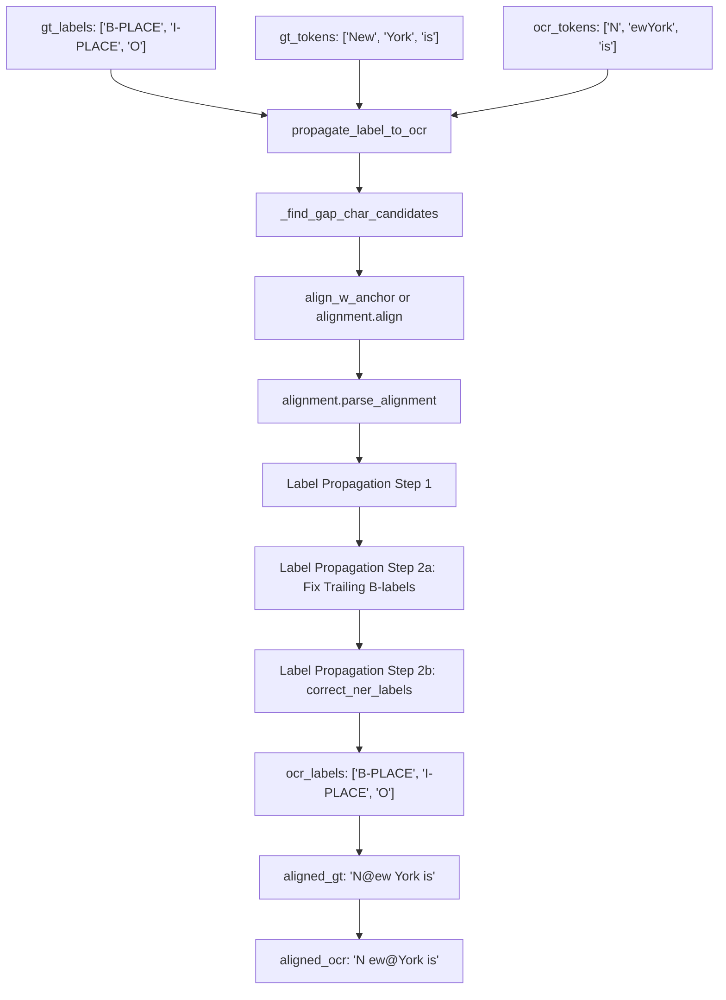
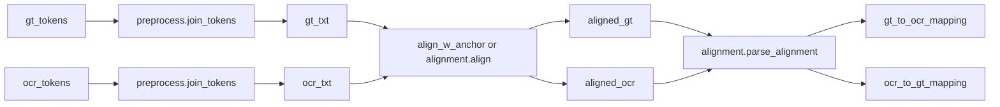
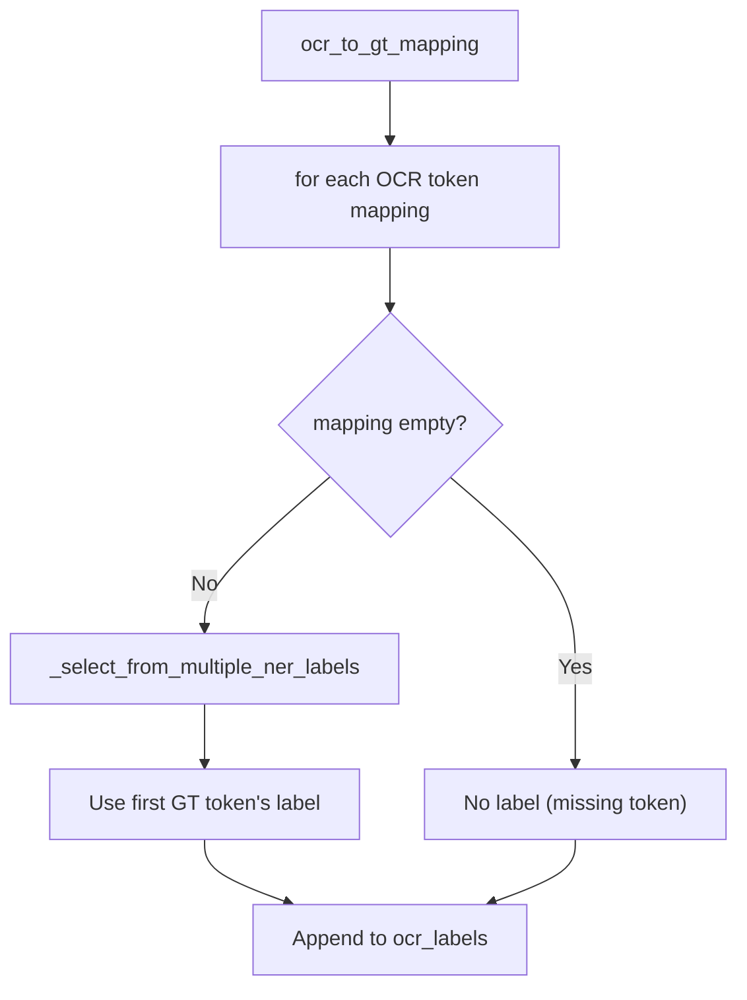
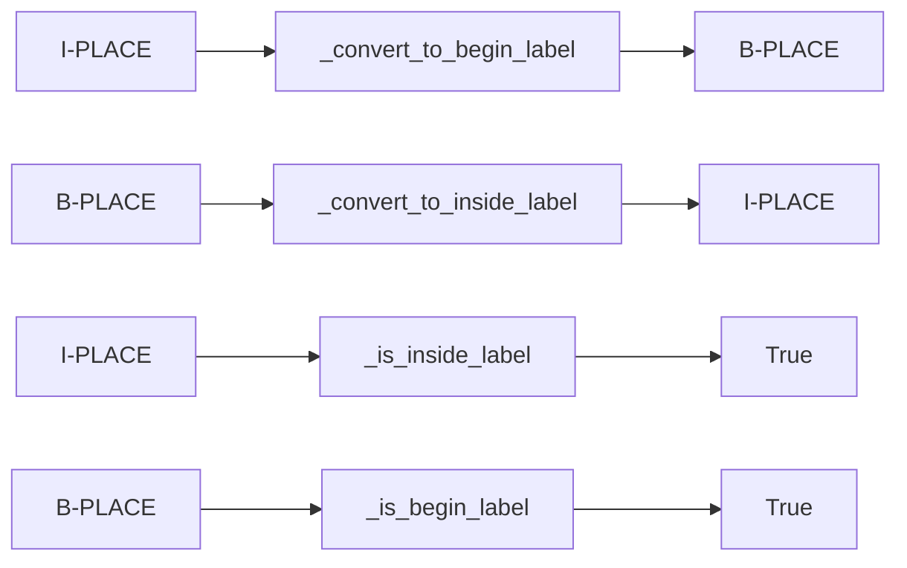
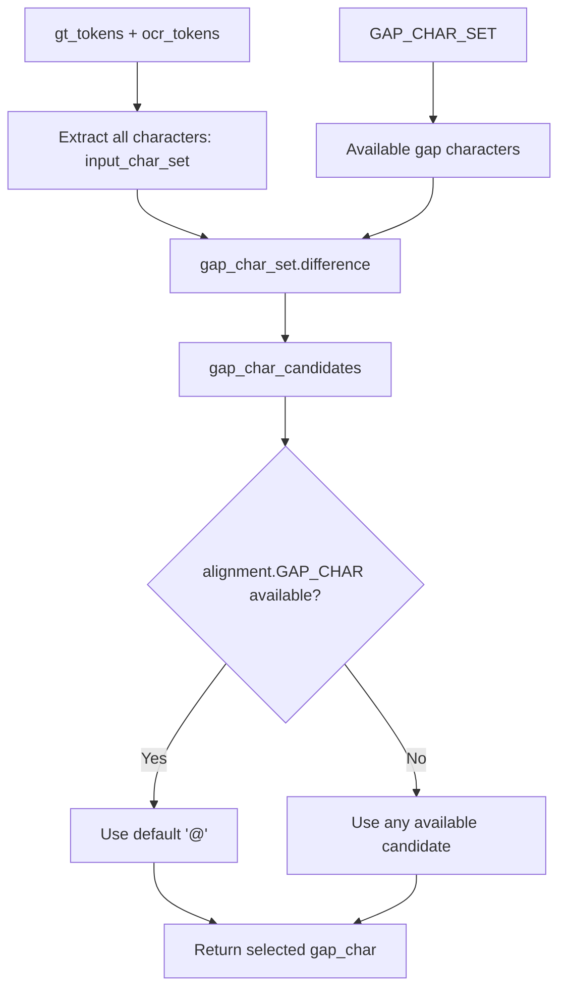
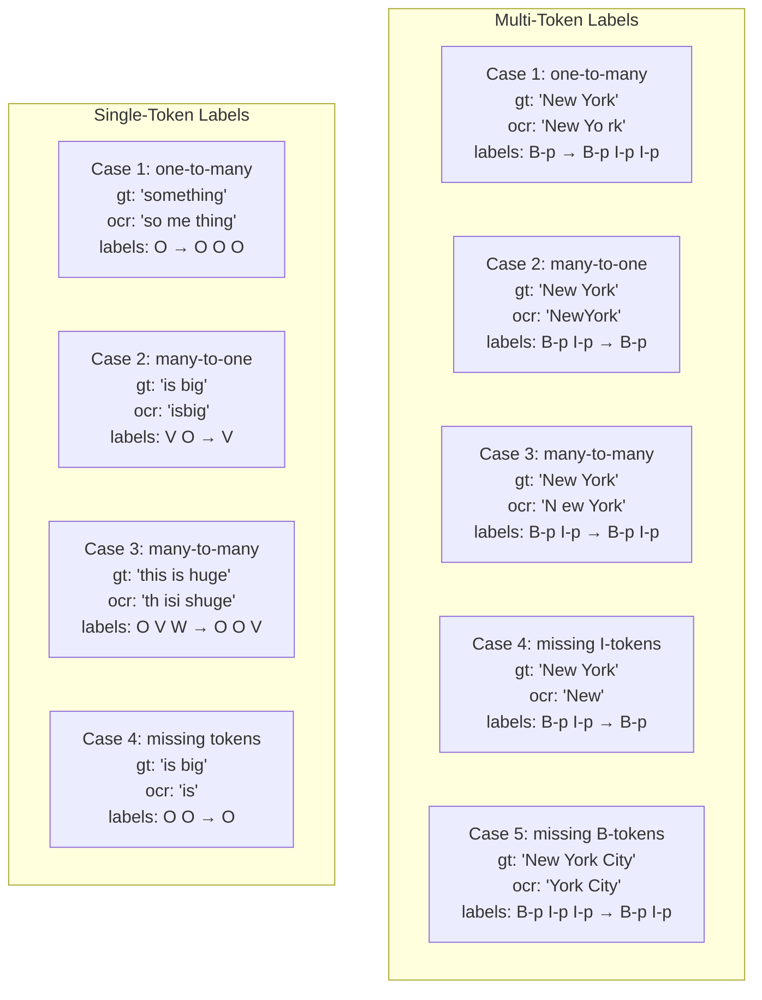
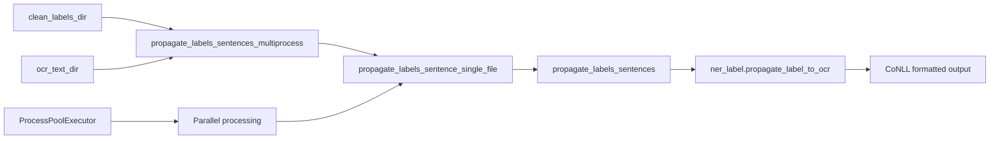

<!-- source: DeepWiki mcp.deepwiki.com · repo microsoft/genalog · extra page NER Label Propagation · fetched 2026-10-26 -->

# NER Label Propagation

Relevant source files

The following files were used as context for generating this wiki page:

- [genalog/ocr/metrics.py](genalog/ocr/metrics.py)
- [genalog/text/alignment.py](genalog/text/alignment.py)
- [genalog/text/conll_format.py](genalog/text/conll_format.py)
- [genalog/text/ner_label.py](genalog/text/ner_label.py)

## Purpose and Scope

This document covers the Named Entity Recognition (NER) label propagation system in genalog, which transfers NER labels from clean ground truth text to OCR'd text containing recognition errors. This process is essential for creating labeled training datasets that enable robust NER models to handle real-world OCR noise.

For information about the underlying text alignment algorithms, see [Text Alignment](#2.3.1). For broader text processing utilities, see [Text Processing](#2.3).

## Overview

NER label propagation solves a critical challenge in synthetic dataset generation: when clean text with NER labels is processed through document generation and OCR, the resulting text contains errors that misalign with the original labels. The propagation system uses sequence alignment to map tokens between clean and OCR'd text, then transfers labels while handling complex cases like token splitting, merging, and missing tokens.

**Core Process Flow**

Sources: [genalog/text/ner_label.py:190-431]()

## Core Algorithm Implementation

The main entry point `propagate_label_to_ocr()` handles gap character selection and delegates to the core implementation `_propagate_label_to_ocr()`. The algorithm operates in three phases:

### Phase 1: Text Alignment and Mapping

The system first reconstructs full text strings from token lists, performs sequence alignment using either the anchor-based method or standard Needleman-Wunsch algorithm, then parses the alignment to create bidirectional token mappings.

Sources: [genalog/text/ner_label.py:384-402]()

### Phase 2: Naive Label Propagation

For each OCR token, the system looks up which ground truth tokens it maps to. If multiple ground truth tokens map to one OCR token, `_select_from_multiple_ner_labels()` selects the first token's label as the representative.

Sources: [genalog/text/ner_label.py:405-414](), [genalog/text/ner_label.py:140-167]()

### Phase 3: Multi-Token Label Correction

The system addresses two critical issues with multi-token NER labels (B-LABEL, I-LABEL sequences):

**Step 2a: Trailing B-label Correction**
When one ground truth token splits into multiple OCR tokens, all OCR tokens initially receive the same label. For B-labels, only the first OCR token should keep the B-label; subsequent tokens should be converted to I-labels.

**Step 2b: Missing B-label Correction**
The `correct_ner_labels()` function scans for I-labels that lack proper B-label prefixes and converts them to B-labels when necessary.

Sources: [genalog/text/ner_label.py:416-428](), [genalog/text/ner_label.py:113-137]()

## Label Types and Conversion Functions

The system handles standard IOB (Inside-Outside-Begin) tagging with specific regex patterns and conversion utilities:

| Function | Purpose | Pattern |
|----------|---------|---------|
| `_is_begin_label()` | Identifies B-labels | `^\s*(B-)([a-z\|A-Z]+)\s*$` |
| `_is_inside_label()` | Identifies I-labels | `^\s*(I-)([a-z\|A-Z]+)\s*$` |
| `_convert_to_begin_label()` | I-label → B-label | Replace `I-` with `B-` |
| `_convert_to_inside_label()` | B-label → I-label | Replace `B-` with `I-` |

Sources: [genalog/text/ner_label.py:19-83]()

## Gap Character Management

The propagation system requires a gap character for sequence alignment that doesn't appear in the input text. The `_find_gap_char_candidates()` function ensures alignment integrity:

If no suitable gap characters exist, the system raises `GapCharError` indicating the input character set is too large.

Sources: [genalog/text/ner_label.py:169-236](), [genalog/text/ner_label.py:25-33]()

## Integration with Text Alignment

NER label propagation depends heavily on the text alignment infrastructure. The system supports two alignment strategies:

| Strategy | Function | Use Case |
|----------|----------|----------|
| Standard | `alignment.align()` | Small text segments (O(N²) complexity) |
| Anchor-based | `anchor.align_w_anchor()` | Longer texts with anchor points |

The `use_anchor` parameter in `propagate_label_to_ocr()` controls which alignment method is used, defaulting to the faster anchor-based approach.

Sources: [genalog/text/ner_label.py:388-393]()

## Complex Mapping Scenarios

The propagation system handles various alignment patterns between ground truth and OCR tokens:

**Case Analysis from Code Comments**

Sources: [genalog/text/ner_label.py:252-279]()

## Usage in Dataset Generation

The propagation system integrates with the broader genalog pipeline through `conll_format.py`, which processes entire datasets:

The `propagate_labels_sentences()` function extends basic label propagation to handle sentence boundaries, ensuring that OCR text is properly segmented to match the original sentence structure.

Sources: [genalog/text/conll_format.py:61-158](), [genalog/text/conll_format.py:244-280]()

## Error Handling and Validation

The system includes comprehensive validation for input data integrity:

| Validation | Error Type | Description |
|------------|------------|-------------|
| Token count mismatch | `ValueError` | `gt_tokens` and `gt_labels` have different lengths |
| Non-atomic tokens | `ValueError` | Tokens contain spaces (not atomic) |
| Invalid tokens | `ValueError` | Empty strings or whitespace-only tokens |
| Gap character conflicts | `GapCharError` | Tokens contain the gap character |
| Alignment failures | `ValueError` | Alignment produces wrong token count |

Sources: [genalog/text/ner_label.py:365-383]()

## Display and Formatting Utilities

The module provides utilities for visualizing label propagation results:

- `format_labels()`: Aligns tokens and labels for display
- `format_label_propagation()`: Shows complete propagation results with optional alignment visualization
- `_format_alignment()`: Displays character-level alignment with match indicators

These functions support debugging and validation of the propagation process by making the token-to-label mappings visually apparent.

Sources: [genalog/text/ner_label.py:433-527]()

---

