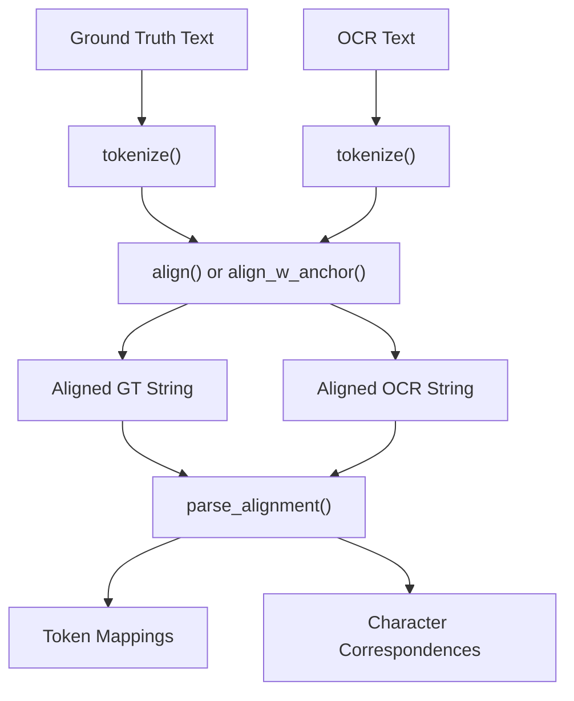
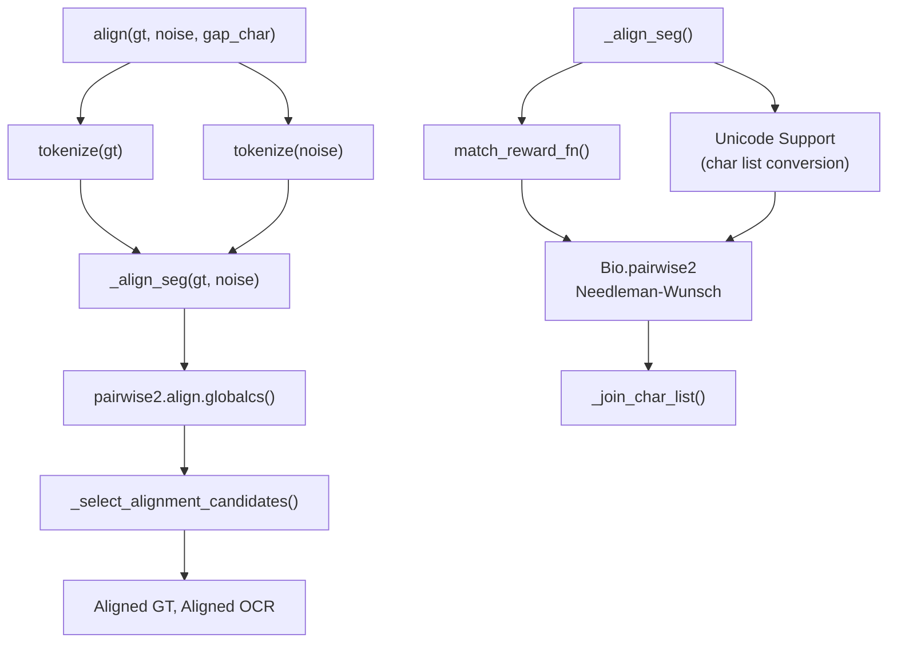
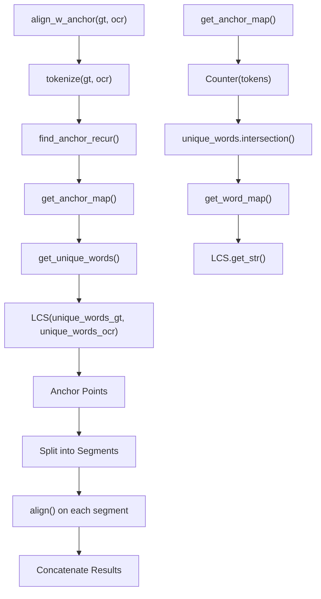
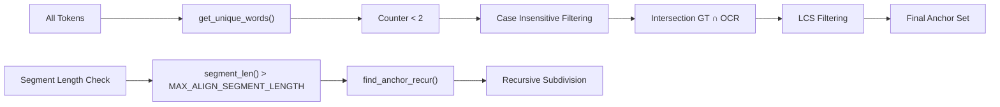
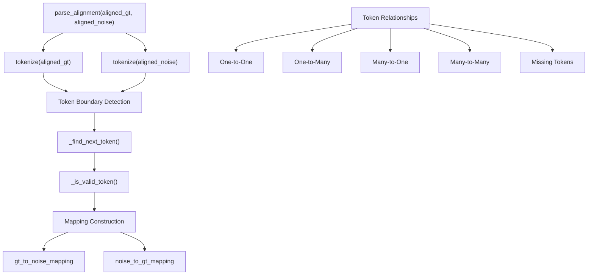
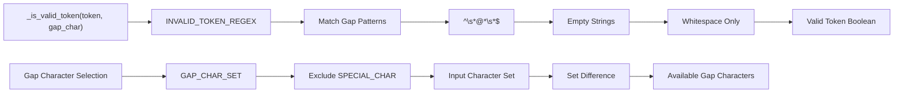
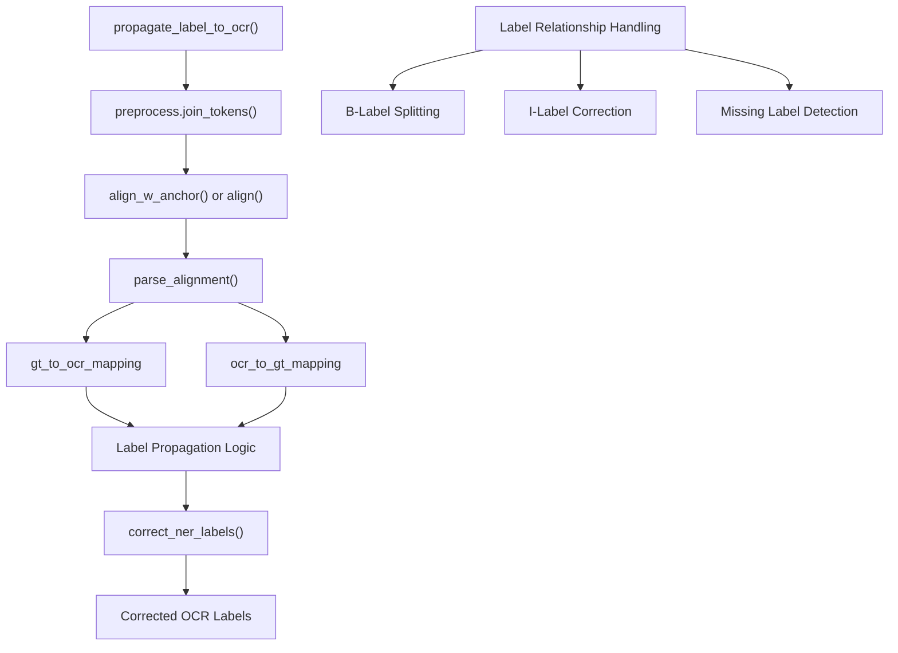

<!-- source: DeepWiki mcp.deepwiki.com · repo microsoft/genalog · extra page Text Alignment · fetched 2026-10-26 -->

# Text Alignment

Relevant source files

The following files were used as context for generating this wiki page:

- [genalog/text/alignment.py](genalog/text/alignment.py)
- [genalog/text/anchor.py](genalog/text/anchor.py)
- [genalog/text/ner_label.py](genalog/text/ner_label.py)

This document covers the text alignment algorithms implemented in genalog for aligning ground truth text with OCR output text. The alignment functionality enables comparison and analysis of OCR accuracy by establishing character-level and token-level correspondences between clean and noisy text versions.

For information about NER label propagation that uses text alignment, see [NER Label Propagation](#2.3.2). For broader text processing utilities, see [Text Processing](#2.3).

## Algorithm Overview

The genalog text alignment system provides two primary alignment strategies:

1. **Global Sequence Alignment**: Direct implementation using the Needleman-Wunsch algorithm via Bio.pairwise2
2. **Anchor-based Alignment**: Fast alignment scheme for longer documents using the RETAS approach

Both algorithms produce aligned text pairs where gaps are inserted to maintain character-level correspondence between ground truth and OCR text.

### Core Alignment Flow

Sources: [genalog/text/alignment.py:149-194](), [genalog/text/anchor.py:232-309]()

## Needleman-Wunsch Global Alignment

The core alignment algorithm implements global sequence alignment using the Needleman-Wunsch dynamic programming approach through the Bio.pairwise2 library.

### Alignment Configuration

| Parameter | Default Value | Purpose |
|-----------|---------------|---------|
| `MATCH_REWARD` | 1 | Reward for matching characters |
| `MISMATCH_PENALTY` | -0.5 | Penalty for character substitutions |
| `GAP_PENALTY` | -0.5 | Penalty for insertions/deletions |
| `GAP_EXT_PENALTY` | -0.5 | Penalty for extending gaps |
| `SPACE_MISMATCH_PENALTY` | 0.1 | Additional penalty for space mismatches |
| `GAP_CHAR` | "@" | Character used to represent gaps |

Sources: [genalog/text/alignment.py:12-20]()

### Alignment Algorithm Implementation

The `align()` function in [genalog/text/alignment.py:149-194]() serves as the main entry point, ensuring that:
- Input validation handles empty strings appropriately
- Token count invariants are maintained between input and output
- Multiple alignment candidates are filtered to preserve ground truth token count

Sources: [genalog/text/alignment.py:28-86](), [genalog/text/alignment.py:88-147]()

## Fast Alignment with Anchors

For longer documents where O(N²) complexity becomes prohibitive, the anchor-based alignment scheme provides significant performance improvements by breaking text into smaller segments.

### RETAS Algorithm Implementation

The anchor-based approach uses the following strategy:

1. **Unique Word Identification**: Extract words that appear only once in each text
2. **Common Anchor Detection**: Find unique words present in both ground truth and OCR text
3. **LCS-based Filtering**: Use Longest Common Subsequence to identify reliable anchor points
4. **Recursive Segmentation**: Split long segments recursively until manageable sizes
5. **Segment Alignment**: Apply standard Needleman-Wunsch to each segment pair

Sources: [genalog/text/anchor.py:84-154](), [genalog/text/anchor.py:157-229](), [genalog/text/anchor.py:232-309]()

### Anchor Selection Criteria

Sources: [genalog/text/anchor.py:33-51](), [genalog/text/anchor.py:53-62]()

## Alignment Parsing and Token Mapping

After alignment, the `parse_alignment()` function converts character-level alignments into token-level mappings that support downstream applications like NER label propagation.

### Token Mapping Generation

The parsing algorithm handles five distinct token relationship patterns:

1. **One-to-One**: Single GT token aligns to single OCR token
2. **One-to-Many**: Single GT token splits into multiple OCR tokens  
3. **Many-to-One**: Multiple GT tokens merge into single OCR token
4. **Many-to-Many**: Complex relationships requiring careful mapping
5. **Missing Tokens**: GT or OCR tokens with no correspondence

Sources: [genalog/text/alignment.py:322-471](), [genalog/text/alignment.py:224-297]()

### Token Validation and Gap Handling

The token validation ensures alignment integrity by identifying invalid tokens composed entirely of gap characters, whitespace, or empty strings. The gap character selection mechanism automatically chooses suitable gap characters that don't conflict with input text characters.

Sources: [genalog/text/alignment.py:299-320](), [genalog/text/ner_label.py:169-188]()

## Integration with NER Label Propagation

The alignment functionality serves as the foundation for NER label propagation, where named entity labels from clean ground truth text are transferred to corresponding OCR tokens.

### Alignment-Based Label Transfer

The label propagation process leverages both mapping directions to handle complex multi-token entity scenarios where entity boundaries may shift between ground truth and OCR text.

Sources: [genalog/text/ner_label.py:190-237](), [genalog/text/ner_label.py:239-431]()

## Performance Characteristics

### Algorithm Complexity Comparison

| Algorithm | Time Complexity | Space Complexity | Best Use Case |
|-----------|----------------|------------------|---------------|
| `align()` | O(N²) | O(N²) | Short text segments (< 100 chars) |
| `align_w_anchor()` | O(N log N) typical | O(N) | Long documents, books, articles |

### Configuration Constants

The alignment behavior can be tuned through several configuration parameters defined in [genalog/text/alignment.py:12-20]():

- **MAX_ALIGN_SEGMENT_LENGTH**: 100 characters - threshold for triggering anchor-based segmentation
- **Scoring Parameters**: Control alignment quality vs. gap insertion tradeoffs
- **Gap Character Handling**: Automatic selection from printable ASCII excluding whitespace

Sources: [genalog/text/anchor.py:30](), [genalog/text/alignment.py:12-20]()

---

