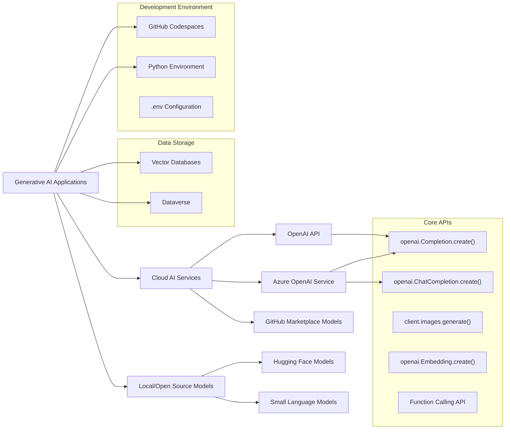

<!-- source: DeepWiki mcp.deepwiki.com · repo microsoft/generative-ai-for-beginners · page 1 Overview · fetched 2026-10-26 -->

# Overview

Relevant source files

The following files were used as context for generating this wiki page:

- [00-course-setup/README.md](00-course-setup/README.md)
- [01-introduction-to-genai/README.md](01-introduction-to-genai/README.md)
- [02-exploring-and-comparing-different-llms/README.md](02-exploring-and-comparing-different-llms/README.md)
- [03-using-generative-ai-responsibly/README.md](03-using-generative-ai-responsibly/README.md)
- [04-prompt-engineering-fundamentals/README.md](04-prompt-engineering-fundamentals/README.md)
- [05-advanced-prompts/README.md](05-advanced-prompts/README.md)
- [06-text-generation-apps/README.md](06-text-generation-apps/README.md)
- [07-building-chat-applications/README.md](07-building-chat-applications/README.md)
- [08-building-search-applications/README.md](08-building-search-applications/README.md)
- [09-building-image-applications/README.md](09-building-image-applications/README.md)
- [10-building-low-code-ai-applications/README.md](10-building-low-code-ai-applications/README.md)
- [11-integrating-with-function-calling/README.md](11-integrating-with-function-calling/README.md)
- [12-designing-ux-for-ai-applications/README.md](12-designing-ux-for-ai-applications/README.md)
- [README.md](README.md)
- [presentations/GenerativeAIBootcamp-Presentation.pdf](presentations/GenerativeAIBootcamp-Presentation.pdf)
- [presentations/GenerativeAIBootcamp-Presentation.pptx](presentations/GenerativeAIBootcamp-Presentation.pptx)
- [translations/en/.co-op-translator.json](translations/en/.co-op-translator.json)
- [translations/en/README.md](translations/en/README.md)
- [translations/en/docs/ENHANCED_FEATURES_ROADMAP.md](translations/en/docs/ENHANCED_FEATURES_ROADMAP.md)
- [translations/en/docs/SECURITY_GUIDELINES.md](translations/en/docs/SECURITY_GUIDELINES.md)
- [translations/es/.co-op-translator.json](translations/es/.co-op-translator.json)
- [translations/es/README.md](translations/es/README.md)
- [translations/es/docs/ENHANCED_FEATURES_ROADMAP.md](translations/es/docs/ENHANCED_FEATURES_ROADMAP.md)
- [translations/es/docs/SECURITY_GUIDELINES.md](translations/es/docs/SECURITY_GUIDELINES.md)
- [translations/fr/.co-op-translator.json](translations/fr/.co-op-translator.json)
- [translations/fr/README.md](translations/fr/README.md)

This document provides a comprehensive introduction to the "Generative AI for Beginners" course, a learning resource developed by Microsoft Cloud Advocates. The course consists of 21 lessons designed to teach the fundamentals of building Generative AI applications. This overview explains the course structure, target audience, core concepts, and technical requirements necessary to get started with Generative AI development.

For information about specific development environment setup, see [Course Structure and Setup](#2).

Sources: [README.md:3-13](), [README.md:45-48](), [00-course-setup/README.md:1-5]()

## Course Objectives and Target Audience

The "Generative AI for Beginners" course is designed for developers, students, and technology enthusiasts who want to start building applications leveraging generative AI capabilities. The course aims to:

- Teach fundamental concepts of generative AI and large language models (LLMs) [01-introduction-to-genai/README.md:20-26]()
- Provide hands-on experience with building various types of generative AI applications [README.md:51-54]()
- Guide learners in using generative AI responsibly and ethically [03-using-generative-ai-responsibly/README.md:1-10]()
- Demonstrate integration of generative AI capabilities into different application types [06-text-generation-apps/README.md:47-54]()

The course is suitable for both beginners in AI as well as experienced developers looking to expand their knowledge into generative AI. Basic knowledge of Python or TypeScript is helpful, as the course provides examples in both languages [README.md:65-65]().

Sources: [README.md:51-58](), [01-introduction-to-genai/README.md:11-26](), [04-prompt-engineering-fundamentals/README.md:49-57]()

## Course Structure and Content

The course is structured into 21 lessons, each covering a specific aspect of generative AI. Lessons are categorized as either "Learn" (explaining concepts) or "Build" (providing practical code examples) [README.md:51-54]().

### Course Structure Diagram

```mermaid
flowchart TD
    A["Generative AI for Beginners Course"] --> B["Setup & Prerequisites"]
    A --> C["Core Concepts"]
    A --> D["Application Development"]
    A --> E["Advanced Topics"]
    
    B --> B1["Course Setup (Lesson 00)"]
    
    C --> C1["Introduction to GenAI (Lesson 01)"]
    C --> C2["Exploring Different LLMs (Lesson 02)"]
    C --> C3["Using GenAI Responsibly (Lesson 03)"]
    C --> C4["Prompt Engineering Fundamentals (Lesson 04)"]
    C --> C5["Advanced Prompts (Lesson 05)"]
    
    D --> D1["Text Generation Apps (Lesson 06)"]
    D --> D2["Chat Applications (Lesson 07)"]
    D --> D3["Search Applications (Lesson 08)"]
    D --> D4["Image Applications (Lesson 09)"]
    D --> D5["Low-Code AI Applications (Lesson 10)"]
    D --> D6["Function Calling Integration (Lesson 11)"]
    D --> D7["UX Design for AI Apps (Lesson 12)"]
    
    E --> E1["Securing AI Applications (Lesson 13)"]
    E --> E2["AI Application Lifecycle (Lesson 14)"]
    E --> E3["RAG and Vector Databases (Lesson 15)"]
    E --> E4["Open Source Models (Lesson 16)"]
    E --> E5["AI Agents (Lesson 17)"]
    E --> E6["Fine-tuning LLMs (Lesson 18)"]
    E --> E7["Small Language Models (Lesson 19-21)"]
```

Sources: [README.md:3-13](), [README.md:51-54](), [00-course-setup/README.md:30-36]()

### Core Concepts

The first five lessons cover the foundational knowledge needed to understand generative AI:

1. **Introduction to Generative AI and LLMs** - Explains what generative AI is, how LLMs work, and their capabilities [01-introduction-to-genai/README.md:13-19]()
2. **Exploring and Comparing Different LLMs** - Guides in selecting the right model for specific use cases [02-exploring-and-comparing-different-llms/README.md:13-26]()
3. **Using Generative AI Responsibly** - Covers ethical considerations and best practices [03-using-generative-ai-responsibly/README.md:1-10]()
4. **Understanding Prompt Engineering Fundamentals** - Teaches the core principles of effective prompting [04-prompt-engineering-fundamentals/README.md:14-24]()
5. **Creating Advanced Prompts** - Explores advanced techniques to improve prompt outcomes [05-advanced-prompts/README.md:13-26]()

Sources: [01-introduction-to-genai/README.md:60-69](), [02-exploring-and-comparing-different-llms/README.md:27-43](), [04-prompt-engineering-fundamentals/README.md:69-81]()

### Building Applications

Lessons 6 through 12 focus on practical implementation of different types of generative AI applications:

6. **Building Text Generation Applications** - Creating applications that generate text using LLMs [06-text-generation-apps/README.md:11-17]()
7. **Building Chat Applications** - Implementing conversational interfaces [07-building-chat-applications/README.md:8-16]()
8. **Building Search Applications with Vector Databases** - Using embeddings for semantic search [08-building-search-applications/README.md:13-21]()
9. **Building Image Generation Applications** - Creating applications that generate images [09-building-image-applications/README.md:9-22]()
10. **Building Low Code AI Applications** - Using Power Platform for AI solutions [10-building-low-code-ai-applications/README.md:15-21]()
11. **Integrating with Function Calling** - Connecting external functions with LLMs [11-integrating-with-function-calling/README.md:9-24]()
12. **Designing UX for AI Applications** - Applying best UX practices to AI applications [12-designing-ux-for-ai-applications/README.md:9-25]()

Sources: [06-text-generation-apps/README.md:132-144](), [08-building-search-applications/README.md:46-60](), [09-building-image-applications/README.md:43-63](), [11-integrating-with-function-calling/README.md:37-45]()

### Application Types Diagram

```mermaid
graph TD
    A["GenAI Application Types"] --> B["Text Generation"]
    A --> C["Chat Applications"]
    A --> D["Search Applications"]
    A --> E["Image Generation"]
    A --> F["Low-Code Applications"]
    
    B --> B1["openai.Completion.create()"]
    B --> B2["Tokens & Temperature"]
    
    C --> C1["openai.ChatCompletion.create()"]
    C --> C2["System Messages"]
    C --> C3["Conversational Context"]
    
    D --> D1["Vector Embeddings"]
    D --> D2["openai.Embedding.create()"]
    D --> D3["Cosine Similarity Search"]
    
    E --> E1["client.images.generate()"]
    E --> E2["DALL-E Integration"]
    E --> E3["Prompt Boundaries"]
    
    F --> F1["Power Apps & Automate"]
    F --> F2["AI Builder"]
    F --> F3["Copilot Integration"]
    
    subgraph Integration Methods
        G["Function Calling"]
        H["RAG"]
        I["AI Agents"]
    end
    
    C --- G
    D --- H
    A --- I
```

Sources: [06-text-generation-apps/README.md:132-144](), [08-building-search-applications/README.md:46-60](), [09-building-image-applications/README.md:141-147](), [10-building-low-code-ai-applications/README.md:44-57](), [11-integrating-with-function-calling/README.md:117-131]()

### Advanced Topics

Lessons 13 through 21 cover advanced concepts and techniques including security, retrieval augmented generation (RAG), and open-source model integration.

Sources: [README.md:3-13]()

## Technical Architecture

The course incorporates different AI services and technologies that interact with each other to build complete applications. The diagram below illustrates the technical components used throughout the course:

Sources: [README.md:60-64](), [00-course-setup/README.md:15-22](), [06-text-generation-apps/README.md:112-130](), [08-building-search-applications/README.md:74-77](), [10-building-low-code-ai-applications/README.md:34-43]()

## Technical Requirements and Setup

To work through the course, you'll need:

1. **Development Environment**:
   - Python (3.x) or knowledge of TypeScript [00-course-setup/README.md:91-94]()
   - GitHub account to fork the repository [00-course-setup/README.md:11-13]()
   - Recommended: GitHub Codespaces for zero-config setup [00-course-setup/README.md:15-22]()

2. **API Access**:
   - Access to one of the following providers:
     - Azure OpenAI Service [README.md:61-61]()
     - GitHub Marketplace Model Catalog [README.md:62-62]()
     - OpenAI API [README.md:63-63]()

3. **Environment Configuration**:
   - Setting up environment variables (e.g., `OPENAI_API_KEY`, `GITHUB_TOKEN`) in a `.env` file [00-course-setup/README.md:60-64]()
   - Creating a virtual environment using `venv` or `Miniconda` [00-course-setup/README.md:106-115]()
   - Installing dependencies via `pip install -r requirements.txt` [09-building-image-applications/README.md:107-113]()

Sources: [README.md:59-68](), [00-course-setup/README.md:7-36](), [06-text-generation-apps/README.md:77-84]()

## Multi-Language Support

The course features automated translation support for over 50 languages via a GitHub Action system. This allows global access to the curriculum.

- **Sparse Checkout**: Due to the large size of translations, learners can use `git sparse-checkout` to clone only the core content [README.md:24-42]().
- **Co-op Translator**: An automated system manages updates across language directories like `/translations/fr/` or `/translations/es/` [README.md:17-22]().

Sources: [README.md:17-43]()

## Conclusion

The "Generative AI for Beginners" course provides a comprehensive introduction to building applications with generative AI. Through 21 lessons, it covers everything from basic concepts to advanced techniques, with practical code examples in Python and TypeScript. Whether you're looking to understand how LLMs work, build specific types of AI applications, or explore cutting-edge techniques like RAG or function calling, this course offers structured guidance to help you achieve your goals.

Sources: [README.md:3-13](), [README.md:45-48]()

---

