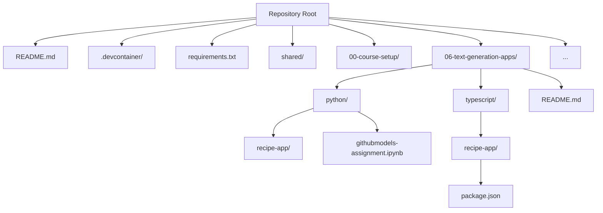
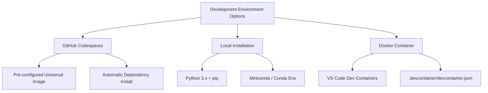

<!-- source: DeepWiki mcp.deepwiki.com · repo microsoft/generative-ai-for-beginners · page 2 Course Structure and Setup · fetched 2026-10-26 -->

# Course Structure and Setup

Relevant source files

The following files were used as context for generating this wiki page:

- [.devcontainer/Setup.txt](.devcontainer/Setup.txt)
- [.devcontainer/devcontainer.json](.devcontainer/devcontainer.json)
- [.devcontainer/environment.yml](.devcontainer/environment.yml)
- [.devcontainer/icon.svg](.devcontainer/icon.svg)
- [.devcontainer/post-create.sh](.devcontainer/post-create.sh)
- [.env.copy](.env.copy)
- [00-course-setup/01-setup-cloud.md](00-course-setup/01-setup-cloud.md)
- [00-course-setup/02-setup-local.md](00-course-setup/02-setup-local.md)
- [00-course-setup/03-providers.md](00-course-setup/03-providers.md)
- [00-course-setup/README.md](00-course-setup/README.md)
- [06-text-generation-apps/python/githubmodels-assignment.ipynb](06-text-generation-apps/python/githubmodels-assignment.ipynb)
- [06-text-generation-apps/typescript/.gitignore](06-text-generation-apps/typescript/.gitignore)
- [06-text-generation-apps/typescript/recipe-app/.env-sample](06-text-generation-apps/typescript/recipe-app/.env-sample)
- [06-text-generation-apps/typescript/recipe-app/package-lock.json](06-text-generation-apps/typescript/recipe-app/package-lock.json)
- [06-text-generation-apps/typescript/recipe-app/package.json](06-text-generation-apps/typescript/recipe-app/package.json)
- [06-text-generation-apps/typescript/recipe-app/tsconfig.json](06-text-generation-apps/typescript/recipe-app/tsconfig.json)
- [07-building-chat-applications/python/aoai-assignment.ipynb](07-building-chat-applications/python/aoai-assignment.ipynb)
- [07-building-chat-applications/python/githubmodels-assignment.ipynb](07-building-chat-applications/python/githubmodels-assignment.ipynb)
- [07-building-chat-applications/python/oai-assignment.ipynb](07-building-chat-applications/python/oai-assignment.ipynb)
- [07-building-chat-applications/typescript/chat-completions-app/src/main.ts](07-building-chat-applications/typescript/chat-completions-app/src/main.ts)
- [07-building-chat-applications/typescript/chat-completions-app/tsconfig.json](07-building-chat-applications/typescript/chat-completions-app/tsconfig.json)
- [08-building-search-applications/python/aoai-solution.ipynb](08-building-search-applications/python/aoai-solution.ipynb)
- [08-building-search-applications/python/oai-solution.ipynb](08-building-search-applications/python/oai-solution.ipynb)
- [11-integrating-with-function-calling/python/aoai-assignment.ipynb](11-integrating-with-function-calling/python/aoai-assignment.ipynb)
- [11-integrating-with-function-calling/python/oai-assignment.ipynb](11-integrating-with-function-calling/python/oai-assignment.ipynb)
- [README.md](README.md)
- [docs/_sidebar.md](docs/_sidebar.md)
- [package-lock.json](package-lock.json)
- [package.json](package.json)
- [requirements.txt](requirements.txt)
- [translations/en/.co-op-translator.json](translations/en/.co-op-translator.json)
- [translations/en/README.md](translations/en/README.md)
- [translations/en/docs/ENHANCED_FEATURES_ROADMAP.md](translations/en/docs/ENHANCED_FEATURES_ROADMAP.md)
- [translations/en/docs/SECURITY_GUIDELINES.md](translations/en/docs/SECURITY_GUIDELINES.md)
- [translations/es/.co-op-translator.json](translations/es/.co-op-translator.json)
- [translations/es/README.md](translations/es/README.md)
- [translations/es/docs/ENHANCED_FEATURES_ROADMAP.md](translations/es/docs/ENHANCED_FEATURES_ROADMAP.md)
- [translations/es/docs/SECURITY_GUIDELINES.md](translations/es/docs/SECURITY_GUIDELINES.md)
- [translations/fr/.co-op-translator.json](translations/fr/.co-op-translator.json)
- [translations/fr/README.md](translations/fr/README.md)
- [vs.code-profile](vs.code-profile)

This document outlines the structure of the Generative AI for Beginners course and provides detailed instructions for setting up your development environment. It covers course organization, repository structure, and technical setup requirements to ensure you can successfully complete the lessons.

For information about the specific development environment configuration, see [Development Environment](#2.1).

## Course Organization

The Generative AI for Beginners course consists of 21 comprehensive lessons designed to teach fundamental concepts and practical applications of generative AI. The course is structured in a progressive manner, starting with core concepts and building toward more advanced topics.

### Curriculum Map

```mermaid
flowchart TD
    A["Generative AI for Beginners Course"] --> B["Prerequisites & Setup"]
    A --> C["Core Concepts"]
    A --> D["Building Applications"]
    A --> E["Advanced Topics"]
    
    B --> B1["00-course-setup"]
    
    C --> C1["01-introduction-to-genai"]
    C --> C2["02-exploring-and-comparing-different-llms"]
    C --> C3["03-using-generative-ai-responsibly"]
    C --> C4["04-prompt-engineering-fundamentals"]
    C --> C5["05-advanced-prompts"]
    
    D --> D1["06-text-generation-apps"]
    D --> D2["07-building-chat-applications"]
    D --> D3["08-building-search-applications"]
    D --> D4["09-building-image-applications"]
    D --> D5["10-building-low-code-ai-applications"]
    D --> D6["11-integrating-with-function-calling"]
    D --> D7["12-designing-ux-for-ai-applications"]
    
    E --> E1["13-securing-ai-applications"]
    E --> E2["14-the-generative-ai-application-lifecycle"]
    E --> E3["15-rag-and-vector-databases"]
    E --> E4["16-open-source-models"]
    E --> E5["17-ai-agents"]
    E --> E6["18-fine-tuning-llms"]
    E --> E7["19-slm"]
    E --> E8["20-mistral"]
    E --> E9["21-meta"]
```

Sources: [README.md:45-58](), [README.md:82-113]()

### Lesson Format

Each lesson in the course follows a consistent format that includes:

- A short video introduction to the topic [README.md:120-120]()
- A written lesson located in the `README.md` file of the lesson directory [README.md:51-53]()
- Code samples in **Python** and **TypeScript** supporting both Azure OpenAI, OpenAI API, and GitHub Models [README.md:53-55](), [README.md:60-63]()
- A "Keep Learning" section with additional tools and resources [README.md:57-57]()

Lessons are labeled as either:
- **Learn** lessons that explain Generative AI concepts [README.md:53-53]()
- **Build** lessons that include both explanations and practical code examples [README.md:53-54]()

Sources: [README.md:51-63]()

## Repository Structure

The repository is organized to provide a clear and consistent learning experience. Each lesson is contained in its own directory with a standardized structure.

Sources: [README.md:1-113](), [06-text-generation-apps/python/githubmodels-assignment.ipynb:1-15](), [06-text-generation-apps/typescript/recipe-app/package.json:1-15]()

## Setup Requirements

Before starting the course, you will need:

1. **GitHub Account**: To [fork this entire repo](https://github.com/microsoft/generative-ai-for-beginners/fork) and access GitHub Codespaces [00-course-setup/README.md:11-13]().
2. **API Access**: Choose one of the following providers:
   - [Azure OpenAI Service](https://aka.ms/genai-beginners/azure-open-ai) [README.md:61-61]()
   - [GitHub Marketplace Model Catalog](https://aka.ms/genai-beginners/gh-models) [README.md:62-62]()
   - [OpenAI API](https://aka.ms/genai-beginners/open-ai) [README.md:63-63]()
3. **Basic Knowledge**: Familiarity with Python or TypeScript [README.md:65-65]().

Sources: [README.md:59-67](), [00-course-setup/README.md:11-17]()

## Setting Up Your Development Environment

### 1. Fork the Repository

To get started, you need to fork the repository to your own GitHub account:

1. Visit the [Generative AI for Beginners repository](https://github.com/microsoft/generative-ai-for-beginners).
2. Click the "Fork" button in the top-right corner [00-course-setup/README.md:13-13]().
3. Star (🌟) the repository to find it more easily later [README.md:70-70]().

### 2. Development Environment Options

You have several options for setting up your development environment:

Sources: [00-course-setup/README.md:16-22](), [00-course-setup/README.md:91-148](), [.devcontainer/devcontainer.json:1-23]()

#### Option 1: GitHub Codespaces (Recommended)

GitHub Codespaces provides a cloud-based development environment with all dependencies pre-configured via the `.devcontainer/devcontainer.json` file [.devcontainer/devcontainer.json:1-23]().

1. From your forked repository, click **Code -> Codespaces -> New on main** [00-course-setup/README.md:19-19]().
2. The environment automatically runs `pip install -r requirements.txt` and a post-create script [.devcontainer/devcontainer.json:10-11]().

Sources: [00-course-setup/README.md:16-22](), [.devcontainer/devcontainer.json:10-11]()

#### Option 2: Local Python Installation

To run the code locally:

1. Clone your forked repository: `git clone https://github.com/microsoft/generative-ai-for-beginners` [00-course-setup/README.md:98-98]().
2. Install dependencies: `pip install -r requirements.txt` [requirements.txt:1-10]().
3. (Optional) Use Miniconda to manage a virtual environment using `.devcontainer/environment.yml` [00-course-setup/README.md:115-144]().

Sources: [00-course-setup/README.md:91-144](), [requirements.txt:1-11]()

### 3. API Setup and Configuration

Most coding lessons require access to an LLM provider. You must configure your credentials in a `.env` file.

#### Setting Up API Keys

1. Create a `.env` file in the root directory [00-course-setup/README.md:50-52]().
2. Populate it using the structure from `.env.copy` [.env.copy:1-12]():
   - `OPENAI_API_KEY`: For OpenAI API access [.env.copy:2-2]().
   - `AZURE_OPENAI_API_KEY` & `AZURE_OPENAI_ENDPOINT`: For Azure OpenAI Service [.env.copy:6-7]().
   - `GITHUB_TOKEN`: For GitHub Models access [00-course-setup/README.md:63-63]().

Sources: [.env.copy:1-12](), [00-course-setup/README.md:48-66]()

## Running the Lessons

Lessons include Jupyter Notebooks (e.g., `aoai-assignment.ipynb`) and standalone applications.

- **Notebooks**: Ensure the Python kernel is set to **Python 3** [00-course-setup/README.md:46-46]().
- **TypeScript**: Use `npm install` in the specific application directory (e.g., `06-text-generation-apps/typescript/recipe-app/`) to install dependencies like `@azure-rest/ai-inference` and `openai` [06-text-generation-apps/typescript/recipe-app/package.json:11-15]().

Sources: [07-building-chat-applications/python/aoai-assignment.ipynb:1-35](), [06-text-generation-apps/typescript/recipe-app/package.json:11-15]()

## Technical Requirements Table

| Component | Requirement |
|-----------|-------------|
| **Languages** | Python (using `openai`, `azure-ai-inference`, `python-dotenv`) [requirements.txt:6-9]() or TypeScript (using `@azure/openai`, `dotenv`) [06-text-generation-apps/typescript/recipe-app/package.json:11-18]() |
| **API Options** | Azure OpenAI, OpenAI, or GitHub Models [README.md:60-63]() |
| **Tools** | VS Code with Python and Jupyter extensions [.devcontainer/devcontainer.json:17-20]() |

Sources: [requirements.txt:1-11](), [README.md:60-63](), [.devcontainer/devcontainer.json:17-20]()

## Getting Help

If you encounter issues such as `401 Unauthorized` or missing kernels, refer to the **Troubleshooting** section in the course setup guide [00-course-setup/README.md:37-46](). You can also join the [Microsoft Foundry Discord](https://discord.gg/nTYy5BXMWG) [README.md:15-15]().

Sources: [00-course-setup/README.md:37-46](), [README.md:15-15]()

---

