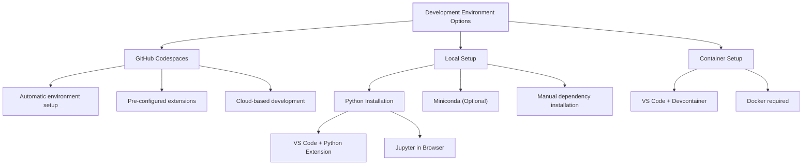
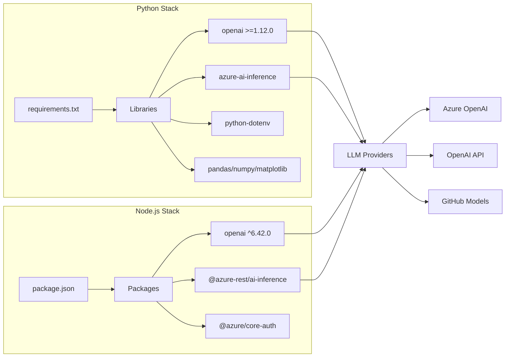
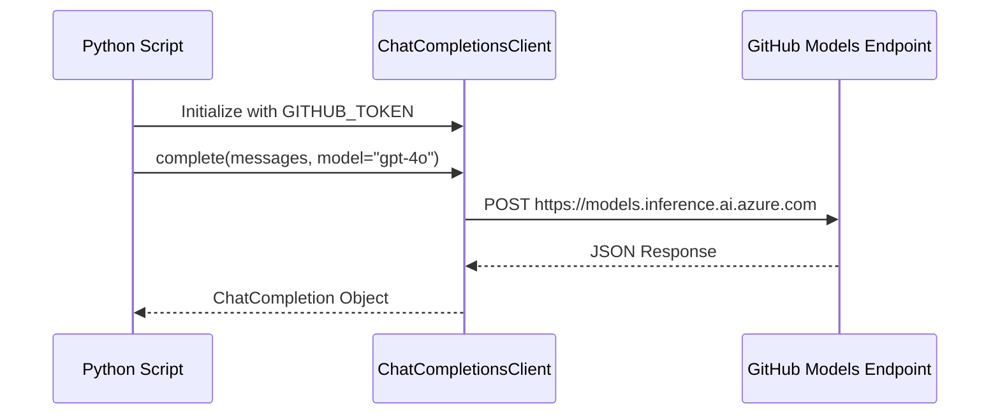

<!-- source: DeepWiki mcp.deepwiki.com · repo microsoft/generative-ai-for-beginners · page 2.1 Development Environment · fetched 2026-10-26 -->

# Development Environment

<details>
<summary>Relevant source files</summary>

The following files were used as context for generating this wiki page:

- [.devcontainer/Setup.txt](.devcontainer/Setup.txt)
- [.devcontainer/devcontainer.json](.devcontainer/devcontainer.json)
- [.devcontainer/environment.yml](.devcontainer/environment.yml)
- [.devcontainer/icon.svg](.devcontainer/icon.svg)
- [.devcontainer/post-create.sh](.devcontainer/post-create.sh)
- [.env.copy](.env.copy)
- [00-course-setup/01-setup-cloud.md](00-course-setup/01-setup-cloud.md)
- [00-course-setup/02-setup-local.md](00-course-setup/02-setup-local.md)
- [00-course-setup/03-providers.md](00-course-setup/03-providers.md)
- [00-course-setup/README.md](00-course-setup/README.md)
- [06-text-generation-apps/python/githubmodels-assignment.ipynb](06-text-generation-apps/python/githubmodels-assignment.ipynb)
- [06-text-generation-apps/typescript/.gitignore](06-text-generation-apps/typescript/.gitignore)
- [06-text-generation-apps/typescript/recipe-app/.env-sample](06-text-generation-apps/typescript/recipe-app/.env-sample)
- [06-text-generation-apps/typescript/recipe-app/package-lock.json](06-text-generation-apps/typescript/recipe-app/package-lock.json)
- [06-text-generation-apps/typescript/recipe-app/package.json](06-text-generation-apps/typescript/recipe-app/package.json)
- [06-text-generation-apps/typescript/recipe-app/tsconfig.json](06-text-generation-apps/typescript/recipe-app/tsconfig.json)
- [07-building-chat-applications/python/aoai-assignment.ipynb](07-building-chat-applications/python/aoai-assignment.ipynb)
- [07-building-chat-applications/python/githubmodels-assignment.ipynb](07-building-chat-applications/python/githubmodels-assignment.ipynb)
- [07-building-chat-applications/python/oai-assignment.ipynb](07-building-chat-applications/python/oai-assignment.ipynb)
- [07-building-chat-applications/typescript/chat-completions-app/src/main.ts](07-building-chat-applications/typescript/chat-completions-app/src/main.ts)
- [07-building-chat-applications/typescript/chat-completions-app/tsconfig.json](07-building-chat-applications/typescript/chat-completions-app/tsconfig.json)
- [08-building-search-applications/python/aoai-solution.ipynb](08-building-search-applications/python/aoai-solution.ipynb)
- [08-building-search-applications/python/oai-solution.ipynb](08-building-search-applications/python/oai-solution.ipynb)
- [11-integrating-with-function-calling/python/aoai-assignment.ipynb](11-integrating-with-function-calling/python/aoai-assignment.ipynb)
- [11-integrating-with-function-calling/python/oai-assignment.ipynb](11-integrating-with-function-calling/python/oai-assignment.ipynb)
- [README.md](README.md)
- [docs/_sidebar.md](docs/_sidebar.md)
- [package-lock.json](package-lock.json)
- [package.json](package.json)
- [requirements.txt](requirements.txt)
- [translations/en/.co-op-translator.json](translations/en/.co-op-translator.json)
- [translations/en/README.md](translations/en/README.md)
- [translations/en/docs/ENHANCED_FEATURES_ROADMAP.md](translations/en/docs/ENHANCED_FEATURES_ROADMAP.md)
- [translations/en/docs/SECURITY_GUIDELINES.md](translations/en/docs/SECURITY_GUIDELINES.md)
- [translations/es/.co-op-translator.json](translations/es/.co-op-translator.json)
- [translations/es/README.md](translations/es/README.md)
- [translations/es/docs/ENHANCED_FEATURES_ROADMAP.md](translations/es/docs/ENHANCED_FEATURES_ROADMAP.md)
- [translations/es/docs/SECURITY_GUIDELINES.md](translations/es/docs/SECURITY_GUIDELINES.md)
- [translations/fr/.co-op-translator.json](translations/fr/.co-op-translator.json)
- [translations/fr/README.md](translations/fr/README.md)
- [translations/hi/00-course-setup/README.md](translations/hi/00-course-setup/README.md)
- [translations/ja/00-course-setup/02-setup-local.md](translations/ja/00-course-setup/02-setup-local.md)
- [translations/ja/00-course-setup/03-providers.md](translations/ja/00-course-setup/03-providers.md)
- [translations/ja/00-course-setup/README.md](translations/ja/00-course-setup/README.md)
- [translations/ko/00-course-setup/README.md](translations/ko/00-course-setup/README.md)
- [vs.code-profile](vs.code-profile)

</details>


This document provides detailed information about configuring the development environment for the Generative AI for Beginners course. It covers container configuration, required dependencies, and provider setup for Azure OpenAI, OpenAI API, and GitHub Models.

## Setup Options

There are multiple ways to set up your development environment. The recommended approach is to use **GitHub Codespaces** for a consistent experience, but local setup and dev container options are also available.

### Setup Options Overview



Sources: [.devcontainer/devcontainer.json:1-24](), [00-course-setup/README.md:15-19](), [00-course-setup/README.md:91-103]()

### GitHub Codespaces (Recommended)

GitHub Codespaces provides a pre-configured environment in the cloud. To create one, navigate to your fork of the repository and select **Code -> Codespaces -> New on main** [00-course-setup/README.md:15-19]().

- **Secrets**: Store your `OPENAI_API_KEY` or `GITHUB_TOKEN` using the **Manage user secret** option in the Codespaces command palette [00-course-setup/README.md:23-26]().
- **Persistence**: Codespaces uses the configuration in `.devcontainer/devcontainer.json` to build the environment [00-course-setup/README.md:15-17]().

### Local Setup

To run the code locally, you need [Python installed](https://www.python.org/downloads/) [00-course-setup/README.md:91-93]().

1. **Clone the repository**:
   ```bash
   git clone https://github.com/microsoft/generative-ai-for-beginners
   cd generative-ai-for-beginners
   ```
   *Note: To skip 50+ language translations and reduce download size, use sparse checkout* [README.md:24-42]().
2. **Install Dependencies**:
   ```bash
   pip install -r requirements.txt
   ```

#### Using Miniconda

[Miniconda](https://conda.io/en/latest/miniconda.html) is recommended for managing isolated virtual environments [00-course-setup/README.md:106-111]().

1. **Create `environment.yml`**: Define dependencies like `openai`, `python-dotenv`, and `azure-ai-ml` [00-course-setup/README.md:115-131]().
2. **Initialize Environment**:
   ```bash
   conda env create --name ai4beg --file .devcontainer/environment.yml
   conda activate ai4beg
   ```

Sources: [README.md:24-42](), [00-course-setup/README.md:91-103](), [00-course-setup/README.md:106-148]()

## Dependencies and Requirements

The course uses a mix of Python for data science/notebook tasks and TypeScript for application building.

### Dependency Structure



Sources: [requirements.txt:1-11](), [package.json:28-32](), [package-lock.json:11-15]()

### Python Dependencies
The `requirements.txt` file specifies the core libraries needed for the Jupyter notebooks and Python scripts:
- `openai>=1.12.0`: Main client for OpenAI and Azure OpenAI [requirements.txt:7]().
- `azure-ai-inference`: Used specifically for GitHub Models integration [requirements.txt:9]().
- `python-dotenv`: For loading configuration from `.env` files [requirements.txt:6]().
- Data Science tools: `numpy`, `pandas`, `matplotlib`, and `ipywidgets` for interactive notebook elements [requirements.txt:1-4]().

### Node.js Dependencies
The root `package.json` and lesson-specific packages (like `recipe-app`) include:
- `openai`: Client for OpenAI services [package.json:31]().
- `@azure-rest/ai-inference`: REST client for Azure AI Inference [package.json:29]().
- `@azure/core-auth`: Authentication for Azure services [package.json:30]().

Sources: [requirements.txt:1-11](), [package.json:28-32](), [06-text-generation-apps/typescript/recipe-app/package.json:11-18]()

## Provider Configuration

The course supports three primary providers. Configuration is typically handled via a `.env` file based on the provided template [00-course-setup/README.md:48-64]().

### Configuration Mapping

| Provider | Required Variables | Key Library |
| :--- | :--- | :--- |
| **Azure OpenAI** | `AZURE_OPENAI_API_KEY`, `AZURE_OPENAI_ENDPOINT`, `AZURE_OPENAI_DEPLOYMENT` | `openai` (AzureOpenAI class) |
| **OpenAI API** | `OPENAI_API_KEY` | `openai` (OpenAI class) |
| **GitHub Models** | `GITHUB_TOKEN` | `azure-ai-inference` |

Sources: [.env.copy:1-12](), [07-building-chat-applications/python/aoai-assignment.ipynb:182-194](), [07-building-chat-applications/python/githubmodels-assignment.ipynb:155-166]()

### Implementation Detail: GitHub Models
GitHub Models uses the `ChatCompletionsClient` from the Azure AI Inference SDK.



Sources: [07-building-chat-applications/python/githubmodels-assignment.ipynb:155-166](), [06-text-generation-apps/python/githubmodels-assignment.ipynb:79-110]()

## Container Configuration

The `.devcontainer` directory defines the automated setup for Codespaces and Docker-based local development.

### Dev Container Lifecycle
1. **Base Image**: Uses `mcr.microsoft.com/devcontainers/universal:2.13` [devcontainer.json:5]().
2. **Content Update**: Runs `python3 -m pip install -r requirements.txt` to ensure Python libraries are ready [devcontainer.json:10]().
3. **Post-Creation**: Executes `.devcontainer/post-create.sh` which manually ensures `python-dotenv` and `openai` are installed [devcontainer.json:11](), [.devcontainer/post-create.sh:3-6]().
4. **VS Code Extensions**: Automatically installs the Python (`ms-python.python`) and Jupyter (`ms-toolsai.jupyter`) extensions [devcontainer.json:16-21]().

Sources: [.devcontainer/devcontainer.json:1-24](), [.devcontainer/post-create.sh:1-12]()

## Troubleshooting

- **Container build stuck**: Use **Codespaces ➜ "Rebuild Container"** [00-course-setup/README.md:42]().
- **401 Unauthorized**: Verify your `OPENAI_API_KEY` or `GITHUB_TOKEN` in your `.env` or Codespace secrets [00-course-setup/README.md:44]().
- **Notebook kernel missing**: Select **Kernel ▸ Select Kernel ▸ Python 3** from the notebook menu [00-course-setup/README.md:46]().

Sources: [00-course-setup/README.md:37-47]()

---

