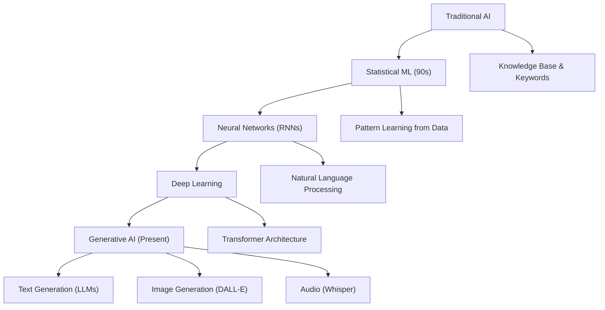
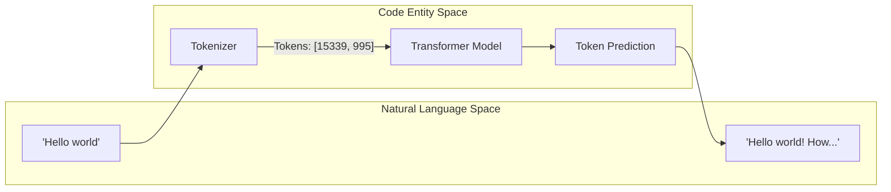
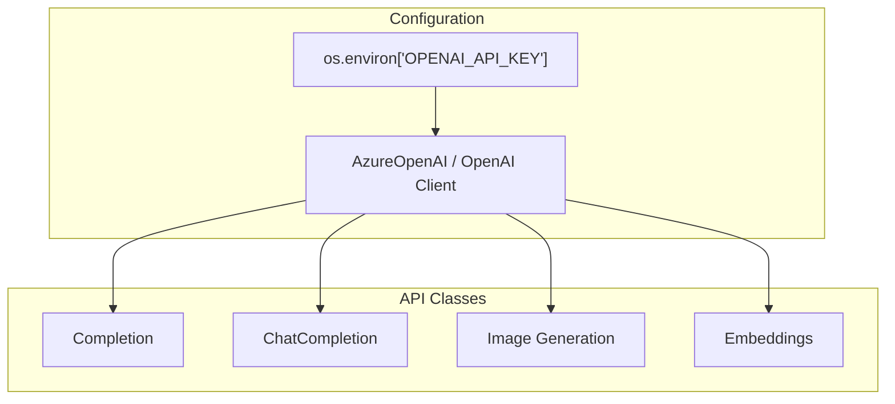

<!-- source: DeepWiki mcp.deepwiki.com · repo microsoft/generative-ai-for-beginners · page 3 Core Concepts · fetched 2026-10-26 -->

# Core Concepts

Relevant source files

The following files were used as context for generating this wiki page:

- [00-course-setup/README.md](00-course-setup/README.md)
- [01-introduction-to-genai/README.md](01-introduction-to-genai/README.md)
- [02-exploring-and-comparing-different-llms/README.md](02-exploring-and-comparing-different-llms/README.md)
- [03-using-generative-ai-responsibly/README.md](03-using-generative-ai-responsibly/README.md)
- [04-prompt-engineering-fundamentals/README.md](04-prompt-engineering-fundamentals/README.md)
- [05-advanced-prompts/README.md](05-advanced-prompts/README.md)
- [06-text-generation-apps/README.md](06-text-generation-apps/README.md)
- [07-building-chat-applications/README.md](07-building-chat-applications/README.md)
- [08-building-search-applications/README.md](08-building-search-applications/README.md)
- [09-building-image-applications/README.md](09-building-image-applications/README.md)
- [10-building-low-code-ai-applications/README.md](10-building-low-code-ai-applications/README.md)
- [11-integrating-with-function-calling/README.md](11-integrating-with-function-calling/README.md)
- [12-designing-ux-for-ai-applications/README.md](12-designing-ux-for-ai-applications/README.md)
- [README.md](README.md)
- [translations/en/.co-op-translator.json](translations/en/.co-op-translator.json)
- [translations/en/README.md](translations/en/README.md)
- [translations/en/docs/ENHANCED_FEATURES_ROADMAP.md](translations/en/docs/ENHANCED_FEATURES_ROADMAP.md)
- [translations/en/docs/SECURITY_GUIDELINES.md](translations/en/docs/SECURITY_GUIDELINES.md)
- [translations/es/.co-op-translator.json](translations/es/.co-op-translator.json)
- [translations/es/README.md](translations/es/README.md)
- [translations/es/docs/ENHANCED_FEATURES_ROADMAP.md](translations/es/docs/ENHANCED_FEATURES_ROADMAP.md)
- [translations/es/docs/SECURITY_GUIDELINES.md](translations/es/docs/SECURITY_GUIDELINES.md)
- [translations/fr/.co-op-translator.json](translations/fr/.co-op-translator.json)
- [translations/fr/README.md](translations/fr/README.md)

This document provides an overview of the fundamental principles and technologies underlying Generative AI systems. Here you'll learn what Generative AI is, how Large Language Models (LLMs) work, the different types of LLMs, prompt engineering basics, and responsible AI practices.

For information about setting up your development environment, see [Course Structure and Setup](#2). For specific implementation details about building applications, see [Building GenAI Applications](#4).

## What is Generative AI?

Generative AI refers to artificial intelligence systems capable of generating new content, including text, images, audio, and other types of media [01-introduction-to-genai/README.md:7-7](). What makes it revolutionary is that it democratizes AI - users can interact with it using natural language prompts rather than requiring specialized programming knowledge [01-introduction-to-genai/README.md:7-8]().

The key technology behind modern generative AI is Large Language Models (LLMs), which are trained on vast amounts of unlabeled data to understand and generate human-like text [01-introduction-to-genai/README.md:68-68]().

### Evolution of AI to Generative AI

The transition from traditional rule-based systems to Generative AI involved several major architectural shifts, notably the move from Recurrent Neural Networks (RNNs) to the Transformer architecture [01-introduction-to-genai/README.md:56-66]().

Sources: [01-introduction-to-genai/README.md:41-68]()

### How LLMs Work

LLMs receive text as input and generate text as output. Because they are statistical models, they process data through a tokenizer [01-introduction-to-genai/README.md:72-74]().

1.  **Tokenization**: Breaking input text into tokens (chunks of text converted to numeric indices) [01-introduction-to-genai/README.md:74-74]().
2.  **Neural Network Processing**: Processing tokens using the transformer architecture and attention mechanisms [01-introduction-to-genai/README.md:66-66]().
3.  **Output Token Prediction**: Predicting the next token based on probability distribution [01-introduction-to-genai/README.md:78-78]().
4.  **Text Generation**: Building complete responses token by token.

Sources: [01-introduction-to-genai/README.md:70-78](), [04-prompt-engineering-fundamentals/README.md:82-87]()

## Types of LLMs

Large Language Models are categorized by their architecture, access, and modality [02-exploring-and-comparing-different-llms/README.md:29-31]().

### Classification of LLMs

-   **Foundation Models**: Large models trained on unlabeled data intended to serve as a starting point for specialized tasks [02-exploring-and-comparing-different-llms/README.md:45-51]().
-   **Open Source vs. Proprietary**: Open models (e.g., Llama, Mistral) allow inspection and modification, while proprietary models (e.g., GPT-4, Claude) are managed by companies [02-exploring-and-comparing-different-llms/README.md:64-70]().
-   **Modality**: Models can be specialized for text, audio (Whisper), or images (DALL-E) [02-exploring-and-comparing-different-llms/README.md:33-41]().

### Model Integration (Python)

The course primarily uses the `openai` library to interact with these models [06-text-generation-apps/README.md:79-79]().

Sources: [06-text-generation-apps/README.md:113-146](), [09-building-image-applications/README.md:130-147](), [11-integrating-with-function-calling/README.md:63-69]()

For more details on model selection, see [Introduction to Generative AI](#3.1).

## Improving LLM Results

There are several approaches to optimize model output, ranging from prompt design to data-heavy customization [02-exploring-and-comparing-different-llms/README.md:43-43]().

| Approach | Description | Complexity |
| :--- | :--- | :--- |
| **Prompt Engineering** | Designing and refining inputs to guide the model [04-prompt-engineering-fundamentals/README.md:12-12](). | Low |
| **RAG** | Retrieving external data to provide context to the prompt [08-building-search-applications/README.md:7-9](). | Medium |
| **Fine-Tuning** | Training a model on a specialized dataset to adapt its behavior [02-exploring-and-comparing-different-llms/README.md:51-51](). | High |

Sources: [02-exploring-and-comparing-different-llms/README.md:43-51](), [04-prompt-engineering-fundamentals/README.md:12-12]()

## Prompt Engineering

Prompt engineering is the primary programming interface for Generative AI applications [04-prompt-engineering-fundamentals/README.md:12-12](). It involves constructing the prompt with context and constraints to achieve consistent quality [05-advanced-prompts/README.md:9-11]().

### Core Techniques
-   **Zero-shot**: Requesting a response with no examples [05-advanced-prompts/README.md:69-71]().
-   **Few-shot**: Providing examples to guide the model [05-advanced-prompts/README.md:76-78]().
-   **Chain-of-thought**: Instructing the model to break down problems into steps [05-advanced-prompts/README.md:89-91]().

### Configuration Parameters
Models accept parameters like `temperature` to control output randomness (0 for deterministic, 1 for creative) and `max_tokens` to limit output length [06-text-generation-apps/README.md:25-25]().

For details, see [Prompt Engineering Fundamentals](#3.2) and [Advanced Prompting Techniques](#3.3).

## Responsible AI and UX

Building AI applications requires addressing ethical implications and user trust [03-using-generative-ai-responsibly/README.md]() (inferred).

### Responsible AI Practices
Developers must mitigate risks such as **hallucinations** (false information), **bias**, and **privacy** concerns [12-designing-ux-for-ai-applications/README.md:42-42](). Implementation should follow the mitigation layer strategy.

### UX Principles
Effective AI UX focuses on:
-   **Explainability**: Helping users understand how AI arrived at an output [12-designing-ux-for-ai-applications/README.md:62-64]().
-   **Control**: Allowing users to modify results and opt-in/out of data usage [12-designing-ux-for-ai-applications/README.md:76-78]().
-   **Friction**: Intentionally reminding users they are interacting with an AI [12-designing-ux-for-ai-applications/README.md:86-86]().

For details, see [Responsible AI Practices](#3.4) and [UX Design for AI Applications](#5.4).

## Integration Patterns

Modern applications integrate LLMs using structured patterns:

### Function Calling
Allows models to generate structured JSON arguments for functions defined in your code, enabling integration with external APIs like weather services or databases [11-integrating-with-function-calling/README.md:41-44]().

### Retrieval Augmented Generation (RAG)
Uses **Embeddings** (numerical vectors) and **Cosine Similarity** to find relevant documents in a vector database to enrich the prompt context [08-building-search-applications/README.md:7-11](), [08-building-search-applications/README.md:78-82]().

For details on implementation, see [Function Calling Integration](#4.6) and [RAG and Vector Databases](#5.1).

Sources:
- [01-introduction-to-genai/README.md]()
- [02-exploring-and-comparing-different-llms/README.md]()
- [04-prompt-engineering-fundamentals/README.md]()
- [05-advanced-prompts/README.md]()
- [06-text-generation-apps/README.md]()
- [08-building-search-applications/README.md]()
- [11-integrating-with-function-calling/README.md]()
- [12-designing-ux-for-ai-applications/README.md]()

---

