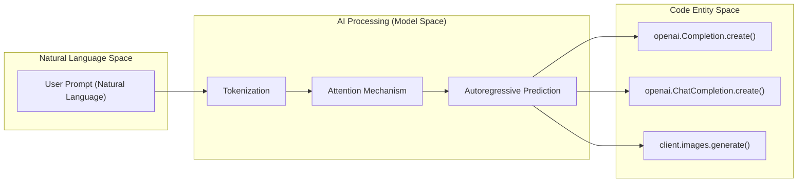
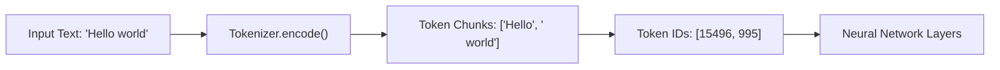
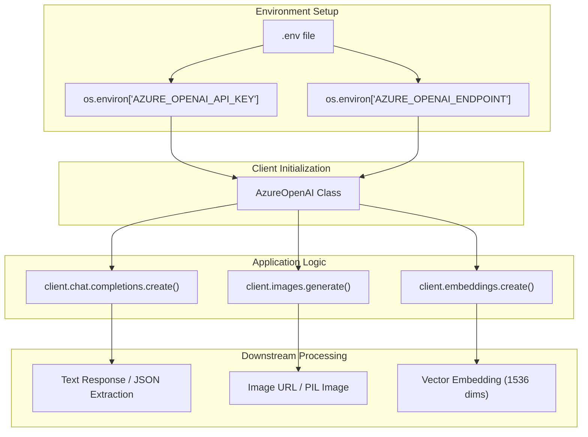

<!-- source: DeepWiki mcp.deepwiki.com · repo microsoft/generative-ai-for-beginners · page 3.1 Introduction to Generative AI · fetched 2026-10-26 -->

# Introduction to Generative AI

<details>
<summary>Relevant source files</summary>

The following files were used as context for generating this wiki page:

- [01-introduction-to-genai/README.md](01-introduction-to-genai/README.md)
- [02-exploring-and-comparing-different-llms/README.md](02-exploring-and-comparing-different-llms/README.md)
- [02-exploring-and-comparing-different-llms/images/AzureAIStudioModelCatalog.png](02-exploring-and-comparing-different-llms/images/AzureAIStudioModelCatalog.png)
- [02-exploring-and-comparing-different-llms/images/FineTuning.png](02-exploring-and-comparing-different-llms/images/FineTuning.png)
- [02-exploring-and-comparing-different-llms/images/Llama1.png](02-exploring-and-comparing-different-llms/images/Llama1.png)
- [02-exploring-and-comparing-different-llms/images/Llama2.png](02-exploring-and-comparing-different-llms/images/Llama2.png)
- [02-exploring-and-comparing-different-llms/images/Llama3.png](02-exploring-and-comparing-different-llms/images/Llama3.png)
- [02-exploring-and-comparing-different-llms/images/Llama4.png](02-exploring-and-comparing-different-llms/images/Llama4.png)
- [02-exploring-and-comparing-different-llms/images/ModelBenchmarks.png](02-exploring-and-comparing-different-llms/images/ModelBenchmarks.png)
- [02-exploring-and-comparing-different-llms/images/ModelCard.png](02-exploring-and-comparing-different-llms/images/ModelCard.png)
- [02-exploring-and-comparing-different-llms/images/ModelDeploy.png](02-exploring-and-comparing-different-llms/images/ModelDeploy.png)
- [03-using-generative-ai-responsibly/README.md](03-using-generative-ai-responsibly/README.md)
- [04-prompt-engineering-fundamentals/README.md](04-prompt-engineering-fundamentals/README.md)
- [05-advanced-prompts/README.md](05-advanced-prompts/README.md)
- [06-text-generation-apps/README.md](06-text-generation-apps/README.md)
- [07-building-chat-applications/README.md](07-building-chat-applications/README.md)
- [08-building-search-applications/README.md](08-building-search-applications/README.md)
- [09-building-image-applications/README.md](09-building-image-applications/README.md)
- [10-building-low-code-ai-applications/README.md](10-building-low-code-ai-applications/README.md)
- [11-integrating-with-function-calling/README.md](11-integrating-with-function-calling/README.md)
- [12-designing-ux-for-ai-applications/README.md](12-designing-ux-for-ai-applications/README.md)
- [translations/ja/01-introduction-to-genai/README.md](translations/ja/01-introduction-to-genai/README.md)

</details>


## Purpose and Scope

This document provides a technical introduction to Generative AI, focusing on its fundamental mechanics, core capabilities, and implementation patterns within the codebase. It explains the transition from traditional AI to Large Language Models (LLMs) and provides a technical overview of how these models are integrated into software via APIs and SDKs.

## What is Generative AI?

Generative AI is a subset of deep learning based on the **Transformer** architecture [01-introduction-to-genai/README.md:62-68](). Unlike traditional discriminative AI that classifies data, Generative AI creates new content (text, images, code, etc.) in response to natural language inputs called "prompts" [04-prompt-engineering-fundamentals/README.md:8-12]().

### The Generative Pipeline
The following diagram bridges the gap between the natural language input provided by a user and the specific code entities used in the `openai` library to process that input.


Title: Generative AI Pipeline from User Input to Code Implementation

Sources: [01-introduction-to-genai/README.md:66-74](), [04-prompt-engineering-fundamentals/README.md:12-13](), [06-text-generation-apps/README.md:134-141](), [09-building-image-applications/README.md:143-147]()

## How Large Language Models Work

### Tokenization
LLMs do not process raw text; they process sequences of numbers. Every input is processed by a **tokenizer** [01-introduction-to-genai/README.md:74-76]().

1.  **Text Splitting**: The input is broken into "tokens" (words, sub-words, or characters).
2.  **Mapping**: Each token is assigned a unique integer index based on the model's vocabulary.
3.  **Encoding**: These indices are fed into the neural network.


Title: Data Flow from Text to Model Input

Sources: [01-introduction-to-genai/README.md:74-76](), [04-prompt-engineering-fundamentals/README.md:82-87]()

### Prediction and Temperature
LLMs are statistical models that predict the next token in a sequence [01-introduction-to-genai/README.md:78-80](). The `temperature` parameter influences this selection:

*   **Temperature = 0**: The model is deterministic, always choosing the most likely token [06-text-generation-apps/README.md:589-599]().
*   **Temperature > 0**: The model introduces randomness, allowing for "creative" or varied responses.

Sources: [01-introduction-to-genai/README.md:80-81](), [06-text-generation-apps/README.md:589-599]()

## Comparing Model Families

The landscape of LLMs includes both proprietary and open-source models, each with distinct architectures and use cases.

| Model Family | Type | Primary Use Case | Access Method in Repo |
| :--- | :--- | :--- | :--- |
| **GPT (OpenAI)** | Proprietary | General purpose, Chat, Coding | `AzureOpenAI` client [06-text-generation-apps/README.md:116-121]() |
| **Llama (Meta)** | Open Source | Research, Local deployment | Azure AI Foundry / GitHub Models [02-exploring-and-comparing-different-llms/README.md:68]() |
| **Mistral** | Open Source | Efficiency, Reasoning | Azure AI Foundry / GitHub Models [02-exploring-and-comparing-different-llms/README.md:31-35]() |
| **Phi (Microsoft)** | SLM (Small) | Edge devices, low latency | GitHub Models [02-exploring-and-comparing-different-llms/README.md:31-35]() |
| **DALL-E** | Image Gen | Text-to-Image | `client.images.generate()` [09-building-image-applications/README.md:143]() |

Sources: [02-exploring-and-comparing-different-llms/README.md:64-70](), [09-building-image-applications/README.md:43-56]()

## Implementation Architecture

The repository demonstrates a standardized pattern for connecting to Generative AI services using environment variables and client classes.


Title: Technical Implementation Architecture

Sources: [06-text-generation-apps/README.md:116-121](), [09-building-image-applications/README.md:136-140](), [11-integrating-with-function-calling/README.md:63-69]()

## Advanced Capabilities

### Function Calling
Function calling allows the LLM to output structured JSON instead of plain text, enabling integration with external APIs like the Microsoft Learn Catalog API [11-integrating-with-function-calling/README.md:25-34]().

```python
# Example structure from the codebase
response = client.chat.completions.create(
    model=deployment,
    messages=[{'role': 'user', 'content': prompt}],
    functions=functions_schema # Defined JSON schema
)
```
Sources: [11-integrating-with-function-calling/README.md:119-131]()

### Embeddings and Semantic Search
Embeddings convert text into high-dimensional vectors (e.g., 1536 numbers). These are used to calculate **Cosine Similarity** to find relevant data in a vector database [08-building-search-applications/README.md:46-60]().

Sources: [08-building-search-applications/README.md:78-83]()

## Responsible AI Considerations

Developing with Generative AI requires a multi-layered mitigation strategy [03-using-generative-ai-responsibly/README.md:87-91]():

1.  **Model Layer**: Choosing the right model (e.g., GPT-4 vs. Phi).
2.  **Safety System**: Implementing content filters (e.g., Azure OpenAI Content Filtering).
3.  **Metaprompt Layer**: Using system messages to define boundaries.
4.  **User Experience**: Designing UI to handle hallucinations and provide feedback loops.

Sources: [03-using-generative-ai-responsibly/README.md:93-101]()

---

