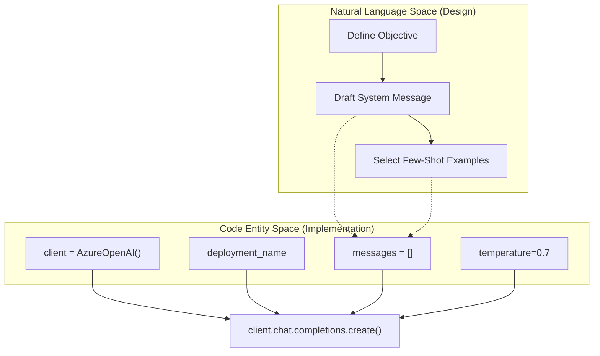
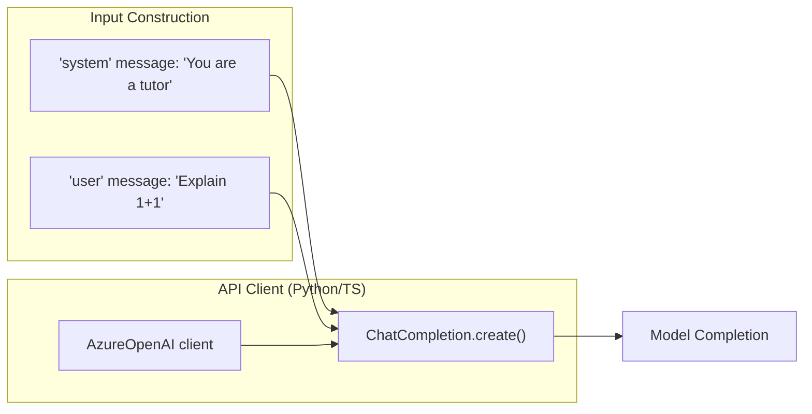

<!-- source: DeepWiki mcp.deepwiki.com · repo microsoft/generative-ai-for-beginners · page 3.2 Prompt Engineering Fundamentals · fetched 2026-10-26 -->

# Prompt Engineering Fundamentals

<details>
<summary>Relevant source files</summary>

The following files were used as context for generating this wiki page:

- [01-introduction-to-genai/README.md](01-introduction-to-genai/README.md)
- [02-exploring-and-comparing-different-llms/README.md](02-exploring-and-comparing-different-llms/README.md)
- [03-using-generative-ai-responsibly/README.md](03-using-generative-ai-responsibly/README.md)
- [04-prompt-engineering-fundamentals/README.md](04-prompt-engineering-fundamentals/README.md)
- [04-prompt-engineering-fundamentals/images/04-fabrication-aoai.png](04-prompt-engineering-fundamentals/images/04-fabrication-aoai.png)
- [04-prompt-engineering-fundamentals/images/04-fabrication-huggingchat.png](04-prompt-engineering-fundamentals/images/04-fabrication-huggingchat.png)
- [04-prompt-engineering-fundamentals/images/04-fabrication-oai.png](04-prompt-engineering-fundamentals/images/04-fabrication-oai.png)
- [04-prompt-engineering-fundamentals/python/githubmodels-assignment.ipynb](04-prompt-engineering-fundamentals/python/githubmodels-assignment.ipynb)
- [05-advanced-prompts/README.md](05-advanced-prompts/README.md)
- [06-text-generation-apps/README.md](06-text-generation-apps/README.md)
- [07-building-chat-applications/README.md](07-building-chat-applications/README.md)
- [08-building-search-applications/README.md](08-building-search-applications/README.md)
- [09-building-image-applications/README.md](09-building-image-applications/README.md)
- [10-building-low-code-ai-applications/README.md](10-building-low-code-ai-applications/README.md)
- [11-integrating-with-function-calling/README.md](11-integrating-with-function-calling/README.md)
- [12-designing-ux-for-ai-applications/README.md](12-designing-ux-for-ai-applications/README.md)
- [translations/bn/04-prompt-engineering-fundamentals/README.md](translations/bn/04-prompt-engineering-fundamentals/README.md)
- [translations/hi/04-prompt-engineering-fundamentals/README.md](translations/hi/04-prompt-engineering-fundamentals/README.md)
- [translations/it/04-prompt-engineering-fundamentals/README.md](translations/it/04-prompt-engineering-fundamentals/README.md)
- [translations/ja/04-prompt-engineering-fundamentals/README.md](translations/ja/04-prompt-engineering-fundamentals/README.md)
- [translations/ko/04-prompt-engineering-fundamentals/README.md](translations/ko/04-prompt-engineering-fundamentals/README.md)
- [translations/mr/04-prompt-engineering-fundamentals/README.md](translations/mr/04-prompt-engineering-fundamentals/README.md)
- [translations/ne/04-prompt-engineering-fundamentals/README.md](translations/ne/04-prompt-engineering-fundamentals/README.md)
- [translations/pa/04-prompt-engineering-fundamentals/README.md](translations/pa/04-prompt-engineering-fundamentals/README.md)
- [translations/pl/04-prompt-engineering-fundamentals/README.md](translations/pl/04-prompt-engineering-fundamentals/README.md)
- [translations/pt-BR/04-prompt-engineering-fundamentals/README.md](translations/pt-BR/04-prompt-engineering-fundamentals/README.md)
- [translations/pt-PT/04-prompt-engineering-fundamentals/README.md](translations/pt-PT/04-prompt-engineering-fundamentals/README.md)
- [translations/tr/04-prompt-engineering-fundamentals/README.md](translations/tr/04-prompt-engineering-fundamentals/README.md)

</details>


Prompt Engineering is the process of designing and refining text inputs (prompts) to effectively communicate with Large Language Models (LLMs). This document explains the core concepts, techniques, and best practices of prompt engineering to help you create more effective prompts that yield consistent and high-quality responses from LLMs.

## Purpose and Scope

This document covers:
- What prompt engineering is and why it's important.
- Core concepts including tokenization and model types.
- How to construct effective prompts using zero-shot, few-shot, and chain-of-thought techniques.
- Best practices and fundamental techniques for prompt engineering.
- Metaprompting and temperature control for application stability.

## What is Prompt Engineering?

Prompt Engineering is the process of designing and optimizing text inputs (prompts) to deliver consistent and quality responses (completions) for a given application objective and model. This involves both the initial design of prompts and their iterative refinement to improve response quality.

### Prompt Engineering Lifecycle
The following diagram maps the conceptual process of prompt engineering to the code-level configuration and logic required to implement it.

**Natural Language to Code Entity Space**

Sources: [04-prompt-engineering-fundamentals/README.md:69-76](), [06-text-generation-apps/README.md:134-143]()

## Core Concepts

### Tokenization
LLMs do not process raw text; they see prompts as a sequence of tokens. A token is a chunk of text consisting of a variable number of characters. The way a prompt is tokenized directly impacts the quality of the generated response and the cost (as APIs often charge per token).

Sources: [04-prompt-engineering-fundamentals/README.md:82-86](), [01-introduction-to-genai/README.md:74-76]()

### Model Types and Architectures
The codebase distinguishes between different types of models that require different prompting strategies:

1.  **Foundation Models (Base LLMs)**: Trained primarily to predict the next token in a sequence. They excel at pattern completion but may not follow instructions well.
2.  **Instruction-Tuned LLMs**: Fine-tuned with specific instructions and Reinforcement Learning from Human Feedback (RLHF) to follow tasks.
3.  **Multi-modal Models**: Capable of processing both text and other data types, such as `gpt-4o` or `gpt-4-vision`.

Sources: [04-prompt-engineering-fundamentals/README.md:94-112](), [02-exploring-and-comparing-different-llms/README.md:41-43]()

## Prompting Techniques

### Zero-Shot Prompting
The most basic form of prompting where a single request is made without any examples. The model relies entirely on its pre-trained knowledge.
- **Example**: "What is Algebra?"

Sources: [05-advanced-prompts/README.md:69-74]()

### Few-Shot Prompting
This technique provides one or more examples (shots) within the prompt to guide the model's response format, style, or logic.
- **Implementation**: Examples are typically passed as a series of `user` and `assistant` messages in the `messages` array of a `ChatCompletion` call.

Sources: [05-advanced-prompts/README.md:76-88](), [04-prompt-engineering-fundamentals/README.md:251-266]()

### Chain-of-Thought (CoT)
CoT instructs the LLM to break down a problem into intermediate steps. This significantly improves performance on reasoning and mathematical tasks.
- **Pattern**: Provide an example that shows the calculation or reasoning steps before asking the final question.

Sources: [05-advanced-prompts/README.md:89-117]()

### Metaprompting (System Messages)
Metaprompts (often implemented as the `system` role in the OpenAI API) define the persona, boundaries, and behavioral constraints of the AI.

**System Message Integration Diagram**

Sources: [04-prompt-engineering-fundamentals/README.md:198-217](), [03-using-generative-ai-responsibly/README.md:97-100]()

## Configuration Parameters

The behavior of a prompt is heavily influenced by the API parameters used during the call.

| Parameter | Range | Description |
| :--- | :--- | :--- |
| `temperature` | 0.0 - 1.0 | Controls randomness. 0.0 is deterministic; 1.0 is highly creative. |
| `max_tokens` | Variable | Limits the length of the completion to manage costs and prevent runaway generation. |
| `top_p` | 0.0 - 1.0 | Nucleus sampling; an alternative to temperature for controlling diversity. |

Sources: [06-text-generation-apps/README.md:15-17](), [05-advanced-prompts/README.md:18-25]()

## Best Practices for Effective Prompts

1.  **Be Specific**: Define the persona, audience, and desired format (e.g., "Return the output as a JSON object").
2.  **Use Delimiters**: Use symbols like `###`, `"""`, or `---` to separate instructions from the content being processed.
3.  **Provide Cues**: End the prompt with a leading phrase like "JSON output:" or "Step 1:" to nudge the model into the correct format.
4.  **Order Matters**: Information placed at the beginning or very end of a prompt often receives more "attention" from the model.
5.  **Fallback Instructions**: Instruct the model on what to do if it cannot find an answer (e.g., "If the answer is not in the text, say 'I do not know'").

Sources: [04-prompt-engineering-fundamentals/README.md:328-342](), [11-integrating-with-function-calling/README.md:86-113]()

## Technical Implementation (Python)

The following example demonstrates a structured prompt using `AzureOpenAI` in Python, incorporating a system persona and specific formatting instructions.

```python
# [06-text-generation-apps/README.md:116-121]
import os
from openai import AzureOpenAI

client = AzureOpenAI(
    api_key=os.environ["OPENAI_API_KEY"],
    api_version="2023-05-15",
    azure_endpoint=os.getenv("API_BASE")
)

# [11-integrating-with-function-calling/README.md:119-131]
response = client.chat.completions.create(
    model="gpt-35-turbo",
    messages=[
        {"role": "system", "content": "You are a helpful education assistant. Always return JSON."},
        {"role": "user", "content": "Extract name and major from: Emily Johnson is a sophomore majoring in computer science."}
    ],
    temperature=0.0 # Low temperature for consistent JSON extraction
)
```

Sources: [06-text-generation-apps/README.md:116-131](), [11-integrating-with-function-calling/README.md:119-131]()

## Challenges and Mitigations

| Challenge | Description | Mitigation Technique |
| :--- | :--- | :--- |
| **Hallucinations** | Factually incorrect but confident-sounding responses. | Use Grounding (RAG) or ask for citations. [03-using-generative-ai-responsibly/README.md:39-54]() |
| **Stochasticity** | Different outputs for the same input. | Set `temperature` to 0. [05-advanced-prompts/README.md:25]() |
| **Prompt Injection** | Users trying to bypass system instructions. | Use Metaprompts and input validation. [03-using-generative-ai-responsibly/README.md:97-100]() |

Sources: [03-using-generative-ai-responsibly/README.md:39-100](), [05-advanced-prompts/README.md:25]()

---

