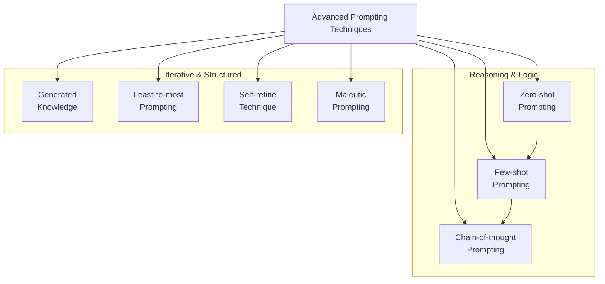
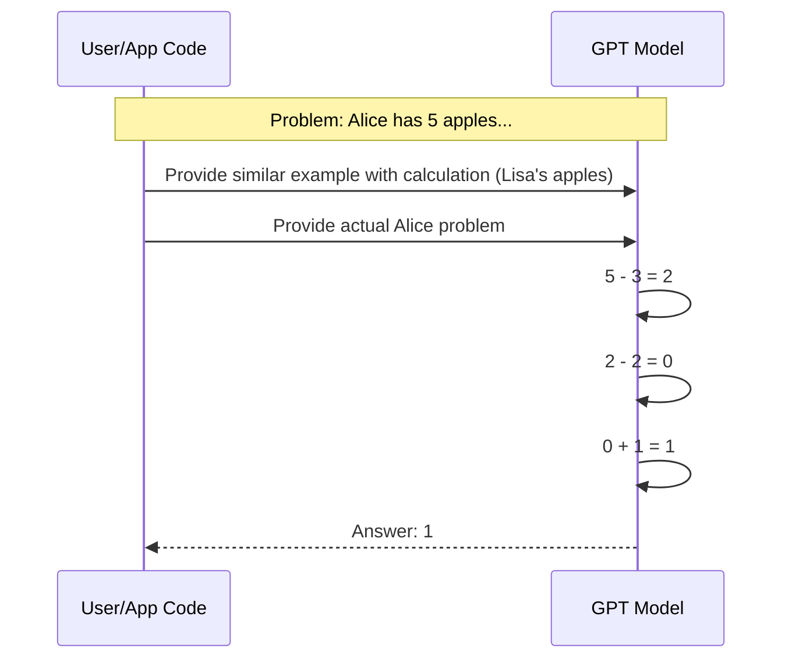
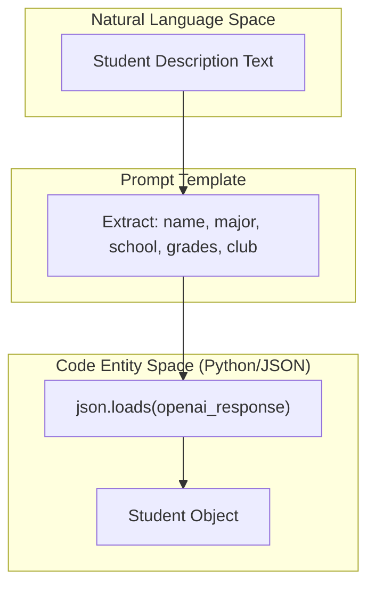

<!-- source: DeepWiki mcp.deepwiki.com · repo microsoft/generative-ai-for-beginners · page 3.3 Advanced Prompting Techniques · fetched 2026-10-26 -->

# Advanced Prompting Techniques

Relevant source files

The following files were used as context for generating this wiki page:

- [01-introduction-to-genai/README.md](01-introduction-to-genai/README.md)
- [02-exploring-and-comparing-different-llms/README.md](02-exploring-and-comparing-different-llms/README.md)
- [03-using-generative-ai-responsibly/README.md](03-using-generative-ai-responsibly/README.md)
- [04-prompt-engineering-fundamentals/README.md](04-prompt-engineering-fundamentals/README.md)
- [05-advanced-prompts/README.md](05-advanced-prompts/README.md)
- [06-text-generation-apps/README.md](06-text-generation-apps/README.md)
- [06-text-generation-apps/python/aoai-app-recipe.py](06-text-generation-apps/python/aoai-app-recipe.py)
- [06-text-generation-apps/python/aoai-app.py](06-text-generation-apps/python/aoai-app.py)
- [06-text-generation-apps/python/aoai-assignment.ipynb](06-text-generation-apps/python/aoai-assignment.ipynb)
- [06-text-generation-apps/python/aoai-history-bot.py](06-text-generation-apps/python/aoai-history-bot.py)
- [06-text-generation-apps/python/aoai-study-buddy.py](06-text-generation-apps/python/aoai-study-buddy.py)
- [06-text-generation-apps/python/githubmodels-app.py](06-text-generation-apps/python/githubmodels-app.py)
- [06-text-generation-apps/python/oai-app-recipe.py](06-text-generation-apps/python/oai-app-recipe.py)
- [06-text-generation-apps/python/oai-app.py](06-text-generation-apps/python/oai-app.py)
- [06-text-generation-apps/python/oai-assigment.ipynb](06-text-generation-apps/python/oai-assigment.ipynb)
- [06-text-generation-apps/python/oai-history-bot.py](06-text-generation-apps/python/oai-history-bot.py)
- [06-text-generation-apps/python/oai-study-buddy.py](06-text-generation-apps/python/oai-study-buddy.py)
- [07-building-chat-applications/README.md](07-building-chat-applications/README.md)
- [08-building-search-applications/README.md](08-building-search-applications/README.md)
- [09-building-image-applications/README.md](09-building-image-applications/README.md)
- [10-building-low-code-ai-applications/README.md](10-building-low-code-ai-applications/README.md)
- [11-integrating-with-function-calling/README.md](11-integrating-with-function-calling/README.md)
- [12-designing-ux-for-ai-applications/README.md](12-designing-ux-for-ai-applications/README.md)
- [translations/ja/05-advanced-prompts/README.md](translations/ja/05-advanced-prompts/README.md)

This document explores advanced prompting techniques that can be applied to Large Language Models (LLMs) to improve and control their outputs. It covers methods beyond basic prompting that help achieve more accurate, useful, and consistent results, particularly for complex business and educational scenarios. For information about prompt engineering fundamentals, see [Prompt Engineering Fundamentals](#3.2).

## Overview of Advanced Prompting Techniques

Advanced prompting is the process of creating prompts that produce a desired outcome by leveraging emergent properties of LLMs. These properties are not built-in features but are discovered through iterative use [05-advanced-prompts/README.md:27-58]().

Sources: [05-advanced-prompts/README.md:56-67]()

## Core Reasoning Techniques

### Zero-shot Prompting
The most basic form where a single prompt requests a response based solely on the model's pre-existing training data [05-advanced-prompts/README.md:61-61]().
*   **Example:** "What is Algebra?" [05-advanced-prompts/README.md:73-73]().

### Few-shot Prompting
Guides the LLM by providing one or more examples (task-specific data) that it can rely on to generate its response, helping it understand context, format, or style [05-advanced-prompts/README.md:62-62](), [05-advanced-prompts/README.md:87-88]().

### Chain-of-thought (CoT)
Instructs the LLM to break down a problem into logical steps [05-advanced-prompts/README.md:63-63](). This is essential for preventing calculation errors in logic-heavy tasks [05-advanced-prompts/README.md:91-96]().

**Scenario: Logical Reasoning in Code Space**

Sources: [05-advanced-prompts/README.md:100-117]()

## Structured Output and Knowledge Integration

### Generated Knowledge
To improve responses, you can provide specific facts or domain knowledge alongside the prompt. This is often implemented using templates with variables that are replaced by data from a company API [05-advanced-prompts/README.md:64-64](), [05-advanced-prompts/README.md:119-134]().

### Persona-Based Prompting
In educational contexts, the persona (e.g., "Student" vs "Teacher") determines how the AI responds. For a student, the AI might guide them through a problem rather than revealing the answer [12-designing-ux-for-ai-applications/README.md:68-70]().

### Structured Formatting (JSON)
For downstream application logic, prompts can be designed to return structured JSON. However, standard prompting can result in inconsistent formatting (e.g., "3.8" vs "3.8 GPA") [11-integrating-with-function-calling/README.md:83-113](), [11-integrating-with-function-calling/README.md:155-167]().

**Scenario: Data Extraction to Code Entities**

Sources: [11-integrating-with-function-calling/README.md:75-140]()

## Iterative Refinement Techniques

### Self-Refine
A technique where the model critiques its own output and improves it [05-advanced-prompts/README.md:66-66]().
1.  **Initial Prompt:** Create a Flask API [05-advanced-prompts/README.md:205-205]().
2.  **Critique:** Ask the LLM for 3 improvements to its own code [05-advanced-prompts/README.md:251-251]().
3.  **Refinement:** The LLM provides corrected code with better error handling [05-advanced-prompts/README.md:261-264]().

### Maieutic Prompting
A form of self-refinement where the user asks the LLM to explain various parts of its answer to ensure correctness and identify inconsistencies [05-advanced-prompts/README.md:67-67](), [05-advanced-prompts/README.md:267-272]().

## Configuration and Control

### Temperature and Variation
LLMs are non-deterministic. The `temperature` parameter controls the randomness of the output [05-advanced-prompts/README.md:319-325]().

| Temperature Value | Effect | Use Case |
| :--- | :--- | :--- |
| **0.0** | Deterministic | Coding, factual extraction, math [05-advanced-prompts/README.md:347-347]() |
| **0.7** | Balanced | General chat, standard assistants [05-advanced-prompts/README.md:348-348]() |
| **1.0** | Creative/Varied | Creative writing, brainstorming [05-advanced-prompts/README.md:349-349]() |

### Tokenization Impact
LLMs process text as sequences of tokens. The way a prompt is tokenized (including whitespace and punctuation) directly impacts the quality of the completion [04-prompt-engineering-fundamentals/README.md:82-86]().

## Best Practices for Advanced Prompts

*   **Contextualization:** Specify the domain (e.g., "geography") to avoid overly broad responses [05-advanced-prompts/README.md:41-48]().
*   **Output Limitation:** Explicitly state constraints like "Generate 10 questions" or "no more than 60 words" [05-advanced-prompts/README.md:42-42](), [08-building-search-applications/README.md:71-71]().
*   **Metaprompting:** Use system-level instructions to define boundaries, such as preventing the AI from answering non-educational questions [03-using-generative-ai-responsibly/README.md:97-98](), [09-building-image-applications/README.md:20-20]().
*   **Template Usage:** Use variables like `{{variable}}` to create reusable structures for business data integration [05-advanced-prompts/README.md:134-134]().

Sources:
- [05-advanced-prompts/README.md:27-317]()
- [04-prompt-engineering-fundamentals/README.md:82-86]()
- [11-integrating-with-function-calling/README.md:75-167]()
- [12-designing-ux-for-ai-applications/README.md:68-70]()
- [03-using-generative-ai-responsibly/README.md:97-98]()

---

