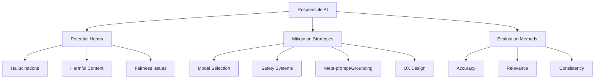
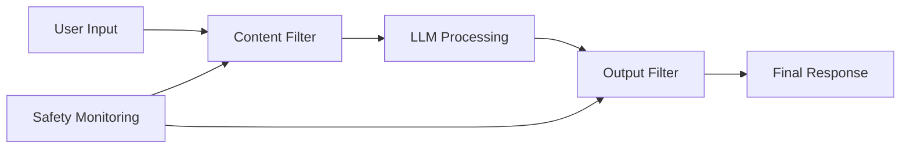
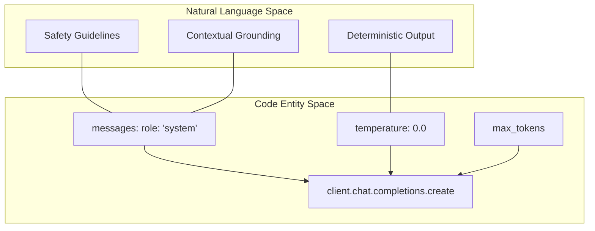

<!-- source: DeepWiki mcp.deepwiki.com · repo microsoft/generative-ai-for-beginners · page 3.4 Responsible AI Practices · fetched 2026-10-26 -->

# Responsible AI Practices

<details>
<summary>Relevant source files</summary>

The following files were used as context for generating this wiki page:

- [01-introduction-to-genai/README.md](01-introduction-to-genai/README.md)
- [02-exploring-and-comparing-different-llms/README.md](02-exploring-and-comparing-different-llms/README.md)
- [03-using-generative-ai-responsibly/README.md](03-using-generative-ai-responsibly/README.md)
- [04-prompt-engineering-fundamentals/README.md](04-prompt-engineering-fundamentals/README.md)
- [05-advanced-prompts/README.md](05-advanced-prompts/README.md)
- [06-text-generation-apps/README.md](06-text-generation-apps/README.md)
- [07-building-chat-applications/README.md](07-building-chat-applications/README.md)
- [08-building-search-applications/README.md](08-building-search-applications/README.md)
- [09-building-image-applications/README.md](09-building-image-applications/README.md)
- [10-building-low-code-ai-applications/README.md](10-building-low-code-ai-applications/README.md)
- [11-integrating-with-function-calling/README.md](11-integrating-with-function-calling/README.md)
- [12-designing-ux-for-ai-applications/README.md](12-designing-ux-for-ai-applications/README.md)
- [13-securing-ai-applications/README.md](13-securing-ai-applications/README.md)
- [translations/hi/.co-op-translator.json](translations/hi/.co-op-translator.json)
- [translations/hi/README.md](translations/hi/README.md)
- [translations/hi/docs/ENHANCED_FEATURES_ROADMAP.md](translations/hi/docs/ENHANCED_FEATURES_ROADMAP.md)
- [translations/hi/docs/SECURITY_GUIDELINES.md](translations/hi/docs/SECURITY_GUIDELINES.md)
- [translations/ja/.co-op-translator.json](translations/ja/.co-op-translator.json)
- [translations/ja/README.md](translations/ja/README.md)
- [translations/ja/docs/ENHANCED_FEATURES_ROADMAP.md](translations/ja/docs/ENHANCED_FEATURES_ROADMAP.md)
- [translations/ja/docs/SECURITY_GUIDELINES.md](translations/ja/docs/SECURITY_GUIDELINES.md)
- [translations/ko/.co-op-translator.json](translations/ko/.co-op-translator.json)
- [translations/ko/README.md](translations/ko/README.md)

</details>


This document outlines the ethical considerations and best practices for the responsible use of generative AI in applications. It covers potential harms associated with generative AI, mitigation strategies, evaluation methods, and implementation patterns to ensure AI systems are developed and used ethically.

## Understanding Responsible AI

Responsible AI refers to the development and deployment of AI systems in a manner that is ethical, transparent, fair, and accountable [07-building-chat-applications/README.md:14-14](). As generative AI models become more sophisticated and widely used, it is crucial to understand potential risks and implement practices to mitigate them.



**Sources:**
- [01-introduction-to-genai/README.md:9-9]()
- [07-building-chat-applications/README.md:14-14]()

## Potential Harms of Generative AI

### Hallucinations
Generative AI models can produce content that appears factual but is actually incorrect or fabricated [03-using-generative-ai-responsibly/README.md](). These "hallucinations" can lead to the spread of misinformation or misguided decision-making when users trust the AI-generated content without verification.

### Harmful Content
AI models can inadvertently generate offensive, biased, or harmful content, especially if they've been trained on unfiltered internet data [01-introduction-to-genai/README.md:68-68](). This includes content that reinforces stereotypes or prejudices and inappropriate or unsafe recommendations.

### Fairness Issues
AI systems may exhibit biases present in their training data, leading to unfair treatment or representation of certain groups [02-exploring-and-comparing-different-llms/README.md:70-70](). This can manifest as under-representation of minority groups or biased language framing.

**Sources:**
- [01-introduction-to-genai/README.md:68-68]()
- [02-exploring-and-comparing-different-llms/README.md:70-70]()
- [03-using-generative-ai-responsibly/README.md]()

## Mitigation Strategies

### Model Selection
Choosing the right model for your use case is critical for responsible AI implementation. Developers must weigh capabilities against costs and limitations [02-exploring-and-comparing-different-llms/README.md:31-31]().

| Consideration | Description |
|---------------|-------------|
| Model capabilities | Select models (e.g., GPT-4o for multi-modality) appropriate for needs [02-exploring-and-comparing-different-llms/README.md:41-41]() |
| Model limitations | Understand what the model cannot do reliably, such as real-time weather without tools [11-integrating-with-function-calling/README.md:39-39]() |
| Open vs Proprietary | Open source allows inspection; proprietary models require trust in the provider's privacy [02-exploring-and-comparing-different-llms/README.md:68-70]() |

### Safety Systems
Implement safeguards to prevent, detect, and handle potential issues through a layered approach.



### Meta-prompting and Grounding
Using carefully designed system prompts and grounding techniques can significantly reduce hallucinations:
1. **System messages**: Define boundaries for the AI's responses [04-prompt-engineering-fundamentals/README.md:120-120]().
2. **Grounding in verified data**: Use techniques like RAG (Retrieval Augmented Generation) or generated knowledge to provide facts [05-advanced-prompts/README.md:64-64]().
3. **Contextual limitations**: Explicitly state the model's limitations in the prompt [05-advanced-prompts/README.md:42-42]().

### UX Design for Responsible AI
Designing user experiences that promote trust and transparency [12-designing-ux-for-ai-applications/README.md:56-56]().

| UX Principle | Implementation |
|--------------|----------------|
| Transparency | Clearly communicate when content is AI-generated (Explainability) [12-designing-ux-for-ai-applications/README.md:64-64]() |
| User control | Allow users to adjust AI parameters or override suggestions [12-designing-ux-for-ai-applications/README.md:76-76]() |
| Feedback mechanisms | Provide ways for users to report issues or correct AI mistakes [12-designing-ux-for-ai-applications/README.md:42-42]() |
| Friction Design | Intentional friction to remind users they are interacting with an AI [12-designing-ux-for-ai-applications/README.md:86-86]() |

**Sources:**
- [02-exploring-and-comparing-different-llms/README.md:31-70]()
- [05-advanced-prompts/README.md:42-64]()
- [11-integrating-with-function-calling/README.md:39-39]()
- [12-designing-ux-for-ai-applications/README.md:42-86]()

## Implementation Patterns

This section discusses how responsible AI principles are implemented in the code structure using the `openai` library.

### Code-to-Entity Mapping
The following diagram maps high-level safety concepts to specific code entities and parameters used in the repository.



### Configuring Model Parameters for Safety
When making API calls via `client.chat.completions.create`, parameters are configured to enhance safety [06-text-generation-apps/README.md:145-155]().

| Parameter | Purpose | Recommendation |
|-----------|---------|----------------|
| `temperature` | Controls randomness | Lower values (0.0) for factual/deterministic responses [06-text-generation-apps/README.md:25-25]() |
| `max_tokens` | Limits response length | Prevents excessive output and token drain [06-text-generation-apps/README.md:25-25]() |
| `api_version` | Ensures consistency | Use specific versions like `2024-02-01` [09-building-image-applications/README.md:139-139]() |

### Structured Output with Function Calling
To mitigate inconsistent formatting and hallucinations, use `Function Calling` to force the model to respond with structured data [11-integrating-with-function-calling/README.md:41-43]().

```python
# [11-integrating-with-function-calling/README.md:119-122]
openai_response1 = client.chat.completions.create(
    model=deployment,
    messages = [{'role': 'user', 'content': prompt1}]
)
```

**Sources:**
- [06-text-generation-apps/README.md:25-155]()
- [09-building-image-applications/README.md:139-139]()
- [11-integrating-with-function-calling/README.md:41-122]()

## Case Study: Educational Applications

For the "Edu4All" startup scenario, implementing responsible AI is critical [01-introduction-to-genai/README.md:29-31]().

1. **Explainability**: Simplification of explanations for students and teachers who are not AI experts [12-designing-ux-for-ai-applications/README.md:72-74]().
2. **User Control**: Students can opt in or out of data sources (e.g., using their own notes vs. teacher resources) [12-designing-ux-for-ai-applications/README.md:82-84]().
3. **Persona-Based Safety**: An AI tutor persona may guide a student to a solution rather than revealing the answer directly [12-designing-ux-for-ai-applications/README.md:68-70]().
4. **Reliability**: Handling AI errors gracefully when automating grading or generating flashcards [12-designing-ux-for-ai-applications/README.md:38-42]().

**Sources:**
- [01-introduction-to-genai/README.md:29-31]()
- [12-designing-ux-for-ai-applications/README.md:38-84]()

## Best Practices Checklist

| Category | Practice | Implementation |
|----------|----------|----------------|
| **Design** | Clear AI identification | "Use AI tutor that adapts to your needs" [12-designing-ux-for-ai-applications/README.md:64-64]() |
| **Development** | Token Management | Configure app to use appropriate token limits [06-text-generation-apps/README.md:25-25]() |
| **Safety** | Content Filtering | Use Azure OpenAI built-in content filters [03-using-generative-ai-responsibly/README.md]() |
| **Integrity** | Deterministic Response | Use low `temperature` for educational facts [06-text-generation-apps/README.md:25-25]() |

**Sources:**
- [03-using-generative-ai-responsibly/README.md]()
- [06-text-generation-apps/README.md:25-25]()
- [12-designing-ux-for-ai-applications/README.md:64-64]()

---

