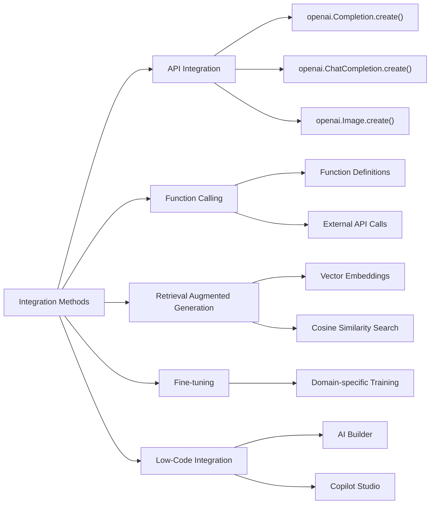

<!-- source: DeepWiki mcp.deepwiki.com · repo microsoft/generative-ai-for-beginners · page 4 Building GenAI Applications · fetched 2026-10-26 -->

# Building GenAI Applications

<details>
<summary>Relevant source files</summary>

The following files were used as context for generating this wiki page:

- [00-course-setup/README.md](00-course-setup/README.md)
- [01-introduction-to-genai/README.md](01-introduction-to-genai/README.md)
- [02-exploring-and-comparing-different-llms/README.md](02-exploring-and-comparing-different-llms/README.md)
- [03-using-generative-ai-responsibly/README.md](03-using-generative-ai-responsibly/README.md)
- [04-prompt-engineering-fundamentals/README.md](04-prompt-engineering-fundamentals/README.md)
- [05-advanced-prompts/README.md](05-advanced-prompts/README.md)
- [06-text-generation-apps/README.md](06-text-generation-apps/README.md)
- [07-building-chat-applications/README.md](07-building-chat-applications/README.md)
- [08-building-search-applications/README.md](08-building-search-applications/README.md)
- [09-building-image-applications/README.md](09-building-image-applications/README.md)
- [10-building-low-code-ai-applications/README.md](10-building-low-code-ai-applications/README.md)
- [11-integrating-with-function-calling/README.md](11-integrating-with-function-calling/README.md)
- [12-designing-ux-for-ai-applications/README.md](12-designing-ux-for-ai-applications/README.md)
- [README.md](README.md)
- [translations/en/.co-op-translator.json](translations/en/.co-op-translator.json)
- [translations/en/README.md](translations/en/README.md)
- [translations/en/docs/ENHANCED_FEATURES_ROADMAP.md](translations/en/docs/ENHANCED_FEATURES_ROADMAP.md)
- [translations/en/docs/SECURITY_GUIDELINES.md](translations/en/docs/SECURITY_GUIDELINES.md)
- [translations/es/.co-op-translator.json](translations/es/.co-op-translator.json)
- [translations/es/README.md](translations/es/README.md)
- [translations/es/docs/ENHANCED_FEATURES_ROADMAP.md](translations/es/docs/ENHANCED_FEATURES_ROADMAP.md)
- [translations/es/docs/SECURITY_GUIDELINES.md](translations/es/docs/SECURITY_GUIDELINES.md)
- [translations/fr/.co-op-translator.json](translations/fr/.co-op-translator.json)
- [translations/fr/README.md](translations/fr/README.md)

</details>


This page provides an overview of the different types of applications you can build with generative AI and the common patterns for implementing them. It serves as a foundational guide for developers who want to understand the landscape of GenAI application development before diving into specific implementation details.

For information about specific prompt engineering techniques, see [Prompt Engineering Fundamentals](#3.2). For information about responsible AI practices when building applications, see [Responsible AI Practices](#3.4).

## Overview of GenAI Application Types

Generative AI can be used to build various types of applications, each serving different purposes and user needs. The following diagram illustrates the main types of GenAI applications covered in this curriculum:

```mermaid
graph TD
    A["GenAI Applications"] --> B["Text Generation"]
    A --> C["Chat Applications"]
    A --> D["Search Applications"]
    A --> E["Image Generation"]
    A --> F["Low-Code Applications"]
    
    B --> B1["Content Creation"]
    B --> B2["Summarization"]
    B --> B3["Text Completion"]
    
    C --> C1["Conversational Interfaces"]
    C --> C2["Contextual Responses"]
    C --> C3["Multi-turn Dialogues"]
    
    D --> D1["Semantic Search"]
    D --> D2["Vector Embeddings"]
    D --> D3["Document Retrieval"]
    
    E --> E1["DALL-E Integration"]
    E --> E2["Image Generation from Text"]
    E --> E3["Creative Design"]
    
    F --> F1["Power Platform"]
    F --> F2["Visual Development"]
    F --> F3["AI-assisted Creation"]
```



Sources: [README.md:67-92](), [06-text-generation-apps/README.md:42-54](), [08-building-search-applications/README.md:7-13](), [09-building-image-applications/README.md:24-31](), [10-building-low-code-ai-applications/README.md:9-13]()

## Common Integration Methods for GenAI Applications

Regardless of the application type, there are several common methods for integrating generative AI models into your applications. Developers can choose between using high-level libraries or direct API calls.



Sources: [11-integrating-with-function-calling/README.md:28-37](), [06-text-generation-apps/README.md:56-72](), [08-building-search-applications/README.md:40-46](), [02-exploring-and-comparing-different-llms/README.md:142-153](), [10-building-low-code-ai-applications/README.md:44-57]()

## Text Generation Applications

Text generation applications are systems that produce new text content based on prompts. These applications leverage models like GPT-4 to create creative writing, summaries, or code assistance.

For details, see [Text Generation Applications](#4.1).

### Implementation Pattern
The standard implementation uses the `openai` library and typically includes configuring the `api_type`, `api_key`, and `api_base` [06-text-generation-apps/README.md:112-133]().

```python
# Create completion
prompt = "Your prompt text here"
completion = openai.Completion.create(
    model="davinci-002",
    prompt=prompt,
    max_tokens=100,
    temperature=0.7
)
```

Sources: [06-text-generation-apps/README.md:75-111](), [06-text-generation-apps/README.md:134-162]()

## Chat Applications

Chat applications create conversational experiences where users can have multi-turn dialogues. These applications maintain conversation context using the `ChatCompletion` class and role-based message arrays [06-text-generation-apps/README.md:145-147]().

For details, see [Chat Applications](#4.2).

### Implementation Pattern
Chat applications use the chat completion API which supports roles like `system`, `user`, and `assistant` [07-building-chat-applications/README.md:63-82]().

Sources: [07-building-chat-applications/README.md:36-54](), [07-building-chat-applications/README.md:84-117]()

## Search Applications

Search applications leverage vector embeddings to find semantically relevant information. This goes beyond keyword search by using numerical representations of text called vectors [08-building-search-applications/README.md:7-13]().

For details, see [Search Applications](#4.3).

### Implementation Pattern
The key steps involve generating embeddings using the `OpenAI Embedding API` and calculating `cosine similarity` to find the most relevant segments in a dataset, such as YouTube transcripts [08-building-search-applications/README.md:40-87]().

Sources: [08-building-search-applications/README.md:40-87](), [08-building-search-applications/README.md:78-87]()

## Image Generation Applications

Image generation applications use models like DALL-E to create visual content from text descriptions. These models, such as DALL-E 3, utilize an autoregressive transformer architecture to generate pixels based on text prompts [09-building-image-applications/README.md:64-72]().

For details, see [Image Generation Applications](#4.4).

### Implementation Pattern
Applications typically use the `client.images.generate()` method from the OpenAI SDK to retrieve a URL for the generated image [09-building-image-applications/README.md:141-160]().

Sources: [09-building-image-applications/README.md:62-72](), [09-building-image-applications/README.md:114-166]()

## Function Calling Integration

Function calling allows LLMs to interact with external APIs and services. This enables the model to provide consistent response formats (like JSON) and access external data sources [11-integrating-with-function-calling/README.md:37-45]().

For details, see [Function Calling Integration](#4.6).

### Implementation Pattern
Developers define function schemas in JSON and the LLM determines when to trigger a `function_call` based on user intent [11-integrating-with-function-calling/README.md:197-384]().

Sources: [11-integrating-with-function-calling/README.md:189-196](), [11-integrating-with-function-calling/README.md:197-384]()

## Low-Code AI Applications

Low-code AI applications leverage platforms like Microsoft Power Platform to enable building solutions with little to no code. This is achieved through tools like `AI Builder` and `Copilot` [10-building-low-code-ai-applications/README.md:9-13]().

For details, see [Low-Code AI Applications](#4.5).

### Components of Low-Code AI Solutions
- **Power Apps**: Visual environment for app development [10-building-low-code-ai-applications/README.md:58-63]().
- **Power Automate**: Workflow automation between services [10-building-low-code-ai-applications/README.md:64-69]().
- **AI Builder**: Prebuilt AI models for tasks like invoice processing [10-building-low-code-ai-applications/README.md:54-57]().

Sources: [10-building-low-code-ai-applications/README.md:44-57](), [10-building-low-code-ai-applications/README.md:76-113]()

## Best Practices for GenAI Applications

### Security and Privacy
- **Environment Variables**: Always store sensitive keys in `.env` files using `python-dotenv` [09-building-image-applications/README.md:76-77]().
- **Input Validation**: Sanitize user prompts to prevent injection attacks.

### Performance Optimization
- **Temperature**: Adjust the `temperature` parameter to control the randomness of output [06-text-generation-apps/README.md:583-597]().
- **Token Management**: Use `max_tokens` to limit response length and control costs [06-text-generation-apps/README.md:583-597]().

### User Experience Design
- **Explainability**: Ensure users know when they are interacting with an AI [12-designing-ux-for-ai-applications/README.md:62-65]().
- **Friction**: Intentionally design "friction" to remind users that the output is generated and may require verification [12-designing-ux-for-ai-applications/README.md:86-88]().

Sources: [06-text-generation-apps/README.md:553-582](), [06-text-generation-apps/README.md:583-597](), [12-designing-ux-for-ai-applications/README.md:52-101]()

---

