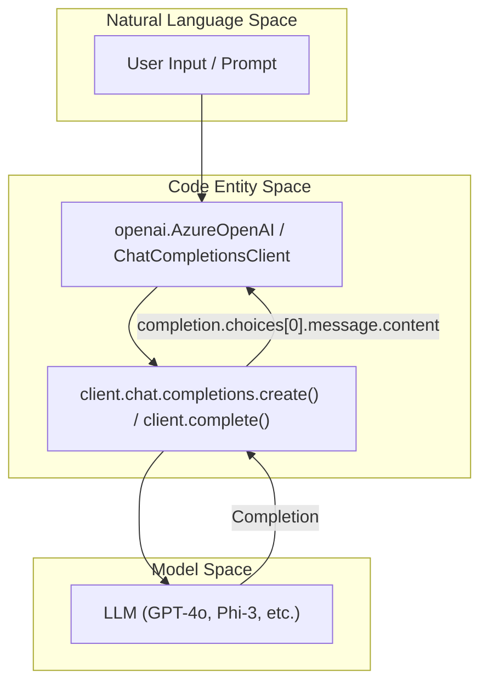
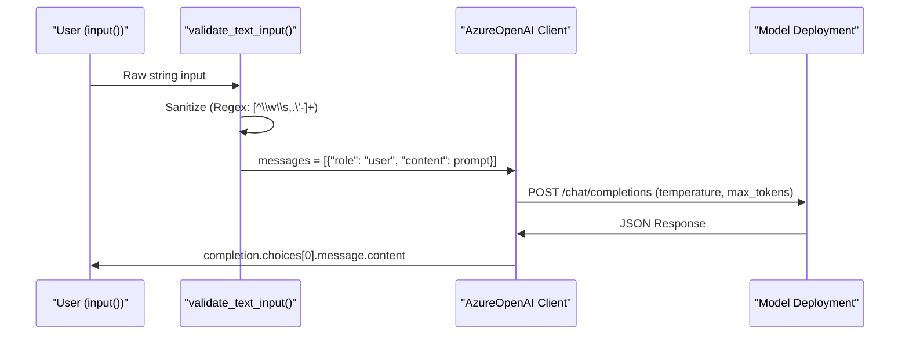

<!-- source: DeepWiki mcp.deepwiki.com · repo microsoft/generative-ai-for-beginners · page 4.1 Text Generation Applications · fetched 2026-10-26 -->

# Text Generation Applications

Relevant source files

The following files were used as context for generating this wiki page:

- [.devcontainer/Setup.txt](.devcontainer/Setup.txt)
- [.devcontainer/devcontainer.json](.devcontainer/devcontainer.json)
- [.devcontainer/environment.yml](.devcontainer/environment.yml)
- [.devcontainer/icon.svg](.devcontainer/icon.svg)
- [.devcontainer/post-create.sh](.devcontainer/post-create.sh)
- [.env.copy](.env.copy)
- [06-text-generation-apps/images/GithubModels-getstarted.png](06-text-generation-apps/images/GithubModels-getstarted.png)
- [06-text-generation-apps/images/GithubModels-modelcard.png](06-text-generation-apps/images/GithubModels-modelcard.png)
- [06-text-generation-apps/images/GithubModels-plagroundcode.png](06-text-generation-apps/images/GithubModels-plagroundcode.png)
- [06-text-generation-apps/images/GithubModelsMainScreen.png](06-text-generation-apps/images/GithubModelsMainScreen.png)
- [06-text-generation-apps/images/codespaces-basicpy.png](06-text-generation-apps/images/codespaces-basicpy.png)
- [06-text-generation-apps/images/vscode-envvariable.png](06-text-generation-apps/images/vscode-envvariable.png)
- [06-text-generation-apps/python/aoai-app-recipe.py](06-text-generation-apps/python/aoai-app-recipe.py)
- [06-text-generation-apps/python/aoai-app.py](06-text-generation-apps/python/aoai-app.py)
- [06-text-generation-apps/python/aoai-assignment.ipynb](06-text-generation-apps/python/aoai-assignment.ipynb)
- [06-text-generation-apps/python/aoai-history-bot.py](06-text-generation-apps/python/aoai-history-bot.py)
- [06-text-generation-apps/python/aoai-study-buddy.py](06-text-generation-apps/python/aoai-study-buddy.py)
- [06-text-generation-apps/python/githubmodels-app.py](06-text-generation-apps/python/githubmodels-app.py)
- [06-text-generation-apps/python/githubmodels-assignment.ipynb](06-text-generation-apps/python/githubmodels-assignment.ipynb)
- [06-text-generation-apps/python/oai-app-recipe.py](06-text-generation-apps/python/oai-app-recipe.py)
- [06-text-generation-apps/python/oai-app.py](06-text-generation-apps/python/oai-app.py)
- [06-text-generation-apps/python/oai-assigment.ipynb](06-text-generation-apps/python/oai-assigment.ipynb)
- [06-text-generation-apps/python/oai-history-bot.py](06-text-generation-apps/python/oai-history-bot.py)
- [06-text-generation-apps/python/oai-study-buddy.py](06-text-generation-apps/python/oai-study-buddy.py)
- [06-text-generation-apps/python/requirements.txt](06-text-generation-apps/python/requirements.txt)
- [06-text-generation-apps/typescript/.gitignore](06-text-generation-apps/typescript/.gitignore)
- [06-text-generation-apps/typescript/recipe-app/.env-sample](06-text-generation-apps/typescript/recipe-app/.env-sample)
- [06-text-generation-apps/typescript/recipe-app/package-lock.json](06-text-generation-apps/typescript/recipe-app/package-lock.json)
- [06-text-generation-apps/typescript/recipe-app/package.json](06-text-generation-apps/typescript/recipe-app/package.json)
- [06-text-generation-apps/typescript/recipe-app/tsconfig.json](06-text-generation-apps/typescript/recipe-app/tsconfig.json)
- [docs/_sidebar.md](docs/_sidebar.md)
- [package-lock.json](package-lock.json)
- [package.json](package.json)
- [requirements.txt](requirements.txt)
- [translations/ja/06-text-generation-apps/README.md](translations/ja/06-text-generation-apps/README.md)
- [vs.code-profile](vs.code-profile)

This document explains how to build applications that generate text using Large Language Models (LLMs). Text generation is one of the most fundamental capabilities of generative AI, allowing developers to create applications that can produce human-like text for various purposes.

## Overview

Text generation applications are software systems that leverage LLMs to generate new text content based on prompts or inputs. Unlike traditional applications with limited command sets or rigid interfaces, text generation applications provide more flexibility by accepting natural language inputs and generating contextually relevant outputs.

Sources: [06-text-generation-apps/python/githubmodels-assignment.ipynb:29-56](), [06-text-generation-apps/python/aoai-app-recipe.py:40-67]()

## Architecture and Data Flow

The codebase supports two primary backends: **Azure OpenAI** and **GitHub Models**. While the underlying goal is the same, the SDKs and authentication methods differ slightly.

### Backend Implementation Comparison

| Feature | Azure OpenAI (Python/TS) | GitHub Models (Python) |
|---------|-------------------------|------------------------|
| **SDK** | `openai` (Python), `@azure/openai` (TS) | `azure-ai-inference` |
| **Client Class** | `AzureOpenAI` | `ChatCompletionsClient` |
| **Method** | `client.chat.completions.create` | `client.complete` |
| **Auth** | `api_key`, `azure_endpoint` | `GITHUB_TOKEN` |
| **Input Type** | List of dictionaries (`messages`) | List of message objects |

Sources: [06-text-generation-apps/python/aoai-app-recipe.py:40-47](), [06-text-generation-apps/python/githubmodels-app.py:11-34](), [package.json:29-31]()

### Data Flow Diagram

This diagram maps the flow from user input to the final processed response, highlighting specific code entities used in the Python implementations.

Sources: [06-text-generation-apps/python/aoai-app-recipe.py:28-37](), [06-text-generation-apps/python/aoai-app-recipe.py:64-67](), [06-text-generation-apps/python/aoai-app-recipe.py:75-76]()

## Implementation Examples

The repository provides three primary patterns for text generation: Recipe Generation, Study Buddy, and History Bot.

### 1. Recipe Generator (Sequential Generation)
This application demonstrates a two-step generation process: first generating recipes, then using that output to generate a shopping list.

- **File (Python)**: [06-text-generation-apps/python/aoai-app-recipe.py]()
- **File (TypeScript)**: [06-text-generation-apps/typescript/recipe-app/index.ts]() (referenced via `package.json` dependencies)
- **Key Feature**: Sequential prompts where the second prompt `new_prompt` includes the result of the first `old_prompt_result` [06-text-generation-apps/python/aoai-app-recipe.py:75-79]().

### 2. Study Buddy (Structured Output)
Focuses on forcing the model to adhere to a specific format using a system-style prompt.

- **File**: [06-text-generation-apps/python/aoai-study-buddy.py]()
- **Prompt Structure**: Instructs the model to provide a response in a specific Markdown format: `- Concept`, `- Example code`, `- explanation` [06-text-generation-apps/python/aoai-study-buddy.py:22-26]().

### 3. History Bot (Persona-based Prompting)
Demonstrates setting a "persona" and adding constraints to prevent hallucinations.

- **File**: [06-text-generation-apps/python/aoai-history-bot.py]()
- **Constraints**: "Don't create content yourself. If you don't know something, tell that you don't remember" [06-text-generation-apps/python/aoai-history-bot.py:23-23]().
- **Configuration**: Uses `temperature=0` to ensure deterministic, factual answers [06-text-generation-apps/python/aoai-history-bot.py:29-29]().

## Configuration Parameters

The behavior of text generation is controlled by several key parameters passed to the `create` or `complete` methods.

| Parameter | Description | Typical Value |
|-----------|-------------|---------------|
| `temperature` | Controls randomness. 0 is deterministic; 1 is creative. | `0.1` (Recipes), `0` (History) |
| `max_tokens` | Limits the length of the generated output. | `600` (Recipes), `1000` (GitHub Models) |
| `model` / `deployment` | Specifies which LLM to use. | `gpt-4o`, `phi-3` |

Sources: [06-text-generation-apps/python/aoai-app-recipe.py:67-67](), [06-text-generation-apps/python/aoai-history-bot.py:29-29](), [06-text-generation-apps/python/githubmodels-app.py:31-33]()

## Security and Validation

The implementation includes critical security layers to protect against prompt injection and environment misconfiguration.

### Input Sanitization
The `validate_text_input` function in [06-text-generation-apps/python/aoai-app-recipe.py:28-37]() performs the following:
1. **Length Check**: Rejects input exceeding 500 characters.
2. **Character Filtering**: Removes potentially dangerous characters like `< > { } [ ] | \`.
3. **Regex Validation**: Ensures the string only contains alphanumeric characters and basic punctuation.

### Environment Management
The applications use `python-dotenv` to load credentials from a `.env` file [06-text-generation-apps/python/aoai-app-recipe.py:7-7](). A helper function `get_required_env` ensures the application fails fast with a helpful error if keys like `AZURE_OPENAI_API_KEY` are missing [06-text-generation-apps/python/aoai-app-recipe.py:10-15]().

Sources: [06-text-generation-apps/python/aoai-app-recipe.py:10-37](), [requirements.txt:6-7]()

---

