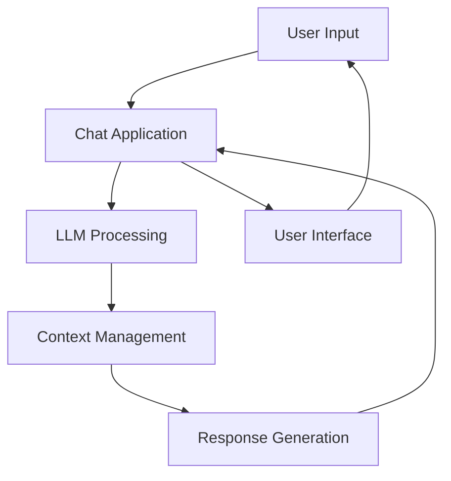
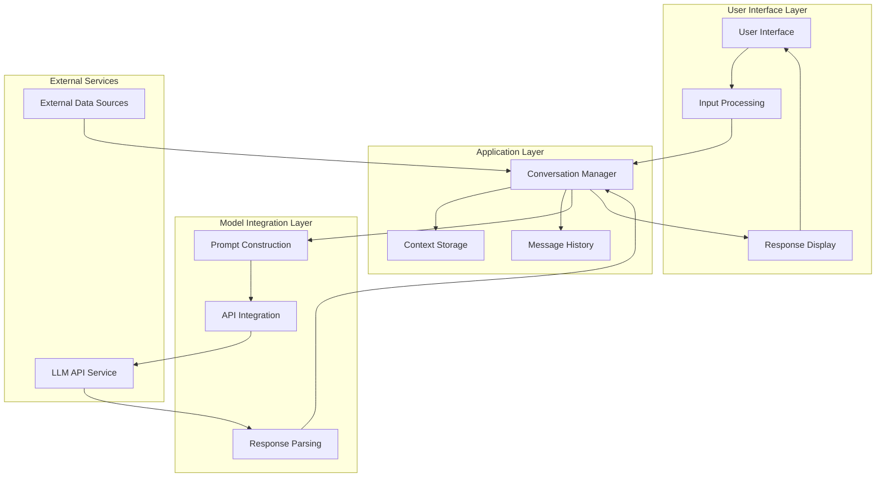
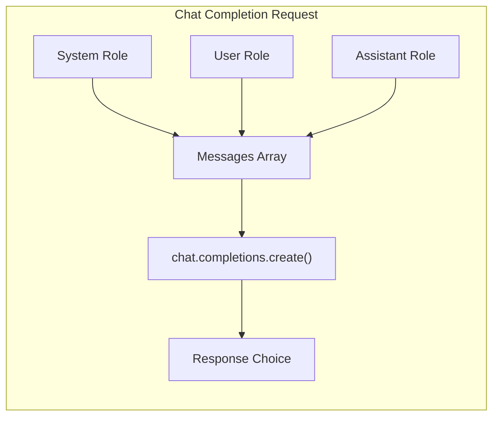
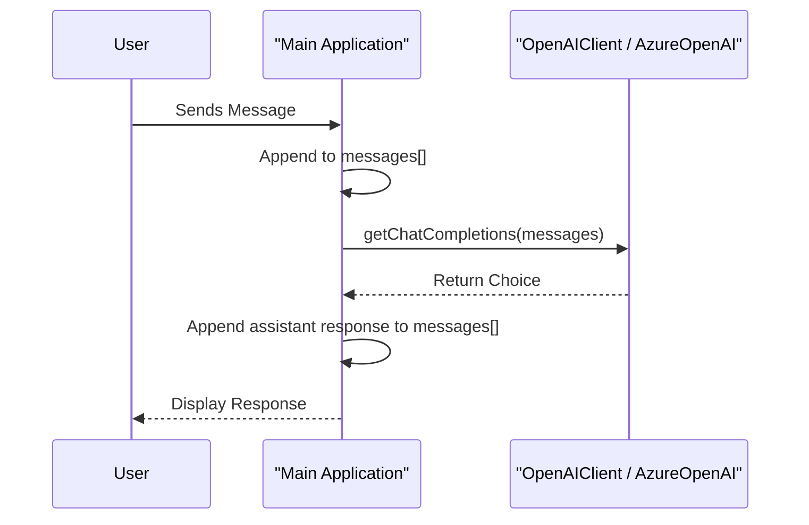
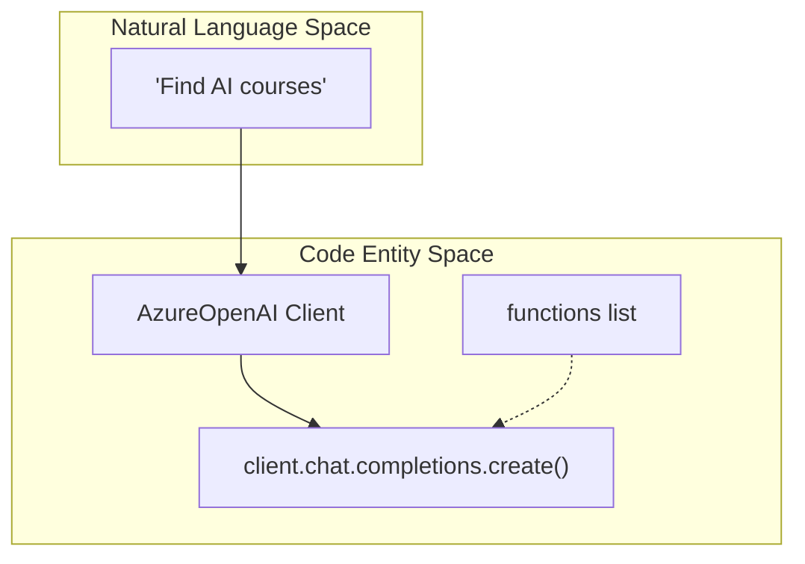

<!-- source: DeepWiki mcp.deepwiki.com · repo microsoft/generative-ai-for-beginners · page 4.2 Chat Applications · fetched 2026-10-26 -->

# Chat Applications

<details>
<summary>Relevant source files</summary>

The following files were used as context for generating this wiki page:

- [.eslintrc.json](.eslintrc.json)
- [.prettierrc](.prettierrc)
- [00-course-setup/01-setup-cloud.md](00-course-setup/01-setup-cloud.md)
- [00-course-setup/02-setup-local.md](00-course-setup/02-setup-local.md)
- [00-course-setup/03-providers.md](00-course-setup/03-providers.md)
- [05-advanced-prompts/javascript/solution.js](05-advanced-prompts/javascript/solution.js)
- [05-advanced-prompts/python/aoai-solution.py](05-advanced-prompts/python/aoai-solution.py)
- [06-text-generation-apps/js-githubmodels/app.js](06-text-generation-apps/js-githubmodels/app.js)
- [06-text-generation-apps/js-githubmodels/package-lock.json](06-text-generation-apps/js-githubmodels/package-lock.json)
- [06-text-generation-apps/js-githubmodels/package.json](06-text-generation-apps/js-githubmodels/package.json)
- [07-building-chat-applications/js-githubmodels/app.js](07-building-chat-applications/js-githubmodels/app.js)
- [07-building-chat-applications/js-githubmodels/package-lock.json](07-building-chat-applications/js-githubmodels/package-lock.json)
- [07-building-chat-applications/js-githubmodels/package.json](07-building-chat-applications/js-githubmodels/package.json)
- [07-building-chat-applications/python/aoai-assigment-simple.ipynb](07-building-chat-applications/python/aoai-assigment-simple.ipynb)
- [07-building-chat-applications/python/aoai-assignment.ipynb](07-building-chat-applications/python/aoai-assignment.ipynb)
- [07-building-chat-applications/python/githubmodels-assignment.ipynb](07-building-chat-applications/python/githubmodels-assignment.ipynb)
- [07-building-chat-applications/python/oai-assigment-simple.ipynb](07-building-chat-applications/python/oai-assigment-simple.ipynb)
- [07-building-chat-applications/python/oai-assignment.ipynb](07-building-chat-applications/python/oai-assignment.ipynb)
- [07-building-chat-applications/typescript/.gitignore](07-building-chat-applications/typescript/.gitignore)
- [07-building-chat-applications/typescript/chat-completions-app/package-lock.json](07-building-chat-applications/typescript/chat-completions-app/package-lock.json)
- [07-building-chat-applications/typescript/chat-completions-app/package.json](07-building-chat-applications/typescript/chat-completions-app/package.json)
- [07-building-chat-applications/typescript/chat-completions-app/src/main.ts](07-building-chat-applications/typescript/chat-completions-app/src/main.ts)
- [07-building-chat-applications/typescript/chat-completions-app/tsconfig.json](07-building-chat-applications/typescript/chat-completions-app/tsconfig.json)
- [08-building-search-applications/js-githubmodels/app.js](08-building-search-applications/js-githubmodels/app.js)
- [08-building-search-applications/js-githubmodels/package-lock.json](08-building-search-applications/js-githubmodels/package-lock.json)
- [08-building-search-applications/js-githubmodels/package.json](08-building-search-applications/js-githubmodels/package.json)
- [08-building-search-applications/python/aoai-solution.ipynb](08-building-search-applications/python/aoai-solution.ipynb)
- [08-building-search-applications/python/oai-solution.ipynb](08-building-search-applications/python/oai-solution.ipynb)
- [08-building-search-applications/scripts/transcript_download.py](08-building-search-applications/scripts/transcript_download.py)
- [11-integrating-with-function-calling/python/aoai-assignment.ipynb](11-integrating-with-function-calling/python/aoai-assignment.ipynb)
- [11-integrating-with-function-calling/python/oai-assignment.ipynb](11-integrating-with-function-calling/python/oai-assignment.ipynb)

</details>


This document explains how to build chat-based applications with Large Language Models (LLMs) in the Generative AI for Beginners course. Chat applications differ from text generation applications (covered in [Text Generation Applications](#4.1)) in that they maintain conversation context and enable interactive, ongoing dialogues rather than one-time responses.

## Key Concepts in Chat Applications

Chat applications have become integrated into our daily lives, offering more than just casual conversation. They're used in customer service, technical support, and sophisticated advisory systems. Generative AI enhances these applications by providing more natural, context-aware interactions.

Unlike traditional chatbots that follow predefined scripts, generative AI-powered chat applications can:
- Maintain conversation context over multiple turns
- Generate dynamic, natural-sounding responses
- Understand and adapt to user intentions
- Provide personalized interactions



Sources: [07-building-chat-applications/python/aoai-assignment.ipynb:14-35](), [07-building-chat-applications/python/githubmodels-assignment.ipynb:14-34]()

## Architecture of Chat Applications

A generative AI-powered chat application typically consists of the following components:



Sources: [11-integrating-with-function-calling/python/aoai-assignment.ipynb:27-51](), [07-building-chat-applications/typescript/chat-completions-app/src/main.ts:9-31]()

## Building Chat Applications with OpenAI and Azure

The course provides implementations for multiple providers, including OpenAI, Azure OpenAI, and GitHub Models.

### Setting Up the Clients

**Python (OpenAI):**
[07-building-chat-applications/python/oai-assignment.ipynb:157-169]()
```python
from openai import OpenAI
client = OpenAI(api_key=os.getenv("OPENAI_API_KEY"))
```

**Python (Azure OpenAI):**
[07-building-chat-applications/python/aoai-assignment.ipynb:182-194]()
```python
from openai import AzureOpenAI
client = AzureOpenAI(
    api_key=os.environ['AZURE_OPENAI_API_KEY'],
    api_version="2023-05-15"
)
```

**TypeScript (Azure OpenAI):**
[07-building-chat-applications/typescript/chat-completions-app/src/main.ts:1-13]()
```typescript
import { OpenAIClient, AzureKeyCredential } from "@azure/openai";
const client = new OpenAIClient(endpoint, new AzureKeyCredential(azureApiKey));
```

### Chat Completion API

Chat applications use the Chat Completions API. The main difference from standard text completion is the use of a `messages` array that defines roles.



Sources: [07-building-chat-applications/python/aoai-assigment-simple.ipynb:33-44](), [07-building-chat-applications/typescript/chat-completions-app/src/main.ts:17-27]()

## Message Structure and Roles

The chat completions API requires a structured array of messages. Each message must have a `role` and `content`.

| Role | Purpose | Code Reference |
| :--- | :--- | :--- |
| **system** | Sets the persona and behavioral guardrails for the assistant. | [07-building-chat-applications/typescript/chat-completions-app/src/main.ts:18-19]() |
| **user** | Represents the input from the human user. | [07-building-chat-applications/python/aoai-assigment-simple.ipynb:40]() |
| **assistant** | Represents previous responses from the LLM to maintain context. | [11-integrating-with-function-calling/python/aoai-assignment.ipynb:51]() |

Sources: [07-building-chat-applications/python/aoai-assigment-simple.ipynb:36-40](), [07-building-chat-applications/typescript/chat-completions-app/src/main.ts:17-21]()

## Maintaining State and Context

Unlike simple text generation, chat applications must manage state by appending new messages to the history array. This allows the model to "remember" previous parts of the conversation.



Sources: [07-building-chat-applications/typescript/chat-completions-app/src/main.ts:17-27](), [11-integrating-with-function-calling/python/aoai-assignment.ipynb:38-51]()

## Function Calling in Chat

Advanced chat applications use `Function Calling` to bridge the gap between natural language and external data sources (like the Microsoft Learn Catalog API).

1. **Definition**: The developer provides a JSON schema of available functions.
2. **Detection**: The LLM determines if a function should be called based on user intent.
3. **Execution**: The application executes the local code and returns the result to the LLM.



Sources: [11-integrating-with-function-calling/python/aoai-assignment.ipynb:27-51](), [11-integrating-with-function-calling/python/oai-assignment.ipynb:42-51]()

## Implementation Details

### TypeScript Implementation
The TypeScript example uses the `@azure/openai` package. It demonstrates a multi-system-message approach to define a persona.

- **File**: `07-building-chat-applications/typescript/chat-completions-app/src/main.ts`
- **Key Function**: `main()` [07-building-chat-applications/typescript/chat-completions-app/src/main.ts:9-31]()
- **Dependencies**: `@azure/openai`, `dotenv` [07-building-chat-applications/typescript/chat-completions-app/package.json:24-28]()

### Python Implementation
The Python examples show how to assert environment variables and handle the response object to extract the content string.

- **File**: `07-building-chat-applications/python/aoai-assigment-simple.ipynb`
- **Key Logic**: Extracting content via `response['choices'][0]['message']['content']` [07-building-chat-applications/python/aoai-assigment-simple.ipynb:43]()

## Best Practices

1. **Environment Security**: Use `.env` files to store `AZURE_OPENAI_API_KEY` and `GITHUB_TOKEN`. Never hardcode keys. [00-course-setup/02-setup-local.md:139-169]()
2. **Model Selection**: Use `gpt-35-turbo` or `gpt-4o` for chat tasks to balance speed and reasoning capability. [07-building-chat-applications/python/aoai-assignment.ipynb:207-212](), [07-building-chat-applications/python/githubmodels-assignment.ipynb:180-205]()
3. **Validation**: Always validate that endpoints and keys are loaded before instantiating clients. [07-building-chat-applications/python/aoai-assigment-simple.ipynb:15-24]()

Sources: [00-course-setup/02-setup-local.md:139-191](), [07-building-chat-applications/python/aoai-assigment-simple.ipynb:9-24]()

---

