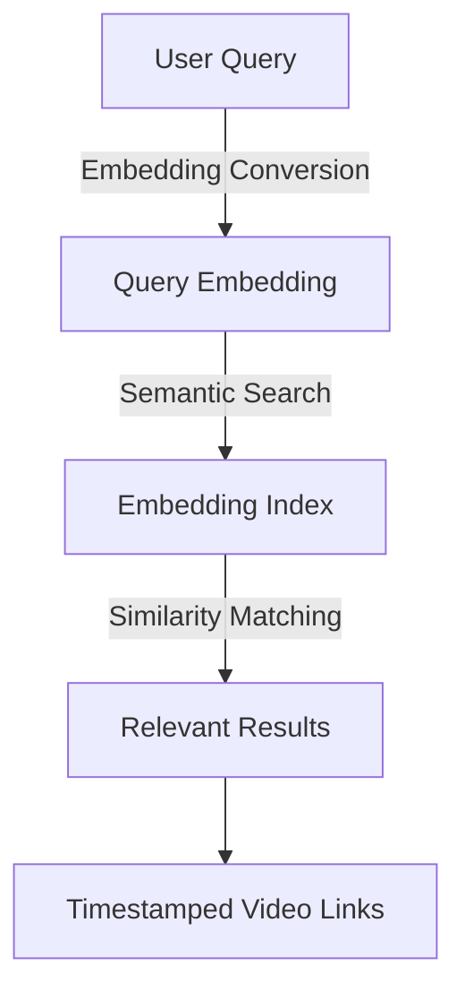
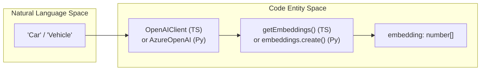
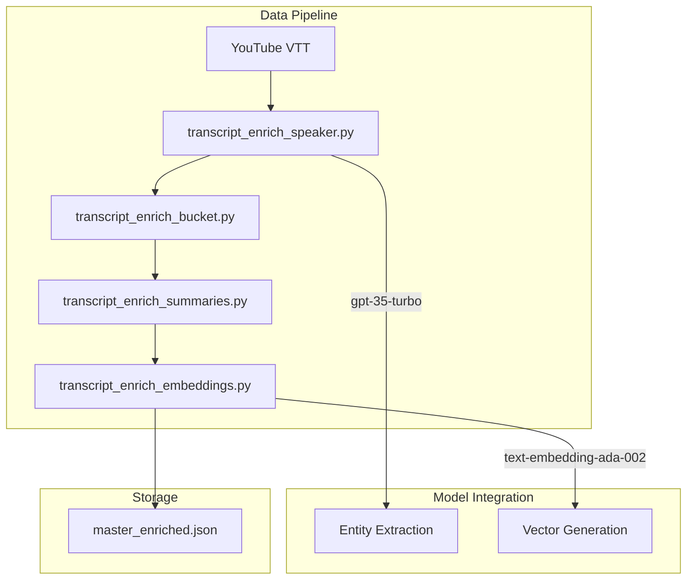

<!-- source: DeepWiki mcp.deepwiki.com · repo microsoft/generative-ai-for-beginners · page 4.3 Search Applications · fetched 2026-10-26 -->

# Search Applications

Relevant source files

The following files were used as context for generating this wiki page:

- [.eslintrc.json](.eslintrc.json)
- [.prettierrc](.prettierrc)
- [05-advanced-prompts/javascript/solution.js](05-advanced-prompts/javascript/solution.js)
- [05-advanced-prompts/python/aoai-solution.py](05-advanced-prompts/python/aoai-solution.py)
- [06-text-generation-apps/js-githubmodels/app.js](06-text-generation-apps/js-githubmodels/app.js)
- [06-text-generation-apps/js-githubmodels/package-lock.json](06-text-generation-apps/js-githubmodels/package-lock.json)
- [06-text-generation-apps/js-githubmodels/package.json](06-text-generation-apps/js-githubmodels/package.json)
- [07-building-chat-applications/js-githubmodels/app.js](07-building-chat-applications/js-githubmodels/app.js)
- [07-building-chat-applications/js-githubmodels/package-lock.json](07-building-chat-applications/js-githubmodels/package-lock.json)
- [07-building-chat-applications/js-githubmodels/package.json](07-building-chat-applications/js-githubmodels/package.json)
- [08-building-search-applications/js-githubmodels/app.js](08-building-search-applications/js-githubmodels/app.js)
- [08-building-search-applications/js-githubmodels/package-lock.json](08-building-search-applications/js-githubmodels/package-lock.json)
- [08-building-search-applications/js-githubmodels/package.json](08-building-search-applications/js-githubmodels/package.json)
- [08-building-search-applications/python/aoai-assignment.ipynb](08-building-search-applications/python/aoai-assignment.ipynb)
- [08-building-search-applications/python/oai-assignment.ipynb](08-building-search-applications/python/oai-assignment.ipynb)
- [08-building-search-applications/python/requirements.txt](08-building-search-applications/python/requirements.txt)
- [08-building-search-applications/scripts/prepare_transcripts_ai_show.bat](08-building-search-applications/scripts/prepare_transcripts_ai_show.bat)
- [08-building-search-applications/scripts/prepare_transcripts_ai_show.ps1](08-building-search-applications/scripts/prepare_transcripts_ai_show.ps1)
- [08-building-search-applications/scripts/transcript_download.py](08-building-search-applications/scripts/transcript_download.py)
- [08-building-search-applications/scripts/transcript_enrich_embeddings.py](08-building-search-applications/scripts/transcript_enrich_embeddings.py)
- [08-building-search-applications/scripts/transcript_enrich_speaker.py](08-building-search-applications/scripts/transcript_enrich_speaker.py)
- [08-building-search-applications/scripts/transcript_enrich_summaries.py](08-building-search-applications/scripts/transcript_enrich_summaries.py)
- [08-building-search-applications/typescript/.gitignore](08-building-search-applications/typescript/.gitignore)
- [08-building-search-applications/typescript/search-app/.env-sample](08-building-search-applications/typescript/search-app/.env-sample)
- [08-building-search-applications/typescript/search-app/package-lock.json](08-building-search-applications/typescript/search-app/package-lock.json)
- [08-building-search-applications/typescript/search-app/package.json](08-building-search-applications/typescript/search-app/package.json)
- [08-building-search-applications/typescript/search-app/src/main.ts](08-building-search-applications/typescript/search-app/src/main.ts)
- [08-building-search-applications/typescript/search-app/tsconfig.json](08-building-search-applications/typescript/search-app/tsconfig.json)

This document explains how to build search applications using vector embeddings for semantic search. It covers the fundamental concepts of embeddings, the process of creating and searching embedding indexes, and practical implementation details for building applications that can find relevant information in unstructured data.

## Introduction to Search Applications

Search applications powered by generative AI go beyond traditional keyword matching by understanding the semantic meaning of text. In the context of this system, search applications use embeddings (numerical representations of text) to find relevant content based on meaning rather than exact word matches.

The primary use case demonstrated in the repository is building a search tool that allows users to search through video transcripts by asking questions in natural language. The system returns links to the specific points in videos where relevant answers can be found.

Sources: [08-building-search-applications/typescript/search-app/src/main.ts:34-63](), [08-building-search-applications/scripts/prepare_transcripts_ai_show.ps1:1-35]()

## Understanding Text Embeddings

Embeddings represent text as points in a high-dimensional space. Texts with similar meanings are positioned closer together, regardless of the specific words used.

### Embedding Generation in Code
The codebase demonstrates embedding generation using the Azure OpenAI SDK and the Azure AI Inference SDK (for GitHub Models). In the TypeScript implementation, the `OpenAIClient` uses `getEmbeddings` to convert strings into numerical arrays [08-building-search-applications/typescript/search-app/src/main.ts:46-48](). In Python, the `client.embeddings.create` method is used [08-building-search-applications/python/aoai-assignment.ipynb:60-60]().

### Natural Language to Code Entity Space: Embeddings
This diagram maps the conceptual flow of embedding generation to the specific SDK classes and methods used in the implementation.

Sources: [08-building-search-applications/typescript/search-app/src/main.ts:39-52](), [08-building-search-applications/python/aoai-assignment.ipynb:24-28](), [08-building-search-applications/python/aoai-assignment.ipynb:60-60]()

## Cosine Similarity: The Core Search Mechanism

Cosine similarity is the mathematical technique used to determine how closely related two embedding vectors are. It measures the cosine of the angle between two vectors.

### Implementation Details
The codebase provides manual implementations of cosine similarity to demonstrate the underlying math:
- **TypeScript**: Uses `reduce` to calculate the dot product and magnitudes [08-building-search-applications/typescript/search-app/src/main.ts:15-29]().
- **Python**: Uses `numpy.dot` and `numpy.linalg.norm` for efficient calculation [08-building-search-applications/python/aoai-assignment.ipynb:47-49]().
- **JavaScript (GitHub Models)**: Implements the same logic for the AI Inference SDK [08-building-search-applications/js-githubmodels/app.js:22-36]().

| Comparison | Result (Conceptual) | Explanation |
| :--- | :--- | :--- |
| "Car" vs "Vehicle" | High (~0.9+) | Semantically similar concepts |
| "Car" vs "Parrot" | Low | Unrelated concepts |
| "Car" vs "Car" | 1.0 | Identical vectors |

Sources: [08-building-search-applications/typescript/search-app/src/main.ts:15-29](), [08-building-search-applications/python/aoai-assignment.ipynb:47-49](), [08-building-search-applications/js-githubmodels/app.js:82-87]()

## The Transcript Enrichment Pipeline

To build a searchable index, raw data must be processed through an enrichment pipeline. The repository provides a PowerShell script `prepare_transcripts_ai_show.ps1` that orchestrates this flow using several Python scripts [08-building-search-applications/scripts/prepare_transcripts_ai_show.ps1:18-24]().

### Data Flow and Script Responsibilities
1.  **Download**: `transcript_download.py` fetches transcripts from YouTube [08-building-search-applications/scripts/prepare_transcripts_ai_show.ps1:18-18]().
2.  **Speaker Extraction**: `transcript_enrich_speaker.py` uses GPT-3.5 and function calling (`get_speaker_name`) to identify speakers from the text [08-building-search-applications/scripts/transcript_enrich_speaker.py:59-75]().
3.  **Chunking**: `transcript_enrich_bucket.py` groups transcript lines into 3-minute "buckets" to provide better context for search [08-building-search-applications/scripts/prepare_transcripts_ai_show.ps1:21-21]().
4.  **Summarization**: `transcript_enrich_summaries.py` generates concise summaries for each bucket [08-building-search-applications/scripts/prepare_transcripts_ai_show.ps1:22-22]().
5.  **Embedding**: `transcript_enrich_embeddings.py` generates the `ada_v2` vector for the segment text [08-building-search-applications/scripts/transcript_enrich_embeddings.py:87-91]().

### Natural Language to Code Entity Space: Enrichment Pipeline
This diagram maps the data processing stages to the specific scripts and models defined in the codebase.

Sources: [08-building-search-applications/scripts/prepare_transcripts_ai_show.ps1:18-24](), [08-building-search-applications/scripts/transcript_enrich_speaker.py:37-39](), [08-building-search-applications/scripts/transcript_enrich_embeddings.py:90-90](), [08-building-search-applications/scripts/transcript_enrich_embeddings.py:163-165]()

## Search Implementation with GitHub Models

The codebase also demonstrates building search applications using the GitHub Models service via the `@azure-rest/ai-inference` SDK. This allows developers to use models like `text-embedding-3-small` or `Cohere-embed-v3-english` [08-building-search-applications/js-githubmodels/app.js:13-20]().

The implementation follows a similar pattern:
1.  Initialize `ModelClient` with a GitHub token [08-building-search-applications/js-githubmodels/app.js:43-43]().
2.  Call the `/embeddings` endpoint [08-building-search-applications/js-githubmodels/app.js:45-45]().
3.  Process the returned `body.data` to extract vectors [08-building-search-applications/js-githubmodels/app.js:56-78]().
4.  Calculate similarity scores [08-building-search-applications/js-githubmodels/app.js:82-87]().

Sources: [08-building-search-applications/js-githubmodels/app.js:1-94](), [08-building-search-applications/js-githubmodels/package.json:1-8]()

## Conclusion

Building search applications involves a multi-step pipeline of data acquisition, enrichment (chunking, metadata extraction), and vectorization. By using cosine similarity on these vectors, applications can perform semantic retrieval that understands user intent far better than keyword-based systems. The repository provides both the "indexing" infrastructure (PowerShell/Python scripts) and the "querying" logic (TypeScript/JavaScript/Notebooks) required to implement this end-to-end.

---

