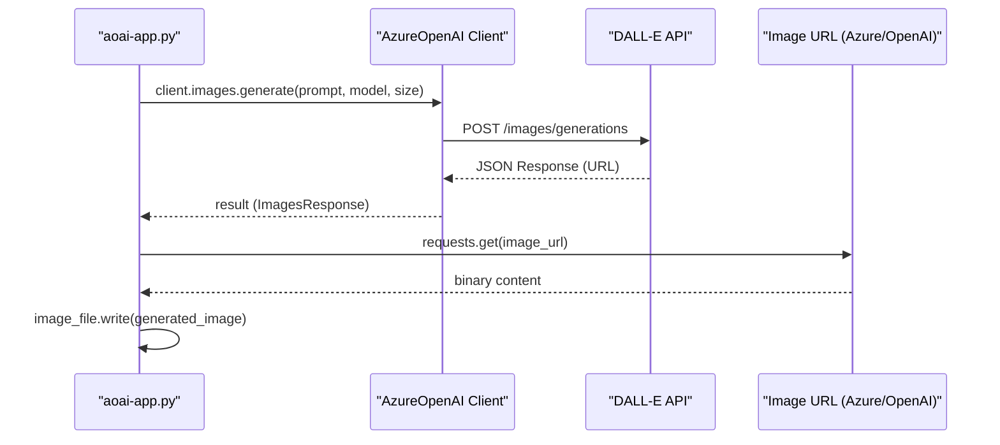
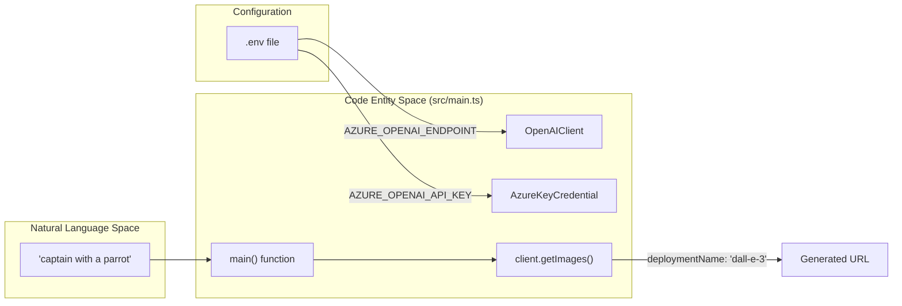

<!-- source: DeepWiki mcp.deepwiki.com · repo microsoft/generative-ai-for-beginners · page 4.4 Image Generation Applications · fetched 2026-10-26 -->

# Image Generation Applications

Relevant source files

The following files were used as context for generating this wiki page:

- [09-building-image-applications/images/mask.png](09-building-image-applications/images/mask.png)
- [09-building-image-applications/images/sunlit_lounge.png](09-building-image-applications/images/sunlit_lounge.png)
- [09-building-image-applications/images/sunlit_lounge_result.png](09-building-image-applications/images/sunlit_lounge_result.png)
- [09-building-image-applications/python/aoai-app-variation.py](09-building-image-applications/python/aoai-app-variation.py)
- [09-building-image-applications/python/aoai-app.py](09-building-image-applications/python/aoai-app.py)
- [09-building-image-applications/python/aoai-assignment.ipynb](09-building-image-applications/python/aoai-assignment.ipynb)
- [09-building-image-applications/python/aoai-solution.py](09-building-image-applications/python/aoai-solution.py)
- [09-building-image-applications/python/oai-app-variation.py](09-building-image-applications/python/oai-app-variation.py)
- [09-building-image-applications/python/oai-app.py](09-building-image-applications/python/oai-app.py)
- [09-building-image-applications/typescript/image-generation-app/.env-sample](09-building-image-applications/typescript/image-generation-app/.env-sample)
- [09-building-image-applications/typescript/image-generation-app/package-lock.json](09-building-image-applications/typescript/image-generation-app/package-lock.json)
- [09-building-image-applications/typescript/image-generation-app/package.json](09-building-image-applications/typescript/image-generation-app/package.json)
- [09-building-image-applications/typescript/image-generation-app/src/main.ts](09-building-image-applications/typescript/image-generation-app/src/main.ts)
- [09-building-image-applications/typescript/image-generation-app/tsconfig.json](09-building-image-applications/typescript/image-generation-app/tsconfig.json)
- [translations/ja/09-building-image-applications/README.md](translations/ja/09-building-image-applications/README.md)
- [translations/ko/09-building-image-applications/README.md](translations/ko/09-building-image-applications/README.md)

This document provides a technical deep dive into building applications that generate images using Generative AI. It details the implementation of image generation, variations, and management using models like DALL-E 3 via both Python and TypeScript SDKs.

## Overview of Image Generation Models

Image generation applications utilize models that bridge the gap between natural language and visual data. The codebase primarily focuses on **DALL-E**, a model developed by OpenAI that uses a combination of CLIP and Diffusion mechanisms to interpret text and synthesize pixels [translations/ja/09-building-image-applications/README.md:47-56]().

### Core Components
*   **CLIP (Contrastive Language-Image Pre-training)**: Generates numerical embeddings from text and images [09-building-image-applications/python/aoai-assignment.ipynb:57-57]().
*   **Diffused Attention**: A model that reconstructs images from these embeddings [09-building-image-applications/python/aoai-assignment.ipynb:59-59]().
*   **Autoregressive Transformers**: The underlying architecture that generates images one pixel at a time by predicting the next pixel based on previous ones [09-building-image-applications/python/aoai-assignment.ipynb:73-75]().

## Technical Implementation: Python

The Python implementation utilizes the `openai` library (specifically the `AzureOpenAI` client) and `Pillow` for image manipulation [09-building-image-applications/python/aoai-app.py:1-5]().

### Image Generation Workflow
The data flow involves sending a prompt to the `images.generate` method and downloading the resulting binary content from a temporary URL.

Sources: [09-building-image-applications/python/aoai-app.py:26-48](), [09-building-image-applications/python/aoai-assignment.ipynb:207-214]()

### Generating Variations
The codebase demonstrates how to take an existing image and generate a visually similar variation using `client.images.create_variation` [09-building-image-applications/python/aoai-app-variation.py:31-35]().

| Function | Purpose | Key Parameters |
| :--- | :--- | :--- |
| `images.generate` | Create image from text | `prompt`, `model`, `size`, `n` |
| `images.create_variation` | Create variation of existing image | `image` (binary), `n`, `size` |

Sources: [09-building-image-applications/python/aoai-app.py:26-31](), [09-building-image-applications/python/aoai-app-variation.py:31-35]()

## Technical Implementation: TypeScript

The TypeScript implementation uses the `@azure/openai` package and is structured to run within a Node.js environment [09-building-image-applications/typescript/image-generation-app/package.json:24-28]().

### Code Entity Mapping
The following diagram maps the high-level generation process to specific code entities in the TypeScript application.

Sources: [09-building-image-applications/typescript/image-generation-app/src/main.ts:1-24](), [09-building-image-applications/typescript/image-generation-app/.env-sample:5-7]()

### Implementation Details
In TypeScript, the `getImages` method is used to interface with the DALL-E deployment. The response format is typically a URL, but it can be configured for standard or vivid styles [09-building-image-applications/typescript/image-generation-app/src/main.ts:18-24]().

## Prompt Engineering for Images

Effective image generation relies on specific prompt structures and "Meta-prompts" to define application boundaries.

### Meta-Prompting Strategies
In the Edu4All scenario, meta-prompts are used to ensure that students generate images that are appropriate for their age group and educational context [translations/ja/09-building-image-applications/README.md:20-21]().

**Example Meta-Prompt Components:**
*   **Style**: Defining if the image should be a "fairytale illustration" or a "photorealistic monument" [09-building-image-applications/python/aoai-assignment.ipynb:37-41]().
*   **Boundaries**: Restricting content to specific subjects like "historical monuments" [09-building-image-applications/python/aoai-assignment.ipynb:39-39]().

## Configuration and Setup

### Environment Variables
Both implementations require a `.env` file to store sensitive credentials.
*   `AZURE_OPENAI_ENDPOINT`: The base URL for the Azure OpenAI resource [09-building-image-applications/python/aoai-app.py:17]().
*   `AZURE_OPENAI_API_KEY`: The authentication key [09-building-image-applications/python/aoai-app.py:15]().
*   `AZURE_OPENAI_DEPLOYMENT`: The specific name given to the DALL-E 3 model deployment [09-building-image-applications/python/aoai-app.py:20]().

### Dependencies
The Python environment requires `python-dotenv`, `openai`, `pillow`, and `requests` [09-building-image-applications/python/aoai-assignment.ipynb:112-116](). The TypeScript environment requires `@azure/openai` and `dotenv` [09-building-image-applications/typescript/image-generation-app/package.json:25-26]().

Sources: [09-building-image-applications/python/aoai-app.py:14-20](), [09-building-image-applications/typescript/image-generation-app/src/main.ts:1-7]()

## Application Scenarios

The repository uses the **Edu4All** startup scenario to demonstrate practical application [09-building-image-applications/python/aoai-assignment.ipynb:35-37]().

| Scenario | Prompt Example | Resulting Code Action |
| :--- | :--- | :--- |
| **Story Illustration** | "Bunny on horse, holding a lollipop" | `client.images.generate()` [09-building-image-applications/python/aoai-app.py:28]() |
| **Historical Visualization** | "Dog next to Eiffel Tower in early morning sunlight" | `client.images.generate()` [09-building-image-applications/python/aoai-assignment.ipynb:45]() |
| **Creative Iteration** | Existing image of a dog | `client.images.create_variation()` [09-building-image-applications/python/aoai-app-variation.py:31]() |

Sources: [09-building-image-applications/python/aoai-app.py:26-31](), [09-building-image-applications/python/aoai-app-variation.py:31-35](), [09-building-image-applications/python/aoai-assignment.ipynb:45-45]()

---

