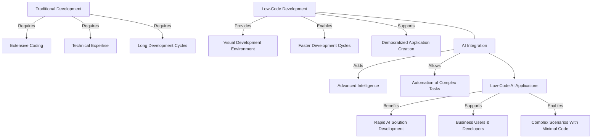
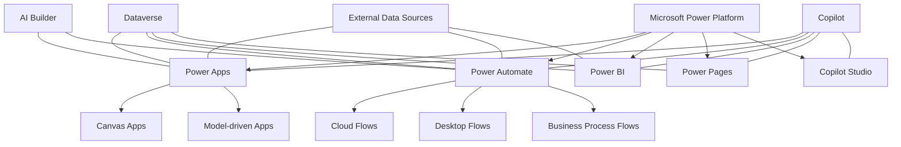
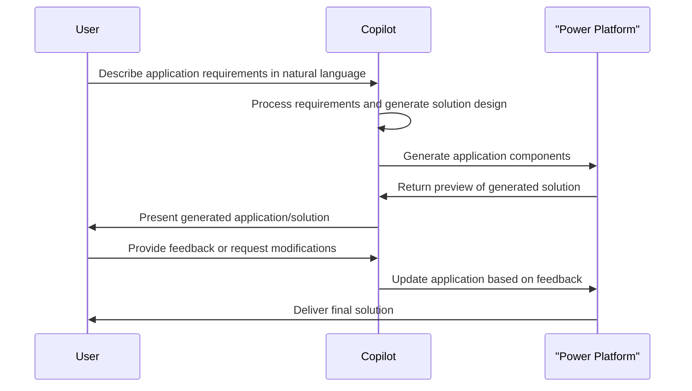
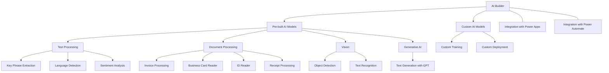
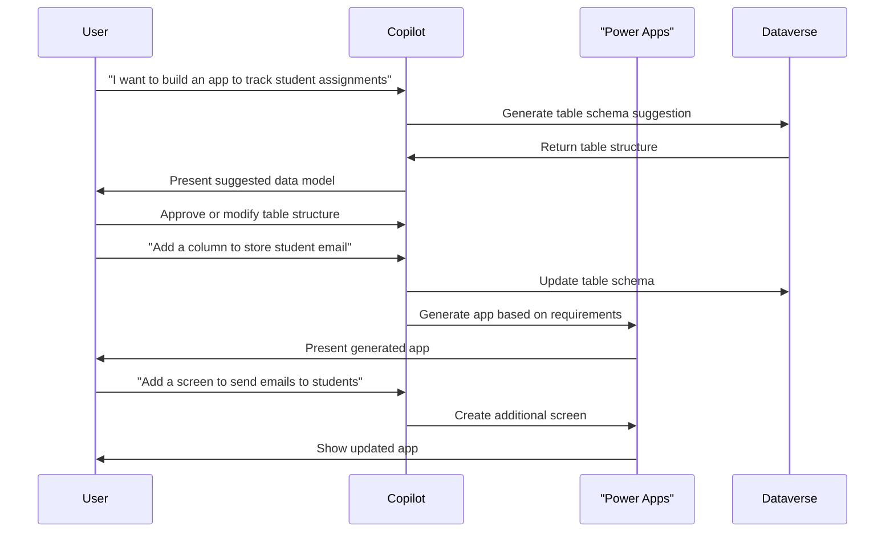
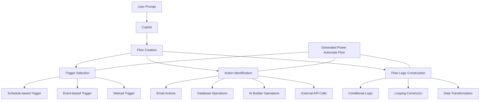
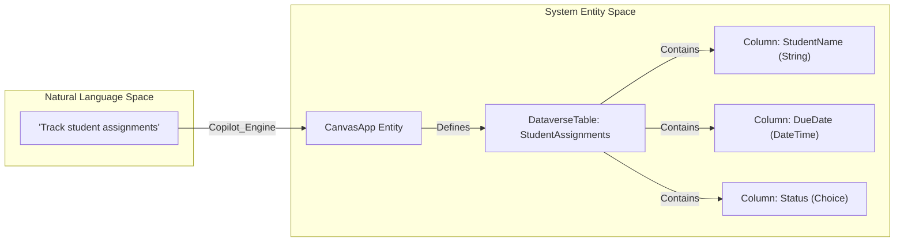
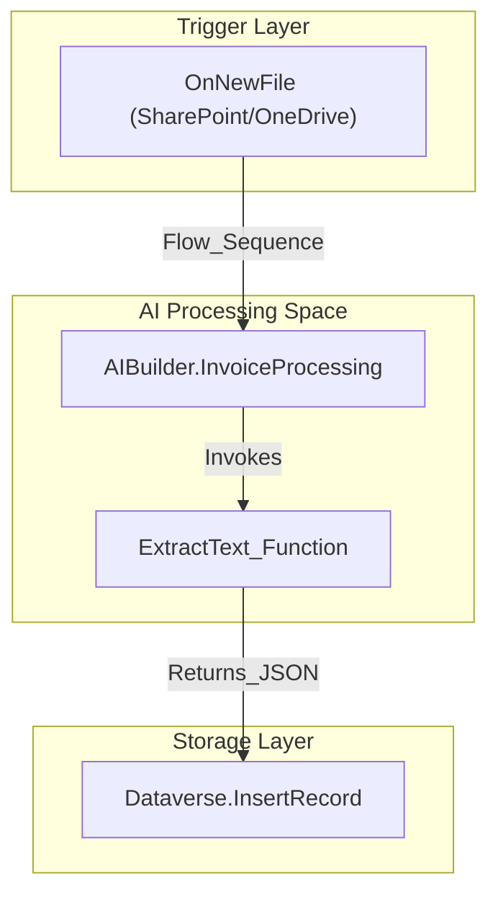
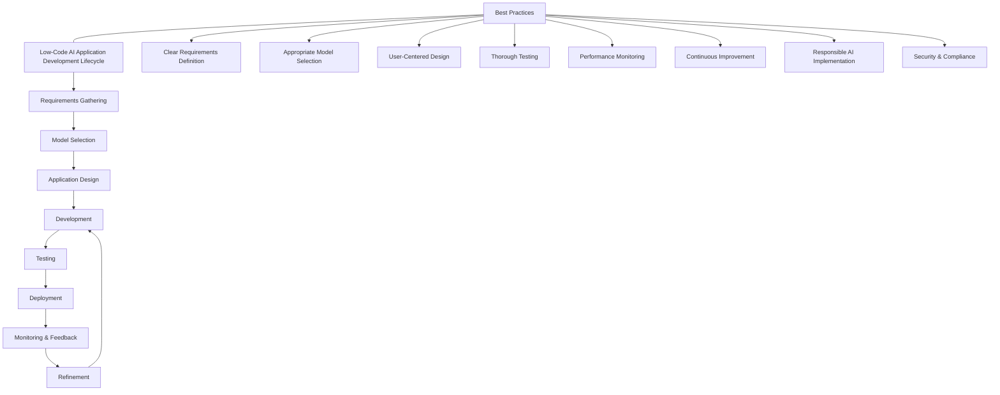
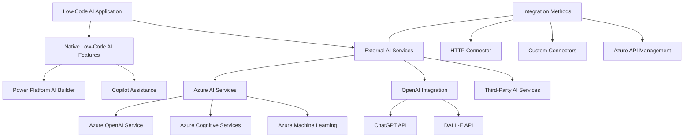

<!-- source: DeepWiki mcp.deepwiki.com · repo microsoft/generative-ai-for-beginners · page 4.5 Low-Code AI Applications · fetched 2026-10-26 -->

# Low-Code AI Applications

Relevant source files

The following files were used as context for generating this wiki page:

- [01-introduction-to-genai/README.md](01-introduction-to-genai/README.md)
- [02-exploring-and-comparing-different-llms/README.md](02-exploring-and-comparing-different-llms/README.md)
- [03-using-generative-ai-responsibly/README.md](03-using-generative-ai-responsibly/README.md)
- [04-prompt-engineering-fundamentals/README.md](04-prompt-engineering-fundamentals/README.md)
- [05-advanced-prompts/README.md](05-advanced-prompts/README.md)
- [06-text-generation-apps/README.md](06-text-generation-apps/README.md)
- [07-building-chat-applications/README.md](07-building-chat-applications/README.md)
- [08-building-search-applications/README.md](08-building-search-applications/README.md)
- [09-building-image-applications/README.md](09-building-image-applications/README.md)
- [10-building-low-code-ai-applications/README.md](10-building-low-code-ai-applications/README.md)
- [11-integrating-with-function-calling/README.md](11-integrating-with-function-calling/README.md)
- [12-designing-ux-for-ai-applications/README.md](12-designing-ux-for-ai-applications/README.md)

This document provides a comprehensive overview of building AI applications using low-code development platforms, specifically focusing on Microsoft Power Platform. Low-code platforms enable developers and non-developers to create sophisticated AI-powered applications with minimal manual coding, using visual development environments and pre-built components.

## Introduction to Low-Code AI Development

Low-code development platforms have revolutionized application building by enabling both traditional developers and non-developers to create solutions with minimal coding. These platforms provide visual development environments where users can drag and drop components to build applications faster and with fewer resources than traditional coding approaches [10-building-low-code-ai-applications/README.md:9-11]().

When combined with AI capabilities, low-code platforms become powerful tools for democratizing AI application development, allowing users without data science expertise to build AI-powered solutions [10-building-low-code-ai-applications/README.md:46-47]().

Sources: [10-building-low-code-ai-applications/README.md:9-16]()

## Microsoft Power Platform for Low-Code AI Development

The Microsoft Power Platform provides organizations with comprehensive low-code and no-code development capabilities, enabling teams to build their own solutions through an intuitive environment. This platform significantly accelerates development timeframes, allowing solutions to be built in days or weeks instead of months or years [10-building-low-code-ai-applications/README.md:13-14]().

### Core Components of Power Platform

The Power Platform consists of five key products [10-building-low-code-ai-applications/README.md:13-14]():

| Component | Description | AI Capabilities |
|-----------|-------------|-----------------|
| Power Apps | Low-code environment for building applications to track, manage and interact with data | Copilot for app generation, AI-enabled form processing [10-building-low-code-ai-applications/README.md:36-62]() |
| Power Automate | Tool for creating automated workflows between applications and services | Copilot for workflow creation, AI-based document processing [10-building-low-code-ai-applications/README.md:40-66]() |
| Power BI | Business analytics service for data visualization and sharing insights | AI-enhanced data analysis and reporting [10-building-low-code-ai-applications/README.md:13]() |
| Power Pages | Tool for creating external-facing websites | AI-assisted content creation [10-building-low-code-ai-applications/README.md:13]() |
| Copilot Studio | Platform for building and deploying intelligent virtual agents | Natural language processing, conversational AI [10-building-low-code-ai-applications/README.md:13]() |

Sources: [10-building-low-code-ai-applications/README.md:11-13](), [10-building-low-code-ai-applications/README.md:31-43]()

## Generative AI in Power Platform

Microsoft has integrated generative AI capabilities into the Power Platform through two main components: Copilot and AI Builder. These tools enable users to create AI-powered applications without requiring data science expertise [10-building-low-code-ai-applications/README.md:46-47]().

### Copilot: AI Assistant for Development

Copilot is an AI assistant that enables users to build Power Platform solutions through conversational interactions using natural language. It can understand requirements described in plain language and generate appropriate solutions [10-building-low-code-ai-applications/README.md:50-52]().

### AI Builder: Low-Code AI Capability

AI Builder is a capability within Power Platform that allows users to incorporate AI models into apps and flows. Users can employ pre-built AI models or create custom ones to automate processes and predict outcomes [10-building-low-code-ai-applications/README.md:54-57]().

Sources: [10-building-low-code-ai-applications/README.md:42-47](), [10-building-low-code-ai-applications/README.md:158-176]()

## Building AI Applications with Copilot

Copilot enhances the development experience in both Power Apps and Power Automate by enabling conversational creation of applications and workflows.

### Copilot in Power Apps

Copilot in Power Apps allows users to describe the app they want to build and the information they want to track. It then generates a responsive Canvas app based on the description and suggests an appropriate Dataverse table structure with necessary fields [10-building-low-code-ai-applications/README.md:62-63]().

Sources: [10-building-low-code-ai-applications/README.md:62-70](), [10-building-low-code-ai-applications/README.md:79-113]()

### Copilot in Power Automate

In Power Automate, Copilot allows users to describe workflows they need to create. It then generates the flow structure and suggests the necessary actions, making it easier to automate complex business processes [10-building-low-code-ai-applications/README.md:68-69]().

Sources: [10-building-low-code-ai-applications/README.md:71-77]()

## Bridge: From Natural Language to Code Entities

The following diagrams illustrate how natural language instructions translate into specific code-level entities and platform functions.

### Entity Mapping: Power Apps Creation

This diagram shows how natural language prompts map to specific system entities in the Power Platform environment.

Sources: [10-building-low-code-ai-applications/README.md:60-63]()

### Flow Integration: Power Automate & AI Builder

This diagram maps the functional flow from a trigger to the AI Builder extraction service.

Sources: [10-building-low-code-ai-applications/README.md:144-156]()

## Working with AI Models in Power Platform

AI Builder in Power Platform provides two types of AI models: Prebuilt AI Models and Custom AI Models. These models can be integrated into Power Apps and Power Automate to add intelligence to applications [10-building-low-code-ai-applications/README.md:158-160]().

### Prebuilt AI Models

Prebuilt AI Models are ready-to-use models trained by Microsoft that can be directly integrated into applications without requiring users to build or train models themselves. These include [10-building-low-code-ai-applications/README.md:162-188]():

- **Key Phrase Extraction**: Extracts key phrases from text.
- **Language Detection**: Detects the language of text.
- **Sentiment Analysis**: Detects positive, negative, neutral, or mixed sentiment in text.
- **Business Card Reader**: Extracts information from business cards.
- **Text Recognition**: Extracts text from images.
- **Object Detection**: Detects and extracts objects from images.
- **Document Processing**: Extracts information from forms.
- **Invoice Processing**: Extracts information from invoices.

Sources: [10-building-low-code-ai-applications/README.md:158-188]()

## Best Practices for Low-Code AI Development

When developing AI applications using low-code platforms, following these best practices can help ensure successful implementation [10-building-low-code-ai-applications/README.md:193-227]():

1. **Define clear requirements**: Understand what you want your AI application to achieve before beginning development.
2. **Start with prebuilt models**: Use prebuilt AI models when possible to save time and resources.
3. **Test thoroughly**: Validate AI model performance with different inputs and scenarios.
4. **Consider data privacy**: Be mindful of data handling practices, especially with sensitive information.
5. **Plan for monitoring**: Implement methods to track application performance and model accuracy.
6. **Include user feedback mechanisms**: Allow users to provide feedback on AI results to improve over time.
7. **Build in flexibility**: Design applications to accommodate model updates and improvements.
8. **Ensure accessibility**: Make applications usable by people with various abilities [12-designing-ux-for-ai-applications/README.md:44-48]().

Sources: [10-building-low-code-ai-applications/README.md:193-227](), [12-designing-ux-for-ai-applications/README.md:30-100]()

## Integration with Other AI Services

Low-code applications can integrate with various AI services beyond those built into the Power Platform. This includes Azure AI services, OpenAI models, and other third-party AI providers [10-building-low-code-ai-applications/README.md:54-57]().

Sources: [10-building-low-code-ai-applications/README.md:46-57]()

---

