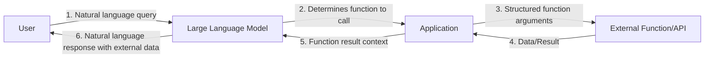
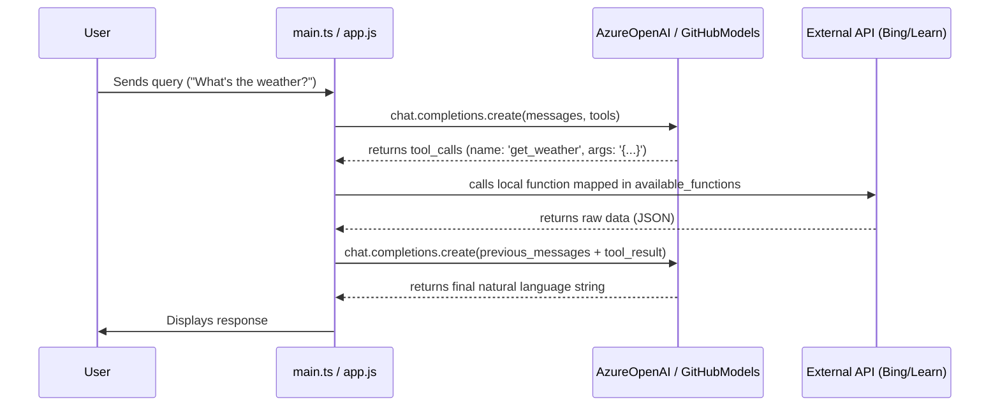

<!-- source: DeepWiki mcp.deepwiki.com · repo microsoft/generative-ai-for-beginners · page 4.6 Function Calling Integration · fetched 2026-10-26 -->

# Function Calling Integration

<details>
<summary>Relevant source files</summary>

The following files were used as context for generating this wiki page:

- [01-introduction-to-genai/README.md](01-introduction-to-genai/README.md)
- [02-exploring-and-comparing-different-llms/README.md](02-exploring-and-comparing-different-llms/README.md)
- [03-using-generative-ai-responsibly/README.md](03-using-generative-ai-responsibly/README.md)
- [04-prompt-engineering-fundamentals/README.md](04-prompt-engineering-fundamentals/README.md)
- [05-advanced-prompts/README.md](05-advanced-prompts/README.md)
- [06-text-generation-apps/README.md](06-text-generation-apps/README.md)
- [07-building-chat-applications/README.md](07-building-chat-applications/README.md)
- [08-building-search-applications/README.md](08-building-search-applications/README.md)
- [09-building-image-applications/README.md](09-building-image-applications/README.md)
- [10-building-low-code-ai-applications/README.md](10-building-low-code-ai-applications/README.md)
- [11-integrating-with-function-calling/README.md](11-integrating-with-function-calling/README.md)
- [11-integrating-with-function-calling/js-githubmodels/app.js](11-integrating-with-function-calling/js-githubmodels/app.js)
- [11-integrating-with-function-calling/js-githubmodels/package-lock.json](11-integrating-with-function-calling/js-githubmodels/package-lock.json)
- [11-integrating-with-function-calling/js-githubmodels/package.json](11-integrating-with-function-calling/js-githubmodels/package.json)
- [11-integrating-with-function-calling/typescript/function-app/.env-sample](11-integrating-with-function-calling/typescript/function-app/.env-sample)
- [11-integrating-with-function-calling/typescript/function-app/.gitignore](11-integrating-with-function-calling/typescript/function-app/.gitignore)
- [11-integrating-with-function-calling/typescript/function-app/package-lock.json](11-integrating-with-function-calling/typescript/function-app/package-lock.json)
- [11-integrating-with-function-calling/typescript/function-app/package.json](11-integrating-with-function-calling/typescript/function-app/package.json)
- [11-integrating-with-function-calling/typescript/function-app/src/main.ts](11-integrating-with-function-calling/typescript/function-app/src/main.ts)
- [11-integrating-with-function-calling/typescript/function-app/tsconfig.json](11-integrating-with-function-calling/typescript/function-app/tsconfig.json)
- [12-designing-ux-for-ai-applications/README.md](12-designing-ux-for-ai-applications/README.md)

</details>


Function calling is a powerful capability within Azure OpenAI and OpenAI services that enables developers to create more structured interactions between large language models (LLMs) and external systems. This document explains the concept of function calling, why it's beneficial, and how to implement it in your generative AI applications using both Python and TypeScript/JavaScript.

## Purpose and Scope

Function calling enables your application to:
1. Obtain consistent, structured outputs from LLMs [11-integrating-with-function-calling/README.md:43-44]().
2. Integrate external data sources seamlessly into AI interactions [11-integrating-with-function-calling/README.md:45-45]().
3. Convert natural language queries into specific actions or API calls [11-integrating-with-function-calling/README.md:189-196]().
4. Bridge the gap between conversational interfaces and programmatic operations.

This system allows LLMs to recognize when they need external data or tools to fulfill a user request, identify the appropriate function to call, and format the necessary arguments properly [11-integrating-with-function-calling/README.md:179-183]().

Sources: [11-integrating-with-function-calling/README.md:13-24](), [11-integrating-with-function-calling/README.md:41-45]()

## Why Use Function Calling?

Before function calling was introduced, responses from an LLM were unstructured and inconsistent. Developers were required to write complex validation code to handle variations in responses [11-integrating-with-function-calling/README.md:39-40]().

### Problem: Inconsistent Response Formats

When asking an LLM to extract information from text, the response format could vary between calls, even with identical prompts [11-integrating-with-function-calling/README.md:167-169](). For example, a `grades` field might return `3.7` in one call and `3.8 GPA` in another [11-integrating-with-function-calling/README.md:145-165](). Function calling forces the model to adhere to a JSON schema.

### Problem: Limited Access to External Data

LLMs are limited to the data they were trained on [11-integrating-with-function-calling/README.md:39-40](). Function calling allows them to fetch real-time data, such as weather or course catalogs, by requesting that the application execute a specific tool [11-integrating-with-function-calling/README.md:27-34]().

Sources: [11-integrating-with-function-calling/README.md:37-178]()

## How Function Calling Works

### Function Calling Flow

The following diagram illustrates the "Round-Trip" pattern where the LLM acts as the orchestrator but the application performs the execution.



**Important**: The LLM doesn't actually execute functions. It identifies which function should be called and provides structured arguments. Your application is responsible for the actual function execution [11-integrating-with-function-calling/README.md:181-183]().

### Code Entity Interaction

This diagram bridges the Natural Language space (User Query) to the Code Entity space (Specific functions and classes in the codebase).



Sources: [11-integrating-with-function-calling/README.md:179-204](), [11-integrating-with-function-calling/typescript/function-app/src/main.ts:1-80](), [11-integrating-with-function-calling/js-githubmodels/app.js:1-50]()

## Implementation Details

### 1. Defining the JSON Schema
Functions are defined as "tools" using a JSON schema that describes the function name, purpose, and parameters.

```typescript
// Example from TypeScript implementation
const tools = [
  {
    type: "function",
    function: {
      name: "get_current_weather",
      description: "Get the current weather in a given location",
      parameters: {
        type: "object",
        properties: {
          location: { type: "string", description: "The city and state, e.g. San Francisco, CA" },
          unit: { type: "string", enum: ["celsius", "fahrenheit"] },
        },
        required: ["location"],
      },
    },
  },
];
```

### 2. Processing the Response
The application must check if the `message` returned by the LLM contains `tool_calls`.

| Step | Action | Description |
| :--- | :--- | :--- |
| **Check** | `message.tool_calls` | Verify if the model wants to call a function. |
| **Parse** | `JSON.parse(tool.function.arguments)` | Convert the stringified arguments from the LLM into a code object. |
| **Invoke** | `available_functions[name](args)` | Call the actual implementation in your code. |
| **Append** | `messages.push(...)` | Add both the assistant's tool request and the function result back to the message history. |

Sources: [11-integrating-with-function-calling/typescript/function-app/src/main.ts:40-75](), [11-integrating-with-function-calling/js-githubmodels/app.js:30-45]()

## Cross-Language Implementation

The repository provides examples in Python, TypeScript, and JavaScript (GitHub Models).

### TypeScript Implementation
The TypeScript example uses the `@azure/openai` SDK [11-integrating-with-function-calling/typescript/function-app/package.json:12-12](). It demonstrates the weather example where a mock function `get_current_weather` is called [11-integrating-with-function-calling/typescript/function-app/src/main.ts:10-20]().

### JavaScript (GitHub Models) Implementation
The JavaScript implementation uses the `@azure-rest/ai-inference` package to interact with GitHub Models [11-integrating-with-function-calling/js-githubmodels/package.json:12-12](). It follows the same pattern:
1. Define tools.
2. Call model.
3. Handle tool calls.
4. Call model again with results.

Sources: [11-integrating-with-function-calling/typescript/function-app/src/main.ts:1-80](), [11-integrating-with-function-calling/js-githubmodels/app.js:1-60]()

## Use Cases for Function Calling

Function calling enables a wide range of powerful application scenarios:

- **External Tool Invocation**: Sending emails or creating calendar invites [11-integrating-with-function-calling/README.md:189-192]().
- **API or Database Query Creation**: Transforming "Who are my top students?" into a SQL query or a call to `get_student_data()` [11-integrating-with-function-calling/README.md:193-194]().
- **Structured Data Creation**: Extracting facts from a text body to create JSON-based flashcards [11-integrating-with-function-calling/README.md:195-196]().

Sources: [11-integrating-with-function-calling/README.md:189-196]()

---

