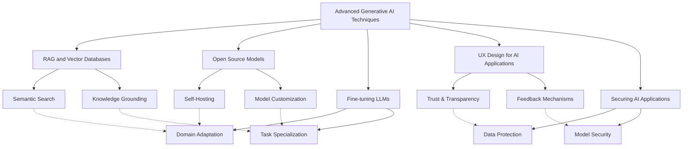
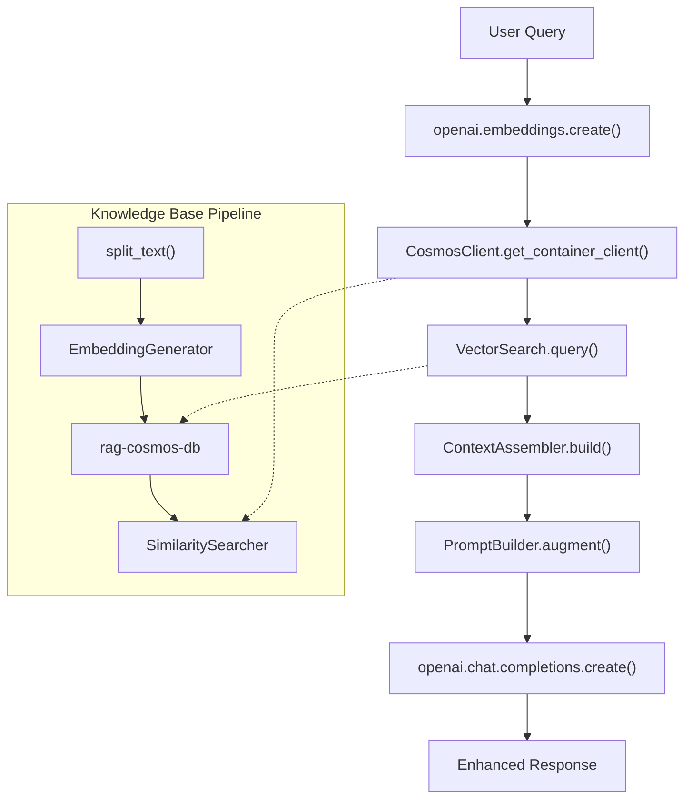
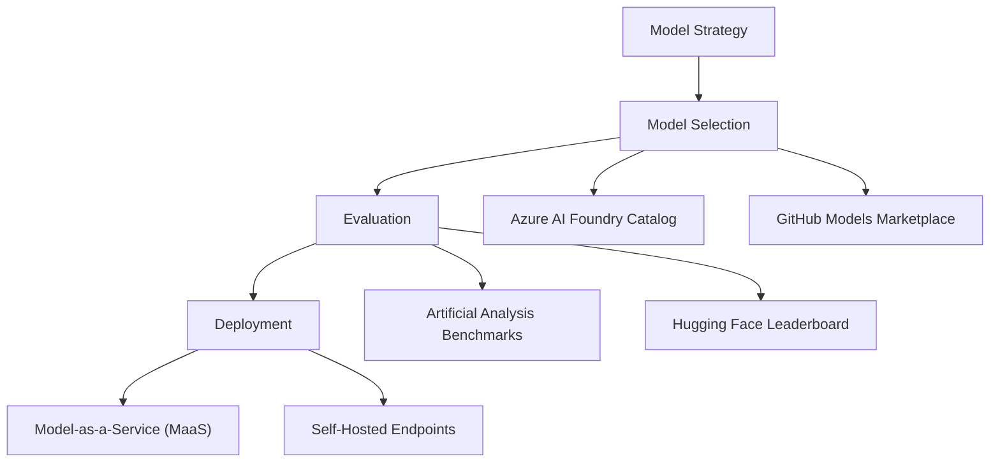
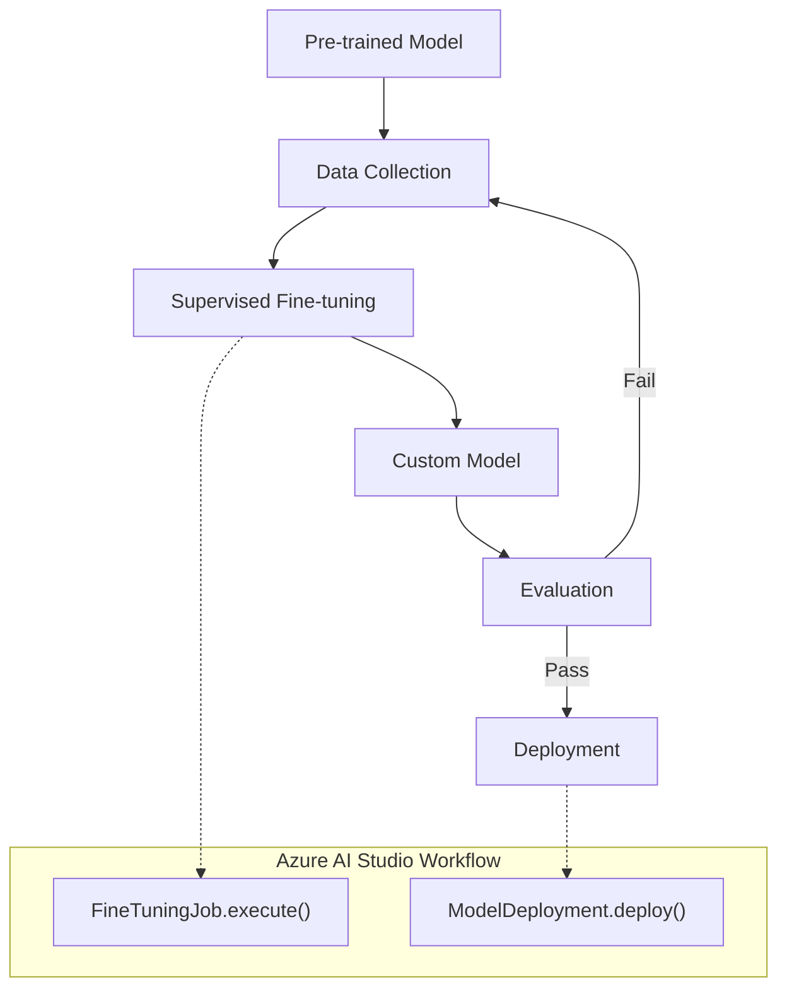

<!-- source: DeepWiki mcp.deepwiki.com · repo microsoft/generative-ai-for-beginners · page 5 Advanced Topics · fetched 2026-10-26 -->

# Advanced Topics

Relevant source files

The following files were used as context for generating this wiki page:

- [00-course-setup/README.md](00-course-setup/README.md)
- [14-the-generative-ai-application-lifecycle/README.md](14-the-generative-ai-application-lifecycle/README.md)
- [15-rag-and-vector-databases/README.md](15-rag-and-vector-databases/README.md)
- [15-rag-and-vector-databases/images/cat.png](15-rag-and-vector-databases/images/cat.png)
- [15-rag-and-vector-databases/images/encoder-decode.png](15-rag-and-vector-databases/images/encoder-decode.png)
- [15-rag-and-vector-databases/images/how-rag-works.png](15-rag-and-vector-databases/images/how-rag-works.png)
- [15-rag-and-vector-databases/notebook-rag-vector-databases.ipynb](15-rag-and-vector-databases/notebook-rag-vector-databases.ipynb)
- [16-open-source-models/README.md](16-open-source-models/README.md)
- [17-ai-agents/README.md](17-ai-agents/README.md)
- [18-fine-tuning/README.md](18-fine-tuning/README.md)
- [18-fine-tuning/RESOURCES.md](18-fine-tuning/RESOURCES.md)
- [README.md](README.md)
- [translations/en/.co-op-translator.json](translations/en/.co-op-translator.json)
- [translations/en/README.md](translations/en/README.md)
- [translations/en/docs/ENHANCED_FEATURES_ROADMAP.md](translations/en/docs/ENHANCED_FEATURES_ROADMAP.md)
- [translations/en/docs/SECURITY_GUIDELINES.md](translations/en/docs/SECURITY_GUIDELINES.md)
- [translations/es/.co-op-translator.json](translations/es/.co-op-translator.json)
- [translations/es/README.md](translations/es/README.md)
- [translations/es/docs/ENHANCED_FEATURES_ROADMAP.md](translations/es/docs/ENHANCED_FEATURES_ROADMAP.md)
- [translations/es/docs/SECURITY_GUIDELINES.md](translations/es/docs/SECURITY_GUIDELINES.md)
- [translations/fr/.co-op-translator.json](translations/fr/.co-op-translator.json)
- [translations/fr/README.md](translations/fr/README.md)

This page provides an overview of advanced concepts and techniques for generative AI applications. While previous sections covered fundamentals like prompt engineering and basic application development, this section explores more sophisticated approaches that can enhance capabilities, improve performance, and address limitations of generative AI systems.

For details about specific foundational concepts, see [Core Concepts](#3) or [Building GenAI Applications](#4) pages.

## Advanced Topics Overview

Developing sophisticated generative AI applications often requires going beyond basic techniques. The advanced topics covered here represent key strategies for enhancing LLM capabilities and building more effective applications.

Sources: 
- [README.md:84-92]()
- [14-the-generative-ai-application-lifecycle/README.md:1-55]()
- [15-rag-and-vector-databases/README.md:1-27]()

## RAG and Vector Databases

Retrieval Augmented Generation (RAG) is a powerful technique that enhances LLMs by integrating external knowledge sources. This addresses a fundamental limitation of LLMs—their knowledge cutoff (e.g., GPT-4's knowledge cutoff is September 2021) and their lack of access to private or confidential data [15-rag-and-vector-databases/README.md:41-44]().

### RAG Architecture and Implementation

The RAG framework combines the generative capabilities of LLMs with the retrieval capabilities of search systems. In this repository, the architecture is implemented using transformers consisting of an encoder and a decoder [15-rag-and-vector-databases/README.md:59-61]().

### Vector Embeddings and Similarity Search

Vector databases store numerical representations of documents (embeddings) rather than just text. This makes it easier for AI systems to process data semantically [15-rag-and-vector-databases/README.md:81-85]().

| Concept | Description | Implementation |
|---------|-------------|----------------|
| Chunking | Breaking large documents into smaller pieces | `split_text()` in [15-rag-and-vector-databases/README.md:100-117]() |
| Vector DB | Storage for embedded vectors | `rag-cosmos-db` in [15-rag-and-vector-databases/notebook-rag-vector-databases.ipynb:118-123]() |
| Client Init | Initializing the database connection | `CosmosClient(url, credential=key)` [15-rag-and-vector-databases/notebook-rag-vector-databases.ipynb:115-115]() |
| Grounding | Providing specific context to the LLM | Scenario: Neural Network lesson [15-rag-and-vector-databases/README.md:31-39]() |

For details, see [RAG and Vector Databases](#5.1).

Sources:
- [15-rag-and-vector-databases/README.md:41-85]()
- [15-rag-and-vector-databases/notebook-rag-vector-databases.ipynb:105-125]()

## Open Source Models

Open source models (or "open models") provide alternatives to proprietary models, offering higher customizability and lower cost per token [16-open-source-models/README.md:29-35]().

### Open Models Landscape

The repository highlights several key open models available through the Azure AI Foundry Model Catalog and GitHub Models:

*   **Llama (Meta):** Optimized for chat-based applications using dialogue fine-tuning [16-open-source-models/README.md:44-47]().
*   **Mistral:** Focused on efficiency using the "Mixture-of-Experts" approach [16-open-source-models/README.md:50-52]().
*   **Falcon (TII):** Uses FlashAttention to reduce memory requirements at inference time [16-open-source-models/README.md:56-58]().
*   **Phi (Microsoft):** Small language models optimized for high performance with fewer parameters.

### Choosing and Deploying Models

For details, see [Open Source Models](#5.2).

Sources:
- [16-open-source-models/README.md:13-71]()
- [14-the-generative-ai-application-lifecycle/README.md:65-68]()

## Fine-tuning LLMs

Fine-tuning is a technique that involves retraining a pre-trained model with additional curated data to improve accuracy and relevance for a specific task or domain [18-fine-tuning/README.md:37-38]().

### Fine-tuning vs. RAG

| Feature | RAG | Fine-tuning |
|---------|-----|-------------|
| **Approach** | Modifies the prompt input | Retrains the model itself |
| **Data Type** | Dynamic/New information | Static/Task-specific patterns |
| **Cost** | Higher token cost per request | Higher initial compute cost |
| **Complexity** | Moderate (Vector DB setup) | High (Data curation & training) |

### The Fine-tuning Lifecycle

The process involves creating a custom model that reduces the number of examples needed for few-shot learning, thereby reducing token costs [18-fine-tuning/README.md:37-38]().

For details, see [Fine-tuning LLMs](#5.3).

Sources:
- [18-fine-tuning/README.md:3-61]()
- [18-fine-tuning/RESOURCES.md:9-19]()

## UX Design for AI Applications

Designing for AI requires a shift toward transparency and feedback loops. Users must understand model limitations to avoid "overtrust" [12-designing-ux-for-ai-applications/README.md:29-75]().

### Design Principles
*   **Transparency:** Clearly communicating AI capabilities and data usage.
*   **Feedback Loops:** Enabling users to correct or rate AI outputs.
*   **Friction Design:** Introducing intentional pauses to ensure users review critical AI-generated content.

For details, see [UX Design for AI Applications](#5.4).

Sources:
- [12-designing-ux-for-ai-applications/README.md:29-100]()

## Securing AI Applications

AI applications introduce new attack vectors, such as prompt injection and data poisoning. Security in this space is often categorized under "LLMOps" [14-the-generative-ai-application-lifecycle/README.md:18-24]().

### Security and Responsible AI
The repository aligns security practices with Microsoft's Responsible AI principles, focusing on fairness, reliability, safety, privacy, and accountability [12-designing-ux-for-ai-applications/README.md:165-174]().

| Metric | Goal |
|--------|------|
| **Harm** | Mitigating toxic or dangerous content |
| **Honesty** | Ensuring response groundedness (reducing hallucinations) |
| **Privacy** | Protecting user data and training datasets |

For details, see [Securing AI Applications](#5.5).

Sources:
- [14-the-generative-ai-application-lifecycle/README.md:28-32]()
- [12-designing-ux-for-ai-applications/README.md:165-174]()

---

