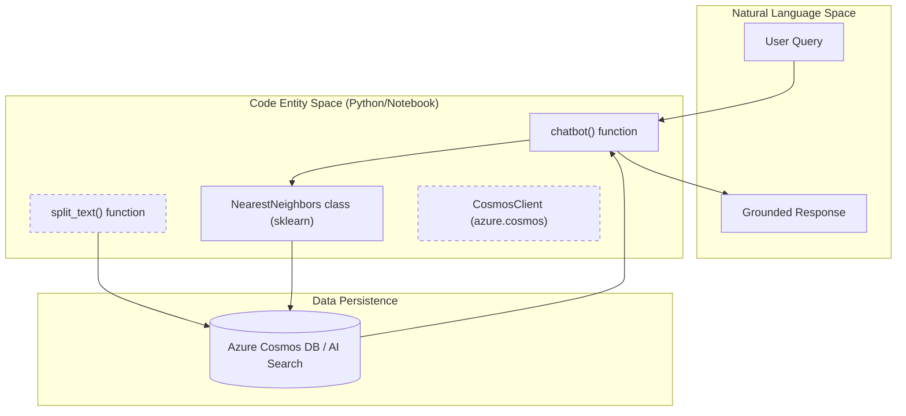
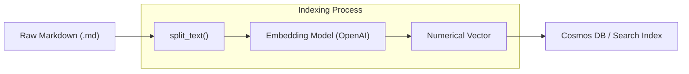

<!-- source: DeepWiki mcp.deepwiki.com · repo microsoft/generative-ai-for-beginners · page 5.1 RAG and Vector Databases · fetched 2026-10-26 -->

# RAG and Vector Databases

<details>
<summary>Relevant source files</summary>

The following files were used as context for generating this wiki page:

- [14-the-generative-ai-application-lifecycle/README.md](14-the-generative-ai-application-lifecycle/README.md)
- [15-rag-and-vector-databases/README.md](15-rag-and-vector-databases/README.md)
- [15-rag-and-vector-databases/data/frameworks.md](15-rag-and-vector-databases/data/frameworks.md)
- [15-rag-and-vector-databases/data/own_framework.md](15-rag-and-vector-databases/data/own_framework.md)
- [15-rag-and-vector-databases/data/perceptron.md](15-rag-and-vector-databases/data/perceptron.md)
- [15-rag-and-vector-databases/images/cat.png](15-rag-and-vector-databases/images/cat.png)
- [15-rag-and-vector-databases/images/encoder-decode.png](15-rag-and-vector-databases/images/encoder-decode.png)
- [15-rag-and-vector-databases/images/how-rag-works.png](15-rag-and-vector-databases/images/how-rag-works.png)
- [15-rag-and-vector-databases/notebook-rag-vector-databases.ipynb](15-rag-and-vector-databases/notebook-rag-vector-databases.ipynb)
- [16-open-source-models/README.md](16-open-source-models/README.md)
- [17-ai-agents/README.md](17-ai-agents/README.md)
- [18-fine-tuning/README.md](18-fine-tuning/README.md)
- [18-fine-tuning/RESOURCES.md](18-fine-tuning/RESOURCES.md)

</details>


This page provides a technical deep dive into Retrieval Augmented Generation (RAG) and Vector Databases. It explains how to enhance Large Language Models (LLMs) with external knowledge by implementing chunking, embedding generation, and nearest-neighbor search.

## Overview of Retrieval Augmented Generation (RAG)

Retrieval Augmented Generation (RAG) is an architectural pattern that grounds LLM responses in external, verifiable data. Standard LLMs are limited by their training data cutoff (e.g., September 2021 for GPT-4) and lack access to private or real-time information [15-rag-and-vector-databases/README.md:43-44](). RAG solves this by retrieving relevant document snippets from a knowledge base and injecting them into the model's prompt [15-rag-and-vector-databases/README.md:55-57]().

### The RAG Data Flow

The RAG process consists of four main stages:
1.  **Knowledge Base Creation**: Documents are ingested, chunked, and stored as embeddings [15-rag-and-vector-databases/README.md:51-52]().
2.  **User Query**: The user provides a natural language input [15-rag-and-vector-databases/README.md:53-53]().
3.  **Retrieval**: The system converts the query into an embedding and retrieves the most similar chunks from the database [15-rag-and-vector-databases/README.md:55-56]().
4.  **Augmented Generation**: The LLM generates a response using its internal training data plus the retrieved context [15-rag-and-vector-databases/README.md:57-58]().

### System Architecture: Natural Language to Code Entity Space

The following diagram maps the logical RAG flow to specific implementation entities found in the codebase.

**RAG System Implementation Map**

Sources: [15-rag-and-vector-databases/README.md:101-117](), [15-rag-and-vector-databases/notebook-rag-vector-databases.ipynb:110-125](), [15-rag-and-vector-databases/README.md:144-150]()

## Vector Databases

Unlike traditional relational databases, vector databases are specialized to store and search numerical representations of data called "embeddings" [15-rag-and-vector-databases/README.md:83-84]().

### Key Roles of Vector Databases
*   **Overcoming Token Limits**: LLMs have a restricted context window. Storing data in a vector database allows the application to only send the most relevant chunks to the LLM [15-rag-and-vector-databases/README.md:85-86]().
*   **Semantic Search**: Finding data based on meaning rather than exact keyword matches [15-rag-and-vector-databases/README.md:83-84]().

### Supported Providers
The curriculum demonstrates integration with:
*   **Azure Cosmos DB**: Used as a vector store for numerical representations [15-rag-and-vector-databases/README.md:37-38]().
*   **Azure AI Search**: Used to create search indexes [15-rag-and-vector-databases/README.md:37-38]().
*   **Others**: Pinecone, Chromadb, Qdrant, and Milvus are mentioned as popular alternatives [15-rag-and-vector-databases/README.md:87-88]().

Sources: [15-rag-and-vector-databases/README.md:81-94]()

## Data Ingestion Pipeline

To prepare data for RAG, it must undergo a transformation pipeline.

### 1. Chunking
Large documents must be broken into smaller pieces. This preserves local context and reduces token costs [15-rag-and-vector-databases/README.md:85-86](). The codebase provides a `split_text` function to handle this:

```python
def split_text(text, max_length, min_length):
    words = text.split()
    chunks = []
    current_chunk = []
    # Logic to iterate and append chunks based on length constraints
    # ...
```
[15-rag-and-vector-databases/README.md:101-117]()

### 2. Embedding Generation
Each chunk is passed through an embedding model (like `text-embedding-ada-002`) to produce a vector. These vectors capture the semantic meaning of the text [15-rag-and-vector-databases/README.md:51-52]().

**Data Ingestion and Indexing Flow**

Sources: [15-rag-and-vector-databases/README.md:97-123](), [15-rag-and-vector-databases/notebook-rag-vector-databases.ipynb:110-125]()

## Nearest-Neighbor Search and Retrieval

When a query is received, the system must find the most similar documents. This is typically done using **Cosine Similarity** or algorithms like **Ball Tree** [15-rag-and-vector-databases/README.md:144-150]().

### Implementation Example
The notebook implementation uses `sklearn.neighbors.NearestNeighbors` to create a search index from embeddings:

```python
from sklearn.neighbors import NearestNeighbors

# embeddings is a list of vectors from the knowledge base
nbrs = NearestNeighbors(n_neighbors=5, algorithm='ball_tree').fit(embeddings)

# Query the index with a new vector
distances, indices = nbrs.kneighbors([query_vector])
```
[15-rag-and-vector-databases/README.md:144-150]()

## RAG Implementation in the Chatbot

The final integration combines the retrieval results into a system message for the LLM.

```python
def chatbot(user_input):
    # 1. Convert user_input to vector
    query_vector = create_embeddings(user_input)

    # 2. Retrieve top-k indices
    distances, indices = nbrs.kneighbors([query_vector])

    # 3. Build context from retrieved chunks
    history = []
    for index in indices[0]:
        history.append(flattened_df['chunks'].iloc[index])

    # 4. Augment prompt and call LLM
    messages = [
        {"role": "system", "content": "You are an AI assistant..."},
        {"role": "user", "content": f"Context: {history} \n Question: {user_input}"}
    ]
    # ... call openai.chat.completions.create
```
[15-rag-and-vector-databases/README.md:188-216]()

## Comparison: RAG vs. Fine-Tuning

While RAG modifies the prompt input, **fine-tuning** retrains the model weights [18-fine-tuning/README.md:5-7]().

| Feature | RAG | Fine-Tuning |
| :--- | :--- | :--- |
| **Data Access** | Dynamic/Real-time [15-rag-and-vector-databases/README.md:71-71]() | Static (requires retraining) [18-fine-tuning/README.md:37-38]() |
| **Hallucination** | Reduced via verifiable grounding [15-rag-and-vector-databases/README.md:73-73]() | Can still hallucinate [18-fine-tuning/README.md:43-43]() |
| **Cost** | Generally lower (per retrieval) [15-rag-and-vector-databases/README.md:75-75]() | High (compute for training) [18-fine-tuning/README.md:54-54]() |
| **Use Case** | Knowledge intensive tasks [15-rag-and-vector-databases/README.md:63-63]() | Specialized tasks/domain style [18-fine-tuning/README.md:37-37]() |

Sources: [15-rag-and-vector-databases/README.md:69-76](), [18-fine-tuning/README.md:30-61]()

---

