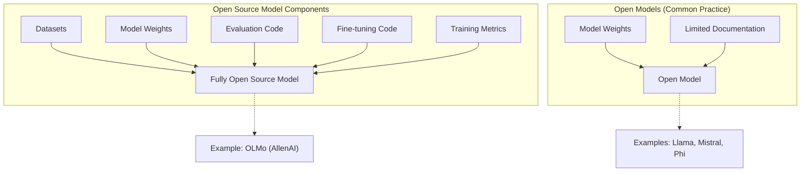
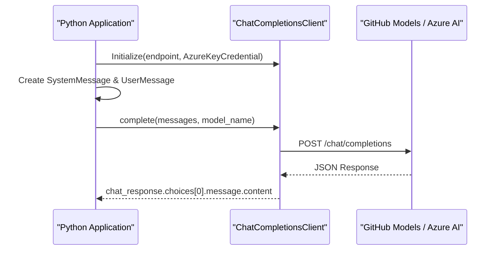
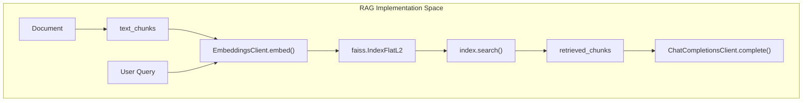

<!-- source: DeepWiki mcp.deepwiki.com · repo microsoft/generative-ai-for-beginners · page 5.2 Open Source Models · fetched 2026-10-26 -->

# Open Source Models

Relevant source files

The following files were used as context for generating this wiki page:

- [14-the-generative-ai-application-lifecycle/README.md](14-the-generative-ai-application-lifecycle/README.md)
- [15-rag-and-vector-databases/README.md](15-rag-and-vector-databases/README.md)
- [15-rag-and-vector-databases/images/cat.png](15-rag-and-vector-databases/images/cat.png)
- [15-rag-and-vector-databases/images/encoder-decode.png](15-rag-and-vector-databases/images/encoder-decode.png)
- [15-rag-and-vector-databases/images/how-rag-works.png](15-rag-and-vector-databases/images/how-rag-works.png)
- [15-rag-and-vector-databases/notebook-rag-vector-databases.ipynb](15-rag-and-vector-databases/notebook-rag-vector-databases.ipynb)
- [16-open-source-models/README.md](16-open-source-models/README.md)
- [17-ai-agents/README.md](17-ai-agents/README.md)
- [18-fine-tuning/README.md](18-fine-tuning/README.md)
- [18-fine-tuning/RESOURCES.md](18-fine-tuning/RESOURCES.md)
- [19-slm/README.md](19-slm/README.md)
- [19-slm/img/gh1.png](19-slm/img/gh1.png)
- [19-slm/img/gh2.png](19-slm/img/gh2.png)
- [19-slm/img/phi3.png](19-slm/img/phi3.png)
- [19-slm/img/slm.png](19-slm/img/slm.png)
- [19-slm/python/Phi-3-Vision-Nividia-NIM.ipynb](19-slm/python/Phi-3-Vision-Nividia-NIM.ipynb)
- [19-slm/python/phi35-instruct-demo.ipynb](19-slm/python/phi35-instruct-demo.ipynb)
- [19-slm/python/phi35-vision-demo.ipynb](19-slm/python/phi35-vision-demo.ipynb)
- [20-mistral/README.md](20-mistral/README.md)
- [20-mistral/python/githubmodels-assignment.ipynb](20-mistral/python/githubmodels-assignment.ipynb)
- [21-meta/README.md](21-meta/README.md)
- [21-meta/python/githubmodels-assignment.ipynb](21-meta/python/githubmodels-assignment.ipynb)
- [21-meta/python/sample.jpg](21-meta/python/sample.jpg)
- [translations/hi/11-integrating-with-function-calling/python/oai-assignment.ipynb](translations/hi/11-integrating-with-function-calling/python/oai-assignment.ipynb)
- [translations/hi/16-open-source-models/README.md](translations/hi/16-open-source-models/README.md)
- [translations/hi/18-fine-tuning/python/openai/oai-assignment.ipynb](translations/hi/18-fine-tuning/python/openai/oai-assignment.ipynb)
- [translations/ja/08-building-search-applications/python/aoai-solution.ipynb](translations/ja/08-building-search-applications/python/aoai-solution.ipynb)
- [translations/ja/08-building-search-applications/python/oai-solution.ipynb](translations/ja/08-building-search-applications/python/oai-solution.ipynb)
- [translations/ja/11-integrating-with-function-calling/python/oai-assignment.ipynb](translations/ja/11-integrating-with-function-calling/python/oai-assignment.ipynb)
- [translations/ja/16-open-source-models/README.md](translations/ja/16-open-source-models/README.md)
- [translations/ja/18-fine-tuning/python/openai/oai-assignment.ipynb](translations/ja/18-fine-tuning/python/openai/oai-assignment.ipynb)
- [translations/ko/16-open-source-models/README.md](translations/ko/16-open-source-models/README.md)

This page provides a comprehensive overview of open source Large Language Models (LLMs) in the generative AI landscape. It details the specific families of models available—including Llama, Mistral, and Phi—and explains how to access them via Azure AI Foundry and GitHub Models.

## What are Open Source Models?

While open source software is defined by the Open Source Initiative (OSI) through 10 specific criteria, the definition for LLMs is more nuanced. For a model to be fully "open source," it should publicly share its datasets, model weights, evaluation code, fine-tuning code, and training metrics [16-open-source-models/README.md:13-24]().

Currently, most models are referred to as "open models" because they may share weights but not the full training data [16-open-source-models/README.md:27-28]().

Sources: [16-open-source-models/README.md:13-28]()

## Benefits of Open Source Models

1.  **Highly Customizable**: Developers can modify internals and create specialized versions for tasks like code generation or medical analysis [16-open-source-models/README.md:30-31]().
2.  **Cost Efficiency**: The cost per token is often lower than proprietary models [16-open-source-models/README.md:33-35]().
3.  **Flexibility**: Users can combine different models or switch between them to avoid vendor lock-in [16-open-source-models/README.md:38-40]().

Sources: [16-open-source-models/README.md:30-41]()

## Major Model Families

### Llama (Meta)
Meta's Llama family includes state-of-the-art models like Llama 3.1 and 3.2. 
- **Llama 3.1**: Features a 128k context window and native function calling. It includes built-in tools like `brave_search` and `wolfram_alpha` [21-meta/README.md:26-46]().
- **Llama 3.2**: Introduces multimodality (vision support) and smaller variations (1B, 3B) for edge devices [21-meta/README.md:96-103]().

### Mistral (Mistral AI)
Mistral models emphasize efficiency and high performance.
- **Mistral Large 2**: Flagship model with 128k context window, optimized for RAG and code generation [20-mistral/README.md:18-30]().
- **Mistral Small**: A Small Language Model (SLM) offering 80% lower costs and lower latency compared to Large [20-mistral/README.md:133-138]().
- **Mistral NeMo**: An open source model released under the Apache 2.0 license [20-mistral/README.md:209-211]().

### Phi (Microsoft)
Phi models are **Small Language Models (SLMs)** designed for efficiency. They leverage a reduced computational footprint while maintaining high performance for NLP tasks like summarization and translation [19-slm/README.md:4-13]().

Sources: [21-meta/README.md:14-103](), [20-mistral/README.md:12-211](), [19-slm/README.md:4-13]()

## Accessing Models via Azure and GitHub

Models can be accessed through the **GitHub Model Marketplace** for prototyping or **Azure AI Foundry** (formerly Azure AI Studio) for enterprise deployment [20-mistral/README.md:15](), [16-open-source-models/README.md:75]().

### Implementation via Azure AI Inference SDK
The codebase uses the `azure.ai.inference` library to interact with these models uniformly.

Sources: [20-mistral/README.md:49-61](), [21-meta/README.md:59-71]()

## When to Choose Open Source vs. Proprietary

| Feature | Proprietary (e.g., GPT-4) | Open Source (e.g., Llama, Mistral) |
| :--- | :--- | :--- |
| **Control** | Limited to API settings | Full control over weights and deployment |
| **Cost** | Pay-per-token (High) | Lower per-token or self-hosted (Low) |
| **Privacy** | Data processed by provider | Can be deployed on-premises/private VPC |
| **Tuning** | Limited (Managed Fine-tuning) | Deep fine-tuning and architecture changes |

Sources: [18-fine-tuning/README.md:51-61](), [16-open-source-models/README.md:30-35]()

## Advanced Patterns: RAG and Fine-Tuning

Open models are frequently used in Retrieval Augmented Generation (RAG) and Fine-tuning.

### RAG with Mistral Large
In a RAG implementation, an `EmbeddingsClient` is used to vectorize chunks, which are then stored in a vector store like `faiss` [20-mistral/README.md:72-93]().

Sources: [20-mistral/README.md:49-131](), [15-rag-and-vector-databases/README.md:45-59]()

### Fine-Tuning
Fine-tuning involves retraining a model on a curated dataset to improve performance in a specific domain [18-fine-tuning/README.md:37-38]().
- **When to fine-tune**: When prompt engineering and RAG do not meet accuracy requirements, or to reduce token costs by embedding instructions into the model itself [18-fine-tuning/README.md:45-61]().

Sources: [18-fine-tuning/README.md:5-61]()

---

