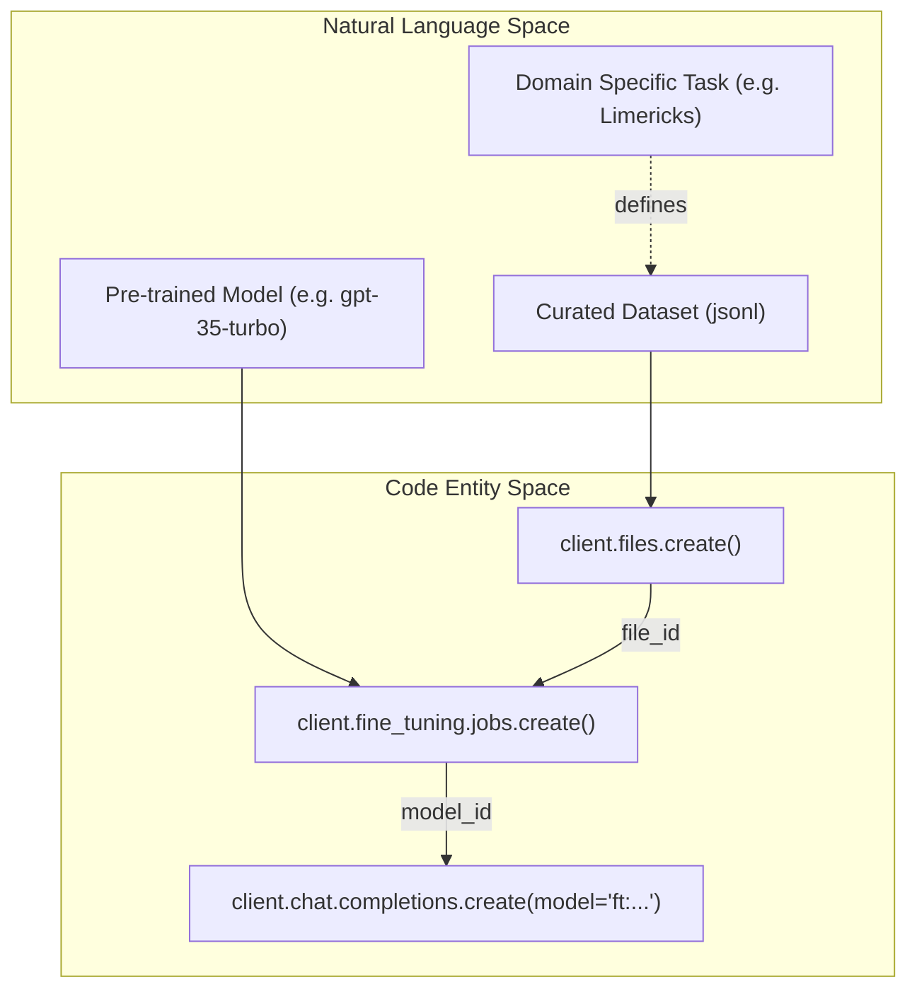
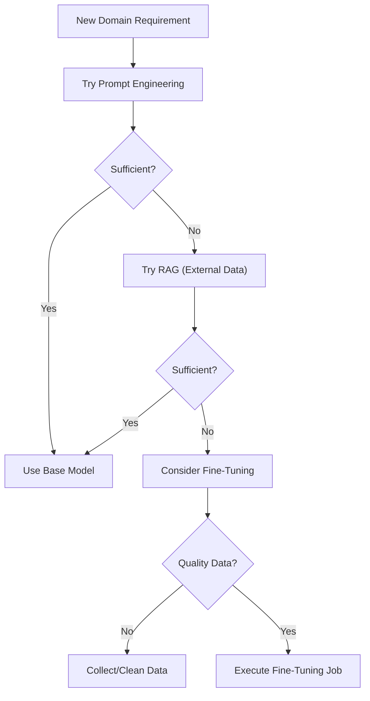

<!-- source: DeepWiki mcp.deepwiki.com · repo microsoft/generative-ai-for-beginners · page 5.3 Fine-tuning LLMs · fetched 2026-10-26 -->

# Fine-tuning LLMs

<details>
<summary>Relevant source files</summary>

The following files were used as context for generating this wiki page:

- [14-the-generative-ai-application-lifecycle/README.md](14-the-generative-ai-application-lifecycle/README.md)
- [15-rag-and-vector-databases/README.md](15-rag-and-vector-databases/README.md)
- [15-rag-and-vector-databases/images/cat.png](15-rag-and-vector-databases/images/cat.png)
- [15-rag-and-vector-databases/images/encoder-decode.png](15-rag-and-vector-databases/images/encoder-decode.png)
- [15-rag-and-vector-databases/images/how-rag-works.png](15-rag-and-vector-databases/images/how-rag-works.png)
- [15-rag-and-vector-databases/notebook-rag-vector-databases.ipynb](15-rag-and-vector-databases/notebook-rag-vector-databases.ipynb)
- [16-open-source-models/README.md](16-open-source-models/README.md)
- [17-ai-agents/README.md](17-ai-agents/README.md)
- [18-fine-tuning/README.md](18-fine-tuning/README.md)
- [18-fine-tuning/RESOURCES.md](18-fine-tuning/RESOURCES.md)
- [18-fine-tuning/python/openai/img/fine-tuned-messages-panel.png](18-fine-tuning/python/openai/img/fine-tuned-messages-panel.png)
- [18-fine-tuning/python/openai/img/fine-tuned-metrics-panel.png](18-fine-tuning/python/openai/img/fine-tuned-metrics-panel.png)
- [18-fine-tuning/python/openai/img/fine-tuned-model-status.png](18-fine-tuning/python/openai/img/fine-tuned-model-status.png)
- [18-fine-tuning/python/openai/img/fine-tuned-playground-compare.png](18-fine-tuning/python/openai/img/fine-tuned-playground-compare.png)
- [18-fine-tuning/python/openai/img/fine-tuned-playground-launch.png](18-fine-tuning/python/openai/img/fine-tuned-playground-launch.png)
- [18-fine-tuning/python/openai/oai-assignment.ipynb](18-fine-tuning/python/openai/oai-assignment.ipynb)
- [18-fine-tuning/python/openai/training-data.jsonl](18-fine-tuning/python/openai/training-data.jsonl)

</details>


Fine-tuning is an advanced technique for customizing pre-trained large language models (LLMs) to improve their performance for specific tasks or domains. Unlike prompt engineering or retrieval-augmented generation (RAG) which modify the prompts sent to a model, fine-tuning involves retraining the model itself with additional data to create a customized version that delivers more accurate and relevant responses for your specific use case [18-fine-tuning/README.md:5-7]().

## Understanding Fine-tuning for LLMs

Fine-tuning is a form of transfer learning where you take a pre-trained language model and retrain it on a curated dataset specific to your domain or task. This process allows the model to learn patterns and knowledge relevant to your use case, while still retaining the general language capabilities it acquired during its initial training [18-fine-tuning/README.md:37]().

### Fine-Tuning Architectural Flow
The following diagram illustrates how fine-tuning bridges the gap between general pre-trained models and specialized application needs, associating high-level concepts with specific SDK implementation steps.


Sources: [18-fine-tuning/README.md](), [18-fine-tuning/python/openai/oai-assignment.ipynb:77-101]()

### Key Benefits of Fine-tuning
Fine-tuning offers several advantages over using a general-purpose model with few-shot learning:

| Benefit | Description |
|---------|-------------|
| **Higher Quality** | Outperforms few-shot learning by training on more examples than can fit in a prompt [18-fine-tuning/README.md:37](). |
| **Lower Latency** | Smaller prompts lead to faster responses as fewer examples are needed in the context [18-fine-tuning/RESOURCES.md:9](). |
| **Cost Efficiency** | Reduces token usage per request by eliminating the need for extensive few-shot examples [18-fine-tuning/README.md:37](). |
| **Consistency** | Better adherence to complex formatting or specific personas (e.g., a chatbot that only speaks in limericks) [18-fine-tuning/python/openai/oai-assignment.ipynb:30-34](). |

Sources: [18-fine-tuning/README.md](), [18-fine-tuning/RESOURCES.md](), [18-fine-tuning/python/openai/oai-assignment.ipynb]()

## When to Consider Fine-tuning vs. RAG

Fine-tuning is an advanced technique that requires expertise. Before proceeding, it is essential to evaluate it against alternatives like Retrieval Augmented Generation (RAG) [18-fine-tuning/README.md:41-45]().

### Comparison Table

| Feature | RAG | Fine-Tuning |
|---------|-----|-------------|
| **Knowledge Source** | External Knowledge Base (Vector DB) [15-rag-and-vector-databases/README.md:51]() | Internalized Model Weights [18-fine-tuning/README.md:7]() |
| **Knowledge Cutoff** | None; can access real-time data [15-rag-and-vector-databases/README.md:71]() | Static; based on training data cutoff [18-fine-tuning/RESOURCES.md:15]() |
| **Cost** | Lower (pay per retrieval/token) [15-rag-and-vector-databases/README.md:75]() | Higher (compute for training + deployment) [18-fine-tuning/README.md:54]() |
| **Complexity** | Moderate (Vector DB management) [15-rag-and-vector-databases/README.md:83]() | High (Data curation & hyperparameter tuning) [18-fine-tuning/README.md:43]() |

### Decision Flow

Sources: [18-fine-tuning/README.md:47-61](), [15-rag-and-vector-databases/README.md:49-58]()

## The OpenAI Fine-tuning Workflow

The process of fine-tuning an OpenAI model follows a four-step lifecycle [18-fine-tuning/python/openai/oai-assignment.ipynb:15-19]().

### 1. Data Preparation
Data must be formatted in `.jsonl` (JSON Lines). For chat models like `gpt-35-turbo`, each line represents a single-turn conversation with `system`, `user`, and `assistant` roles [18-fine-tuning/python/openai/oai-assignment.ipynb:34-41]().

**Example format:**
```json
{ "messages": [{"role": "system", "content": "Elle is a factual chatbot..."}, {"role": "user", "content": "Tell me about Iron"}, {"role": "assistant", "content": "Iron, a metal so strong..."}]}
```
Sources: [18-fine-tuning/python/openai/training-data.jsonl:1-10]()

### 2. Uploading and Training
The dataset is uploaded using the Files API before the fine-tuning job is initiated.

- **File Upload**: `client.files.create()` with `purpose="fine-tune"` [18-fine-tuning/python/openai/oai-assignment.ipynb:80-83]().
- **Job Creation**: `client.fine_tuning.jobs.create()` specifying the `model` and `training_file` [18-fine-tuning/python/openai/oai-assignment.ipynb:100-104]().

### 3. Monitoring and Evaluation
The job status is monitored until it transitions to `succeeded`. Key metrics like training loss are evaluated to ensure the model isn't overfitting [18-fine-tuning/python/openai/oai-assignment.ipynb:110-115]().

### 4. Deployment and Inference
Once completed, the job provides a `fine_tuned_model` ID. This ID is used in the `model` parameter of the Chat Completions API [18-fine-tuning/python/openai/oai-assignment.ipynb:120-125]().

Sources: [18-fine-tuning/python/openai/oai-assignment.ipynb]()

## Fine-tuning Open Source Models

Open models (e.g., Llama, Mistral, Falcon) offer high customizability as they allow modification of model internals and weights [16-open-source-models/README.md:31]().

- **Llama 2**: Often fine-tuned for chat using dialogue and human feedback [16-open-source-models/README.md:46]().
- **Mistral**: Uses Mixture-of-Experts (MoE), allowing specialized experts to be fine-tuned for specific domains like medicine (BioMistral) [16-open-source-models/README.md:52-54]().
- **Falcon**: Uses FlashAttention to reduce memory requirements, making it suitable for efficient fine-tuning on smaller compute budgets [16-open-source-models/README.md:58]().

Sources: [16-open-source-models/README.md]()

## Best Practices and Limitations

### Best Practices
- **Supervised Fine-tuning (SFT)**: Focus on adding new, high-quality data that was not in the original set [18-fine-tuning/README.md:41]().
- **Continuous Fine-tuning**: Iteratively select an already fine-tuned model as a base to refine it further with new data [18-fine-tuning/RESOURCES.md:13]().
- **Function Calling**: Fine-tune with function calling examples to improve the accuracy and consistency of structured tool outputs [18-fine-tuning/RESOURCES.md:14]().

### Limitations
- **Expertise Required**: Incorrect fine-tuning can degrade model performance [18-fine-tuning/README.md:43]().
- **Data Dependency**: Requires a significant quantity of high-quality examples to see impact [18-fine-tuning/README.md:55]().
- **Compute Costs**: Involves costs for running training jobs and hosting the custom model [18-fine-tuning/README.md:54]().

Sources: [18-fine-tuning/README.md](), [18-fine-tuning/RESOURCES.md]()

---

