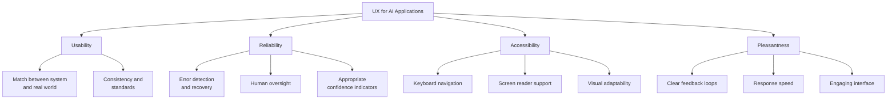
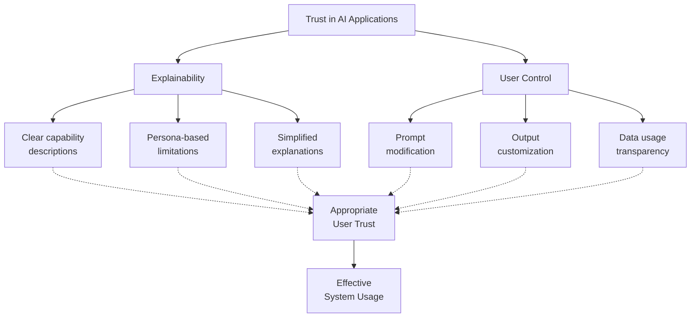
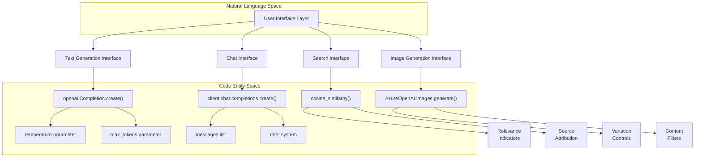
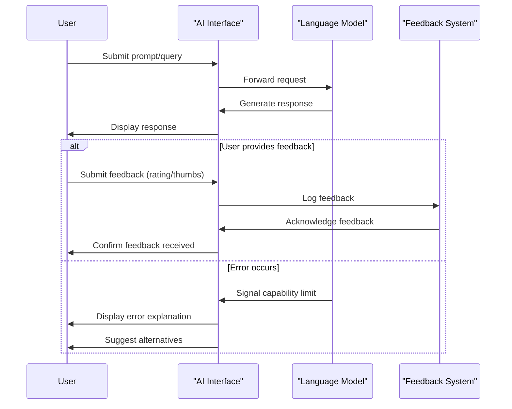
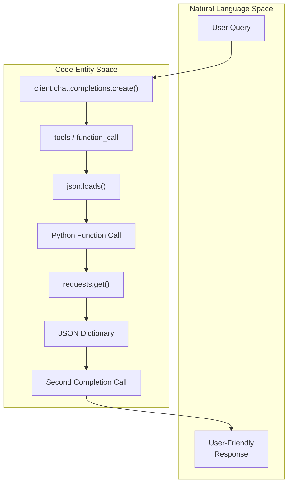

<!-- source: DeepWiki mcp.deepwiki.com · repo microsoft/generative-ai-for-beginners · page 5.4 UX Design for AI Applications · fetched 2026-10-26 -->

# UX Design for AI Applications

Relevant source files

The following files were used as context for generating this wiki page:

- [01-introduction-to-genai/README.md](01-introduction-to-genai/README.md)
- [02-exploring-and-comparing-different-llms/README.md](02-exploring-and-comparing-different-llms/README.md)
- [03-using-generative-ai-responsibly/README.md](03-using-generative-ai-responsibly/README.md)
- [04-prompt-engineering-fundamentals/README.md](04-prompt-engineering-fundamentals/README.md)
- [05-advanced-prompts/README.md](05-advanced-prompts/README.md)
- [06-text-generation-apps/README.md](06-text-generation-apps/README.md)
- [07-building-chat-applications/README.md](07-building-chat-applications/README.md)
- [08-building-search-applications/README.md](08-building-search-applications/README.md)
- [09-building-image-applications/README.md](09-building-image-applications/README.md)
- [10-building-low-code-ai-applications/README.md](10-building-low-code-ai-applications/README.md)
- [11-integrating-with-function-calling/README.md](11-integrating-with-function-calling/README.md)
- [12-designing-ux-for-ai-applications/README.md](12-designing-ux-for-ai-applications/README.md)
- [14-the-generative-ai-application-lifecycle/README.md](14-the-generative-ai-application-lifecycle/README.md)
- [15-rag-and-vector-databases/README.md](15-rag-and-vector-databases/README.md)
- [15-rag-and-vector-databases/images/cat.png](15-rag-and-vector-databases/images/cat.png)
- [15-rag-and-vector-databases/images/encoder-decode.png](15-rag-and-vector-databases/images/encoder-decode.png)
- [15-rag-and-vector-databases/images/how-rag-works.png](15-rag-and-vector-databases/images/how-rag-works.png)
- [15-rag-and-vector-databases/notebook-rag-vector-databases.ipynb](15-rag-and-vector-databases/notebook-rag-vector-databases.ipynb)
- [16-open-source-models/README.md](16-open-source-models/README.md)
- [17-ai-agents/README.md](17-ai-agents/README.md)
- [18-fine-tuning/README.md](18-fine-tuning/README.md)
- [18-fine-tuning/RESOURCES.md](18-fine-tuning/RESOURCES.md)

This page documents the key principles, patterns, and implementation strategies for designing effective user experiences (UX) in generative AI applications. It focuses on the technical aspects of building AI interfaces that are usable, reliable, accessible, and pleasant while ensuring appropriate levels of trust and feedback.

For information about implementing specific AI application types, see [Text Generation Applications](#4.1), [Chat Applications](#4.2), [Search Applications](#4.3), and [Image Generation Applications](#4.4).

## Core UX Principles for AI Applications

When designing AI applications, developers must consider four fundamental UX principles that determine how users will interact with and perceive the system:

| Principle | Description | Implementation Considerations |
|-----------|-------------|-------------------------------|
| **Usability** | The application performs its intended purpose effectively | Functions match user needs; clear purpose-driven design [12-designing-ux-for-ai-applications/README.md:36-38]() |
| **Reliability** | The application performs tasks consistently with appropriate error handling | Error detection, recovery mechanisms, human oversight [12-designing-ux-for-ai-applications/README.md:40-43]() |
| **Accessibility** | The application is usable by people with various abilities | Keyboard navigation, screen reader support, text scaling [12-designing-ux-for-ai-applications/README.md:44-47]() |
| **Pleasantness** | The application is enjoyable to use | Clear feedback, appropriate response times, engaging interactions [12-designing-ux-for-ai-applications/README.md:48-51]() |

### UX Principles Relationship Diagram

Sources: [12-designing-ux-for-ai-applications/README.md:31-51]()

## Building Trust through UX Design

Building appropriate trust is critical for AI applications. Users must neither underestimate (mistrust) nor overestimate (overtrust) the system's capabilities [12-designing-ux-for-ai-applications/README.md:57-59](). The primary mechanisms for establishing appropriate trust are explainability and control.

### Explainability

Explainability refers to making the AI's decisions and processes understandable to users [12-designing-ux-for-ai-applications/README.md:62-65](). This includes:

1. **Clear capability descriptions**: Instead of vague claims, provide specific examples of what the AI can do [12-designing-ux-for-ai-applications/README.md:64-66]().
2. **Persona-based limitations**: Communicate how different user types (e.g., students vs. teachers) might experience different constraints [12-designing-ux-for-ai-applications/README.md:68-71]().
3. **Simplified explanations**: Present technical concepts in accessible language for non-experts [12-designing-ux-for-ai-applications/README.md:72-74]().

### User Control

Control refers to giving users agency over the AI system, including:

1. **Prompt modification**: Allow users to refine their inputs (e.g., tone, format, length) when results aren't satisfactory [12-designing-ux-for-ai-applications/README.md:77-80]().
2. **Output customization**: Enable editing or adjustment of generated content [12-designing-ux-for-ai-applications/README.md:78-81]().
3. **Data usage transparency**: Provide clear opt-in/opt-out mechanisms for data usage [12-designing-ux-for-ai-applications/README.md:82-84]().

### Trust and Control Relationship

Sources: [12-designing-ux-for-ai-applications/README.md:52-95]()

## Application-Specific UX Considerations

Different types of AI applications require specific UX considerations:

### Text Generation Applications

For text generation apps, key UX considerations include:

- **Prompt optimization**: Clearly communicate how to write effective prompts [06-text-generation-apps/README.md:7-9]().
- **Temperature controls**: Provide appropriate controls for output variability [06-text-generation-apps/README.md:25-26]().
- **Token management**: Offer transparency about token usage and limitations [06-text-generation-apps/README.md:17-18]().
- **Response formatting**: Ensure outputs are formatted in a usable way (e.g., JSON) [11-integrating-with-function-calling/README.md:87-97]().

The following table shows how temperature settings affect user experience:

| Temperature | UX Implication | Use Case |
|-------------|----------------|----------|
| Low (0-0.3) | Deterministic, consistent outputs | Facts, code generation [05-advanced-prompts/README.md:25-26]() |
| Medium (0.4-0.7) | Balanced creativity and consistency | Creative writing with constraints |
| High (0.8-1.0) | Maximum creativity, more variability | Brainstorming, idea generation [06-text-generation-apps/README.md:25-26]() |

Sources: [06-text-generation-apps/README.md:15-26](), [05-advanced-prompts/README.md:25-26]()

### Chat Applications

For chat applications, important UX considerations include:

- **Context retention**: Maintain conversation history while respecting privacy [07-building-chat-applications/README.md:40-42]().
- **Ambiguity handling**: Provide mechanisms for clarification when needed.
- **Personalization**: Allow users to create profiles that inform responses [01-introduction-to-genai/README.md:31-33]().
- **System messages**: Implement clear system messages that define AI capabilities and limitations [07-building-chat-applications/README.md:80-85]().

### AI Application Types and UX Flow

Sources: 
- [06-text-generation-apps/README.md:134-141]()
- [07-building-chat-applications/README.md:80-113]()
- [08-building-search-applications/README.md:80-83]()
- [09-building-image-applications/README.md:143-147]()

## Designing for Collaboration and Feedback

AI applications should be designed to support collaboration between the AI and user, including proper feedback loops and error handling [12-designing-ux-for-ai-applications/README.md:88-90]().

### Feedback Mechanisms

There are several key feedback mechanisms to implement:

1. **User feedback collection**: Provide thumbs up/down or rating options for responses [12-designing-ux-for-ai-applications/README.md:95-97]().
2. **Error explanation**: When the AI cannot fulfill a request, clearly explain why [12-designing-ux-for-ai-applications/README.md:98-100]().
3. **Capability communication**: Transparently communicate what the AI can and cannot do [12-designing-ux-for-ai-applications/README.md:72-74]().
4. **Confidence indicators**: Show the AI's confidence level in its responses.

### Implementation of Feedback Loops

Sources: [12-designing-ux-for-ai-applications/README.md:88-100]()

## Function Calling and External Data Integration

Function calling provides a way to enhance UX by ensuring consistent response formats and integrating external data [11-integrating-with-function-calling/README.md:41-45]().

### Function Calling Flow

Function calling improves UX by:

1. **Consistent formatting**: Ensuring responses follow a predictable structure [11-integrating-with-function-calling/README.md:43-44]().
2. **External data integration**: Bringing real-time information into conversations [11-integrating-with-function-calling/README.md:45-46]().
3. **Specialized operations**: Enabling domain-specific functionality like course search [11-integrating-with-function-calling/README.md:27-34]().

Sources: [11-integrating-with-function-calling/README.md:11-46]()

## Accessibility Considerations

AI applications must be accessible to users with various impairments, including visual, auditory, motor, and cognitive disabilities [12-designing-ux-for-ai-applications/README.md:44-47]().

### Key Accessibility Features

| Impairment Type | Feature | Implementation |
|-----------------|---------|----------------|
| Visual | High contrast themes | CSS contrast ratios meeting WCAG standards |
| Visual | Screen reader compatibility | ARIA labels and proper semantic HTML |
| Auditory | Text-to-speech | Integration with device accessibility APIs |
| Auditory | Visual cues for audio | Visual indicators for audio notifications |
| Motor | Keyboard navigation | Complete keyboard access to all functions |
| Motor | Voice commands | Speech recognition integration |
| Cognitive | Simplified language | Clear, concise text with adjustable complexity [12-designing-ux-for-ai-applications/README.md:72-74]() |

Sources: [12-designing-ux-for-ai-applications/README.md:44-47](), [12-designing-ux-for-ai-applications/README.md:106-112]()

## Best Practices for AI UX Implementation

When implementing UX for AI applications, follow these technical best practices:

1. **Set appropriate expectations**: Clearly communicate what the AI can and cannot do [12-designing-ux-for-ai-applications/README.md:57-59]().
2. **Manage conversation history**: Balance context retention with privacy concerns [07-building-chat-applications/README.md:40-42]().
3. **Implement feedback mechanisms**: Create clear paths for users to provide feedback [12-designing-ux-for-ai-applications/README.md:95-97]().
4. **Handle errors gracefully**: Convert errors into learning opportunities [12-designing-ux-for-ai-applications/README.md:98-100]().
5. **Provide control**: Allow users to modify inputs and outputs [12-designing-ux-for-ai-applications/README.md:76-81]().
6. **Design for accessibility**: Ensure the application works for all users [12-designing-ux-for-ai-applications/README.md:44-47]().
7. **Balance automation with human intervention**: Know when to involve human review [12-designing-ux-for-ai-applications/README.md:58-60]().

Sources: 
- [06-text-generation-apps/README.md:17-26]()
- [07-building-chat-applications/README.md:98-113]()
- [12-designing-ux-for-ai-applications/README.md:52-100]()

---

