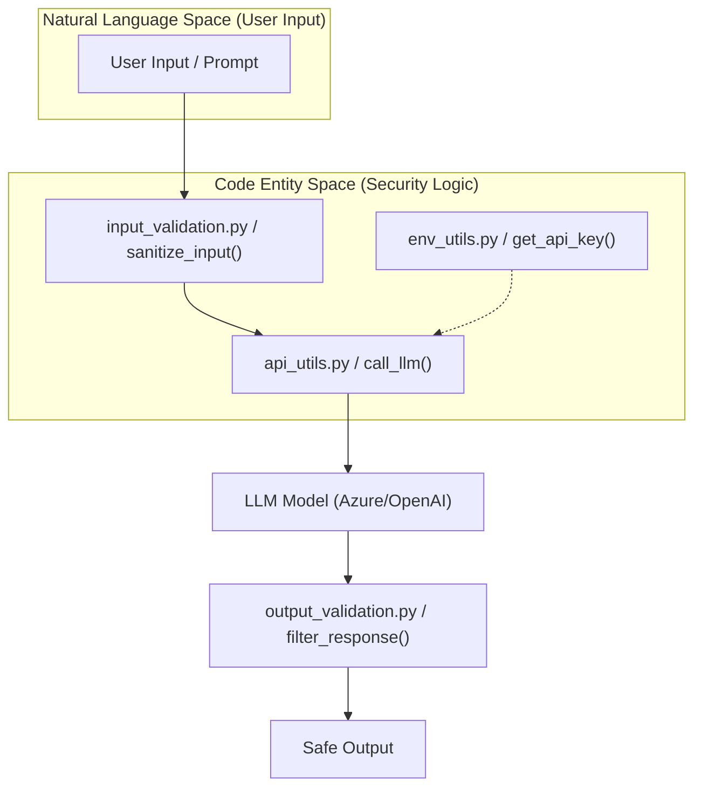
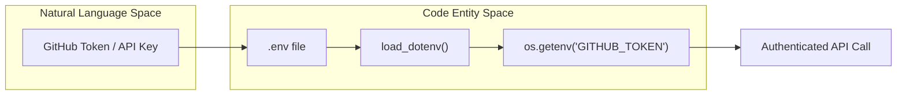

<!-- source: DeepWiki mcp.deepwiki.com · repo microsoft/generative-ai-for-beginners · page 5.5 Securing AI Applications · fetched 2026-10-26 -->

# Securing AI Applications

Relevant source files

The following files were used as context for generating this wiki page:

- [00-course-setup/README.md](00-course-setup/README.md)
- [13-securing-ai-applications/README.md](13-securing-ai-applications/README.md)
- [README.md](README.md)
- [translations/en/.co-op-translator.json](translations/en/.co-op-translator.json)
- [translations/en/README.md](translations/en/README.md)
- [translations/en/docs/ENHANCED_FEATURES_ROADMAP.md](translations/en/docs/ENHANCED_FEATURES_ROADMAP.md)
- [translations/en/docs/SECURITY_GUIDELINES.md](translations/en/docs/SECURITY_GUIDELINES.md)
- [translations/es/.co-op-translator.json](translations/es/.co-op-translator.json)
- [translations/es/README.md](translations/es/README.md)
- [translations/es/docs/ENHANCED_FEATURES_ROADMAP.md](translations/es/docs/ENHANCED_FEATURES_ROADMAP.md)
- [translations/es/docs/SECURITY_GUIDELINES.md](translations/es/docs/SECURITY_GUIDELINES.md)
- [translations/fr/.co-op-translator.json](translations/fr/.co-op-translator.json)
- [translations/fr/README.md](translations/fr/README.md)
- [translations/hi/.co-op-translator.json](translations/hi/.co-op-translator.json)
- [translations/hi/README.md](translations/hi/README.md)
- [translations/hi/docs/ENHANCED_FEATURES_ROADMAP.md](translations/hi/docs/ENHANCED_FEATURES_ROADMAP.md)
- [translations/hi/docs/SECURITY_GUIDELINES.md](translations/hi/docs/SECURITY_GUIDELINES.md)
- [translations/ja/.co-op-translator.json](translations/ja/.co-op-translator.json)
- [translations/ja/README.md](translations/ja/README.md)
- [translations/ja/docs/ENHANCED_FEATURES_ROADMAP.md](translations/ja/docs/ENHANCED_FEATURES_ROADMAP.md)
- [translations/ja/docs/SECURITY_GUIDELINES.md](translations/ja/docs/SECURITY_GUIDELINES.md)
- [translations/ko/.co-op-translator.json](translations/ko/.co-op-translator.json)
- [translations/ko/README.md](translations/ko/README.md)

This document details security considerations and practices for AI applications in the context of generative AI systems. It covers the unique security challenges presented by AI applications, common threats and attack vectors, and best practices for implementing robust security measures. 

The focus is on practical approaches to secure AI applications that use Large Language Models (LLMs) like those covered throughout this course.

## Understanding Security in AI Context

Security for AI applications encompasses traditional application security plus AI-specific considerations. Unlike conventional software, AI systems have unique vulnerabilities due to their learning capabilities, reliance on external data, and the probabilistic nature of their outputs [13-securing-ai-applications/README.md:23-31]().

Sources: [13-securing-ai-applications/README.md:21-34](), [00-course-setup/README.md:74-87]()

### Key Security Dimensions

When securing AI applications, several key dimensions must be considered to protect both customer data and the AI systems themselves [13-securing-ai-applications/README.md:23-29]():

1.  **Data Integrity**: Protecting the data stores models use to make decisions [13-securing-ai-applications/README.md:33-34]().
2.  **Model Protection**: Guarding against sophisticated attacks from trolls or organized groups [13-securing-ai-applications/README.md:28-29]().
3.  **Input/Output Security**: Managing the interface between untrusted user input and the model.

Sources: [13-securing-ai-applications/README.md:23-34]()

## Common Threats and Risks in AI Applications

AI systems face a range of threats beyond traditional cybersecurity concerns. 

### Data Poisoning
Data poisoning is currently the most significant security threat to AI systems [13-securing-ai-applications/README.md:37-38](). It occurs when an attacker intentionally manipulates training data to compromise model performance.

| Type | Description | Example |
| :--- | :--- | :--- |
| **Label Flipping** | Flipping labels of a small subset of training data [13-securing-ai-applications/README.md:41](). | Benign samples labeled as malicious to break spam filters [13-securing-ai-applications/README.md:42](). |
| **Feature Poisoning** | Subtly modifying features to introduce bias [13-securing-ai-applications/README.md:43](). | Adding irrelevant keywords to manipulate recommendation systems [13-securing-ai-applications/README.md:44](). |
| **Data Injection** | Injecting malicious data into the training set [13-securing-ai-applications/README.md:45](). | Fake user reviews to skew sentiment analysis [13-securing-ai-applications/README.md:46](). |
| **Backdoor Attacks** | Inserting a hidden pattern (backdoor) the model learns to recognize [13-securing-ai-applications/README.md:47](). | Face recognition system misidentifying a specific person when triggered [13-securing-ai-applications/README.md:48](). |

Sources: [13-securing-ai-applications/README.md:37-48]()

### Prompt Injection and Application Risks
Prompt injection involves manipulating an LLM through crafted inputs to behave outside its intended parameters [13-securing-ai-applications/README.md:58-59]().

Other risks include:
*   **Supply Chain Vulnerabilities**: Compromised Python modules or external datasets used by the LLM [13-securing-ai-applications/README.md:59-60]().
*   **Overreliance**: Taking LLM "hallucinations" or inaccurate results at face value [13-securing-ai-applications/README.md:60-61]().

Sources: [13-securing-ai-applications/README.md:58-61]()

## Security Frameworks and Testing

### ATLAS Framework
The MITRE Corporation developed **ATLAS (Adversarial Threat Landscape for Artificial-Intelligence Systems)**, a knowledge base of tactics and techniques used in real-world attacks on AI systems [13-securing-ai-applications/README.md:50-52](). It is modeled after the MITRE ATT&CK® framework [13-securing-ai-applications/README.md:54-55]().

### Security Testing Methods
Security testing identifies and exploits vulnerabilities in AI systems [13-securing-ai-applications/README.md:68-69]():

1.  **Data Sanitization**: Removing or anonymizing sensitive information from training data or inputs [13-securing-ai-applications/README.md:70-71]().
2.  **Adversarial Testing**: Applying adversarial examples to evaluate robustness [13-securing-ai-applications/README.md:72-73]().

Sources: [13-securing-ai-applications/README.md:50-73]()

## Implementation: Securing the Environment

The codebase emphasizes secure handling of secrets and environment variables to prevent credential leakage.

Sources: [00-course-setup/README.md:60-87]()

### Secure Configuration Practices
*   **Secret Management**: Using `.env` files to store sensitive keys like `GITHUB_TOKEN` or `OPENAI_API_KEY` rather than hardcoding them [00-course-setup/README.md:60-64]().
*   **Dependency Isolation**: Using Conda virtual environments (defined in `environment.yml`) to manage package versions and reduce supply chain risks [00-course-setup/README.md:115-146]().
*   **Provider Validation**: The course supports multiple backends (Azure OpenAI, GitHub Models, OpenAI API), requiring distinct configuration steps for each to ensure secure connectivity [README.md:60-63]().

Sources: [00-course-setup/README.md:60-146](), [README.md:60-63]()

## Summary of Best Practices

| Category | Action | Source |
| :--- | :--- | :--- |
| **Data** | Track origin and lineage to prevent "garbage in, garbage out". | [13-securing-ai-applications/README.md:37-38]() |
| **Input** | Sanitize user prompts to prevent injection attacks. | [13-securing-ai-applications/README.md:70-71]() |
| **Secrets** | Use `python-dotenv` to load environment variables from `.env`. | [00-course-setup/README.md:74-87]() |
| **Infrastructure** | Use GitHub Codespaces to avoid local dependency conflicts. | [00-course-setup/README.md:15-19]() |
| **Frameworks** | Refer to MITRE ATLAS and OWASP Top 10 for LLMs. | [13-securing-ai-applications/README.md:50-57]() |

Sources: [13-securing-ai-applications/README.md:37-71](), [00-course-setup/README.md:15-87]()

---

