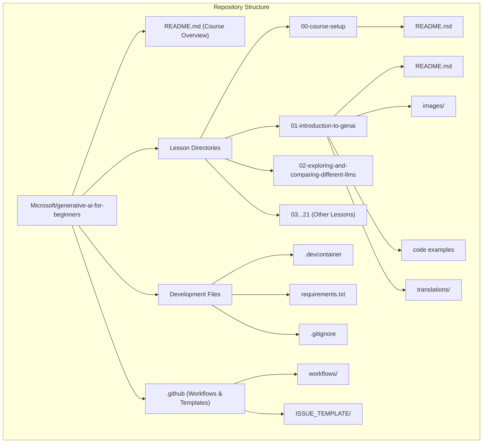
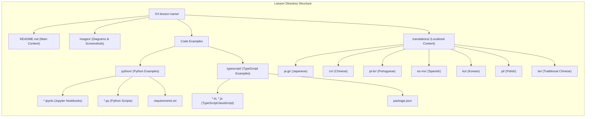
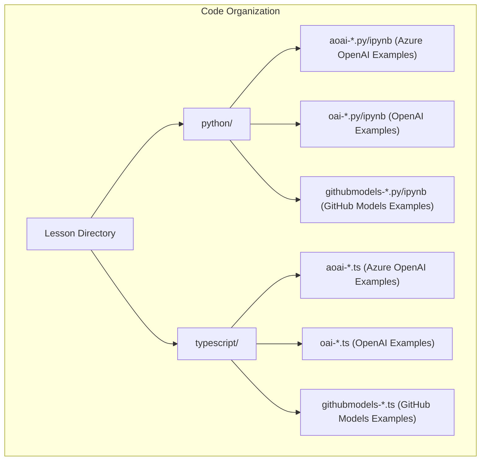
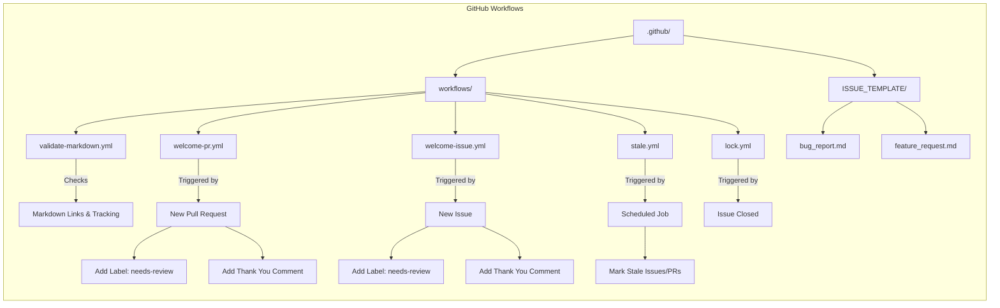
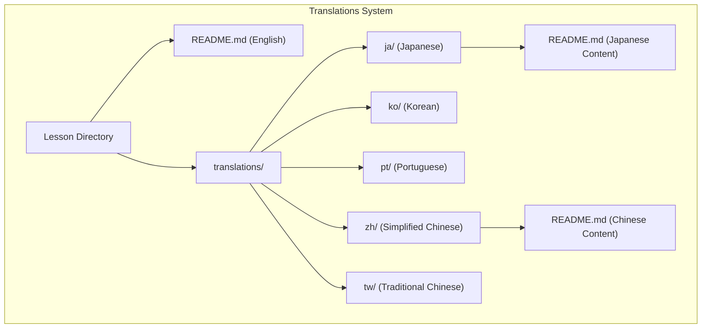

<!-- source: DeepWiki mcp.deepwiki.com · repo microsoft/generative-ai-for-beginners · page 6 Repository Structure · fetched 2026-10-26 -->

# Repository Structure

Relevant source files

The following files were used as context for generating this wiki page:

- [.github/ISSUE_TEMPLATE/bug_report.md](.github/ISSUE_TEMPLATE/bug_report.md)
- [.github/ISSUE_TEMPLATE/feature_request.md](.github/ISSUE_TEMPLATE/feature_request.md)
- [.github/workflows/lock.yml](.github/workflows/lock.yml)
- [.github/workflows/stale.yml](.github/workflows/stale.yml)
- [.github/workflows/validate-markdown.yml](.github/workflows/validate-markdown.yml)
- [.github/workflows/welcome-issue.yml](.github/workflows/welcome-issue.yml)
- [.github/workflows/welcome-pr.yml](.github/workflows/welcome-pr.yml)
- [.gitignore](.gitignore)
- [CONTRIBUTING.md](CONTRIBUTING.md)
- [LICENSE](LICENSE)
- [docs/_navbar.md](docs/_navbar.md)
- [images/android-chrome-192x192.png](images/android-chrome-192x192.png)
- [images/android-chrome-512x512.png](images/android-chrome-512x512.png)
- [images/apple-touch-icon.png](images/apple-touch-icon.png)
- [images/favicon-16x16.png](images/favicon-16x16.png)
- [images/favicon-32x32.png](images/favicon-32x32.png)
- [images/favicon.ico](images/favicon.ico)
- [images/github-check-country-locale-comment.png](images/github-check-country-locale-comment.png)
- [images/github-check-paths-missing-tracking-comment.png](images/github-check-paths-missing-tracking-comment.png)
- [images/github-check-urls-missing-tracking-comment.png](images/github-check-urls-missing-tracking-comment.png)
- [index.html](index.html)

This document provides a technical overview of the Generative AI for Beginners GitHub repository structure, organization, and key components. It explains how the codebase is organized, the relationships between different components, and how the repository is designed to support both learners and contributors.

## Repository Overview

The Generative AI for Beginners repository is a comprehensive educational resource consisting of 21 lessons that teach the fundamentals of building Generative AI applications. The repository is structured to provide a progressive learning path from basic concepts to advanced implementations.

Sources: [CONTRIBUTING.md:1-42](), [.gitignore:1-169]()

## Lesson Structure

Each lesson in the repository follows a consistent structure that includes the lesson content, code examples, and supporting files.

Sources: [CONTRIBUTING.md:40-41](), [.gitignore:78-80]()

### Lesson Components

Each lesson typically includes the following components:

| Component | Description | File Pattern |
|-----------|-------------|--------------|
| Lesson Content | The main educational material with explanations and theory | `README.md` |
| Images | Supporting visuals, diagrams, screenshots | `images/*.png`, `images/*.jpg` |
| Python Examples | Code examples in Python | `python/*.py`, `python/*.ipynb` |
| TypeScript Examples | Code examples in TypeScript | `typescript/*.ts`, `typescript/*.js` |
| Translations | Localized versions of the content | `translations/*/README.md` |

The lessons are designed to provide a consistent learning experience with both theoretical content and practical code examples.

Sources: [CONTRIBUTING.md:23-32](), [.gitignore:162-167]()

## Code Organization

The code examples in the repository are organized by language and follow a consistent pattern across lessons. Each lesson that includes code examples has separate directories for Python and TypeScript implementations.

### Shared Utilities
For common patterns like environment loading and API initialization, the repository utilizes shared utility modules. For details, see [Shared Utilities and Code Patterns](#6.2).

Sources: [.gitignore:2-4](), [.gitignore:122-130]()

## GitHub Workflows

The repository uses GitHub Actions to automate various processes related to repository management, community engagement, and content validation.

### Workflow Functions

| Workflow | Purpose | Trigger |
|----------|---------|---------|
| `validate-markdown.yml` | Validates markdown paths, URLs, and tracking IDs | Pull Request |
| `welcome-pr.yml` | Adds labels and comments to welcome new contributors | New Pull Request |
| `welcome-issue.yml` | Adds labels and comments to welcome new issue creators | New Issue |
| `stale.yml` | Marks and closes stale issues and PRs after 30 days | Scheduled (daily) |
| `lock.yml` | Locks closed issues to prevent further comments | Issue Closed |

For details, see [CI/CD and GitHub Workflows](#6.1).

Sources: [.github/workflows/validate-markdown.yml:1-96](), [.github/workflows/welcome-pr.yml:1-35](), [.github/workflows/welcome-issue.yml:1-35](), [.github/workflows/stale.yml:1-31](), [.github/workflows/lock.yml:1-18]()

## Translations System

The repository supports multiple languages through a translations system, with localized content available for each lesson. The navigation bar in `docs/_navbar.md` facilitates switching between languages.

The translations are maintained through community contributions, with the following process enforced:
*   Machine translations are strictly prohibited [CONTRIBUTING.md:8-9]().
*   Full translations are required for pull requests; partial translations are not accepted [CONTRIBUTING.md:30-30]().

Sources: [docs/_navbar.md:1-11](), [CONTRIBUTING.md:8-30](), [index.html:21-28]()

## File Structure Overview

The repository follows a consistent organization pattern with the following top-level directories:

| Directory/File | Purpose |
|----------------|---------|
| `00-course-setup/` | Instructions for setting up the development environment |
| `01-introduction-to-genai/` | Curriculum content directories |
| `.github/` | GitHub workflows and issue templates |
| `docs/` | Documentation site assets including `_navbar.md` |
| `images/` | Global images, favicons, and site assets |
| `README.md` | Main repository documentation |
| `LICENSE` | MIT License file |
| `.gitignore` | Git ignore configuration |
| `requirements.txt` | Python dependencies |

Sources: [.gitignore:1-169](), [LICENSE:1-22](), [index.html:11-14](), [docs/_navbar.md:1-11]()

---

