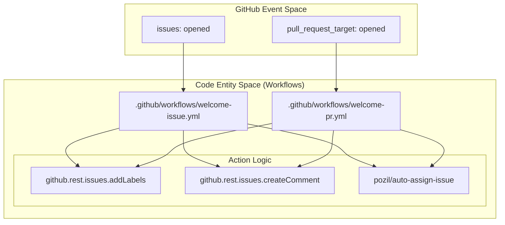
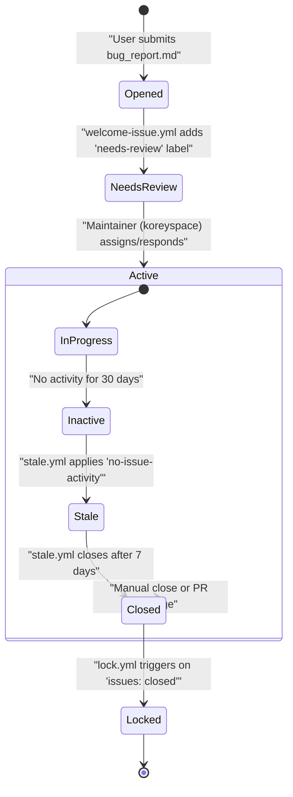

<!-- source: DeepWiki mcp.deepwiki.com · repo microsoft/generative-ai-for-beginners · page 6.1 CI/CD and GitHub Workflows · fetched 2026-10-26 -->

# CI/CD and GitHub Workflows

Relevant source files

The following files were used as context for generating this wiki page:

- [.github/ISSUE_TEMPLATE/bug_report.md](.github/ISSUE_TEMPLATE/bug_report.md)
- [.github/ISSUE_TEMPLATE/feature_request.md](.github/ISSUE_TEMPLATE/feature_request.md)
- [.github/workflows/lock.yml](.github/workflows/lock.yml)
- [.github/workflows/stale.yml](.github/workflows/stale.yml)
- [.github/workflows/validate-markdown.yml](.github/workflows/validate-markdown.yml)
- [.github/workflows/welcome-issue.yml](.github/workflows/welcome-issue.yml)
- [.github/workflows/welcome-pr.yml](.github/workflows/welcome-pr.yml)
- [.gitignore](.gitignore)
- [LICENSE](LICENSE)

This page details the automated workflows and continuous integration processes used in the Generative AI for Beginners repository. These workflows ensure content quality, manage community contributions, and maintain repository hygiene through GitHub Actions.

## Markdown and Content Validation

The repository utilizes a comprehensive validation pipeline to ensure that all educational content—including Markdown files and Jupyter Notebooks—meets specific quality standards before being merged into the `main` branch.

### Validation Pipeline Architecture

The `Validate Markdown` workflow is triggered on pull requests targeting `main` that modify `.md` or `.ipynb` files, excluding translation directories `[.github/workflows/validate-markdown.yml:3-12]()`. It executes a series of sequential checks using the `john0isaac/action-check-markdown` action.

| Job Name | Function | Implementation |
| :--- | :--- | :--- |
| `check-broken-paths` | Validates relative file links within the repo. | `command: check_broken_paths` `[.github/workflows/validate-markdown.yml:25-29]()` |
| `check-paths-tracking` | Ensures internal paths have required tracking parameters. | `command: check_paths_tracking` `[.github/workflows/validate-markdown.yml:41-45]()` |
| `check-urls-tracking` | Ensures external URLs include required tracking telemetry. | `command: check_urls_tracking` `[.github/workflows/validate-markdown.yml:57-61]()` |
| `check-urls-locale` | Prevents hardcoded country/locale codes in Microsoft URLs. | `command: check_urls_locale` `[.github/workflows/validate-markdown.yml:73-77]()` |
| `check-broken-urls` | Performs HTTP HEAD requests to verify external link integrity. | `command: check_broken_urls` `[.github/workflows/validate-markdown.yml:88-92]()` |

**Sources:**
- `[.github/workflows/validate-markdown.yml:1-96]()`

## Triage and Contribution Management

To handle the high volume of community contributions, the repository automates the initial triage of both Issues and Pull Requests.

### Automated Triage Flow

When a new Issue or Pull Request is opened, the `Welcome` workflows perform three primary actions:
1.  **Labeling**: Adds the `needs-review` label `[.github/workflows/welcome-issue.yml:22]()`, `[.github/workflows/welcome-pr.yml:22]()`.
2.  **Commenting**: Posts a "thanks" message to the contributor `[.github/workflows/welcome-issue.yml:24-29]()`, `[.github/workflows/welcome-pr.yml:24-29]()`.
3.  **Assignment**: Automatically assigns the item to the maintainer `koreyspace` using `pozil/auto-assign-issue` `[.github/workflows/welcome-issue.yml:30-34]()`, `[.github/workflows/welcome-pr.yml:30-34]()`.

### System Entity Mapping: Triage Automation

The following diagram maps the GitHub event space to the specific code entities responsible for triage.

**Triage Logic Mapping**

**Sources:**
- `[.github/workflows/welcome-issue.yml:1-35]()`
- `[.github/workflows/welcome-pr.yml:1-35]()`

## Repository Hygiene and Lifecycle

The repository maintains a clean state by automatically managing inactive items and locking resolved discussions.

### Stale Management
The `Mark stale issues and pull requests` workflow runs daily via a cron schedule `[.github/workflows/stale.yml:9-10]()`. It uses the `actions/stale` action to identify and eventually close inactive threads:
*   **Stale Threshold**: 30 days of inactivity `[.github/workflows/stale.yml:29]()`.
*   **Closure Threshold**: 7 days after being marked stale `[.github/workflows/stale.yml:30]()`.
*   **Labels**: Applies `no-issue-activity` or `no-pr-activity` `[.github/workflows/stale.yml:27-28]()`.

### Issue Locking
Once an issue is closed, the `Lock closed issue` workflow triggers `[.github/workflows/lock.yml:3-5]()`. It utilizes `OSDKDev/lock-issues` to prevent further comments on resolved issues, ensuring that new problems are tracked in fresh issue threads `[.github/workflows/lock.yml:15-18]()`.

### Data Flow: Maintenance Lifecycle

This diagram illustrates the lifecycle of a GitHub Issue within the repository's automated ecosystem.

**Issue Lifecycle Data Flow**

**Sources:**
- `[.github/workflows/stale.yml:1-31]()`
- `[.github/workflows/lock.yml:1-18]()`
- `[.github/ISSUE_TEMPLATE/bug_report.md:1-39]()`

## Environment and Ignore Configurations

To prevent CI/CD interference and local file leakage, the repository maintains a strict `.gitignore` policy. Key exclusions include:
*   **Python Artifacts**: `__pycache__`, `.venv`, and `build/` `[.gitignore:2-12]()`.
*   **Notebook Checkpoints**: `.ipynb_checkpoints` `[.gitignore:79]()`.
*   **Environment Secrets**: `.env` files to prevent credential leakage `[.gitignore:123]()`.
*   **Dependency Managers**: Local caches for `node_modules/`, `.pytest_cache/`, and `.mypy_cache/` `[.gitignore:162, 51, 142]()`.

**Sources:**
- `[.gitignore:1-169]()`

---

