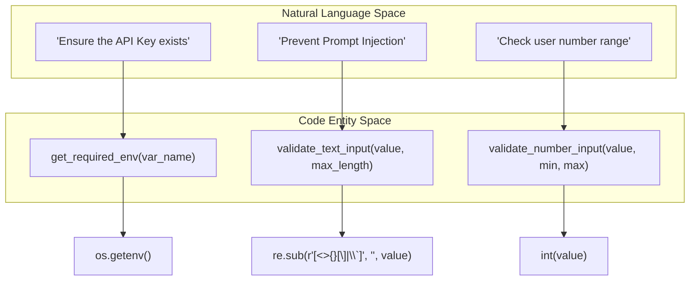
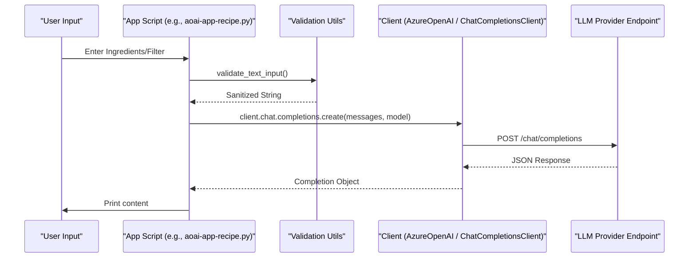

<!-- source: DeepWiki mcp.deepwiki.com · repo microsoft/generative-ai-for-beginners · page 6.2 Shared Utilities and Code Patterns · fetched 2026-10-26 -->

# Shared Utilities and Code Patterns

Relevant source files

The following files were used as context for generating this wiki page:

- [00-course-setup/README.md](00-course-setup/README.md)
- [06-text-generation-apps/python/aoai-app-recipe.py](06-text-generation-apps/python/aoai-app-recipe.py)
- [06-text-generation-apps/python/aoai-app.py](06-text-generation-apps/python/aoai-app.py)
- [06-text-generation-apps/python/aoai-assignment.ipynb](06-text-generation-apps/python/aoai-assignment.ipynb)
- [06-text-generation-apps/python/aoai-history-bot.py](06-text-generation-apps/python/aoai-history-bot.py)
- [06-text-generation-apps/python/aoai-study-buddy.py](06-text-generation-apps/python/aoai-study-buddy.py)
- [06-text-generation-apps/python/githubmodels-app.py](06-text-generation-apps/python/githubmodels-app.py)
- [06-text-generation-apps/python/oai-app-recipe.py](06-text-generation-apps/python/oai-app-recipe.py)
- [06-text-generation-apps/python/oai-app.py](06-text-generation-apps/python/oai-app.py)
- [06-text-generation-apps/python/oai-assigment.ipynb](06-text-generation-apps/python/oai-assigment.ipynb)
- [06-text-generation-apps/python/oai-history-bot.py](06-text-generation-apps/python/oai-history-bot.py)
- [06-text-generation-apps/python/oai-study-buddy.py](06-text-generation-apps/python/oai-study-buddy.py)
- [CONTRIBUTING.md](CONTRIBUTING.md)
- [README.md](README.md)
- [images/android-chrome-192x192.png](images/android-chrome-192x192.png)
- [images/android-chrome-512x512.png](images/android-chrome-512x512.png)
- [images/apple-touch-icon.png](images/apple-touch-icon.png)
- [images/favicon-16x16.png](images/favicon-16x16.png)
- [images/favicon-32x32.png](images/favicon-32x32.png)
- [images/favicon.ico](images/favicon.ico)
- [images/github-check-country-locale-comment.png](images/github-check-country-locale-comment.png)
- [images/github-check-paths-missing-tracking-comment.png](images/github-check-paths-missing-tracking-comment.png)
- [images/github-check-urls-missing-tracking-comment.png](images/github-check-urls-missing-tracking-comment.png)
- [translations/en/.co-op-translator.json](translations/en/.co-op-translator.json)
- [translations/en/README.md](translations/en/README.md)
- [translations/en/docs/ENHANCED_FEATURES_ROADMAP.md](translations/en/docs/ENHANCED_FEATURES_ROADMAP.md)
- [translations/en/docs/SECURITY_GUIDELINES.md](translations/en/docs/SECURITY_GUIDELINES.md)
- [translations/es/.co-op-translator.json](translations/es/.co-op-translator.json)
- [translations/es/README.md](translations/es/README.md)
- [translations/es/docs/ENHANCED_FEATURES_ROADMAP.md](translations/es/docs/ENHANCED_FEATURES_ROADMAP.md)
- [translations/es/docs/SECURITY_GUIDELINES.md](translations/es/docs/SECURITY_GUIDELINES.md)
- [translations/fr/.co-op-translator.json](translations/fr/.co-op-translator.json)
- [translations/fr/README.md](translations/fr/README.md)

This page documents the shared Python utilities and recurring architectural patterns used across the Generative AI for Beginners course. To ensure consistency and security, the repository utilizes standardized methods for environment management, API communication, and input validation.

## Overview of Shared Utilities

The repository organizes its logic into reusable patterns to minimize boilerplate in lesson implementations. These utilities handle the bridge between the local execution environment and the remote AI services (Azure OpenAI, OpenAI, and GitHub Models).

### Environment Management
The primary mechanism for configuration is the `.env` file, which is loaded into the system environment using `python-dotenv` [00-course-setup/README.md:71-81](). This pattern ensures that sensitive credentials like `AZURE_OPENAI_API_KEY` or `GITHUB_TOKEN` are never hardcoded into the scripts.

### Core Utilities Table

| Utility Area | Key Functions/Logic | Purpose |
| :--- | :--- | :--- |
| **Env Utils** | `get_required_env` | Fetches environment variables with explicit error reporting for missing keys [06-text-generation-apps/python/aoai-app-recipe.py:10-15](). |
| **Input Validation** | `validate_number_input`, `validate_text_input` | Sanitizes user input to prevent prompt injection and ensure type safety [06-text-generation-apps/python/aoai-app-recipe.py:18-37](). |
| **API Client Setup** | `AzureOpenAI()`, `ChatCompletionsClient()` | Standardized initialization for various LLM providers [06-text-generation-apps/python/aoai-app.py:10-15](), [06-text-generation-apps/python/githubmodels-app.py:11-14](). |

**Sources:** [00-course-setup/README.md](), [06-text-generation-apps/python/aoai-app-recipe.py]()

---

## Code Patterns and Implementation

### 1. Secure Input and Environment Pattern
The "Build" lessons follow a specific sequence to ensure the application is robust against missing configurations and malicious user input.

**Implementation Flow:**
1.  **Environment Loading**: `load_dotenv()` is called at the entry point [06-text-generation-apps/python/aoai-app-recipe.py:7]().
2.  **Strict Variable Retrieval**: Using `get_required_env` to fail fast if the environment is not configured [06-text-generation-apps/python/aoai-app-recipe.py:41-46]().
3.  **Input Sanitization**: User-provided strings are passed through regex-based sanitizers to strip dangerous characters like `< > { } [ ] \` [06-text-generation-apps/python/aoai-app-recipe.py:33-35]().

**Natural Language to Code Entity Space: Security Pattern**

**Sources:** [06-text-generation-apps/python/aoai-app-recipe.py:10-37]()

### 2. Multi-Provider Client Pattern
The codebase supports multiple backends (Azure, OpenAI, and GitHub Models). While the specific SDKs differ, the pattern for generating completions remains consistent.

*   **Azure OpenAI**: Uses the `AzureOpenAI` client with `azure_endpoint` and `api_version` [06-text-generation-apps/python/aoai-app.py:10-15]().
*   **OpenAI**: Uses the standard `OpenAI` client [06-text-generation-apps/python/oai-app.py:9-10]().
*   **GitHub Models**: Uses `ChatCompletionsClient` from the `azure.ai.inference` package [06-text-generation-apps/python/githubmodels-app.py:11-14]().

**Data Flow: Completion Request**

**Sources:** [06-text-generation-apps/python/aoai-app-recipe.py:49-67](), [06-text-generation-apps/python/githubmodels-app.py:18-34]()

### 3. Prompt Chaining Pattern
Advanced lessons demonstrate "chaining" where the output of one LLM call becomes the input for the next. A common example is generating a recipe and then generating a shopping list based on that specific recipe [06-text-generation-apps/python/aoai-app-recipe.py:75-81]().

**Key Steps in Chaining:**
1.  **Initial Completion**: Capture the result in a variable (e.g., `old_prompt_result`) [06-text-generation-apps/python/aoai-app-recipe.py:75]().
2.  **Context Injection**: Create a `new_prompt` that interpolates the previous result and the original user context [06-text-generation-apps/python/aoai-app-recipe.py:79]().
3.  **Follow-up Request**: Call the client again with the updated message list [06-text-generation-apps/python/aoai-app-recipe.py:81]().

**Sources:** [06-text-generation-apps/python/aoai-app-recipe.py:75-81]()

---

## Technical Implementation Details

### Input Validation Logic
The `validate_text_input` function is a critical security utility. It limits input length and uses a regular expression `^[\w\s,.\'-]+$` to ensure only alphanumeric characters and basic punctuation are processed [06-text-generation-apps/python/aoai-app-recipe.py:28-37]().

### Configuration Requirements
Every implementation assumes the presence of specific environment variables. Missing variables trigger a `ValueError` via the `get_required_env` helper [06-text-generation-apps/python/aoai-app-recipe.py:14]().

| Variable Name | Required For |
| :--- | :--- |
| `AZURE_OPENAI_ENDPOINT` | Azure OpenAI Service connection [06-text-generation-apps/python/aoai-app.py:11]() |
| `AZURE_OPENAI_API_KEY` | Azure OpenAI Authentication [06-text-generation-apps/python/aoai-app.py:12]() |
| `AZURE_OPENAI_DEPLOYMENT`| Specifying the model deployment name [06-text-generation-apps/python/aoai-app.py:17]() |
| `GITHUB_TOKEN` | GitHub Models Marketplace access [06-text-generation-apps/python/githubmodels-app.py:6]() |

**Sources:** [06-text-generation-apps/python/aoai-app-recipe.py](), [06-text-generation-apps/python/githubmodels-app.py]()

---

