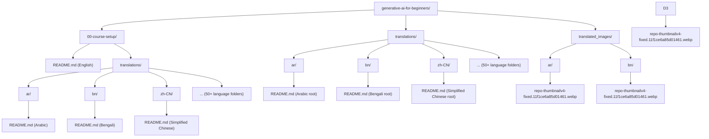
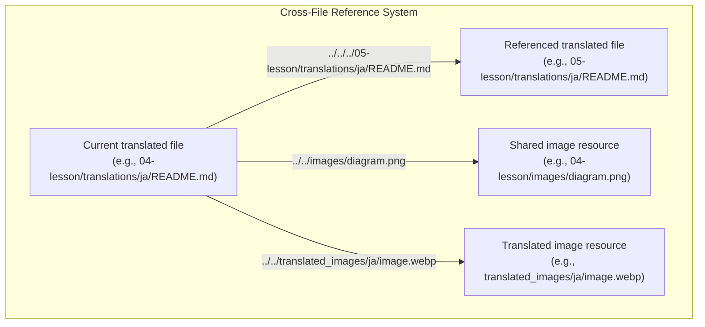
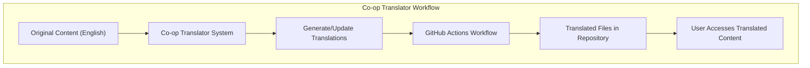
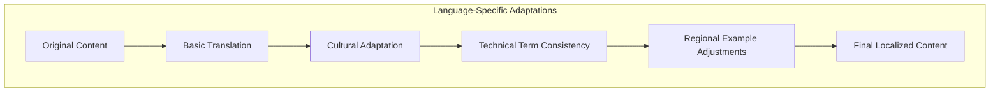

<!-- source: DeepWiki mcp.deepwiki.com · repo microsoft/generative-ai-for-beginners · page 7 Translations and Internationalization · fetched 2026-10-26 -->

# Translations and Internationalization

<details>
<summary>Relevant source files</summary>

The following files were used as context for generating this wiki page:

- [00-course-setup/README.md](00-course-setup/README.md)
- [13-securing-ai-applications/README.md](13-securing-ai-applications/README.md)
- [README.md](README.md)
- [translations/ar/.co-op-translator.json](translations/ar/.co-op-translator.json)
- [translations/ar/README.md](translations/ar/README.md)
- [translations/ar/docs/ENHANCED_FEATURES_ROADMAP.md](translations/ar/docs/ENHANCED_FEATURES_ROADMAP.md)
- [translations/ar/docs/SECURITY_GUIDELINES.md](translations/ar/docs/SECURITY_GUIDELINES.md)
- [translations/cs/.co-op-translator.json](translations/cs/.co-op-translator.json)
- [translations/cs/README.md](translations/cs/README.md)
- [translations/cs/docs/ENHANCED_FEATURES_ROADMAP.md](translations/cs/docs/ENHANCED_FEATURES_ROADMAP.md)
- [translations/cs/docs/SECURITY_GUIDELINES.md](translations/cs/docs/SECURITY_GUIDELINES.md)
- [translations/de/.co-op-translator.json](translations/de/.co-op-translator.json)
- [translations/de/README.md](translations/de/README.md)
- [translations/de/docs/ENHANCED_FEATURES_ROADMAP.md](translations/de/docs/ENHANCED_FEATURES_ROADMAP.md)
- [translations/de/docs/SECURITY_GUIDELINES.md](translations/de/docs/SECURITY_GUIDELINES.md)
- [translations/en/.co-op-translator.json](translations/en/.co-op-translator.json)
- [translations/en/README.md](translations/en/README.md)
- [translations/en/docs/ENHANCED_FEATURES_ROADMAP.md](translations/en/docs/ENHANCED_FEATURES_ROADMAP.md)
- [translations/en/docs/SECURITY_GUIDELINES.md](translations/en/docs/SECURITY_GUIDELINES.md)
- [translations/es/.co-op-translator.json](translations/es/.co-op-translator.json)
- [translations/es/README.md](translations/es/README.md)
- [translations/es/docs/ENHANCED_FEATURES_ROADMAP.md](translations/es/docs/ENHANCED_FEATURES_ROADMAP.md)
- [translations/es/docs/SECURITY_GUIDELINES.md](translations/es/docs/SECURITY_GUIDELINES.md)
- [translations/fa/.co-op-translator.json](translations/fa/.co-op-translator.json)
- [translations/fa/README.md](translations/fa/README.md)
- [translations/fa/docs/ENHANCED_FEATURES_ROADMAP.md](translations/fa/docs/ENHANCED_FEATURES_ROADMAP.md)
- [translations/fa/docs/SECURITY_GUIDELINES.md](translations/fa/docs/SECURITY_GUIDELINES.md)
- [translations/fr/.co-op-translator.json](translations/fr/.co-op-translator.json)
- [translations/fr/README.md](translations/fr/README.md)
- [translations/he/.co-op-translator.json](translations/he/.co-op-translator.json)
- [translations/he/README.md](translations/he/README.md)
- [translations/he/docs/ENHANCED_FEATURES_ROADMAP.md](translations/he/docs/ENHANCED_FEATURES_ROADMAP.md)
- [translations/he/docs/SECURITY_GUIDELINES.md](translations/he/docs/SECURITY_GUIDELINES.md)
- [translations/hi/.co-op-translator.json](translations/hi/.co-op-translator.json)
- [translations/hi/README.md](translations/hi/README.md)
- [translations/hi/docs/ENHANCED_FEATURES_ROADMAP.md](translations/hi/docs/ENHANCED_FEATURES_ROADMAP.md)
- [translations/hi/docs/SECURITY_GUIDELINES.md](translations/hi/docs/SECURITY_GUIDELINES.md)
- [translations/hu/.co-op-translator.json](translations/hu/.co-op-translator.json)
- [translations/hu/README.md](translations/hu/README.md)
- [translations/hu/docs/ENHANCED_FEATURES_ROADMAP.md](translations/hu/docs/ENHANCED_FEATURES_ROADMAP.md)
- [translations/hu/docs/SECURITY_GUIDELINES.md](translations/hu/docs/SECURITY_GUIDELINES.md)
- [translations/it/.co-op-translator.json](translations/it/.co-op-translator.json)
- [translations/it/README.md](translations/it/README.md)
- [translations/it/docs/ENHANCED_FEATURES_ROADMAP.md](translations/it/docs/ENHANCED_FEATURES_ROADMAP.md)
- [translations/it/docs/SECURITY_GUIDELINES.md](translations/it/docs/SECURITY_GUIDELINES.md)
- [translations/ja/.co-op-translator.json](translations/ja/.co-op-translator.json)
- [translations/ja/README.md](translations/ja/README.md)
- [translations/ja/docs/ENHANCED_FEATURES_ROADMAP.md](translations/ja/docs/ENHANCED_FEATURES_ROADMAP.md)
- [translations/ja/docs/SECURITY_GUIDELINES.md](translations/ja/docs/SECURITY_GUIDELINES.md)
- [translations/ko/.co-op-translator.json](translations/ko/.co-op-translator.json)
- [translations/ko/README.md](translations/ko/README.md)
- [translations/nl/.co-op-translator.json](translations/nl/.co-op-translator.json)
- [translations/nl/README.md](translations/nl/README.md)
- [translations/nl/docs/ENHANCED_FEATURES_ROADMAP.md](translations/nl/docs/ENHANCED_FEATURES_ROADMAP.md)
- [translations/nl/docs/SECURITY_GUIDELINES.md](translations/nl/docs/SECURITY_GUIDELINES.md)
- [translations/pl/.co-op-translator.json](translations/pl/.co-op-translator.json)
- [translations/pl/README.md](translations/pl/README.md)
- [translations/pl/docs/ENHANCED_FEATURES_ROADMAP.md](translations/pl/docs/ENHANCED_FEATURES_ROADMAP.md)
- [translations/pl/docs/SECURITY_GUIDELINES.md](translations/pl/docs/SECURITY_GUIDELINES.md)
- [translations/ru/.co-op-translator.json](translations/ru/.co-op-translator.json)
- [translations/ru/README.md](translations/ru/README.md)
- [translations/sw/.co-op-translator.json](translations/sw/.co-op-translator.json)
- [translations/sw/README.md](translations/sw/README.md)
- [translations/tr/.co-op-translator.json](translations/tr/.co-op-translator.json)
- [translations/tr/README.md](translations/tr/README.md)
- [translations/ur/.co-op-translator.json](translations/ur/.co-op-translator.json)
- [translations/ur/README.md](translations/ur/README.md)
- [translations/ur/docs/ENHANCED_FEATURES_ROADMAP.md](translations/ur/docs/ENHANCED_FEATURES_ROADMAP.md)
- [translations/ur/docs/SECURITY_GUIDELINES.md](translations/ur/docs/SECURITY_GUIDELINES.md)
- [translations/vi/.co-op-translator.json](translations/vi/.co-op-translator.json)
- [translations/vi/README.md](translations/vi/README.md)
- [translations/zh-CN/.co-op-translator.json](translations/zh-CN/.co-op-translator.json)
- [translations/zh-CN/README.md](translations/zh-CN/README.md)

</details>


This document details the multilingual aspects of the course, the Co-op Translator automation system, available translations across 50+ languages, and how to work with the translation infrastructure. The repository is designed with a global audience in mind and features content translated into multiple languages to make generative AI knowledge accessible worldwide.

For related topics on repository structure, please see [Repository Structure](#6).

## Overview of the Translation System

The `generative-ai-for-beginners` repository supports multiple languages through a structured translation system. The course materials, originally developed in English, are translated into over 50 languages to reach a global audience interested in learning about generative AI. This process is largely automated by the Co-op Translator system.

### Co-op Translator System
The Co-op Translator is an automation system that manages the translation of course content. It uses `.co-op-translator.json` configuration files to define translation rules and leverages hash-based change detection to ensure translations are kept up-to-date with the original English content. This system integrates with GitHub Actions to automate the translation workflow. For details, see [Co-op Translator System](#7.1).

### Available Language Translations
The course content is available in over 50 languages. These translations include not only the markdown lesson files but also translated images, which are stored in the `translated_images` directory. For a comprehensive list of supported languages and guidance on contributing, see [Available Language Translations](#7.2).

Sources: [README.md:17-22](), [README.md:24-42]()

## Supported Languages

The repository currently supports over 50 languages, with translations automatically managed. The `README.md` file at the root of the repository lists all supported languages and provides direct links to their translated versions.

For a complete list of all 50+ supported languages, see [Available Language Translations](#7.2).

Sources: [README.md:22]()

## Translation Directory Structure

The repository follows a consistent structure for organizing translations. Each lesson folder contains the original English content and a `translations` directory with subfolders for each language. Additionally, translated images are stored separately.


Sources: [README.md:22](), [translations/ko/README.md:1](), [translations/ja/README.md:1](), [translations/tr/README.md:1](), [translations/pl/README.md:1](), [translations/vi/README.md:1](), [translations/nl/README.md:1](), [translations/he/README.md:1](), [translations/sw/README.md:1](), [translations/hu/README.md:1]()

## Link Structure in Translations

Links within translated content are carefully managed to maintain the language context and ensure correct navigation. This involves using relative paths that account for the language-specific directory structure.



Internal links follow these patterns:
- Links to other translated lessons: `../../../[lesson-number]/translations/[language-code]/README.md`
- Links to original images (shared across all languages): `../../images/[image-name]`
- Links to translated images: `../../translated_images/[language-code]/[image-name]`

Sources: [translations/ko/README.md:1](), [translations/ja/README.md:1](), [translations/tr/README.md:1](), [translations/pl/README.md:1](), [translations/vi/README.md:1](), [translations/nl/README.md:1](), [translations/he/README.md:1](), [translations/sw/README.md:1](), [translations/hu/README.md:1]()

## Translation Content Guidelines

The translation system supports various content types to provide a fully localized experience:

1.  **Text Content**: All descriptive text, headings, and explanations are translated.
2.  **Code Comments**: Comments within code examples are translated to aid understanding.
3.  **UI Elements**: Descriptions of UI elements and user interactions are localized.
4.  **Images**: Image references are updated to point to language-specific translated images where available, or to original images if no translation exists. Alt text for images is also translated.
5.  **Links**: Links are adapted to maintain proper relative paths and language context.

Code snippets themselves typically remain in English to maintain technical accuracy and consistency across programming languages.

Sources: [translations/ko/README.md:1](), [translations/ja/README.md:1](), [translations/tr/README.md:1](), [translations/pl/README.md:1](), [translations/vi/README.md:1](), [translations/nl/README.md:1](), [translations/he/README.md:1](), [translations/sw/README.md:1](), [translations/hu/README.md:1]()

## Tracking Parameters

Links in translations maintain tracking parameters for analytics. For example:

```
?WT.mc_id=academic-105485-koreyst
```

These tracking IDs are preserved in all translations to maintain consistent analytics across languages, allowing Microsoft to understand content consumption patterns globally.

Sources: [README.md:5-13](), [translations/ko/README.md:5-13](), [translations/ja/README.md:5-13](), [translations/tr/README.md:5-13](), [translations/pl/README.md:5-13](), [translations/vi/README.md:5-13](), [translations/nl/README.md:5-13](), [translations/he/README.md:5-13](), [translations/sw/README.md:5-13](), [translations/hu/README.md:5-13]()

## Translation Workflow

The process for creating and maintaining translations is largely automated by the Co-op Translator system.



The Co-op Translator system monitors changes in the original English content. When changes are detected, it triggers a GitHub Actions workflow to update the corresponding translated files. This ensures that all translations are kept up-to-date with the latest English version.

For a detailed explanation of the Co-op Translator's mechanics, see [Co-op Translator System](#7.1).

Sources: [README.md:19](), [translations/ko/README.md:19](), [translations/ja/README.md:19](), [translations/tr/README.md:19](), [translations/pl/README.md:19](), [translations/vi/README.md:19](), [translations/nl/README.md:19](), [translations/he/README.md:19](), [translations/sw/README.md:19](), [translations/hu/README.md:19]()

## Internationalization Considerations

Beyond direct translation, the repository addresses broader internationalization issues to ensure the content is globally relevant and accessible:

1.  **Technical Terminology**: While code remains in English, technical terms in explanatory text are consistently translated or transliterated as appropriate for each language.
2.  **Cultural Context**: Examples and explanations are reviewed to ensure they are culturally appropriate and relevant to diverse audiences.
3.  **URL Structure**: The relative URL structure ensures that navigation works seamlessly across different language versions of the content.
4.  **Shared Resources**: Images and code examples are shared efficiently, with translated images provided where necessary.
5.  **Sparse Checkout**: Recommendations are provided for users to clone the repository using sparse checkout to avoid downloading all 50+ language translations, which significantly reduces the repository size and download time. This is particularly useful for users who only need the English content or a specific language.

Sources: [README.md:24-42](), [00-course-setup/README.md:93-100]()

## Main Lessons in Translation

Each of the 21 lessons in the course has corresponding translation files. The structure ensures that each lesson's content is available in all supported languages.

| Lesson Number | Topic | Translation Folder Structure |
|---------------|-------|------------------------------|
| 00 | Course Setup | `/00-course-setup/translations/[language-code]/` |
| 01 | Introduction to GenAI | `/01-introduction-to-genai/translations/[language-code]/` |
| 02 | Exploring LLMs | `/02-exploring-and-comparing-different-llms/translations/[language-code]/` |
| 03 | Responsible AI | `/03-using-generative-ai-responsibly/translations/[language-code]/` |
| 04 | Prompt Engineering Fundamentals | `/04-prompt-engineering-fundamentals/translations/[language-code]/` |
| 05 | Advanced Prompts | `/05-advanced-prompts/translations/[language-code]/` |
| 06 | Text Generation Apps | `/06-text-generation-apps/translations/[language-code]/` |
| 07 | Chat Applications | `/07-building-chat-applications/translations/[language-code]/` |
| 08 | Search Applications | `/08-building-search-applications/translations/[language-code]/` |
| 09 | Image Applications | `/09-building-image-applications/translations/[language-code]/` |
| 10 | Low Code AI Applications | `/10-building-low-code-ai-applications/translations/[language-code]/` |
| 11 | Function Calling Integration | `/11-integrating-with-function-calling/translations/[language-code]/` |
| 12 | UX Design for AI Applications | `/12-designing-ux-for-ai-applications/translations/[language-code]/` |
| 13 | Securing AI Applications | `/13-securing-ai-applications/translations/[language-code]/` |
| ... | ... | ... |

Sources: [13-securing-ai-applications/README.md:1-190]()

## Language-Specific Adaptations

In addition to direct translation, some content is adapted to be more relevant to specific language audiences. This includes:



Examples include:
- Explanatory notes added by translators to clarify concepts for a specific cultural context.
- Additional context for region-specific examples to make them more relatable.
- Consistent translation of technical terminology, sometimes preserving English terms if they are widely understood in the local technical community.
- Preservation of code examples in English while translating comments and surrounding explanatory text.

Sources: [translations/ko/README.md:59-66](), [translations/ja/README.md:59-66](), [translations/tr/README.md:59-66](), [translations/pl/README.md:59-66](), [translations/vi/README.md:59-66](), [translations/nl/README.md:59-66](), [translations/he/README.md:59-66](), [translations/sw/README.md:59-66](), [translations/hu/README.md:59-66]()

## Root Translation Files

The repository also maintains translated versions of the main `README.md` at the root level:

```
/translations/
├── ar/
│   └── README.md (Arabic translation of main README)
├── bn/
│   └── README.md (Bengali translation of main README)
├── zh-CN/
│   └── README.md (Simplified Chinese translation of main README)
└── ... (50+ language folders)
```

These files provide an entry point for non-English speakers and include translated versions of:
- Course overview
- Setup instructions
- Course structure
- Links to individual lessons

Sources: [README.md:22]()

## Technical Implementation Details

The translation system relies on relative paths and GitHub's Markdown rendering to create a seamless experience:

1.  Translated files use the same filename as the original (`README.md`).
2.  Links maintain language context by navigating through appropriate language directories.
3.  Shared resources (original images, code) are referenced using relative paths from the translated file.
4.  Translated images are stored in the `translated_images` directory, organized by language code, and referenced accordingly.
5.  Analytics tracking parameters are preserved across translations.

Sources: [translations/ko/README.md:1](), [translations/ja/README.md:1](), [translations/tr/README.md:1](), [translations/pl/README.md:1](), [translations/vi/README.md:1](), [translations/nl/README.md:1](), [translations/he/README.md:1](), [translations/sw/README.md:1](), [translations/hu/README.md:1]()

## Contributing to Translations

The repository welcomes translation contributions. The Co-op Translator system automates much of the process, but manual contributions and reviews are valuable.

To contribute:
1.  Fork the repository.
2.  Create or update translations following the established directory structure.
3.  Ensure proper linking and resource references, especially for translated images.
4.  Submit a pull request with the translations.

For detailed instructions on working with the Co-op Translator system and contributing translations, see [Co-op Translator System](#7.1) and [Available Language Translations](#7.2).

Sources: [README.md:86-88]()

---

