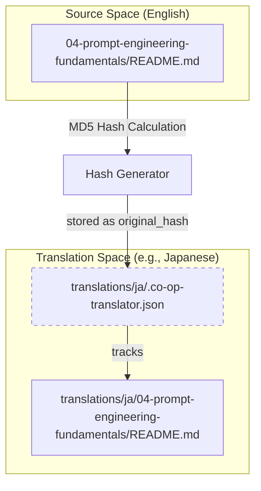
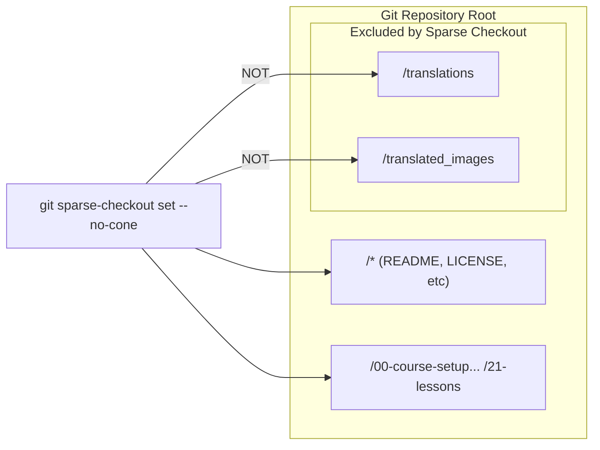

<!-- source: DeepWiki mcp.deepwiki.com · repo microsoft/generative-ai-for-beginners · page 7.1 Co-op Translator System · fetched 2026-10-26 -->

# Co-op Translator System

<details>
<summary>Relevant source files</summary>

The following files were used as context for generating this wiki page:

- [00-course-setup/README.md](00-course-setup/README.md)
- [13-securing-ai-applications/README.md](13-securing-ai-applications/README.md)
- [README.md](README.md)
- [translations/bn/04-prompt-engineering-fundamentals/README.md](translations/bn/04-prompt-engineering-fundamentals/README.md)
- [translations/en/.co-op-translator.json](translations/en/.co-op-translator.json)
- [translations/en/README.md](translations/en/README.md)
- [translations/en/docs/ENHANCED_FEATURES_ROADMAP.md](translations/en/docs/ENHANCED_FEATURES_ROADMAP.md)
- [translations/en/docs/SECURITY_GUIDELINES.md](translations/en/docs/SECURITY_GUIDELINES.md)
- [translations/es/.co-op-translator.json](translations/es/.co-op-translator.json)
- [translations/es/README.md](translations/es/README.md)
- [translations/es/docs/ENHANCED_FEATURES_ROADMAP.md](translations/es/docs/ENHANCED_FEATURES_ROADMAP.md)
- [translations/es/docs/SECURITY_GUIDELINES.md](translations/es/docs/SECURITY_GUIDELINES.md)
- [translations/fr/.co-op-translator.json](translations/fr/.co-op-translator.json)
- [translations/fr/README.md](translations/fr/README.md)
- [translations/hi/.co-op-translator.json](translations/hi/.co-op-translator.json)
- [translations/hi/04-prompt-engineering-fundamentals/README.md](translations/hi/04-prompt-engineering-fundamentals/README.md)
- [translations/hi/README.md](translations/hi/README.md)
- [translations/hi/docs/ENHANCED_FEATURES_ROADMAP.md](translations/hi/docs/ENHANCED_FEATURES_ROADMAP.md)
- [translations/hi/docs/SECURITY_GUIDELINES.md](translations/hi/docs/SECURITY_GUIDELINES.md)
- [translations/it/04-prompt-engineering-fundamentals/README.md](translations/it/04-prompt-engineering-fundamentals/README.md)
- [translations/ja/.co-op-translator.json](translations/ja/.co-op-translator.json)
- [translations/ja/04-prompt-engineering-fundamentals/README.md](translations/ja/04-prompt-engineering-fundamentals/README.md)
- [translations/ja/README.md](translations/ja/README.md)
- [translations/ja/docs/ENHANCED_FEATURES_ROADMAP.md](translations/ja/docs/ENHANCED_FEATURES_ROADMAP.md)
- [translations/ja/docs/SECURITY_GUIDELINES.md](translations/ja/docs/SECURITY_GUIDELINES.md)
- [translations/ko/.co-op-translator.json](translations/ko/.co-op-translator.json)
- [translations/ko/04-prompt-engineering-fundamentals/README.md](translations/ko/04-prompt-engineering-fundamentals/README.md)
- [translations/ko/README.md](translations/ko/README.md)
- [translations/mr/04-prompt-engineering-fundamentals/README.md](translations/mr/04-prompt-engineering-fundamentals/README.md)
- [translations/ne/04-prompt-engineering-fundamentals/README.md](translations/ne/04-prompt-engineering-fundamentals/README.md)
- [translations/pa/04-prompt-engineering-fundamentals/README.md](translations/pa/04-prompt-engineering-fundamentals/README.md)
- [translations/pl/04-prompt-engineering-fundamentals/README.md](translations/pl/04-prompt-engineering-fundamentals/README.md)
- [translations/pt-BR/04-prompt-engineering-fundamentals/README.md](translations/pt-BR/04-prompt-engineering-fundamentals/README.md)
- [translations/pt-PT/04-prompt-engineering-fundamentals/README.md](translations/pt-PT/04-prompt-engineering-fundamentals/README.md)
- [translations/tr/04-prompt-engineering-fundamentals/README.md](translations/tr/04-prompt-engineering-fundamentals/README.md)

</details>


The **Co-op Translator System** is an automated infrastructure designed to maintain the multilingual nature of the "Generative AI for Beginners" course. It ensures that content across 50+ supported languages remains synchronized with the primary English source material through a hash-based change detection mechanism and GitHub Actions integration.

## System Architecture

The translation system operates as a bridge between the core curriculum (English source files) and the localized versions stored in the `translations/` directory. It uses automated workflows to detect modifications in the source files and triggers updates to the corresponding translated files.

### Data Flow and Change Detection

The system relies on `.co-op-translator.json` configuration files located within each language-specific directory (e.g., `translations/ja/`). These files act as a registry for the translation state of every document in that language.

| Component | Description |
| :--- | :--- |
| **Source File** | The original markdown content (e.g., `04-prompt-engineering-fundamentals/README.md`). |
| **Target Translation** | The localized version (e.g., `translations/ja/04-prompt-engineering-fundamentals/README.md`). |
| **Hash Registry** | `.co-op-translator.json` stores the `original_hash` of the source file at the time of translation. |
| **Automation** | GitHub Actions compare the current source file hash against the registry to detect "stale" translations. |

### Translation Infrastructure Diagram

This diagram illustrates the relationship between source content and the tracking metadata.

**Translation Metadata Linkage**

**Sources:** [translations/ja/.co-op-translator.json:1-49](), [README.md:17-22]()

---

## Configuration Registry (`.co-op-translator.json`)

Each supported language folder contains a `.co-op-translator.json` file. This JSON object maps the relative path of the source file to a metadata object containing the following keys:

*   `original_hash`: The MD5 hash of the English source file used for the last translation [translations/ja/.co-op-translator.json:3]().
*   `translation_date`: The timestamp of the last successful translation update [translations/ja/.co-op-translator.json:4]().
*   `source_file`: The relative path to the source document [translations/ja/.co-op-translator.json:5]().
*   `language_code`: The ISO 639-1 code for the target language [translations/ja/.co-op-translator.json:6]().

### Example Registry Entry
```json
"04-prompt-engineering-fundamentals/README.md": {
  "original_hash": "28e5f65560fd43a26a7fa45d558f8fac",
  "translation_date": "2026-02-16T15:18:44+00:00",
  "source_file": "04-prompt-engineering-fundamentals/README.md",
  "language_code": "ja"
}
```
**Sources:** [translations/ja/.co-op-translator.json:44-49](), [translations/hi/.co-op-translator.json:44-49]()

---

## Sparse Checkout Optimization

Because the repository hosts 50+ translations and a `translated_images` directory for each language, the total repository size is significant [README.md:24-26](). To optimize local development, the system recommends using Git's **Sparse Checkout** feature to exclude the translation infrastructure when it is not needed.

### Sparse Checkout Logic
The system uses the `--no-cone` mode to explicitly exclude the `translations` and `translated_images` directories while keeping all root files and lesson folders.

**Code Entity to File System Mapping**


**Implementation Commands:**
*   **Bash/Linux/macOS:** `git sparse-checkout set --no-cone '/*' '!translations' '!translated_images'` [README.md:32]()
*   **Windows CMD:** `git sparse-checkout set --no-cone "/*" "!translations" "!translated_images"` [README.md:39]()

**Sources:** [README.md:24-43](), [translations/ko/README.md:24-43]()

---

## GitHub Actions Integration

The translation system is fully automated via GitHub Actions [README.md:19](). The workflow performs the following sequence:

1.  **Trigger:** Detects a push to the `main` branch affecting any markdown files in the lesson directories.
2.  **Validation:** Checks the `original_hash` in all `.co-op-translator.json` files against the new file hashes.
3.  **Translation Update:** If a mismatch is found, the automation (leveraging the Co-op Translator tool) generates updated markdown content for the specific language.
4.  **Image Handling:** The system references localized images stored in `translated_images/{lang}/` to ensure that even diagrams and banners are language-appropriate [translations/ja/README.md:1]().
5.  **Table Synchronization:** Updates the "Supported Languages" table in the root `README.md` to ensure links to new translations are added automatically [README.md:21-23]().

**Sources:** [README.md:17-22](), [translations/ja/README.md:17-22](), [translations/ko/README.md:1-2]()

---

