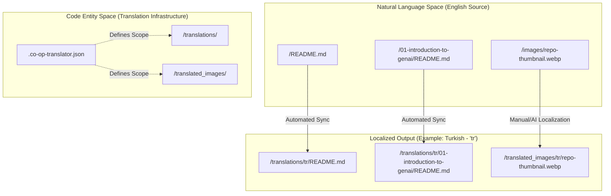
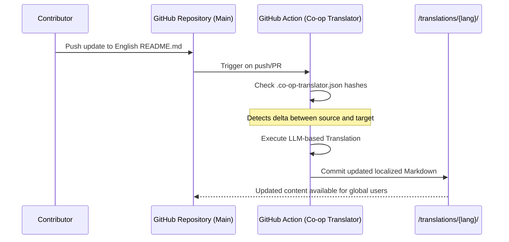

<!-- source: DeepWiki mcp.deepwiki.com · repo microsoft/generative-ai-for-beginners · page 7.2 Available Language Translations · fetched 2026-10-26 -->

# 7.2. Available Language Translations

<details>
<summary>Relevant source files</summary>

The following files were used as context for generating this wiki page:

- [translations/ar/.co-op-translator.json](translations/ar/.co-op-translator.json)
- [translations/ar/README.md](translations/ar/README.md)
- [translations/ar/docs/ENHANCED_FEATURES_ROADMAP.md](translations/ar/docs/ENHANCED_FEATURES_ROADMAP.md)
- [translations/ar/docs/SECURITY_GUIDELINES.md](translations/ar/docs/SECURITY_GUIDELINES.md)
- [translations/bg/.co-op-translator.json](translations/bg/.co-op-translator.json)
- [translations/bg/README.md](translations/bg/README.md)
- [translations/bg/docs/ENHANCED_FEATURES_ROADMAP.md](translations/bg/docs/ENHANCED_FEATURES_ROADMAP.md)
- [translations/bg/docs/SECURITY_GUIDELINES.md](translations/bg/docs/SECURITY_GUIDELINES.md)
- [translations/bn/.co-op-translator.json](translations/bn/.co-op-translator.json)
- [translations/bn/README.md](translations/bn/README.md)
- [translations/bn/docs/ENHANCED_FEATURES_ROADMAP.md](translations/bn/docs/ENHANCED_FEATURES_ROADMAP.md)
- [translations/bn/docs/SECURITY_GUIDELINES.md](translations/bn/docs/SECURITY_GUIDELINES.md)
- [translations/cs/.co-op-translator.json](translations/cs/.co-op-translator.json)
- [translations/cs/README.md](translations/cs/README.md)
- [translations/cs/docs/ENHANCED_FEATURES_ROADMAP.md](translations/cs/docs/ENHANCED_FEATURES_ROADMAP.md)
- [translations/cs/docs/SECURITY_GUIDELINES.md](translations/cs/docs/SECURITY_GUIDELINES.md)
- [translations/da/.co-op-translator.json](translations/da/.co-op-translator.json)
- [translations/da/README.md](translations/da/README.md)
- [translations/da/docs/ENHANCED_FEATURES_ROADMAP.md](translations/da/docs/ENHANCED_FEATURES_ROADMAP.md)
- [translations/da/docs/SECURITY_GUIDELINES.md](translations/da/docs/SECURITY_GUIDELINES.md)
- [translations/de/.co-op-translator.json](translations/de/.co-op-translator.json)
- [translations/de/README.md](translations/de/README.md)
- [translations/de/docs/ENHANCED_FEATURES_ROADMAP.md](translations/de/docs/ENHANCED_FEATURES_ROADMAP.md)
- [translations/de/docs/SECURITY_GUIDELINES.md](translations/de/docs/SECURITY_GUIDELINES.md)
- [translations/el/.co-op-translator.json](translations/el/.co-op-translator.json)
- [translations/el/README.md](translations/el/README.md)
- [translations/el/docs/ENHANCED_FEATURES_ROADMAP.md](translations/el/docs/ENHANCED_FEATURES_ROADMAP.md)
- [translations/el/docs/SECURITY_GUIDELINES.md](translations/el/docs/SECURITY_GUIDELINES.md)
- [translations/fi/.co-op-translator.json](translations/fi/.co-op-translator.json)
- [translations/fi/README.md](translations/fi/README.md)
- [translations/fi/docs/ENHANCED_FEATURES_ROADMAP.md](translations/fi/docs/ENHANCED_FEATURES_ROADMAP.md)
- [translations/fi/docs/SECURITY_GUIDELINES.md](translations/fi/docs/SECURITY_GUIDELINES.md)
- [translations/he/.co-op-translator.json](translations/he/.co-op-translator.json)
- [translations/he/README.md](translations/he/README.md)
- [translations/he/docs/ENHANCED_FEATURES_ROADMAP.md](translations/he/docs/ENHANCED_FEATURES_ROADMAP.md)
- [translations/he/docs/SECURITY_GUIDELINES.md](translations/he/docs/SECURITY_GUIDELINES.md)
- [translations/hu/.co-op-translator.json](translations/hu/.co-op-translator.json)
- [translations/hu/README.md](translations/hu/README.md)
- [translations/hu/docs/ENHANCED_FEATURES_ROADMAP.md](translations/hu/docs/ENHANCED_FEATURES_ROADMAP.md)
- [translations/hu/docs/SECURITY_GUIDELINES.md](translations/hu/docs/SECURITY_GUIDELINES.md)
- [translations/id/.co-op-translator.json](translations/id/.co-op-translator.json)
- [translations/id/README.md](translations/id/README.md)
- [translations/id/docs/ENHANCED_FEATURES_ROADMAP.md](translations/id/docs/ENHANCED_FEATURES_ROADMAP.md)
- [translations/id/docs/SECURITY_GUIDELINES.md](translations/id/docs/SECURITY_GUIDELINES.md)
- [translations/it/.co-op-translator.json](translations/it/.co-op-translator.json)
- [translations/it/README.md](translations/it/README.md)
- [translations/it/docs/ENHANCED_FEATURES_ROADMAP.md](translations/it/docs/ENHANCED_FEATURES_ROADMAP.md)
- [translations/it/docs/SECURITY_GUIDELINES.md](translations/it/docs/SECURITY_GUIDELINES.md)
- [translations/mr/.co-op-translator.json](translations/mr/.co-op-translator.json)
- [translations/mr/README.md](translations/mr/README.md)
- [translations/mr/docs/ENHANCED_FEATURES_ROADMAP.md](translations/mr/docs/ENHANCED_FEATURES_ROADMAP.md)
- [translations/mr/docs/SECURITY_GUIDELINES.md](translations/mr/docs/SECURITY_GUIDELINES.md)
- [translations/ms/.co-op-translator.json](translations/ms/.co-op-translator.json)
- [translations/ms/README.md](translations/ms/README.md)
- [translations/ms/docs/ENHANCED_FEATURES_ROADMAP.md](translations/ms/docs/ENHANCED_FEATURES_ROADMAP.md)
- [translations/ms/docs/SECURITY_GUIDELINES.md](translations/ms/docs/SECURITY_GUIDELINES.md)
- [translations/ne/.co-op-translator.json](translations/ne/.co-op-translator.json)
- [translations/ne/README.md](translations/ne/README.md)
- [translations/nl/.co-op-translator.json](translations/nl/.co-op-translator.json)
- [translations/nl/README.md](translations/nl/README.md)
- [translations/nl/docs/ENHANCED_FEATURES_ROADMAP.md](translations/nl/docs/ENHANCED_FEATURES_ROADMAP.md)
- [translations/nl/docs/SECURITY_GUIDELINES.md](translations/nl/docs/SECURITY_GUIDELINES.md)
- [translations/no/.co-op-translator.json](translations/no/.co-op-translator.json)
- [translations/no/README.md](translations/no/README.md)
- [translations/pa/.co-op-translator.json](translations/pa/.co-op-translator.json)
- [translations/pa/README.md](translations/pa/README.md)
- [translations/pa/docs/ENHANCED_FEATURES_ROADMAP.md](translations/pa/docs/ENHANCED_FEATURES_ROADMAP.md)
- [translations/pa/docs/SECURITY_GUIDELINES.md](translations/pa/docs/SECURITY_GUIDELINES.md)
- [translations/pl/.co-op-translator.json](translations/pl/.co-op-translator.json)
- [translations/pl/README.md](translations/pl/README.md)
- [translations/pl/docs/ENHANCED_FEATURES_ROADMAP.md](translations/pl/docs/ENHANCED_FEATURES_ROADMAP.md)
- [translations/pl/docs/SECURITY_GUIDELINES.md](translations/pl/docs/SECURITY_GUIDELINES.md)
- [translations/pt-BR/.co-op-translator.json](translations/pt-BR/.co-op-translator.json)
- [translations/pt-BR/README.md](translations/pt-BR/README.md)
- [translations/pt-BR/docs/ENHANCED_FEATURES_ROADMAP.md](translations/pt-BR/docs/ENHANCED_FEATURES_ROADMAP.md)
- [translations/pt-BR/docs/SECURITY_GUIDELINES.md](translations/pt-BR/docs/SECURITY_GUIDELINES.md)
- [translations/pt-PT/.co-op-translator.json](translations/pt-PT/.co-op-translator.json)
- [translations/pt-PT/README.md](translations/pt-PT/README.md)
- [translations/ro/.co-op-translator.json](translations/ro/.co-op-translator.json)
- [translations/ro/README.md](translations/ro/README.md)
- [translations/ro/docs/ENHANCED_FEATURES_ROADMAP.md](translations/ro/docs/ENHANCED_FEATURES_ROADMAP.md)
- [translations/ro/docs/SECURITY_GUIDELINES.md](translations/ro/docs/SECURITY_GUIDELINES.md)
- [translations/ru/.co-op-translator.json](translations/ru/.co-op-translator.json)
- [translations/ru/README.md](translations/ru/README.md)
- [translations/sk/.co-op-translator.json](translations/sk/.co-op-translator.json)
- [translations/sk/README.md](translations/sk/README.md)
- [translations/sv/.co-op-translator.json](translations/sv/.co-op-translator.json)
- [translations/sv/README.md](translations/sv/README.md)
- [translations/sv/docs/ENHANCED_FEATURES_ROADMAP.md](translations/sv/docs/ENHANCED_FEATURES_ROADMAP.md)
- [translations/sv/docs/SECURITY_GUIDELINES.md](translations/sv/docs/SECURITY_GUIDELINES.md)
- [translations/sw/.co-op-translator.json](translations/sw/.co-op-translator.json)
- [translations/sw/README.md](translations/sw/README.md)
- [translations/th/.co-op-translator.json](translations/th/.co-op-translator.json)
- [translations/th/README.md](translations/th/README.md)
- [translations/tl/.co-op-translator.json](translations/tl/.co-op-translator.json)
- [translations/tl/README.md](translations/tl/README.md)
- [translations/tr/.co-op-translator.json](translations/tr/.co-op-translator.json)
- [translations/tr/README.md](translations/tr/README.md)
- [translations/vi/.co-op-translator.json](translations/vi/.co-op-translator.json)
- [translations/vi/README.md](translations/vi/README.md)

</details>


The Generative AI for Beginners course is designed for a global audience, offering comprehensive educational content across more than 50 languages. This internationalization is achieved through an automated pipeline that synchronizes content from the primary English source to language-specific directories [translations/tr/README.md:17-19]().

## Supported Languages

The repository currently maintains translations for the following languages. Each translation includes the full 21-lesson curriculum, localized `README.md` files, and specialized image assets [translations/tr/README.md:21-22]().

| Language Code | Language Name | Language Code | Language Name |
| :--- | :--- | :--- | :--- |
| `ar` | Arabic | `bn` | Bengali |
| `bg` | Bulgarian | `my` | Burmese (Myanmar) |
| `zh-CN` | Chinese (Simplified) | `zh-HK` | Chinese (Traditional, HK) |
| `zh-MO` | Chinese (Traditional, Macau) | `zh-TW` | Chinese (Traditional, Taiwan) |
| `hr` | Croatian | `cs` | Czech |
| `da` | Danish | `nl` | Dutch |
| `et` | Estonian | `fi` | Finnish |
| `fr` | French | `de` | German |
| `el` | Greek | `he` | Hebrew |
| `hi` | Hindi | `hu` | Hungarian |
| `id` | Indonesian | `it` | Italian |
| `ja` | Japanese | `kn` | Kannada |
| `km` | Khmer | `ko` | Korean |
| `lt` | Lithuanian | `ms` | Malay |
| `ml` | Malayalam | `mr` | Marathi |
| `ne` | Nepali | `pcm` | Nigerian Pidgin |
| `no` | Norwegian | `fa` | Persian (Farsi) |
| `pl` | Polish | `pt-BR` | Portuguese (Brazil) |
| `pt-PT` | Portuguese (Portugal) | `pa` | Punjabi (Gurmukhi) |
| `ro` | Romanian | `ru` | Russian |
| `sr` | Serbian (Cyrillic) | `sk` | Slovak |
| `sl` | Slovenian | `es` | Spanish |
| `sw` | Swahili | `sv` | Swedish |
| `tl` | Tagalog (Filipino) | `ta` | Tamil |
| `te` | Telugu | `th` | Thai |
| `tr` | Turkish | `uk` | Ukrainian |
| `ur` | Urdu | `vi` | Vietnamese |

**Sources:** [translations/tr/README.md:22](), [translations/pl/README.md:22](), [translations/vi/README.md:22]()

## Repository Structure and Data Flow

The translation system organizes data into two primary root-level directories: `translations/` for text and `translated_images/` for localized visual assets.

### Translation Directory Hierarchy
Each language is assigned a sub-directory under `translations/` using its ISO 639-1 or specialized locale code (e.g., `pt-BR`). Inside these directories, the file structure mirrors the root of the repository, allowing relative links to function consistently across languages [translations/tr/README.md:1-3]().

### Image Localization
Visual assets that contain text are localized to ensure clarity for non-English speakers. These are stored in the `translated_images/` directory, partitioned by language code [translations/tr/README.md:1]().

**Course Translation Asset Mapping**
The following diagram illustrates how the system maps English source entities to their translated counterparts.


**Sources:** [translations/tr/README.md:1-22](), [translations/tr/.co-op-translator.json](), [translations/sw/.co-op-translator.json]()

## Developer Guidance: Sparse Checkout

Due to the volume of translations (50+ languages), the repository size is significant. For developers only interested in the core code and English content, the use of `sparse-checkout` is recommended to exclude the `translations/` and `translated_images/` directories [translations/tr/README.md:24-26]().

### Implementation via Git CLI
To configure a workspace without translations, execute the following commands:

```bash
git clone --filter=blob:none --sparse https://github.com/microsoft/generative-ai-for-beginners.git
cd generative-ai-for-beginners
git sparse-checkout set --no-cone '/*' '!translations' '!translated_images'
```
**Sources:** [translations/tr/README.md:28-33](), [translations/pl/README.md:28-33]()

## Translation Synchronization Logic

The translations are managed by the `Co-op Translator` system. Each translation folder contains a `.co-op-translator.json` file which acts as the configuration manifest for that specific locale.

**Translation Update Pipeline**
This diagram describes the data flow when a change is detected in the primary English documentation.


**Sources:** [translations/tr/README.md:19](), [translations/sw/.co-op-translator.json](), [translations/hu/.co-op-translator.json]()

## Contribution Guidelines for Translations

Contributors wishing to update or fix translations should follow these technical requirements:
1. **Bug Reports:** If a translation error is found, a GitHub issue should be created specifically mentioning the language code [translations/he/README.md:86-88]().
2. **Pull Requests:** PRs for translations should focus on the files within the `translations/{lang}/` directory.
3. **Consistency:** Ensure that technical terms (e.g., "LLM", "Generative AI", "Prompt Engineering") remain consistent with the glossary used in that specific language's version of the course [translations/tr/README.md:51-53]().
4. **Link Integrity:** Maintain relative pathing (e.g., `../../translated_images/...`) to ensure images render correctly across the GitHub UI and local clones [translations/tr/README.md:1]().

**Sources:** [translations/tr/README.md:1-53](), [translations/he/README.md:86-88]()

---

