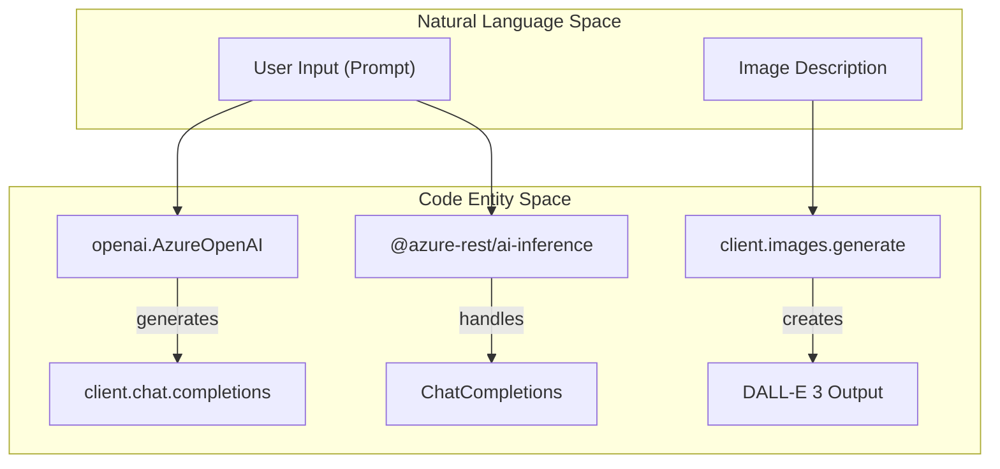
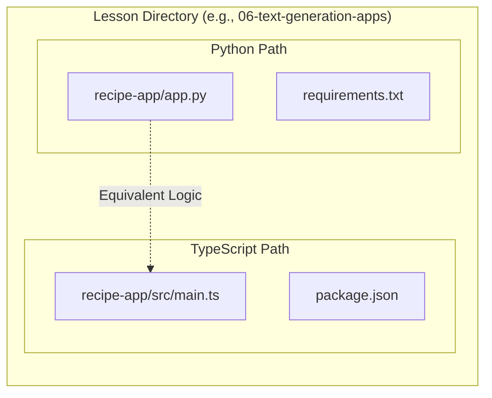

<!-- source: DeepWiki mcp.deepwiki.com · repo microsoft/generative-ai-for-beginners · page 8 Glossary · fetched 2026-10-26 -->

# Glossary

Relevant source files

The following files were used as context for generating this wiki page:

- [.devcontainer/Setup.txt](.devcontainer/Setup.txt)
- [.devcontainer/devcontainer.json](.devcontainer/devcontainer.json)
- [.devcontainer/environment.yml](.devcontainer/environment.yml)
- [.devcontainer/icon.svg](.devcontainer/icon.svg)
- [.devcontainer/post-create.sh](.devcontainer/post-create.sh)
- [.env.copy](.env.copy)
- [00-course-setup/README.md](00-course-setup/README.md)
- [01-introduction-to-genai/README.md](01-introduction-to-genai/README.md)
- [02-exploring-and-comparing-different-llms/README.md](02-exploring-and-comparing-different-llms/README.md)
- [03-using-generative-ai-responsibly/README.md](03-using-generative-ai-responsibly/README.md)
- [04-prompt-engineering-fundamentals/README.md](04-prompt-engineering-fundamentals/README.md)
- [05-advanced-prompts/README.md](05-advanced-prompts/README.md)
- [06-text-generation-apps/README.md](06-text-generation-apps/README.md)
- [06-text-generation-apps/python/githubmodels-assignment.ipynb](06-text-generation-apps/python/githubmodels-assignment.ipynb)
- [06-text-generation-apps/typescript/.gitignore](06-text-generation-apps/typescript/.gitignore)
- [06-text-generation-apps/typescript/recipe-app/.env-sample](06-text-generation-apps/typescript/recipe-app/.env-sample)
- [06-text-generation-apps/typescript/recipe-app/package-lock.json](06-text-generation-apps/typescript/recipe-app/package-lock.json)
- [06-text-generation-apps/typescript/recipe-app/package.json](06-text-generation-apps/typescript/recipe-app/package.json)
- [06-text-generation-apps/typescript/recipe-app/tsconfig.json](06-text-generation-apps/typescript/recipe-app/tsconfig.json)
- [07-building-chat-applications/README.md](07-building-chat-applications/README.md)
- [08-building-search-applications/README.md](08-building-search-applications/README.md)
- [09-building-image-applications/README.md](09-building-image-applications/README.md)
- [10-building-low-code-ai-applications/README.md](10-building-low-code-ai-applications/README.md)
- [11-integrating-with-function-calling/README.md](11-integrating-with-function-calling/README.md)
- [11-integrating-with-function-calling/typescript/function-app/.env-sample](11-integrating-with-function-calling/typescript/function-app/.env-sample)
- [11-integrating-with-function-calling/typescript/function-app/.gitignore](11-integrating-with-function-calling/typescript/function-app/.gitignore)
- [11-integrating-with-function-calling/typescript/function-app/package-lock.json](11-integrating-with-function-calling/typescript/function-app/package-lock.json)
- [11-integrating-with-function-calling/typescript/function-app/package.json](11-integrating-with-function-calling/typescript/function-app/package.json)
- [11-integrating-with-function-calling/typescript/function-app/src/main.ts](11-integrating-with-function-calling/typescript/function-app/src/main.ts)
- [11-integrating-with-function-calling/typescript/function-app/tsconfig.json](11-integrating-with-function-calling/typescript/function-app/tsconfig.json)
- [12-designing-ux-for-ai-applications/README.md](12-designing-ux-for-ai-applications/README.md)
- [13-securing-ai-applications/README.md](13-securing-ai-applications/README.md)
- [14-the-generative-ai-application-lifecycle/README.md](14-the-generative-ai-application-lifecycle/README.md)
- [15-rag-and-vector-databases/README.md](15-rag-and-vector-databases/README.md)
- [15-rag-and-vector-databases/images/cat.png](15-rag-and-vector-databases/images/cat.png)
- [15-rag-and-vector-databases/images/encoder-decode.png](15-rag-and-vector-databases/images/encoder-decode.png)
- [15-rag-and-vector-databases/images/how-rag-works.png](15-rag-and-vector-databases/images/how-rag-works.png)
- [15-rag-and-vector-databases/notebook-rag-vector-databases.ipynb](15-rag-and-vector-databases/notebook-rag-vector-databases.ipynb)
- [16-open-source-models/README.md](16-open-source-models/README.md)
- [17-ai-agents/README.md](17-ai-agents/README.md)
- [18-fine-tuning/README.md](18-fine-tuning/README.md)
- [18-fine-tuning/RESOURCES.md](18-fine-tuning/RESOURCES.md)
- [README.md](README.md)
- [docs/_sidebar.md](docs/_sidebar.md)
- [package-lock.json](package-lock.json)
- [package.json](package.json)
- [requirements.txt](requirements.txt)
- [translations/en/.co-op-translator.json](translations/en/.co-op-translator.json)
- [translations/en/README.md](translations/en/README.md)
- [translations/en/docs/ENHANCED_FEATURES_ROADMAP.md](translations/en/docs/ENHANCED_FEATURES_ROADMAP.md)
- [translations/en/docs/SECURITY_GUIDELINES.md](translations/en/docs/SECURITY_GUIDELINES.md)
- [translations/es/.co-op-translator.json](translations/es/.co-op-translator.json)
- [translations/es/README.md](translations/es/README.md)
- [translations/es/docs/ENHANCED_FEATURES_ROADMAP.md](translations/es/docs/ENHANCED_FEATURES_ROADMAP.md)
- [translations/es/docs/SECURITY_GUIDELINES.md](translations/es/docs/SECURITY_GUIDELINES.md)
- [translations/fr/.co-op-translator.json](translations/fr/.co-op-translator.json)
- [translations/fr/README.md](translations/fr/README.md)
- [translations/hi/.co-op-translator.json](translations/hi/.co-op-translator.json)
- [translations/hi/README.md](translations/hi/README.md)
- [translations/hi/docs/ENHANCED_FEATURES_ROADMAP.md](translations/hi/docs/ENHANCED_FEATURES_ROADMAP.md)
- [translations/hi/docs/SECURITY_GUIDELINES.md](translations/hi/docs/SECURITY_GUIDELINES.md)
- [translations/ja/.co-op-translator.json](translations/ja/.co-op-translator.json)
- [translations/ja/README.md](translations/ja/README.md)
- [translations/ja/docs/ENHANCED_FEATURES_ROADMAP.md](translations/ja/docs/ENHANCED_FEATURES_ROADMAP.md)
- [translations/ja/docs/SECURITY_GUIDELINES.md](translations/ja/docs/SECURITY_GUIDELINES.md)
- [translations/ko/.co-op-translator.json](translations/ko/.co-op-translator.json)
- [translations/ko/README.md](translations/ko/README.md)
- [vs.code-profile](vs.code-profile)

This page provides definitions for technical terms, domain-specific jargon, and codebase entities used throughout the **Generative AI for Beginners** curriculum. It serves as a reference for onboarding engineers to understand the relationship between AI concepts and their implementation in this repository.

## AI and Machine Learning Concepts

| Term | Definition | Code Reference / Context |
| :--- | :--- | :--- |
| **LLM** | Large Language Model. A type of AI trained on vast datasets to understand and generate text [01-introduction-to-genai/README.md:68-70](). | `GPT-4`, `Phi-3`, `Llama` |
| **Tokenization** | The process of converting raw text into numerical chunks (tokens) that models can process [01-introduction-to-genai/README.md:74-76](). | `tiktoken` library [requirements.txt:8]() |
| **Prompt** | The text input sent to an LLM to elicit a response (completion) [04-prompt-engineering-fundamentals/README.md:10-12](). | `prompt` variable in [06-text-generation-apps/README.md:137-139]() |
| **Completion** | The output generated by an LLM in response to a prompt [04-prompt-engineering-fundamentals/README.md:10-12](). | `completion.choices[0].text` [06-text-generation-apps/README.md:140]() |
| **Temperature** | A hyperparameter that controls the randomness of the model's output [06-text-generation-apps/README.md:17-18](). | API parameter in `openai.Completion.create` |
| **Embedding** | A numerical representation of text used to understand semantic relationships [02-exploring-and-comparing-different-llms/README.md:75-77](). | Used in search apps [08-building-search-applications/README.md:1-5]() |

**Sources:** [01-introduction-to-genai/README.md:68-76](), [04-prompt-engineering-fundamentals/README.md:10-12](), [06-text-generation-apps/README.md:17-140](), [02-exploring-and-comparing-different-llms/README.md:75-77]()

---

## SDKs and Codebase Entities

The repository utilizes several core SDKs to interact with AI models.

### Natural Language to Code Entity Mapping

The following diagram bridges the gap between high-level concepts and the specific classes/packages used in the codebase.

**AI Service Integration Flow**

**Sources:** [06-text-generation-apps/README.md:116-140](), [09-building-image-applications/README.md:136-147](), [package.json:28-32]()

### Key Libraries

*   **`openai` (Python/TS)**: The primary library for interacting with OpenAI and Azure OpenAI services [06-text-generation-apps/README.md:79-82]().
*   **`@azure-rest/ai-inference`**: A lightweight client for Azure AI model inference, used for GitHub Models and Azure AI Foundry [package.json:29]().
*   **`python-dotenv`**: Used to manage environment variables like `AZURE_OPENAI_API_KEY` without hardcoding them [09-building-image-applications/README.md:132-133]().
*   **`tiktoken`**: A fast BPE tokenizer for use with OpenAI's models [requirements.txt:8]().

**Sources:** [package.json:28-32](), [requirements.txt:6-9](), [09-building-image-applications/README.md:132-133]()

---

## Repository Specific Patterns

### Provider Configuration
The codebase supports three primary backends, configured via environment variables [00-course-setup/README.md:60-64]():
1.  **Azure OpenAI**: Requires `AZURE_OPENAI_ENDPOINT` and `AZURE_OPENAI_API_KEY` [09-building-image-applications/README.md:90-93]().
2.  **OpenAI API**: Standard API integration.
3.  **GitHub Models**: Accessible via the Azure AI Inference SDK.

### The "Build" Pattern
Lessons categorized as "Build" lessons contain parallel implementations in Python and TypeScript [README.md:53-54]().

**Cross-Language Implementation Pattern**

**Sources:** [README.md:53-54](), [06-text-generation-apps/typescript/recipe-app/package.json:1-10](), [09-building-image-applications/README.md:122-140]()

---

## Infrastructure and Setup Jargon

*   **Codespace**: A cloud-hosted development environment configured via `.devcontainer/` to ensure all dependencies (Python, Node.js) are pre-installed [00-course-setup/README.md:17-19]().
*   **Sparse Checkout**: A Git feature used to clone the repo without the 50+ language translations to save disk space [README.md:26-33]().
*   **Metaprompt**: A system-level prompt that defines the boundaries and persona of the AI application (e.g., "You are a helpful kitchen assistant") [09-building-image-applications/README.md:20-21]().
*   **Function Calling**: A technique where the LLM outputs a JSON object to invoke local code functions, such as fetching weather data [11-integrating-with-function-calling/README.md:1-5]().

**Sources:** [00-course-setup/README.md:17-19](), [README.md:26-33](), [09-building-image-applications/README.md:20-21](), [11-integrating-with-function-calling/typescript/function-app/src/main.ts:1-20]()