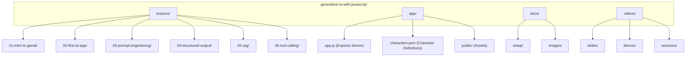
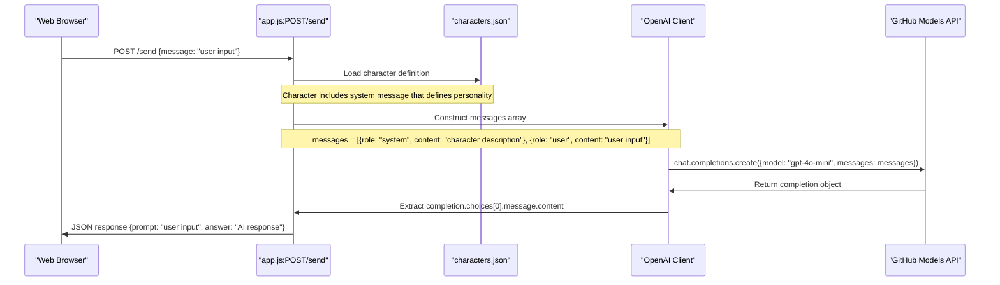
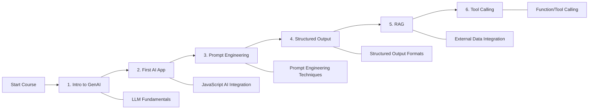
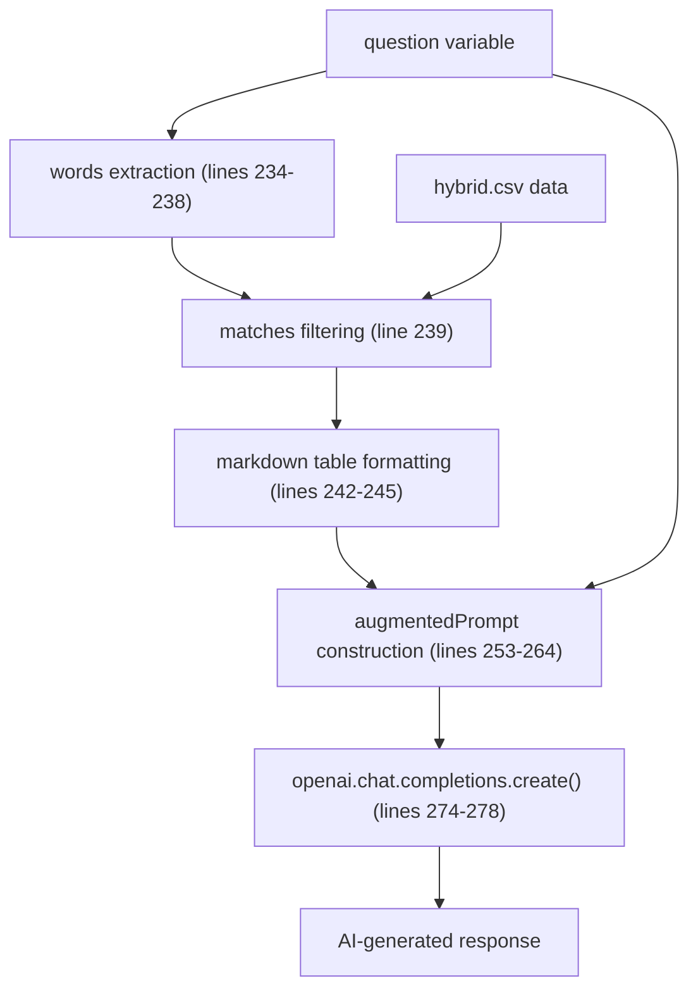
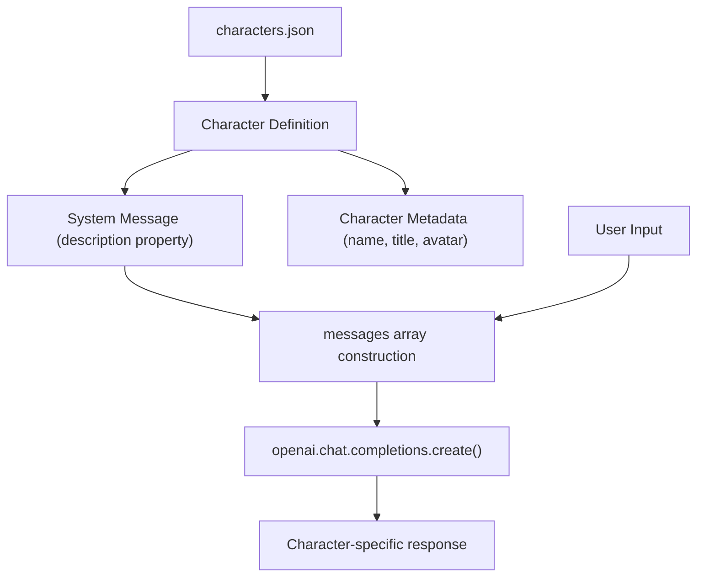
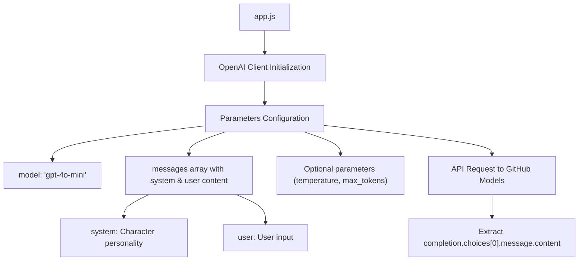

<!-- source: DeepWiki mcp.deepwiki.com · repo microsoft/generative-ai-with-javascript · page 1 Overview · fetched 2026-10-26 -->

# Overview

Relevant source files

The following files were used as context for generating this wiki page:

- [README.md](README.md)
- [app/README.md](app/README.md)
- [lessons/01-intro-to-genai/README.md](lessons/01-intro-to-genai/README.md)
- [lessons/02-first-ai-app/README.md](lessons/02-first-ai-app/README.md)
- [lessons/04-structured-output/README.md](lessons/04-structured-output/README.md)
- [lessons/05-rag/README.md](lessons/05-rag/README.md)

The Generative AI with JavaScript repository is a comprehensive educational resource that teaches JavaScript developers how to build applications with Generative AI capabilities. The repository follows a narrative-driven approach where learners progress through various lessons while experiencing a time-travel adventure interacting with historical figures via a companion application.

This document provides a technical overview of the repository structure, key components, and the relationships between them. For specific setup instructions, see [Setup and Configuration](#7).

## Repository Structure and Components

The repository is organized into several key directories that serve different purposes within the learning framework:

Sources: [README.md:15-16](), [README.md:82-93](), [app/README.md:1-5]()

Each lesson directory contains:
- README.md with lesson content
- assets/ folder with images
- solution/ directory with assignment solutions
- Some lessons contain example/ directories with code samples

The companion app serves as a practical demonstration of the concepts taught in the lessons, allowing learners to interact with AI-powered historical characters.

## Companion App Architecture

The companion app provides a chat interface for interacting with AI-simulated historical figures. Here's the technical flow of how the app processes user messages:

Sources: [lessons/01-intro-to-genai/README.md:189-225](), [app/README.md:1-14]()

The app uses GitHub Models API for generating text responses, which is accessed via the OpenAI client library. Character personalities are defined in the system message stored in `characters.json`.

## Learning Progression and Technical Concepts

The course follows a carefully designed learning progression, with each lesson building upon previous knowledge:

Sources: [README.md:82-93]()

### Key Technical Components

#### Retrieval-Augmented Generation (RAG) System

Lesson 5 introduces RAG, which enhances AI responses by incorporating external data sources. The implementation demonstrates the core components and data flow:

Sources: [lessons/05-rag/README.md:206-285]()

The RAG implementation demonstrates how to:
1. Extract keywords from user questions
2. Search external data sources (CSV file in this example)
3. Format the retrieved information
4. Augment the prompt with this information
5. Generate a more accurate and contextually relevant response

#### Character System Implementation

The character system controls how the AI responds, using system messages to define each character's personality:

Sources: [app/README.md:22-24](), [lessons/01-intro-to-genai/README.md:189-225]()

## Narrative Integration with Technical Learning

The repository combines a narrative-driven approach with technical learning. Each lesson presents a story segment where the learner "time travels" to meet historical figures while learning specific AI concepts:

| Lesson | Historical Figure | Time Period | Technical Focus |
|--------|-------------------|------------|----------------|
| 1 | Dinocrates | Alexandria, 300 BC | Intro to GenAI |
| 2 | Leonardo da Vinci | Renaissance Florence | First AI App |
| 4 | Montezuma | Aztec Empire | Structured Output |
| 5 | Ada Lovelace | Victorian England | RAG |

Sources: [lessons/01-intro-to-genai/README.md:29-33](), [lessons/02-first-ai-app/README.md:25-33](), [lessons/04-structured-output/README.md:25-34](), [lessons/05-rag/README.md:24-32]()

## API Integration Architecture

The repository demonstrates how to integrate with AI models via API calls, primarily using the OpenAI client library to access GitHub Models:

Sources: [lessons/01-intro-to-genai/README.md:189-225](), [lessons/02-first-ai-app/README.md:184-222]()

## JavaScript AI Workflow and Best Practices

The repository illustrates several core patterns for JavaScript AI development:

1. **System Message Configuration**: Using system messages to control AI behavior and create character personalities.
   
2. **Context Window Management**: Setting `max_tokens` parameter to control the length of generated responses.
   
3. **Temperature Setting**: Adjusting the `temperature` parameter to control the randomness/creativity of responses.
   
4. **Structured Output**: Techniques for requesting AI responses in specific formats (JSON, tables, etc.).
   
5. **Retrieval-Augmented Generation**: Enhancing AI responses with information from external sources.

Sources: [lessons/02-first-ai-app/README.md:335-352](), [lessons/02-first-ai-app/README.md:402-440](), [lessons/04-structured-output/README.md:220-238]()

These patterns and practices are demonstrated through practical examples in each lesson, making the repository a valuable resource for JavaScript developers looking to integrate Generative AI into their applications.

---

